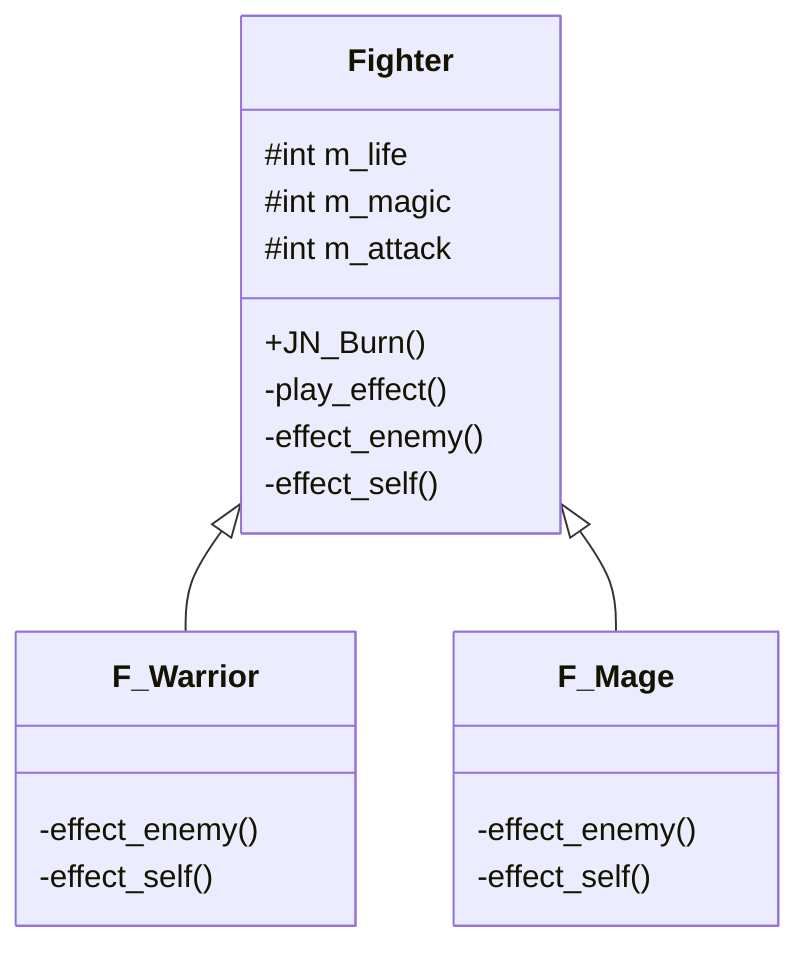

# 第 2 章 模板方法模式

&gt; 原书第 18–27 页 ｜ 本节内容：从一个闯关打斗游戏范例出发，经历两个版本的逐步重构引出模板方法模式（Template Method），给出模式定义、UML 图，并进一步完善代码（钩子方法）与应用联想。

很多事情是由几个固定的步骤来完成的，例如到饭馆吃饭，需要经历点餐→用餐→结账这样的步骤，因为这几个步骤是固定的，所以被作为一种样板，这就是"模板方法（Template Method）模式"名字的由来。但是在这几个固定步骤中，有很多细微的部分可以有差异，例如在点餐这个环节，有人点的是粤菜，有人点的是鲁菜；在结账这个环节，有人用人民币结账，有人用信用卡结账……在固定步骤确定的情况下，通过多态机制在多个子类中对每个步骤的细节进行差异化实现，这就是模板方法模式能够达到的效果。

模板方法模式是一种行为型模式，其实现简单且被经常使用，实现代码具有代表性，甚至很多程序员在不知不觉中就会使用到该模式而不自知。从最简单的模式讲起，总是让人更容易接受。


## 2.1 一个具体实现范例的逐步重构

这里讲解一个实际工作中的范例。A 公司有一个小的游戏项目组，要开发一个单机的闯关打斗类游戏（类似街机打拳类游戏）。一般来讲，一个游戏项目组中最少需要由 3 名担任不同角色的员工组成，分别是游戏策划、游戏程序、游戏美术。

（1）游戏策划（简称策划）负责提出游戏的各种玩法需求、确定游戏中的各种数值，例如角色人物（包括敌人）的生命值、魔法值等。

（2）游戏程序（简称程序）需要与游戏策划紧密配合通过代码来实现游戏策划要求的各种功能。

（3）游戏美术需要承担一切看得见的游戏内容的设计工作，例如角色设计、道具设计、游戏特效设计等，因为游戏美术与本书所讲解的设计模式没有直接关系，故不具体介绍。

游戏策划给出的游戏项目需求是这样的：游戏主角是一个战士（攻击力不够强，但生命值比较多），主角通过不断往前走来闯关，遇到敌人就进行攻击，敌人会进行反击，也会在距离比较近时主动攻击主角。主角有生命值、魔法值、攻击力 3 个属性，主角生命值消耗为 0 则主角死亡（游戏结束），攻击力决定打敌人一下敌人会失去多少点生命，魔法值暂时用不上，先写在代码中留存，待以后扩展。主角的起始生命值为 1000，起始魔法值为 0，起始攻击力为 200。

于是，程序根据策划提出的需求开始书写第一个版本的源代码，先把主角人物这个类定义出来，代码如下：

```cpp
//定义一个"战士"类
class Warrior
{
public:
    //构造函数
    Warrior(int life, int magic, int attack) : m_life(life), m_magic(magic), m_attack(attack) {}

    ...//一些成员函数等

private:
    //角色属性
    int m_life;            //生命值
    int m_magic;           //魔法值
    int m_attack;          //攻击力
};
```

这里 Warrior 类中可能有很多成员函数来实现"战士"这个角色的各种功能，这些不重要，所以这里不深究。

某一天，策划希望给主角人物增加一个名字叫作"燃烧"的技能，目的是当主角被一群敌人包围的时候使用该技能可能会挽救主角的性命，该技能是这样描述的：使用"燃烧"技能可以使附近的所有敌人每人失去 500 点生命值，但主角自身也会损失掉 300 点生命值。显然这是一个杀敌一千自损八百的技能，但关键时刻主角如果被群殴，使用该技能可能会瞬间杀死一堆敌人从而使自己脱离险境。程序在接到策划的该需求后，继续为 Warrior 类增加新的成员函数，代码如下：

```cpp
public:
    void JN_Burn()        //技能"燃烧"
    {
        cout << "让所有敌人每人失去500点生命值，相关逻辑代码在这里略..." << endl;
        cout << "主角自身失去300点生命值" << endl;
        m_life -= 300;
        cout << "播放技能"燃烧"的技能特效给玩家看" << endl;
    }
```

在 main 主函数中加入代码释放"燃烧"这个技能的效果：

```cpp
Warrior mroleobj(1000, 0, 200);        //创建主角
mroleobj.JN_Burn();                    //主角释放"燃烧"技能
```

执行起来，看一看结果：

```
让所有敌人每人失去500点生命值，相关逻辑代码在这里略...
主角自身失去300点生命值
播放技能"燃烧"的技能特效给玩家看
```

可以看到，在代码中创建了一个主角对象，然后主角释放了"燃烧"技能，结果正确。

过了几天时间，策划对程序说：游戏中只有"战士"这样一个主角，可玩性不强，需要再增加一个"法师（攻击力很强，但生命值相对比较少）"作为主角，玩家可以自由选择以"战士"或者"法师"的身份参加战斗，"法师"主角的起始生命值为 800，起始魔法值为 200，起始攻击力为 300。法师也有一个名字叫作"燃烧"的技能，引入该技能的初衷与战士相同，该技能是这样描述的：使用"燃烧"技能可以使附近的所有敌人每人失去 650 点生命值，但主角自身会损失掉 100 点魔法值。显然这个技能是通过魔法值来杀敌，那么魔法值对于法师来讲就显得特别珍贵了。

程序拿到这个需求的时候，就开始思考代码该如何书写了。如果重新实现一个 Mage（法师）类，那么内部的代码会与 Warrior 类大同小异（造成代码的大量重复），更何况，也许日后策划再增加一个其他类型的主角，则又要写一个新的类来应付，这实在是会让代码变得特别丑陋。于是，程序员利用自己丰富的编码经验，重新实现了一个 Fighter（战斗者）类作为父类，而创建 F_Warrior 和 F_Mage 作为子类，父类 Fighter 中的内容尽量不做变动或者少做变动，而变动主要集中在 F_Warrior 和 F_Mage 子类中进行，如果将来策划需要增加新类型的主角，只需要增加新的子类即可。

于是，程序根据自己的想法，开始编写第二个版本的源代码（代码重构），首先实现父类：

```cpp
//战斗者父类
class Fighter
{
public:
    //构造函数
    Fighter(int life, int magic, int attack) : m_life(life), m_magic(magic), m_attack(attack) {}
    virtual ~Fighter() {}        //作父类时析构函数应该为虚函数

    void JN_Burn()                //技能"燃烧"
    {
        //...待增加
    }

protected:                        //可能被子类访问的成员，用protected修饰
    //角色属性
    int m_life;                    //生命值
    int m_magic;                   //魔法值
    int m_attack;                  //攻击力
};
```

这里 Fighter 类的实现代码与 Warrior 类的实现代码类似，但现在关键问题是"燃烧"这个技能的代码如何实现，通过与策划进行沟通，策划确认了两件事情：

（1）游戏中近期至少还会增加一个"牧师"作为主角；

（2）每个主角都有一个"燃烧"这样的技能，燃烧技能在释放时产生的效果各不相同，但毫无疑问有两点是**肯定不变的**：一是对主角自身会产生影响；二是对敌人会产生影响。

有了策划这样的承诺，程序就知道"燃烧"这个技能该怎样编写代码了。

（1）对敌人产生影响的函数，取名为 effect_enemy，因为不同的主角释放"燃烧"技能会对敌人产生的影响不同，所以 effect_enemy 应该是一个虚函数，在子类中重新实现该虚函数。

（2）对主角自身产生影响的函数取名为 effect_self，因为不同的主角释放"燃烧"技能会对主角自身产生的影响不同，所以 effect_self 也应该是一个虚函数，在子类中重新实现该虚函数。

（3）播放技能"燃烧"的技能特效，因为策划确定所有主角在释放"燃烧"技能时，所播放的技能特效是一样的，所以，可以写一个专门的播放函数（而不是把这些代码直接放在 JN_Burn 函数中，否则代码显得太散乱了），取名为 play_effect，该函数并不需要是一个虚函数，因为无须在子类中重新实现。

于是，Fighter 类的 JN_Burn 成员函数代码应该如下：

```cpp
void JN_Burn()                //技能"燃烧"
{
    effect_enemy();            //对敌人产生的影响
    effect_self();             //对主角自身产生的影响
    play_effect();             //播放技能"燃烧"的技能特效
}
```

同时，也需要在 Fighter 类中增加 effect_enemy 和 effect_self 这两个虚函数以及 play_effect 非虚函数：

```cpp
private:
    virtual void effect_enemy() {}        //函数体为空，表示什么都不做，如果要求必须在子类中重
                                          //新实现该虚函数，则可以将该函数写成纯虚函数
    virtual void effect_self() {};
    void play_effect()
    {
        cout << "播放技能"燃烧"的技能特效给玩家看" << endl;
                                          //所有主角播放的技能特效都相同，因此不用写成一个虚
                                          //函数并在子类中实现技能特效的播放
    }
```

接着，实现战士这个主角类 F_Warrior，代码如下：

```cpp
//"战士"类，父类为Fighter
class F_Warrior : public Fighter
{
public:
    //构造函数
    F_Warrior(int life, int magic, int attack) : Fighter(life, magic, attack) {}
private:
    //对敌人产生的影响
    virtual void effect_enemy()
    {
        cout << "战士主角_让所有敌人每人失去500点生命值，相关逻辑代码在这里略..." << endl;
    }
    //对主角自身产生的影响
    virtual void effect_self()
    {
        cout << "战士主角_自身失去300点生命值" << endl;
        m_life -= 300;
    }
};
```

然后，实现法师这个主角类 F_Mage，代码如下：

```cpp
//"法师"类，父类为Fighter
class F_Mage : public Fighter
{
public:
    //构造函数
    F_Mage(int life, int magic, int attack) : Fighter(life, magic, attack) {}
private:
    //对敌人产生的影响
    virtual void effect_enemy()
    {
        cout << "法师主角_让所有敌人每人失去650点生命值，相关逻辑代码在这里略..." << endl;
    }
    //对主角自身产生的影响
    virtual void effect_self()
    {
        cout << "法师主角_自身失去100点魔法值" << endl;
        m_magic -= 100;
    }
};
```

在 main 主函数中，注释掉原有代码，增加如下代码：

```cpp
Fighter* prole_war = new F_Warrior(1000, 0, 200);        //创建战士主角，注意这是父类指针
                                                          //指向子类对象以利用多态特性
prole_war->JN_Burn();                                     //战士主角释放"燃烧"技能

cout << "--------------------------" << endl;              //分隔线，以更醒目地显示信息

Fighter* prole_mag = new F_Mage(800, 200, 300);           //创建法师主角，注意这是父类指针指
                                                          //向子类对象以利用多态特性
prole_mag->JN_Burn();                                     //法师主角释放"燃烧"技能

//释放资源
delete prole_war;
delete prole_mag;
```

执行起来，看一看结果：

```
战士主角_让所有敌人每人失去500点生命值，相关逻辑代码在这里略...
战士主角_自身失去300点生命值
播放技能"燃烧"的技能特效给玩家看
--------------------------
法师主角_让所有敌人每人失去650点生命值，相关逻辑代码在这里略...
法师主角_自身失去100点魔法值
播放技能"燃烧"的技能特效给玩家看
```

从结果可以看到，战士作为主角施展"燃烧"技能时的表现与法师作为主角施展"燃烧"技能时的表现是不一样的，这种不一样的表现主要是通过 F_Warrior 和 F_Mage 子类中的 effect_enemy 和 effect_self 虚函数来体现的。

上面的代码经过了重构，实际上是逐步引入了设计模式，通过这个范例，正式引入模板方法模式。

## 2.2 引入模板方法模式

首先要提醒读者在设计模式运用过程中始终要把握的一条最重要原则：软件开发中需求的变化是非常频繁的，开发人员必须尝试**寻找变化点**，将变化的部分和稳定的部分**分离开**，并在**变化点所在的位置处**应用设计模式，程序员必须不断提升自己的眼界和能力，逐步掌握这种抽象（把代码的组织按一定层次结构划分）的能力，如此才能更好地运用设计模式。所以，在学习设计模式过程中，往往强调的是：学习一个设计模式并不难，难的是选择该设计模式的场合和时机。

在前面的范例中，Fighter 类中的 JN_Burn 成员函数的实现就使用了模板方法模式。观察 JN_Burn，它具有非常稳定的结构，换句话说，该成员函数固定调用如下 3 个成员函数：

```cpp
effect_enemy();        //对敌人产生的影响
effect_self();         //对主角自身产生的影响
play_effect();         //播放技能"燃烧"的技能特效
```

这种非常**稳定**的结构（也称为算法的骨架/框架：这里的算法说的就是 JN_Burn，设计模式术语中往往会把某个成员函数说成是一个算法，而骨架是指 JN_Burn 中调用的是很固定的 3 个成员函数）是在 JN_Burn 中能够运用模板方法模式的前提（否则就不适合用模板方法模式实现 JN_Burn）。这种非常稳定的结构（只调用若干固定的成员函数）就可被看作一个样板或者说一个模板，这就是"**模板方法**"模式名字的由来，因为成员函数往往可以被称为方法，所以 JN_Burn 成员函数在这里其实就被称为模板方法。

当然，在 JN_Burn 中，针对 effect_enemy、effect_self 的调用，需要做出不同的改变，例如战士使用"燃烧"技能对敌人和对自身的影响与法师使用"燃烧"技能对敌人和对自身的影响是不同的。换句话说，骨架开发人员（JN_Burn 开发者）无法决定 effect_enemy、effect_self 如何实现，要留给子类 F_Warrior、F_Mage 去实现。

在模板方法模式中，有一个值得说明的开发技巧。main 主函数中的代码行"Fighter* prole_war = new F_Warrior(1000, 0, 200);"采用了父类指针指向子类对象的编码方式，这样代码行"prole_war-&gt;JN_Burn();"通过 JN_Burn（该函数并不是虚函数）来间接调用 effect_enemy、effect_self 虚函数时，因为虚函数的动态绑定机制，就可以达到正确执行子类 F_Warrior、F_Mage 中 effect_enemy、effect_self 虚函数的效果。

许多开发者将这种在子类中重新实现某些虚函数以产生不同程序执行结果的代码编写方法称为**晚绑定**，也就是说，在程序运行的时候，才能根据 new 后面的类型名知道究竟执行的是 F_Warrior 类还是 F_Mage 类中的 effect_enemy、effect_self 函数，相对应的还有一个**早绑定**概念，如果在 main 主函数中加入如下代码：

```cpp
F_Warrior role_war(1000, 0, 200);
role_war.JN_Burn();
```

上面这种代码编写方式就称为早绑定，因为在编译（非程序运行）阶段就已经知道，代码行"role_war.JN_Burn();"通过 JN_Burn 来间接调用 effect_enemy、effect_self 时，调用的肯定是 F_Warrior 类（肯定不会是 F_Mage 类）中的 effect_enemy、effect_self 函数。

引入"模板方法"设计模式的**定义**（实现意图）：定义一个操作中的算法的骨架（稳定部分），而将一些步骤**延迟**到子类中去实现（父类中定义虚函数，让子类实现/重写这个虚函数）从而达到在整体稳定的情况下产生一些变化的目的。

这里引用一句对设计模式的经典总结：设计模式的作用就是在变化和稳定中间寻找**隔离点**，去分离稳定和变化，从而管理变化，但如果整个设计中到处都是变化或到处都稳定，那么自然也就不需要使用任何设计模式了。

模板方法模式是一种代码复用技术（子类复用了父类的 JN_Burn 代码），同时这种模式也被认为导致了一种反向的控制结构，这种结构被称为"好莱坞法则"，也就是"不要来调用（骚扰——好莱坞大导演就是这样有脾气）我，我会去调用你（有事我自然会联系你——演员，地位显然与导演不能比）"，虽然单独提这个法则会让人特别困惑，但只要结合前面的范例就非常好理解，这里指的反向控制结构就是父类的 JN_Burn 会去调用子类的 effect_enemy 或 effect_self，虽然从常理来讲，父类成员函数调用子类成员函数是一件感觉比较奇怪的事，但在这里却是很正常的，因为 main 主函数中的 new 代码行是利用父类指针指向了一个子类对象，例如：

```cpp
Fighter* prole_war = new F_Warrior(1000, 0, 200);
```

那么接下来的代码行中涉及的对虚函数 effect_enemy 或 effect_self 的调用显然调用的都应该是 F_Warrior 子类的 effect_enemy 或 effect_self，这也正是虚函数的晚绑定机制的能力：

```cpp
prole_war->JN_Burn();        //这会调用F_Warrior子类的effect_enemy或effect_self
```

需要注意的是，在实际的工作岗位中，尤其是在一些大型的项目中，往往项目经理或主程序会负责实现 Fighter 父类（当然包含其中的 JN_Burn 成员函数的实现代码），并给其他同项目组的普通开发者一个开发说明文档，其他普通开发者负责实现 F_Warrior、F_Mage 子类以及子类中的 effect_enemy、effect_self 等接口，甚至可能出现父类是第三方开发厂商开发的，普通开发者看不到父类的源码（拿到手的只是一个编译好了的库），唯一能看到的就是开发说明文档，此时普通开发者也许会因为无法看到父类的实现代码而产生只见树木不见森林的开发困惑，这是一个非常普遍的问题——设计模式的运用，在很大程度上增加了程序员从整体上理解代码的难度。当然，话说回来，程序员如果仅仅负责实现 F_Warrior、F_Mage 子类中的 effect_enemy、effect_self 功能，那么从开发的角度来讲，编写代码变得更简单了。如果读者是普通开发者中的一员，则建议不要试图以打破砂锅问到底的态度去尝试理解整个 Fighter 父类的实现方式，那可能会花费大量的时间，必要性值得商榷，一定要优先实现好 F_Warrior、F_Mage 子类中的 effect_enemy、effect_self 接口，这样做至少能够顺利完成工作任务。

## 2.3 模板方法模式的 UML 图

UML 的全称是统一建模语言（Unified Modeling Language），这里不详细介绍 UML，有兴趣的读者可以通过搜索引擎详细了解，读者可以将 UML 理解为一种工具，通过这种工具可以以图形的方式绘制出一个类的结构图以及类与类之间关系，把所编写的代码以图形方式呈现出来对于代码的全局理解和掌握好处巨大。现在，就使用 UML 工具，针对前面的代码范例绘制一下模板方法模式的 UML 图，如图 2.1 所示。



*原书图 2.1（第 36 页）：*

参考图 2.1，简单介绍 UML 图的绘制方法如下。当用 UML 图表示类结构（以 Fighter 类为例）和类与类之间关系时：

（1）一个类用一个长方形表示，长方形从上到下被分为 3 个区域，分别是类名、成员变量名、成员函数名。

（2）用 public 修饰的成员变量名或成员函数名前面额外用一个"＋"表示，用 protected 修饰的成员变量名或成员函数名前面额外用一个"#"表示，用 private 修饰的成员变量名或成员函数名前面额外用一个"－"表示。

（3）在既有普通成员函数又有虚成员函数的类中，绘制类结构时往往使用斜体文字表示虚成员函数以示与普通成员函数的区别（原书图中 effect_enemy、effect_self 即以斜体表示虚函数）。

（4）在父类（Fighter）中，笔者刻意将稳定部分（JN_Burn）字号放大，变化部分（effect_enemy 和 effect_self）字号缩小以突出显示哪些部分是稳定的，哪些部分是变化的，以此帮助读者加深对模板方法模式的理解。

（5）类与类之间以实线箭头表示父子关系，子类（F_Warrior、F_Mage）与父类（Fighter）之间有一条带箭头的实线，箭头方向指向父类。

## 2.4 程序代码的进一步完善及应用联想

不出几天，程序员就以极快的速度写好了代码，并迅速提交给测试人员进行测试。没想到，仅仅测试了半小时，测试人员就发现了程序功能不完善的地方：

（1）战士主角使用一次"燃烧"技能会使自身失去 300 点生命值，但是如果战士主角的生命值已经不够 300 点了，那么就不应该允许战士主角使用"燃烧"技能。

（2）法师也同样存在类似的问题，法师主角使用一次"燃烧"技能会使自身失去 100 点魔法值，但是如果法师主角的魔法值已经不够 100 点了，那么就不应该允许法师主角使用"燃烧"技能。

程序员拿到测试人员的这个反馈，简直是无地自容，作为一个多年的老程序员，犯这种低级错误简直是没脸见人，赶紧通宵加班补救问题吧。

鉴于程序员可以直接修改 Fighter 父类中的代码，所以程序员决定直接修改 Fighter 父类中的 JN_Burn 成员函数，前面说过 JN_Burn 成员函数是稳定的，但稳定是相对的概念而不是稳定到永远不变，所以，对 JN_Burn 成员函数的适当修改也完全在情理之中，修改后的代码如下：

```cpp
void JN_Burn()                    //技能"燃烧"
{
    if (canUseJN() == false)      //如果不能使用该技能，则直接返回
        return;
    effect_enemy();               //对敌人产生的影响
    effect_self();                //对主角自身产生的影响
    play_effect();                //播放技能"燃烧"的技能特效
}
```

上面的代码增加了一个 canUseJN 成员函数，用来判断是否能够使用"燃烧"技能，如果不满足使用条件，则程序执行流程直接从 JN_Burn 中返回。现在问题的重点是如何实现 canUseJN 成员函数，考虑到 F_Warrior 和 F_Mage 这两个子类都需要重新实现 canUseJN 来判断主角自身到底能否释放"燃烧"技能，因此，在 Fighter 父类中，有必要将 canUseJN 成员函数声明为**纯虚函数**，代码如下：

```cpp
private:
    virtual bool canUseJN() = 0;    //判断是否能使用技能"燃烧"，这是纯虚函数声明，子类中
                                    //必须重新实现canUseJN
```

接着，在 F_Warrior 子类中增加 canUseJN 的实现代码：

```cpp
private:
    //判断是否能使用"燃烧"技能
    virtual bool canUseJN()
    {
        if (m_life < 300)           //生命值不够300点，不能使用"燃烧"技能
            return false;
        return true;
    }
```

在 F_Mage 子类中增加 canUseJN 的实现代码：

```cpp
private:
    //判断是否能使用"燃烧"技能
    virtual bool canUseJN()
    {
        if (m_magic < 100)          //魔法值不够100点，不能使用"燃烧"技能
            return false;
        return true;
    }
```

这样，代码就修改完毕了。做个测试，在 main 主函数中，创建一个生命值只有 50 的战士主角，让其释放"燃烧"技能，显然无法成功释放：

```cpp
Fighter* prole_war2 = new F_Warrior(50, 0, 200);        //创建生命值只有50的战士主角
prole_war2->JN_Burn();                                  //该战士无法成功释放"燃烧"技能，不输出任何结果
delete prole_war2;
```

这里的 canUseJN 成员函数有另外一个称呼，叫作"钩子方法"，笔者认为这个名字并不好，因为会增加理解的难度，其实这无非就是一个子类可以控制父类行为的方法，例如，子类的 canUseJN 成员函数返回 true，主角就可以释放"燃烧"技能，否则，主角就无法释放"燃烧"技能。这有那么一点子类钩住父类从而反向控制父类行为的意思，因此起名为钩子方法。

虽然前面的范例针对的是一个游戏项目的开发，但是只要稍微拓展一下思路，就会发现在许多场合都适合使用模板方法模式，读者必须善于识别，还要大开脑洞、发挥想象。尤其对于一些程序框架，例如 MFC（微软基础类库）框架，很容易想象其中一定会用到很多模板方法模式——由框架来控制完成哪些事务，而框架内各种事务的实现细节可以由具体的程序开发人员根据需求来确定和实现。例如，通过 MFC 创建一个基于对话框的应用程序，程序执行起来后，当创建对话框时就会自动调用对话框所属类的 OnInitDialog 成员函数，这个成员函数就是一个虚函数，就是为了给 MFC 框架的开发者提供变化，相当于 effect_enemy、effect_self 这样的虚函数。

当然，对于普通的开发者来说，就不必考虑开发框架了，解决一些日常问题更加实际，再试举一例：

某车间能够装配很多种零件，如果这些零件的装配工序都非常固定，只有在涉及某道工序细节时有一些小的变化，那么就可以针对零件创建一个父类，其中的零件装配工序（成员函数）就非常适合采用模板方法模式来实现，而处理某道工序的细节可以直接放在子类（针对某个具体零件的类）虚函数中进行。
