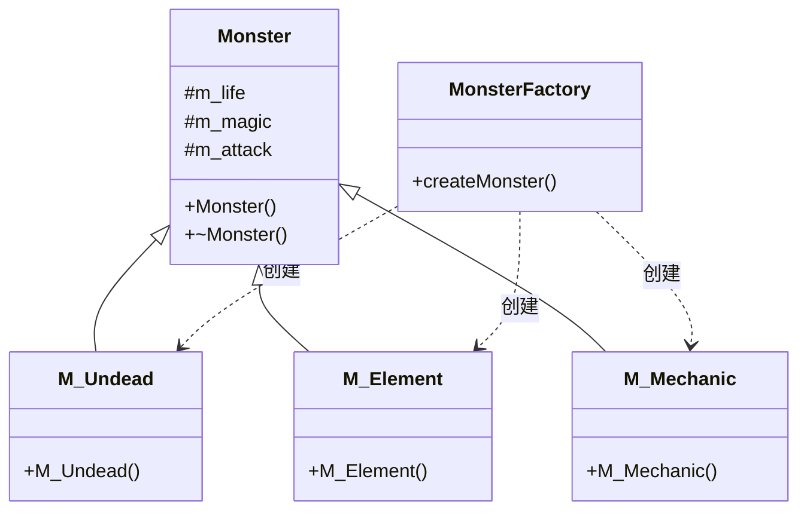
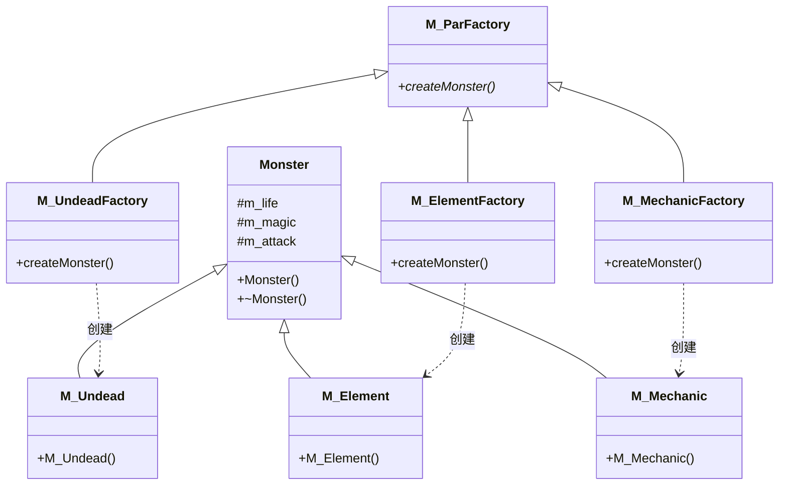
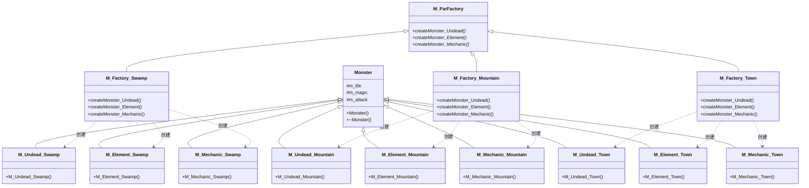
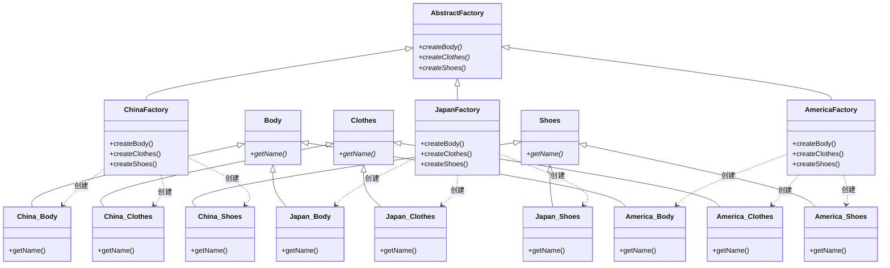
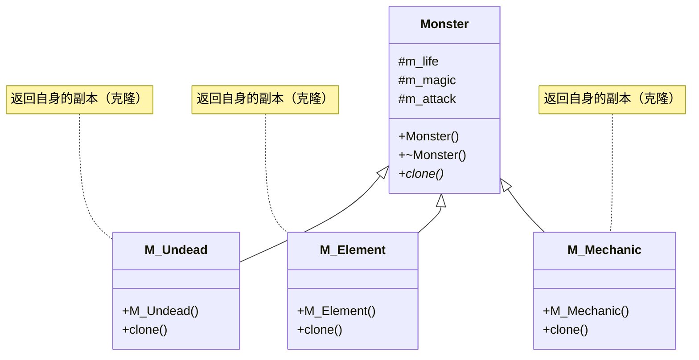
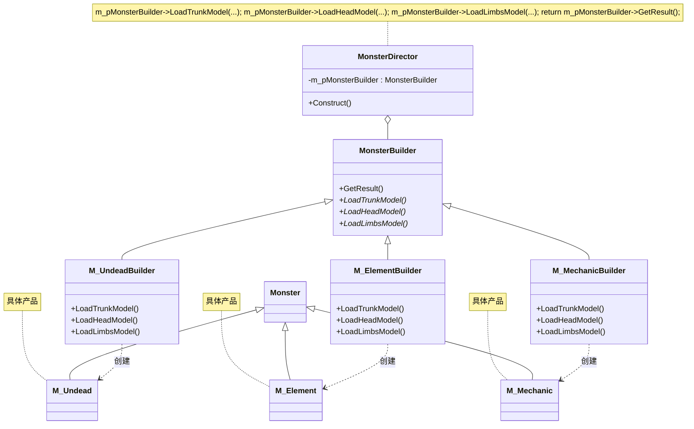
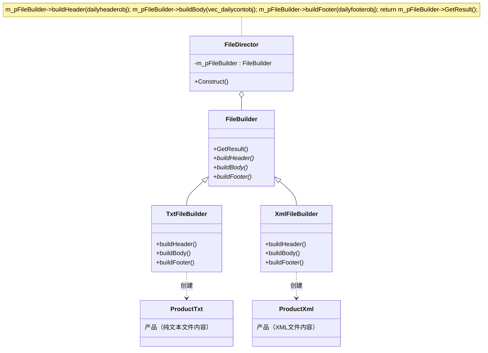

# 第 3 章 工厂模式、原型模式、建造者模式

&gt; 原书第 39–89 页 ｜ 本节内容：以单机闯关打斗类游戏、芭比娃娃生产、员工工作日报导出等范例逐步重构，讲解简单工厂、工厂方法、抽象工厂、原型、建造者 5 种创建型模式，并引出开闭原则。

工厂模式、原型模式、建造者模式都属于创建型模式，用于创建对象实例。本章就学习一下这些设计模式，学习过程中应注意比较它们之间的异同及适用场合。


## 3.1 工厂模式

创建一个类对象的传统方式是使用关键字 new，因为用 new 创建的类对象是一个堆对象，可以实现多态。工厂模式通过把创建对象的代码包装起来，实现创建对象的代码与具体的业务逻辑代码相隔离的目的（将对象的创建和使用进行解耦）。试想，如果创建一个类 A 的对象，可能会写出“A * pobja = new A();”这样的代码行，但当给类 A 的构造函数增加一个参数时，所有利用 new 创建类 A 对象的代码行全部需要修改，如果通过工厂模式把创建类 A 对象的代码统一放到某个位置，则对于诸如给类 A 的构造函数增加参数之类的问题，只需要修改一个位置就可以了。

工厂模式属于创建型模式，一般可以细分为 3 种：简单工厂模式、工厂方法模式和抽象工厂模式。每种都有不同的特色和应用场景，本章将会逐一介绍。在讲解过程中，还会引出面向对象程序设计的一个重要原则——开闭原则，并对该原则进行细致的阐述。

### 3.1.1 简单工厂模式

简单工厂（Simple Factory）模式在四人组写的《设计模式——可复用面向对象软件的基础》中并没有出现，所以可以认为这并不算是一个标准的设计模式，但因为其应用场合比较多，所以在这里专门介绍一下。此外，有些书籍并不把简单工厂模式看成一种设计模式，只是看成一种编程手法，这也没什么问题，在笔者看来，更倾向把简单工厂模式看成一种编程手法或者编程技巧。

之所以叫简单工厂模式，是因为该模式与其他两种工厂模式（工厂方法模式和抽象工厂模式）比较而言，实现的代码相对简单，作为其他两种工厂模式学习的基础非常合适。

这里继续以前面的单机闯关打斗类游戏的开发为例来阐述工厂模式。游戏中的主角需要通过攻击并杀死怪物来进行闯关，策划规定，在该游戏中，暂时有 3 类怪物（后面可能会增加新的怪物种类），分别是亡灵类怪物、元素类怪物、机械类怪物，每种怪物都有一些各自的特点（细节略），当然，这些怪物还有一些共同特点，例如同主角一样，都有生命值、魔法值、攻击力 3 个属性，为此，创建一个 Monster（怪物）类作为父类，而创建 M_Undead（亡灵类怪物）、M_Element（元素类怪物）和 M_Mechanic（机械类怪物）作为子类是合适的。针对怪物，程序定义了如下几个类：

```cpp
//怪物父类
class Monster
{
public:
    //构造函数
    Monster(int life, int magic, int attack) :m_life(life), m_magic(magic), m_attack(attack) {}
    virtual ~Monster() {}       //作父类时析构函数应该为虚函数

protected:                      //可能被子类访问的成员，用protected修饰
    //怪物属性
    int m_life;                 //生命值
    int m_magic;                //魔法值
    int m_attack;               //攻击力
};

//亡灵类怪物
class M_Undead :public Monster
{
public:
    //构造函数
    M_Undead(int life, int magic, int attack) :Monster(life, magic, attack)
    {
        cout << "一只亡灵类怪物来到了这个世界" << endl;
    }
    //其他代码略...
};

//元素类怪物
class M_Element :public Monster
{
public:
    //构造函数
    M_Element(int life, int magic, int attack) :Monster(life, magic, attack)
    {
        cout << "一只元素类怪物来到了这个世界" << endl;
    }
    //其他代码略...
};

//机械类怪物
class M_Mechanic :public Monster
{
public:
    //构造函数
    M_Mechanic(int life, int magic, int attack) :Monster(life, magic, attack)
    {
        cout << "一只机械类怪物来到了这个世界" << endl;
    }
    //其他代码略...
};
```

当需要在游戏的战斗场景中产生怪物时，传统方法可以使用 new 直接产生各种怪物，例如在 main 主函数中可以加入如下代码：

```cpp
Monster* pM1 = new M_Undead(300, 50, 80);       //产生了一只亡灵类怪物
Monster* pM2 = new M_Element(200, 80, 100);     //产生了一只元素类怪物
Monster* pM3 = new M_Mechanic(400, 0, 110);     //产生了一只机械类怪物
//释放资源
delete pM1;
delete pM2;
delete pM3;
```

执行结果如下：

```text
一只亡灵类怪物来到了这个世界
一只元素类怪物来到了这个世界
一只机械类怪物来到了这个世界
```

上面这种创建怪物的写法虽然合法，但不难看到，当创建不同种类的怪物时，避免不了直接与多个怪物类（M_Undead、M_Element、M_Mechanic）打交道，这属于一种依赖具体类的紧耦合，因为需要知道这些类的名字，尤其是随着游戏内容的不断增加，怪物的种类也可能会不断增加。如果通过某个扮演工厂角色的类（怪物工厂类）来创建怪物，则意味着创建怪物时不再使用 new 关键字，而是通过该工厂类来进行，这样的话，即便将来怪物的种类增加，main 主函数中创建怪物的代码也可以尽量保持稳定。通过工厂类，避免了在 main 函数中（也可以在任何其他函数中）直接使用 new 创建对象时必须知道具体类名（这是一种依赖具体类的紧耦合关系）的情形发生，实现了**创建怪物的代码**与各个具体怪物类对象要实现的**业务逻辑代码**隔离，这就是**简单工厂模式的实现思路**。当然，和使用 new 创建对象的直观性比，显然简单工厂模式的实现思路是绕了弯的。

下面就创建一个怪物工厂类 MonsterFactory，用这个工厂类来生产（产生）出各种不同种类的怪物，代码如下：

```cpp
//怪物工厂类
class MonsterFactory
{
public:
    Monster* createMonster(string strmontype)
    {
        Monster* prtnobj = nullptr;
        if (strmontype == "udd")            //udd代表要创建亡灵类怪物
        {
            prtnobj = new M_Undead(300, 50, 80);
        }
        else if (strmontype == "elm")       //ele代表要创建元素类怪物
        {
            prtnobj = new M_Element(200, 80, 100);
        }
        else if (strmontype == "mec")       //mec代表要创建机械类怪物
        {
            prtnobj = new M_Mechanic(400, 0, 110);
        }
        return prtnobj;
    }
};
```

通过上面的代码可以看到，createMonster 成员函数的形参是一个字符串，代表怪物类型。虽然通过工厂创建怪物不再需要直接与各个怪物类打交道，但必须通过一个标识告诉怪物工厂类要创建哪种怪物，这就是该字符串的作用。当然，不使用字符串而使用一个整型数字也没问题，只要能标识出不同的怪物类型即可。createMonster 成员函数返回的是 Monster * 这个所有怪物类的父类指针以支持多态。

在 main 主函数中，注释掉原有代码，增加如下代码：

```cpp
MonsterFactory facobj;
Monster* pM1 = facobj.createMonster("udd");     //产生了一只亡灵类怪物，当然这里必须知
                                                //道"udd"代表的是创建亡灵类怪物
Monster* pM2 = facobj.createMonster("elm");     //产生了一只元素类怪物
Monster* pM3 = facobj.createMonster("mec");     //产生了一只机械类怪物
//释放资源
delete pM1;
delete pM2;
delete pM3;
```

代码虽然经过了上述改造，但执行结果不变。代码经过改造后，创建各种怪物时就不必面对（书写）M_Undead、M_Element、M_Mechanic 等具体的怪物类，只要面对 MonsterFactory 类即可。当然，其实 main 主函数创建对象时遇到的麻烦（依赖具体怪物类）依旧存在，只是被转嫁给了 MonsterFactory 类而已。其实，依赖这件事本身并不会因为引入设计模式而完全消失，程序员能做的是把这种依赖的范围尽量缩小（例如缩小到 MonsterFactory 类的 createMonster 成员函数中），从而避免依赖关系遍布整个代码（所有需要创建怪物对象的地方），这就是所谓的**封装变化**（把容易变化的代码段限制在一个小范围内），就可以在很大程度上提高代码的可维护性和可扩展性，否则可能会导致一修改代码就要修改一大片的困境。例如以往如果这样写代码：

```cpp
Monster* pM1 = new M_Undead(300, 50, 80);
```

那么一旦要对圆括号中的参数类型进行修改或者新增参数，则所有涉及 new M_Undead 的代码段可能都要修改，但采用简单工厂模式后，只需要修改 MonsterFactory 类的 createMonster 成员函数，确实省了很多事。

MonsterFactory 类的实现也有缺点。最明显的缺点就是当引入新的怪物类型时，需要修改 createMonster 成员函数的源码来增加新的 if 判断分支，从而支持对新类型怪物的创建工作，这违反了面向对象程序设计的一个原则——**开闭原则**（Open Close Principle，OCP）。

面向对象程序设计有几大原则比较难理解，讲解时需要相关的代码做讲解支撑才容易懂，所以笔者尽可能遇到时再讲解。这里提一下开闭原则，开闭原则讲的是代码的扩展性问题，它是这样解释的：**对扩展开放，对修改关闭**（封闭）。这个解释太粗糙，如果解释得详细一点，应该是这样：当增加新功能时，不应该通过修改已经存在的代码来进行（修改 MonsterFactory 类中的 createMonster 成员函数就属于修改已经存在的代码范畴），而应该通过扩展代码（例如增加新类、增加新成员函数等）来进行。开闭原则一般是面向对象程序设计所追求的目标。

前述通过修改 createMonster 成员函数来增加对新类型怪物的支持，违反了开闭原则，得到的好处是代码阅读起来简单明了了，但如果通过扩展代码来增加对新怪物的支持，那么代码会复杂很多，也会在相当程度上增加对代码的理解难度，具体如何通过扩展代码来践行开闭原则，后面的讲解中会详细谈到。

请记住，如果 if 分支语句并不是很多（此时用简单工厂设计模式就是适合的），例如只有数个而并不是数十上百个，那么适当地违反开闭原则完全可以接受。当然，如果怪物类型只有 2 或 3 种且不经常变动则不引入工厂类 MonsterFactory 而直接采用 new 的方式创建对象也仍然可以，开发者需要在代码的可读性和可扩展性之间做出权衡，在应用设计模式时不应该生搬硬套，而是依据实际情形和实际应用场景确定。

引入“简单工厂”设计模式的定义（实现意图）：定义一个工厂类（MonsterFactory），该类的成员函数（createMonster）可以根据不同的参数创建并返回不同的类对象，被创建的对象所属的类（M_Undead、M_Element、M_Mechanic）一般都具有相同的父类（Monster）。调用者（这里指 main 函数）无须关心创建对象的细节。

也可以把 MonsterFactory 类中的 createMonster 实现为静态成员函数，具体如下：

```cpp
public:
    static Monster* createMonster(string strmontype)
    {
        ...
    }
```

这样在 main 函数中就不必创建 facobj 对象，直接采用诸如“MonsterFactory::createMonster("udd");”的调用方式创建怪物即可，此时的简单工厂模式又可以称为静态工厂方法（Static Factory Method）模式。

针对前面的代码范例绘制一下简单工厂模式的 UML 图，如图 3.1 所示。



*原书图 3.1（第 44 页）：*

在图 3.1 中，可以看到：

（1）类与类之间以实线箭头表示父子关系，子类（M_Undead、M_Element、M_Mechanic）与父类（Monster）之间有一条带箭头的实线，箭头的方向指向父类。MonsterFactory 类与 M_Undead、M_Element、M_Mechanic 类之间的虚线箭头表示箭头连接的两个类之间存在着依赖关系（一个类引用另一个类），换句话说，虚线箭头表示一个类（MonsterFactory）实例化另外一个类（M_Undead、M_Element、M_Mechanic）的对象，箭头指向被实例化对象的类。

（2）因为创建怪物只需要与 MonsterFactory 类打交道，所以创建怪物的代码（调用 createMonster 成员函数的代码）是稳定的，但增加新类型怪物需要修改 MonsterFactory 类的 createMonster 成员函数代码，所以 createMonster 成员函数是变化的。

（3）如果 MonsterFactory 类由第三方开发商开发，该开发商并不希望将 M_Undead、M_Element、M_Mechanic 这些类的名字等信息暴露给开发者，那么通过为开发者提供 createMonster 成员函数（接口）来创建出不同类型的怪物就可以实现具体怪物类的隐藏效果，同时也实现了创建怪物对象的代码与具体的怪物类（M_Undead、M_Element、M_Mechanic）解耦合（对任意一个模块的更改都不会影响另外一个模块）的效果。

### 3.1.2 工厂方法模式

有些书籍资料会把简单工厂模式看成工厂方法（Factory Method）模式的特例（笔者认为这种看法不太合适，读者学习完本模式后可自行体会），所以并不会单独讲解简单工厂模式。工厂方法模式是使用频率最高的工厂模式，而人们通常所说的工厂模式也常常指的就是工厂方法模式，换句话说，工厂方法模式可以简称为**工厂模式**或**多态工厂模式**，这种模式的实现难度比简单工厂模式略高一些。

前面讲解简单工厂模式时，读者已经注意到了如果引入新的怪物类型，则必须要修改 MonsterFactory 类的 createMonster 成员函数来增加新的 if 判断分支，如果怪物的种类非常多，那么这个 if 判断分支会很长，从而造成逻辑过于烦琐使代码变得难以维护，同时，前面也介绍了 createMonster 成员函数的设计违反了开闭原则（对扩展开放，对修改关闭）。工厂方法模式的引入，很好地满足了面向对象程序设计的开闭原则。当增加新的怪物类型时，工厂方法模式采用**增加新的工厂类**的方式支持新怪物类型（不影响已有的代码）。与简单工厂模式相比，工厂方法模式的灵活性更强，实现也更加复杂（增加了理解难度），同时也要引入更多的新类（主要是引入新的工厂类）。

本节以简单工厂模式中实现的代码为基础进行代码改造，将用简单工厂模式实现的代码修改为用工厂方法模式实现。在工厂方法模式中，不是用一个工厂类 MonsterFactory 来解决创建多种类型怪物的问题，而是用多个工厂类来解决创建多种类型怪物的问题。而且，**针对每种类型的怪物，都需要创建一个对应的工厂类**，例如，当前要创建 3 种类型的怪物 M_Undead、M_Element、M_Mechanic，那么，就需要创建 3 个工厂类，例如分别命名为 M_UndeadFactory、M_ElementFactory、M_MechanicFactory。而且这 3 个工厂类还会共同继承自同一个工厂父类，例如将该工厂父类命名为 M_ParFactory（工厂抽象类）。如果将来策划要求引入第四种类型的怪物，那么毫无疑问，需要为该种类型的怪物增加对应的一个新工厂类，当然该新工厂类依然继承自 M_ParFactory 类。

从上面的描述，可以初步看出，工厂方法模式通过增加新的工厂类来符合面向对象程序设计的开闭原则（对扩展开放，对修改关闭），但付出的代价是需要增加多个新的工厂类。

下面开始改造简单工厂模式中实现的代码。首先注释掉 main 主函数中的所有代码，然后将原有的怪物工厂类 MonsterFactory 也注释掉。接着，先来实现所有工厂类的父类 M_ParFactory（等价于将简单工厂模式中的工厂类 MonsterFactory 进行抽象），代码如下：

```cpp
//所有工厂类的父类
class M_ParFactory
{
public:
    virtual Monster* createMonster() = 0;       //具体的实现在子类中进行
    virtual ~M_ParFactory() {}                  //作父类时析构函数应该为虚函数
};
```

然后，针对每个具体的怪物子类，都需要创建一个相关的工厂类，所以，针对 M_Undead、M_Element、M_Mechanic 类，创建 3 个工厂类 M_UndeadFactory、M_ElementFactory、M_MechanicFactory，代码如下：

```cpp
//M_Undead怪物类型的工厂，生产M_Undead类型怪物
class M_UndeadFactory : public M_ParFactory
{
public:
    virtual Monster* createMonster()
    {
        return new M_Undead(300, 50, 80);       //创建亡灵类怪物
    }
};

//M_Element怪物类型的工厂，生产M_Element类型怪物
class M_ElementFactory : public M_ParFactory
{
public:
    virtual Monster* createMonster()
    {
        return new M_Element(200, 80, 100);     //创建元素类怪物
    }
};

//M_Mechanic怪物类型的工厂，生产M_Mechanic类型怪物
class M_MechanicFactory : public M_ParFactory
{
public:
    virtual Monster* createMonster()
    {
        return new M_Mechanic(400, 0, 110);     //创建机械类怪物
    }
};
```

有了这 3 个怪物工厂类之后，可以创建一个全局函数 Gbl_CreateMonster 来处理怪物对象的生成，代码如下：

```cpp
//全局用于创建怪物对象的函数，注意形参的类型是工厂父类类型的指针，返回类型是怪物父类类
//型的指针
Monster* Gbl_CreateMonster(M_ParFactory* factory)
{
    return factory->createMonster();    //createMonster虚函数扮演了多态new的行为，factory
                                        //指向的具体怪物工厂类不同，创建的怪物对象也不同
}
```

从现在的代码可以看到，Gbl_CreateMonster 作为创建怪物对象的核心函数，并不依赖于具体的 M_Undead、M_Element、M_Mechanic 怪物类，只依赖于 Monster 类（Gbl_CreateMonster 的返回类型）和 M_ParFactory 类（Gbl_CreateMonster 的形参类型），变化的部分被隔离到调用 Gbl_CreateMonster 函数的地方去了。

在 main 主函数中，注释掉原有代码，增加如下代码来通过各自的工厂生产各自的产品：

```cpp
M_ParFactory* p_ud_fy = new M_UndeadFactory();  //多态工厂，注意指针类型
Monster* pM1 = Gbl_CreateMonster(p_ud_fy);      //产生了一只亡灵类怪物，也是多态，注意返
                                                //回类型，当然也可以直接写成 Monster*
                                                //pM1 = p_ud_fy->createMonster();

M_ParFactory* p_elm_fy = new M_ElementFactory();
Monster* pM2 = Gbl_CreateMonster(p_elm_fy);     //产生了一只元素类怪物

M_ParFactory* p_mec_fy = new M_MechanicFactory();
Monster* pM3 = Gbl_CreateMonster(p_mec_fy);     //产生了一只机械类怪物

//释放资源
//释放工厂
delete p_ud_fy;
delete p_elm_fy;
delete p_mec_fy;

//释放怪物
delete pM1;
delete pM2;
delete pM3;
```

从上述代码可以看到，创建怪物对象时，不需要记住具体怪物类的名称，但需要知道创建该类怪物的工厂的名称。

引入**工厂方法设计模式的定义**（实现意图）：定义一个用于创建对象的接口（M_ParFactory 类中的 createMonster 成员函数，这其实就是工厂方法，工厂方法模式的名字也是由此而来），但由子类（M_UndeadFactory、M_ElementFactory、M_MechanicFactory）决定要实例化的类是哪一个。该模式使得某个类（M_Undead、M_Element、M_Mechanic）的实例化**延迟**到子类（M_UndeadFactory、M_ElementFactory、M_MechanicFactory）。

针对前面的代码范例绘制一下工厂方法模式的 UML 图，如图 3.2 所示。



*原书图 3.2（第 47 页）：*

在图 3.2 中，可以看到：

- Gbl_CreateMonster 函数所依赖的 Monster 类和 M_ParFactory 类都属于稳定部分（不需要改动的类）。
- M_UndeadFactory、M_ElementFactory、M_MechanicFactory 类以及 M_Undead、M_Element、M_Mechanic 类都属于变化部分。Gbl_CreateMonster 函数并不依赖于这些变化部分。
- 当出现一个新的怪物类型[例如 M_Beast（野兽类怪物）]时，既不需要更改 Gbl_CreateMonster 函数，也不需要像简单工厂模式那样修改 MonsterFactory 类中的 createMonster 成员函数来增加新的 if 分支，除了要添加继承自 Monster 的类 M_Beast 之外，只需要为新的怪物类型 M_Beast 增加一个新的继承自 M_ParFactory 的工厂类 M_BeastFactory 即可。这正好符合面向对象程序设计的开闭原则——对扩展开放，对修改关闭（封闭）。所以，一般可以认为，将简单工厂模式的代码通过把工厂类进行抽象改造成符合开闭原则后的代码，就变成了工厂方法模式的代码。
- 如果 M_ParFactory 工厂类以及各个工厂子类由第三方开发商开发，那么利用工厂方法模式可以很好地隐藏 M_Undead、M_Element、M_Mechanic 类，使其不暴露给开发者。
- 可以根据实际需要扩充 M_ParFactory 中的接口（虚函数），例如增加游戏中对其他内容[例如 NPC（非玩家角色，如商人、路人等）]的创建支持，或者不实现成抽象类而为 createMonster 提供一些默认实现，等等，这方面读者可以发挥自身的想象力和创造力。
- 增加新的工厂类是工厂方法设计模式必须付出的代价。

关于使用工厂模式的好处，再次阐明一下笔者的观点。从宏观的角度来讲，所有的工厂模式（简单工厂模式、工厂方法模式、抽象工厂模式）都致力于将 new 创建对象这件事集中到某个或者某些工厂类的成员函数（createMonster）中去做，这样做有几个非常明显的好处。

（1）在讲解简单工厂模式时已经说过，就是希望封装变化，想将依赖具体怪物类的范围尽量缩小，试想如果将来 new 相关的代码行需要修改，例如原来是如下代码行：

```cpp
prtnobj = new M_Element(200, 80, 100);
```

现在需要增加一个参数或者修改一个已有的参数：

```cpp
prtnobj = new M_Element(200, 80, 80, 300);
```

那么利用了工厂模式的代码，只需要修改工厂类的成员函数（createMonster）即可；如果不采用工厂模式，则代码中凡是涉及“new M_Element(200, 80, 100);”的代码段可能都需要修改，这是一个极其繁重又枯燥的工作。

当然，如果不怕暴露各种怪物类的类名，又不想写这么多的工厂子类，单纯地只是想封装变化，也就是想把创建怪物对象的代码段限制在 createMonster 成员函数中，那么通过创建一个继承自 M_ParFactory 类的子类模板，也能达到同样的效果。参考如下代码段：

```cpp
//创建怪物工厂子类模板
template < typename T>
class M_ChildFactory : public M_ParFactory
{
public:
    virtual Monster* createMonster()
    {
        return new T(300, 50, 80);      //如果需要不同的值，则可以考虑通过
                                        //createMonster的形参将值传递进来
    }
};
```

main 主函数中，可以像下面这样来使用 M_ChildFactory 类模板：

```cpp
M_ChildFactory <M_Undead> myFactory;
Monster* pM10 = myFactory.createMonster();
//释放资源
delete pM10;
```

（2）如果在创建一个对象之前需要一些额外的业务代码（例如，返回怪物对象之前还要设置一下怪物的位置），那么可以将这些代码统一增加到具体工厂类的 createMonster 成员函数中，例如：

```cpp
virtual Monster* createMonster()
{
    Monster* ptmp = new M_Undead(300, 50, 80);      //创建亡灵类怪物
    //这里可以增加一些其他的业务代码
    return ptmp;
}
```

对于工厂方法模式与简单工厂模式相比有什么明显不同或者说好处的问题，其实上面已经解释得很清楚了，面向对象程序设计原则告诉人们：“修改现有的代码来实现一个新功能不如通过增加新代码来实现该功能好。”为了遵循这个原则，人们将简单工厂模式通过将工厂类进行抽象的方法进行改造升级成了工厂方法模式。如果从源码实现的角度看，也可以这样解释：简单工厂模式把创建对象这件事放到了一个统一的地方来处理，弹性比较差，而工厂方法模式相当于建立了一个程序实现框架，从而让工厂子类来决定对象如何创建。

另外，必须注意，**工厂方法模式往往需要创建一个与产品等级结构（层次）相同的工厂等级结构**，这也增加了新类的层次结构和数目。

### 3.1.3 抽象工厂模式

#### 1. 战斗场景分类范例

继续前面开发的单机闯关打斗类游戏，随着游戏内容越来越丰富，游戏中战斗场景（关卡）数量和类型不断增加，从原来的在城镇中战斗逐步进入在沼泽地战斗、在山脉地区战斗等。于是，策划把怪物种类进一步按照场景进行了分类，怪物目前仍旧保持 3 类：亡灵类、元素类和机械类。战斗场景也分为 3 类：沼泽地区、山脉地区和城镇。这样来划分的话，整个游戏中目前就有 9 类怪物：沼泽地区的亡灵类、元素类、机械类怪物；山脉地区的亡灵类、元素类、机械类怪物；城镇中的亡灵类、元素类、机械类怪物。策划规定每个区域的同类型怪物能力上差别很大，例如，沼泽地中的亡灵类怪物攻击力比城镇中的亡灵类怪物高很多，山脉地区的机械类怪物会比沼泽地区的机械类怪物生命值高许多。

这样看起来，从怪物父类 Monster 继承而来的怪物子类就会由原来的 3 种 M_Undead、M_Element、M_Mechanic 变为 9 种，按照这样的怪物分类方式，使用工厂方法模式创建怪物对象则需要创建多达 9 个工厂子类，但如果一个工厂子类能够生产不止一种具有相同规则的怪物对象，那么就可以有效地减少所创建的工厂子类数量，这就是**抽象工厂**（Abstract Factory）模式的核心思想。

有两个概念在抽象工厂模式中经常被提及，分别是“产品等级结构”和“产品族”。绘制一个坐标轴，把前述的 9 种怪物放入其中，如图 3.3 所示。

在图 3.3 中，相同的形状代表种类相同但场景不同的怪物，横着按行来观察，发现每个怪物的种类不同，但所有怪物都位于相同的场景中，例如都位于沼泽中（产品的产地相同），每一行产品就是一个产品族（3 行代表着 3 个产品族）。接着，竖着按列来观察，发现每个怪物的种类相同，但每个怪物都位于不同的场景中，那么每一列怪物就是一个产品等级结构（3 列代表着 3 个产品等级结构）。不难想象，如果用一个工厂子类生产 1 个产品族（1 行），那么因为有 3 个产品族（3 行），所以只需要 3 个工厂就可以生产 9 个产品（9 种怪物对象）。所以在图中，所需的 3 个工厂分别是沼泽地区的工厂、山脉地区的工厂以及城镇的工厂。请记住，抽象工厂模式是按照**产品族**来生产产品——一个地点有一个工厂，该工厂负责生产本产地的所有产品。

*原书图 3.3（第 50 页）：*

现在，程序要根据策划的需求重新规划怪物对象的创建问题。保留 Monster 怪物父类，删除原有的 M_Undead、M_Element、M_Mechanic 怪物子类，重新引入一共 9 个怪物类。代码如下，注意代码中的注释部分：

```cpp
//--------------------------------------------------------------------------
//沼泽亡灵类怪物
class M_Undead_Swamp :public Monster
{
public:
    M_Undead_Swamp(int life, int magic, int attack) :Monster(life, magic, attack)
    {
        cout << "一只沼泽的亡灵类怪物来到了这个世界" << endl;
    }
};
//沼泽元素类怪物
class M_Element_Swamp :public Monster
{
public:
    M_Element_Swamp(int life, int magic, int attack) :Monster(life, magic, attack)
    {
        cout << "一只沼泽的元素类怪物来到了这个世界" << endl;
    }
};
//沼泽机械类怪物
class M_Mechanic_Swamp :public Monster
{
public:
    M_Mechanic_Swamp(int life, int magic, int attack) :Monster(life, magic, attack)
    {
        cout << "一只沼泽的机械类怪物来到了这个世界" << endl;
    }
};
```

```cpp
//--------------------------------------------------------------------------
//山脉亡灵类怪物
class M_Undead_Mountain :public Monster
{
public:
    M_Undead_Mountain(int life, int magic, int attack) :Monster(life, magic, attack)
    {
        cout << "一只山脉的亡灵类怪物来到了这个世界" << endl;
    }
};
//山脉元素类怪物
class M_Element_Mountain :public Monster
{
public:
    M_Element_Mountain(int life, int magic, int attack) :Monster(life, magic, attack)
    {
        cout << "一只山脉的元素类怪物来到了这个世界" << endl;
    }
};
//山脉机械类怪物
class M_Mechanic_Mountain :public Monster
{
public:
    M_Mechanic_Mountain(int life, int magic, int attack) :Monster(life, magic, attack)
    {
        cout << "一只山脉的机械类怪物来到了这个世界" << endl;
    }
};
```

```cpp
//--------------------------------------------------------------------------
//城镇亡灵类怪物
class M_Undead_Town :public Monster
{
public:
    M_Undead_Town(int life, int magic, int attack) :Monster(life, magic, attack)
    {
        cout << "一只城镇的亡灵类怪物来到了这个世界" << endl;
    }
};
//城镇元素类怪物
class M_Element_Town :public Monster
{
public:
    M_Element_Town(int life, int magic, int attack) :Monster(life, magic, attack)
    {
        cout << "一只城镇的元素类怪物来到了这个世界" << endl;
    }
};
//城镇机械类怪物
class M_Mechanic_Town :public Monster
{
public:
    M_Mechanic_Town(int life, int magic, int attack) :Monster(life, magic, attack)
    {
        cout << "一只城镇的机械类怪物来到了这个世界" << endl;
    }
};
```

因为工厂是针对一个产品族进行生产的，所以总共需要创建 1 个工厂父类和 3 个工厂子类。先看一看工厂父类的写法：

```cpp
//所有工厂类的父类
class M_ParFactory
{
public:
    virtual Monster* createMonster_Undead() = 0;        //创建亡灵类怪物
    virtual Monster* createMonster_Element() = 0;       //创建元素类怪物
    virtual Monster* createMonster_Mechanic() = 0;      //创建机械类怪物
    virtual ~M_ParFactory() {}                          //作父类时析构函数应该为虚函数
};
```

3 个工厂子类代码如下：

```cpp
//--------------------------------------------------------------------------
//沼泽地区的工厂
class M_Factory_Swamp : public M_ParFactory
{
public:
    virtual Monster* createMonster_Undead()
    {
        return new M_Undead_Swamp(300, 50, 120);        //创建沼泽亡灵类怪物
    }
    virtual Monster* createMonster_Element()
    {
        return new M_Element_Swamp(200, 80, 110);       //创建沼泽元素类怪物
    }
    virtual Monster* createMonster_Mechanic()
    {
        return new M_Mechanic_Swamp(400, 0, 90);        //创建沼泽机械类怪物
    }
};

//山脉地区的工厂
class M_Factory_Mountain : public M_ParFactory
{
public:
    virtual Monster* createMonster_Undead()
    {
        return new M_Undead_Mountain(300, 50, 80);      //创建山脉亡灵类怪物
    }
    virtual Monster* createMonster_Element()
    {
        return new M_Element_Mountain(200, 80, 100);    //创建山脉元素类怪物
    }
    virtual Monster* createMonster_Mechanic()
    {
        return new M_Mechanic_Mountain(600, 0, 110);    //创建山脉机械类怪物
    }
};

//城镇的工厂
class M_Factory_Town : public M_ParFactory
{
public:
    virtual Monster* createMonster_Undead()
    {
        return new M_Undead_Town(300, 50, 80);          //创建城镇亡灵类怪物
    }
    virtual Monster* createMonster_Element()
    {
        return new M_Element_Town(200, 80, 100);        //创建城镇元素类怪物
    }
    virtual Monster* createMonster_Mechanic()
    {
        return new M_Mechanic_Town(400, 0, 110);        //创建城镇机械类怪物
    }
};
```

在 main 主函数中，注释掉原有代码，增加如下代码：

```cpp
M_ParFactory* p_mou_fy = new M_Factory_Mountain();          //多态工厂，山脉地区的工厂
Monster* pM1 = p_mou_fy->createMonster_Element();           //创建山脉地区的元素类怪物

M_ParFactory* p_twn_fy = new M_Factory_Town();              //多态工厂，城镇的工厂
Monster* pM2 = p_twn_fy->createMonster_Undead();            //创建城镇的亡灵类怪物
Monster* pM3 = p_twn_fy->createMonster_Mechanic();          //创建城镇的机械类怪物

//释放资源
//释放工厂
delete p_mou_fy;
delete p_twn_fy;

//释放怪物
delete pM1;
delete pM2;
delete pM3;
```

看一看抽象工厂模式的优缺点：

（1）如果游戏中的战斗场景新增加一个森林类型的场景而怪物种类不变（依旧是亡灵类怪物、元素类怪物和机械类怪物），则只需要增加一个新的子工厂类，例如 M_Factory_Forest 并继承自 M_ParFactory，而后在 M_Factory_Forest 类中实现 createMonster_Undead、createMonster_Element、createMonster_Mechanic 虚函数（接口）即可。这种代码实现方式符合开闭原则，也就是通过增加新代码而不是修改原有代码来为游戏增加新功能（对森林类型场景中怪物的创建支持）。

（2）如果游戏中新增加了一个新的怪物种类（例如龙类怪物），则此时不但要新增 3 个继承自 Monster 的子类来分别支持沼泽龙类怪物、山脉龙类怪物、城镇龙类怪物，还必须修改工厂父类 M_ParFactory 来增加新的虚函数（例如 createMonster_Dragon）以支持创建龙类怪物，各个工厂子类也需要增加对 createMonster_Dragon 的支持。这种在工厂类中通过修改已有代码来扩充游戏功能的方式显然不符合开闭原则。所以此种情况下不适合使用抽象工厂模式。

（3）抽象工厂模式具备工厂方法模式的优点，从图 3.3 来看，如果只是增加新的产品族（新增 1 行），则只需要增加新的子工厂类，符合开闭原则，这是抽象工厂模式的优点。但如果增加新的产品等级结构（新增 1 列），那么就需要修改抽象层的代码，这是抽象工厂模式的缺点，所以应该避免在产品等级结构不稳定的情况下使用该模式，也就是说，如果游戏中怪物种类（亡灵类、元素类、机械类）比较固定的情况下，更适合使用抽象工厂模式。

针对前面的代码范例绘制工厂方法模式的 UML 图，如图 3.4 所示。



*原书图 3.4（第 54 页）：*

#### 2. 不同厂商生产不同部件范例

再举一个范例增加读者对抽象工厂模式的理解。

芭比娃娃受到很多人的喜爱，它主要由 3 个部件组成：身体（包括头、颈、躯干、四肢）、衣服、鞋子。现在，中国、日本、美国的厂商都可以制造芭比娃娃的身体、衣服、鞋子部件。现在要求制作两个芭比娃娃，其中一个芭比娃娃的身体、衣服、鞋子全部采用中国厂商制造的部件，另一个芭比娃娃的身体部件采用中国厂商，衣服部件采用日本厂商，鞋子部件采用美国厂商。

这个题目就可以采用抽象工厂来实现，理一理类的设计思路：

- 将身体、衣服、鞋子这 3 个部件实现为抽象类。
- 实现一个抽象工厂，分别用来生产身体、衣服、鞋子这 3 个部件。
- 针对不同厂商的每个部件实现具体的类以及每个厂商所代表的具体工厂。

身体、衣服、鞋子 3 个部件的抽象类实现代码如下：

```cpp
//身体抽象类
class Body
{
public:
    virtual void getName() = 0;
    virtual ~Body() {}
};

//衣服抽象类
class Clothes
{
public:
    virtual void getName() = 0;
    virtual ~Clothes() {}
};

//鞋子抽象类
class Shoes
{
public:
    virtual void getName() = 0;
    virtual ~Shoes() {}
};
```

抽象工厂类实现代码如下：

```cpp
//抽象工厂类
class AbstractFactory
{
public:
    //所创建的部件应该稳定地保持这3个部件，才适合抽象工厂模式
    virtual Body* createBody() = 0;             //创建身体
    virtual Clothes* createClothes() = 0;       //创建衣服
    virtual Shoes* createShoes() = 0;           //创建鞋子
    virtual ~AbstractFactory() {}
};
```

抽象类和抽象工厂都具备的情况下，可以写一个芭比娃娃类如下：

```cpp
//芭比娃娃类
class BarbieDoll
{
public:
    //构造函数
    BarbieDoll(Body* tmpbody, Clothes* tmpclothes, Shoes* tmpshoes)
    {
        body = tmpbody;
        clothes = tmpclothes;
        shoes = tmpshoes;
    }
    void Assemble()                             //组装芭比娃娃
    {
        cout << "成功组装了一个芭比娃娃:" << endl;
        body->getName();
        clothes->getName();
        shoes->getName();
    }
private:
    Body* body;
    Clothes* clothes;
    Shoes* shoes;
};
```

接着，就是针对每个厂商、针对每个部件实现具体部件类和具体工厂类。先针对中国来实现，代码如下：

```cpp
//中国厂商实现的3个部件
class China_Body :public Body
{
public:
    virtual void getName()
    {
        cout << "中国厂商产的_身体部件" << endl;
    }
};
class China_Clothes :public Clothes
{
public:
    virtual void getName()
    {
        cout << "中国厂商产的_衣服部件" << endl;
    }
};
class China_Shoes :public Shoes
{
public:
    virtual void getName()
    {
        cout << "中国厂商产的_鞋子部件" << endl;
    }
};
//创建一个中国工厂
class ChinaFactory :public AbstractFactory
{
public:
    virtual Body* createBody()
    {
        return new China_Body;
    }
    virtual Clothes* createClothes()
    {
        return new China_Clothes;
    }
    virtual Shoes* createShoes()
    {
        return new China_Shoes;
    }
};
```

接着，再针对日本厂商实现具体部件类和具体工厂类，代码如下：

```cpp
//日本厂商实现的3个部件
class Japan_Body :public Body
{
public:
    virtual void getName()
    {
        cout << "日本厂商产的_身体部件" << endl;
    }
};
class Japan_Clothes :public Clothes
{
public:
    virtual void getName()
    {
        cout << "日本厂商产的_衣服部件" << endl;
    }
};
class Japan_Shoes :public Shoes
{
public:
    virtual void getName()
    {
        cout << "日本厂商产的_鞋子部件" << endl;
    }
};
//创建一个日本工厂
class JapanFactory :public AbstractFactory
{
public:
    virtual Body* createBody()
    {
        return new Japan_Body;
    }
    virtual Clothes* createClothes()
    {
        return new Japan_Clothes;
    }
    virtual Shoes* createShoes()
    {
        return new Japan_Shoes;
    }
};
```

最后，针对美国厂商实现具体部件类和具体工厂类，代码如下：

```cpp
//美国厂商实现的3个部件
class America_Body :public Body
{
public:
    virtual void getName()
    {
        cout << "美国厂商产的_身体部件" << endl;
    }
};
class America_Clothes :public Clothes
{
public:
    virtual void getName()
    {
        cout << "美国厂商产的_衣服部件" << endl;
    }
};
class America_Shoes :public Shoes
{
public:
    virtual void getName()
    {
        cout << "美国厂商产的_鞋子部件" << endl;
    }
};
//创建一个美国工厂
class AmericaFactory :public AbstractFactory
{
public:
    virtual Body* createBody()
    {
        return new America_Body;
    }
    virtual Clothes* createClothes()
    {
        return new America_Clothes;
    }
    virtual Shoes* createShoes()
    {
        return new America_Shoes;
    }
};
```

现在，在 main 主函数中，就可以生产第一个芭比娃娃了（身体、衣服、鞋子全部采用中国厂商制造的部件），代码如下：

```cpp
//创建第一个芭比娃娃----------------------------------------
//(1)创建一个中国工厂
AbstractFactory* pChinaFactory = new ChinaFactory();
//(2)创建中国产的各种部件
Body* pChinaBody = pChinaFactory->createBody();
Clothes* pChinaClothes = pChinaFactory->createClothes();
Shoes* pChinaShoes = pChinaFactory->createShoes();
//(3)创建芭比娃娃
BarbieDoll* pbd1obj = new BarbieDoll(pChinaBody, pChinaClothes, pChinaShoes);
pbd1obj->Assemble();                            //组装芭比娃娃
```

上面的代码没有释放内存，内存留到最后统一释放。执行起来，看一看结果：

```text
成功组装了一个芭比娃娃:
中国厂商产的_身体部件
中国厂商产的_衣服部件
中国厂商产的_鞋子部件
```

接着，生产第二个芭比娃娃（身体采用中国厂商，衣服采用日本厂商，鞋子采用美国厂商），代码如下：

```cpp
//创建第二个芭比娃娃----------------------------------------
//(1)创建另外两个工厂：日本工厂，美国工厂
AbstractFactory* pJapanFactory = new JapanFactory();
AbstractFactory* pAmericaFactory = new AmericaFactory();
//(2)创建中国产的身体部件，日本产的衣服部件，美国产的鞋子部件
Body* pChinaBody2 = pChinaFactory->createBody();
Clothes* pJapanClothes = pJapanFactory->createClothes();
Shoes* pAmericaShoes = pAmericaFactory->createShoes();
//(3)创建芭比娃娃
BarbieDoll* pbd2obj = new BarbieDoll(pChinaBody2, pJapanClothes, pAmericaShoes);
pbd2obj->Assemble();                            //组装芭比娃娃
```

执行起来，看一看新增代码行的执行结果：

```text
成功组装了一个芭比娃娃:
中国厂商产的_身体部件
日本厂商产的_衣服部件
美国厂商产的_鞋子部件
```

在 main 主函数的最后统一释放内存：

```cpp
//最后记得释放内存------------------------------------------
delete pbd1obj;
delete pChinaShoes;
delete pChinaClothes;
delete pChinaBody;
delete pChinaFactory;
// ----------
delete pbd2obj;
delete pAmericaShoes;
delete pJapanClothes;
delete pChinaBody2;
delete pAmericaFactory;
delete pJapanFactory;
```

针对前面的代码范例绘制工厂方法模式的 UML 图，如图 3.5 所示。



*原书图 3.5（第 60 页）：*

从图 3.5 中可以看到，如果新增一个法国工厂也同样生产身体、衣服、鞋子部件，那么编写代码并不复杂，并且代码也符合开闭原则。从整体看，抽象工厂整个确实比较复杂，无论是产品还是工厂都进行了抽象。抽象工厂 AbstractFactory 定义了一组虚函数（createBody、createClothes、createShoes），而在工厂子类中这一组虚函数中的每一个都负责创建一个具体的产品，例如 China_Body、Japan_Clothes 等。相应地，绘制模式示意图，如图 3.6 所示。

*原书图 3.6（第 61 页）：*

在本范例中，能够成功运用抽象工厂模式的前提是所创建的部件应该保持稳定，始终是身体、衣服、鞋子这 3 个部件，如果部件是不稳定的，例如将来会增加新的部件，那么采用抽象工厂模式编程，代码的改动就会非常大并且违反开闭原则，这时可以考虑使用单独的工厂方法模式，也许会更灵活一些。

下面再分析一下工厂方法模式与抽象工厂模式的区别：工厂方法模式适用于一个工厂生产一个产品的需求，抽象工厂模式适用于一个工厂生产多个产品（一个产品族）的需求（笔者认为抽象工厂模式改名为“产品族工厂方法模式”似乎更合适）。另外，无论是产品族数量较多还是产品等级结构数量较多，抽象工厂的优势都将更加明显。

引入“抽象工厂”设计模式的定义（实现意图）：提供一个接口（AbstractFactory），让该接口负责创建一系列相关或者相互依赖的对象（Body、Clothes、Shoes），而无须指定它们具体的类。

到这里，简单工厂模式、工厂方法模式、抽象工厂模式就都讲解完了，下面对这 3 种工厂模式做一个总结：

- 从代码实现复杂度上，简单工厂模式最简单，工厂方法模式次之，抽象工厂模式最复杂。把简单工厂模式中的代码修改得符合开闭原则，就变成了工厂方法模式，修改工厂方法模式的代码使一个工厂支持对多个具体产品的生产，就变成了抽象工厂模式。
- 从需要的工厂数量上，简单工厂模式需要的工厂数量最少，工厂方法模式需要的工厂数量最多，抽象工厂模式能够有效地减少工厂方法模式所需要的工厂数量（可以将工厂方法模式看作抽象工厂模式的一种特例——抽象工厂模式中的工厂若只创建一种对象就是工厂方法模式）。
- 从实际应用上，当项目中的产品数量比较少时考虑使用简单工厂模式，如果项目稍大一点或者为了满足开闭原则，则可以使用工厂方法模式，而对于大型项目中有众多厂商并且每个厂商都生产一系列产品时应考虑使用抽象工厂模式。

## 3.2 原型模式

同工厂模式一样，原型（Prototype）模式也是一种创建型模式。原型模式通过一个对象（原型对象）克隆出多个一模一样的对象。实际上，该模式与其说是一种设计模式，不如说是一种创建对象的方法（对象克隆），尤其是创建给定类的对象（实例）过程很复杂（例如，要设置许多成员变量的值）时，使用这种设计模式就比较合适。

### 3.2.1 通过工厂方法模式演变到原型模式

回顾一下前面讲解工厂方法模式时的范例，由图 3.2，可以看到：

- 怪物相关类 M_Undead、M_Element、M_Mechanic 分别继承自怪物父类 Monster；
- 怪物工厂相关类 M_UndeadFactory、M_ElementFactory、M_MechanicFactory 分别继承自工厂父类 M_ParFactory；
- 怪物工厂类 M_UndeadFactory、M_ElementFactory、M_MechanicFactory 中的成员函数 createMonster 分别用于创建怪物类 M_Undead、M_Element、M_Mechanic 对象。

现在，把上述类的层次结构（源码）进行一下变换，请读者仔细观察：

（1）把怪物父类 Monster 和工厂父类 M_ParFactory 合二为一（或者说成是把 M_ParFactory 类中的能力搬到 Monster 中去并把 M_ParFactory 类删除掉），让怪物父类 Monster 本身具有克隆自己的能力。改造后的代码如下：

```cpp
//怪物父类
class Monster
{
public:
    //构造函数
    Monster(int life, int magic, int attack) :m_life(life), m_magic(magic), m_attack(attack) {}
    virtual ~Monster() {}                   //作父类时析构函数应该为虚函数

public:
    virtual Monster* createMonster() = 0;   //具体的实现在子类中进行

protected:                                  //可能被子类访问的成员，用protected修饰
    //怪物属性
    int m_life;                             //生命值
    int m_magic;                            //魔法值
    int m_attack;                           //攻击力
};
```

（2）遵从传统习惯（但不是一定要这样做），将上述成员函数 createMonster 重新命名为 clone，clone 的中文翻译为“克隆”，意味着调用该成员函数就会从当前类对象复制出一个完全相同的对象（通过克隆自己来创建出新对象），这当然也是一种创建该类所属对象的方式，虽然读者可能以往没见过这种创建对象的方式，但相信在将来阅读大型项目的源码时会遇到这种创建对象的方式。改造后的代码如下：

```cpp
public:
    virtual Monster* clone() = 0;           //具体的实现在子类中进行
```

（3）把 M_UndeadFactory、M_ElementFactory、M_MechanicFactory 这 3 个怪物工厂类中的 createMonster 成员函数分别搬到 M_Undead、M_Element、M_Mechanic 中并将该成员函数重新命名为 clone，同时将 M_UndeadFactory、M_ElementFactory、M_MechanicFactory 类删除掉。改造后的代码如下：

```cpp
//亡灵类怪物
class M_Undead :public Monster
{
public:
    //构造函数
    M_Undead(int life, int magic, int attack) :Monster(life, magic, attack)
    {
        cout << "一只亡灵类怪物来到了这个世界" << endl;
    }

    virtual Monster* clone()
    {
        return new M_Undead(300, 50, 80);       //创建亡灵类怪物
    }
    //其他代码略...
};

//元素类怪物
class M_Element :public Monster
{
public:
    //构造函数
    M_Element(int life, int magic, int attack) :Monster(life, magic, attack)
    {
        cout << "一只元素类怪物来到了这个世界" << endl;
    }

    virtual Monster* clone()
    {
        return new M_Element(200, 80, 100);     //创建元素类怪物
    }
    //其他代码略...
};

//机械类怪物
class M_Mechanic :public Monster
{
public:
    //构造函数
    M_Mechanic(int life, int magic, int attack) :Monster(life, magic, attack)
    {
        cout << "一只机械类怪物来到了这个世界" << endl;
    }

    virtual Monster* clone()
    {
        return new M_Mechanic(400, 0, 110);     //创建机械类怪物
    }
    //其他代码略...
};
```

（4）当然，既然是克隆，那么上述 M_Undead、M_Element、M_Mechanic 中的 clone 成员函数的实现体是需要修改的。例如，某个机械类怪物因为被主角砍了一刀失去了 100 点生命值，导致该怪物对象的 m_life 成员变量（生命值）从原来的 400 变成 300，那么调用 clone 方法克隆出来的新机械类怪物对象也应该是 300 点生命值，所以此时 M_Mechanic 类中 clone 成员函数中的代码行“return new M_Mechanic(400, 0, 110);”就不合适，因为这样会创建（克隆）出一个 400 点生命值的新怪物，不符合 clone 这个成员函数的本意（复制出一个完全相同的对象）。

克隆对象自身实际上是需要调用类的**拷贝构造函数**的。阅读过笔者的《C++ 新经典：对象模型》的读者都知道：

①如果程序员在类中没有定义自己的拷贝构造函数，那么编译器会在**必要**的时候（但不是一定）合成出一个拷贝构造函数；

②在某些情况下，程序员必须书写自己的拷贝构造函数，例如在涉及**深拷贝**的情形之下，如果读者对深拷贝和浅拷贝这两个概念理解模糊，建议一定要通过搜索引擎或者《C++ 新经典：对象模型》这本书理解清楚，因为这决定着你能否写出正确的程序代码。克隆对象意味着复制出一个**全新的对象**，所以在涉及深拷贝和浅拷贝概念时都是要实现**深拷贝**的（这样后续如果需要对克隆出来的对象进行修改才不会影响原型对象）。

为方便查看测试结果，笔者为 M_Element 类编写了一个拷贝构造函数供读者参考，在 M_Element 中，加入如下代码：

```cpp
public:
    //拷贝构造函数
    M_Element(const M_Element& tmpobj) :Monster(tmpobj)     //初始化列表中注意对父类子对象
                                                            //的初始化
    {
        cout << "调用了M_Element::M_Element(const M_Element& tmpobj)拷贝构造函数创建了一
只元素类怪物" << endl;
    }
```

也为 M_Mechanic 类编写一个拷贝构造函数，在 M_Mechanic 中，加入如下代码：

```cpp
public:
    //拷贝构造函数
    M_Mechanic(const M_Mechanic& tmpobj) :Monster(tmpobj)
    {
        cout << "调用了M_Mechanic::M_Mechanic(const M_Mechanic& tmpobj)拷贝构造函数创建了一
只机械类怪物" << endl;
    }
```

M_Undead 类的拷贝构造函数留给读者自己编写。

对 M_Undead、M_Element、M_Mechanic 中的 clone 成员函数的实现体分别进行修改，通过调用类的拷贝构造函数的方式真正实现类对象的克隆，修改后的代码如下（重复的代码省略，以“…”标注）：

```cpp
//亡灵类怪物
class M_Undead :public Monster
{
public:
    ...
    virtual Monster* clone()
    {
        return new M_Undead(*this);     //触发拷贝构造函数的调用来创建亡灵类怪物
    }
    ...
};
//元素类怪物
class M_Element :public Monster
{
public:
    ...
    virtual Monster* clone()
    {
        return new M_Element(*this);
    }
    ...
};
//机械类怪物
class M_Mechanic :public Monster
{
public:
    ...
    virtual Monster* clone()
    {
        return new M_Mechanic(*this);
    }
    ...
};
```

（5）如果在上述（4）中确定要编写自己的拷贝构造函数，应确保无误。因为只有拷贝构造函数正确，调用 clone 成员函数时才能正确地克隆出新的对象。

（6）在实际项目中，可以先创建出原型对象，原型对象一般只是用于克隆目的而存在，然后就可以调用这些对象所属类的 clone 成员函数来随时克隆出新的对象，并通过这些**新对象**实现项目的业务逻辑。在 main 主函数中，增加如下测试代码：

```cpp
M_Mechanic myPropMecMonster(400, 0, 110);           //创建一只机械类怪物对象作为原型
                                                    //对象以用于克隆目的
Monster* pmyPropEleMonster = new M_Element(200, 80, 100);
                //创建一只元素类怪物对象作为原型对象以用于克隆目的，这里可以直接用
                //new创建，也可以通过工厂模式创建原型对象，取决于程序员自己的喜好
...
Monster* p_CloneObj1 = myPropMecMonster.clone();        //使用原型对象克隆出新的机械类怪
                                                        //物对象
Monster* p_CloneObj2 = pmyPropEleMonster->clone();      //使用原型对象克隆出新的元素类怪
                                                        //物对象

//可以对p_CloneObj1、p_CloneObj2所指向的对象进行各种操作（实现具体业务逻辑）
....

//释放资源
//释放克隆出来的怪物对象
delete p_CloneObj1;
delete p_CloneObj2;

//释放原型对象（堆中的）
delete pmyPropEleMonster;
```

执行起来，看一看结果：

```text
一只机械类怪物来到了这个世界
一只元素类怪物来到了这个世界
调用了M_Mechanic::M_Mechanic(const M_Mechanic& tmpobj)拷贝构造函数创建了一只机械类怪物
调用了M_Element::M_Element(const M_Element& tmpobj)拷贝构造函数创建了一只元素类怪物
```

从代码中可以看到，分别在栈和堆上创建了一个原型对象以用于克隆的目的，当然，在堆中创建的原型对象最终不要忘记释放对应的内存以防止内存泄漏。甚至可以根据项目的需要，将多个原型对象保存在例如 map 容器中，甚至可以书写专门的管理类来管理这些原型对象，当需要用这些原型对象创建（克隆）新对象时，可以从容器中取出来使用。在对原型对象的使用方面，程序员完全可以发挥自己的想象力。

### 3.2.2 引入原型模式

在前面的范例中，原型对象通过 clone 成员函数调用怪物子类的拷贝构造函数，可能有些读者认为这有些多余——直接利用怪物子类的拷贝构造函数生成新对象不是更直接、更方便吗？例如在 main 主函数利用代码行“Monster * p_CloneObj3 = new M_Mechanic(myPropMecMonst);”也可以克隆出一个新的对象。其实这样认为也没错，但读者要认识到，设计模式是独立于计算机编程语言而存在的，这意味着虽然 C++ 语言中怪物子类的 clone 成员函数可以直接调用拷贝构造函数，但在其他计算机编程语言中可能并没有拷贝构造函数这种概念，此时，本该在拷贝构造函数中的实现代码就必须放在 clone 成员函数中实现了。

引入“**原型**”（Prototype）模式的定义：用原型实例指定创建对象的种类，并且通过复制这些原型创建新的对象。简单来说，就是通过克隆来创建新的对象实例。

前面范例中的 main 主函数中，myPropMecMonster 对象就是原型实例，通过调用该对象的 clone 成员函数就指定了所创建的对象种类——当然，创建的是 M_Mechanic 类型的对象而不是 M_Undead 或 M_Element 类型的对象。通过复制 myPropMecMonster 这个原型对象以及 pmyPropEleMonster 所指向的原型对象创建了两个新对象：一个是机械类怪物对象，一个是元素类怪物对象，指针 p_CloneObj1 和 p_CloneObj2 分别指向这两个新对象。

针对前面的代码范例绘制原型模式的 UML 图，如图 3.7 所示。



*原书图 3.7（第 67 页）：*

原型模式的 UML 图中，包含两种角色。

（1）Prototype（抽象原型类）：所有具体原型类的父类，在其中声明克隆方法。这里指 Monster 类。

（2）ConcretePrototype（具体原型类）：实现在抽象原型类中声明的克隆方法，在克隆方法中返回自己的一个克隆对象。这里指 M_Undead 类、M_Element 类和 M_Mechanic 类。

和工厂方法模式相比，原型模式有什么明显的特点呢？什么情况下应该采用原型模式来克隆对象呢？

设想一下，如果某个对象的内部数据比较复杂且多变，例如一个实际游戏中的怪物对象：

- 在战斗中它的**生命值**可能因为被玩家攻击而不断减少；
- 如果这个怪物会魔法，那么它施法后自身的**魔法值**也会减少；
- 在生命值过低时怪物还可能自己使用一些药剂类物品或者治疗类魔法来替自己增加生命值；
- 玩家也可能通过施法导致怪物产生一些**负面效果**，例如中毒会持续让怪物丢失生命值、混乱会让怪物乱跑而无法攻击玩家、石化导致怪物完全原地不动若干秒等。

如果使用工厂方法模式创建这种怪物对象（战斗中的，自身生命值、魔法值、状态等数据随时在变化的怪物对象），那么大概要执行的步骤是：

- 先通过调用工厂方法模式中的 createMonster 创建出该怪物对象（实际上就是创建一个怪物对象）；
- 通过怪物所属类中暴露出的设置接口（成员函数）来设置该怪物当前的生命值、魔法值、状态（例如，中毒、混乱、石化）等，这些程序代码可能会比较烦琐。

显然，在这种情形下，使用工厂模式创建当前这个怪物对象就不如使用克隆方式来克隆当前怪物对象容易，如果采用克隆方式来克隆当前对象，仅仅需要调用 clone 成员函数，那么因为 clone 调用的实际是类的拷贝构造函数，所以这个怪物对象当前的内部数据（生命值、魔法值、状态等）都会被立即克隆到新产生的对象中而不需要程序员额外通过程序代码设置这些数据，也就是说，在调用 clone 成员函数的那个时刻，克隆出来的对象与原型对象内部的数据是完全一样的。例如，当游戏中的一个 BOSS 级别的怪物被攻击失血到一定程度时，它会产生自己的分身，这种情况下使用 clone 成员函数来产生这个分身就很合适，当然，一旦新的对象被克隆出来后依旧可以单独设置该克隆对象自身的数据而丝毫不会影响原型对象。

所以，如果对象的**内部数据比较复杂且多变**并且在创建对象的时候希望保持对象的当前的状态，那么用原型模式显然比用工厂方法模式更合适。

总结一下工厂方法模式和原型模式在创建对象时的异同点：

- 在前面范例中创建怪物对象时，这两种模式其实都不需要程序员知道所创建对象所属的类名；
- 工厂方法模式是调用相应的创建接口，例如使用 createMonster 接口来创建新的怪物对象，该接口中采用代码行“new 类名（参数…）;”来完成对象的最终创建工作，这仍旧是属于**根据类名来生成新对象**；
- 原型模式是调用例如 clone（程序员可以修改成任意其他名字）接口来创建新的怪物对象，按照惯例，这个接口一般不带任何参数，以免破坏克隆接口的统一性。该接口中采用的是代码行“new 类名（\*this）;”完成对类拷贝构造函数的调用来创建对象，所以这种创建对象的方式是**根据现有对象来生成新对象**。

当然，有些读者把原型模式看成是一种特殊的工厂方法模式（工厂方法模式的变体），这也是可以的——把原型对象所属的类本身（例如，M_Undead、M_Element、M_Mechanic）看成是创建克隆对象的工厂，而工厂方法指的自然就是克隆方法（clone）。

看一看原型模式的优缺点：

（1）如果创建的新对象内部数据比较复杂且多变，那么使用原型模式可以简化对象的创建过程，提高新对象的创建效率。设想一下，如果对象内部数据是通过复杂的算法（例如通过排序、计算哈希值等）计算得到，或者是通过从网络、数据库、文件中读取得到，那么用原型模式从原型对象中直接复制生成新对象而不是每次从零开始创建全新的对象，对象的创建效率显然会提高很多。

（2）通过观察图 3.2（工厂方法模式 UML 图）可以发现，工厂方法模式往往需要创建一个与产品等级结构（层次）相同的工厂等级结构，这当然是一种额外的开销，而原型模式不存在这种额外的等级结构——原型模式不需要额外的工厂类，只要通过调用类中的克隆方法就可以生产新的对象。

（3）在产品类中，必须存在一个克隆方法以用于根据当前对象克隆出新的对象（加重开发者负担，这算是缺点）。当然，不一定采用“new 类名（\*this）；”的形式来调用所属类的拷贝构造函数实现对原型对象自身的克隆，也可以采用“new 类名（参数…）；”先生成新的对象，然后通过调用类的成员函数、直接设置成员变量等手段把原型对象内部的所有当前数据赋给新对象，例如，可以把 M_Undead 的 clone 成员函数实现成下面的样子：

```cpp
public:
    virtual Monster* clone()
    {
        Monster* pmonster = new M_Undead(300, 50, 80);
        pmonster->m_life = m_life;
        pmonster->m_magic = m_magic;
        pmonster->m_attack = m_attack;
        return pmonster;
    }
```

当然，上述代码段要想顺利编译通过，必须在 Monster 类中将 m_life、m_magic、m_attack 的修饰符从 protected 修改为 public。从更规范的编程角度来讲，修改 protected 修饰符的方式不太妥当，可以编写专门的成员函数来设置这 3 个成员变量的值，例如，可以增加如下的成员函数来修改怪物的生命值：

```cpp
public:
    void setlife(int tmplife)
    {
        m_life = tmplife;
    }
```

这样，M_Undead 的 clone 成员函数中的“pmonster-&gt;m_life = m_life;”代码行就可以修改为“pmonster-&gt;setlife(m_life);”了，同理，可以增加类似的成员函数来修改怪物的魔法值和攻击力。

（4）在某些情况下，产品类中存在一个克隆方法也会给开发提供一些明显的便利。设想一个全局函数 Gbl_CreateMonster2，其形参为 Monster * 类型的指针，如果期望创建一个与该指针所指向的对象相同类型的对象，那么传统做法的代码可能如下：

```cpp
//全局用于创建怪物对象的函数
void Gbl_CreateMonster2(Monster* pMonster)
{
    Monster* ptmpobj = nullptr;
    if (dynamic_cast <M_Undead*>(pMonster) != nullptr)
    {
        ptmpobj = new M_Undead(300, 50, 80);        //创建亡灵类怪物
    }
    else if (dynamic_cast <M_Element*>(pMonster) != nullptr)
    {
        ptmpobj = new M_Element(200, 80, 100);      //创建元素类怪物
    }
    else if (dynamic_cast <M_Mechanic*>(pMonster) != nullptr)
    {
        ptmpobj = new M_Mechanic(400, 0, 110);      //创建机械类怪物
    }

    if (ptmpobj != nullptr)
    {
        //这里可以针对ptmpobj对象实现各种业务逻辑
        //...
        //不要忘记释放资源
        delete ptmpobj;
    }
}
```

在 main 主函数中，可以注释掉原有代码并加入如下代码进行测试：

```cpp
Monster* pMonsterObj = new M_Element(200, 80, 100);
Gbl_CreateMonster2(pMonsterObj);
delete pMonsterObj;
```

但是，如果每一个 Monster 子类（M_Undead、M_Element、M_Mechanic）都提供一个克隆方法，那么 Gbl_CreateMonster2 函数的实现就简单得多，此时根本不使用 **dynamic_cast** 和通过**类名**进行类型判断就可以直接利用已有对象来创建新对象，新的实现代码如下：

```cpp
//全局用于创建怪物对象的函数
void Gbl_CreateMonster2(Monster* pMonster)
{
    Monster* ptmpobj = pMonster->clone();       //根据已有对象直接创建新对象，不需要
                                                //知道已有对象所属的类型

    //这里可以针对ptmpobj对象进行实现各种业务逻辑
    //...
    //不要忘记释放资源
    delete ptmpobj;
}
```

从这个范例中不难看到，根本就不需要知道 Gbl_CreateMonster2 的形参 pMonster 所指向的对象到底是什么类型就可以创建出新的该形参所属类型的对象，这也减少了 Gbl_CreateMonster2 函数中需要知道的产品类名的数目。

## 3.3 建造者模式

建造者（Builder）模式也称构建器模式、构建者模式或生成器模式，同工厂模式或原型模式一样，也是一种创建型模式。建造者模式比较复杂，不太常用，但这并不表示不需要了解和掌握该模式。建造者模式通常用来创建一个比较复杂的对象（这也是建造者模式本身比较复杂的主要原因），该对象的构建一般是需要按一定顺序分步骤进行的。例如，建造一座房子（无论是平房、别墅还是高楼），通常都需要按顺序建造地基、建筑体、建筑顶等步骤，建造一辆汽车通常会包含发动机、方向盘、轮胎等部件，创建一份报表也通常会包含表头、表身、表尾等部分。

### 3.3.1 一个具体实现范例的逐步重构

这里还是以游戏中的怪物类来讲解。怪物同样分为亡灵类怪物、元素类怪物、机械类怪物。

在创建怪物对象的过程中，有一个创建步骤非常烦琐——把怪物模型创建出来用于显示给玩家。策划规定，任何一种怪物都由**头部、躯干**（包括颈部、尾巴等）、**肢体** 3 个部位组成，在制作怪物模型时，头部、躯干、肢体模型**分开**制作。每个部位模型都会有一些位置和方向信息，用于挂接在其他部位模型上，比如将头部挂接到躯干部，再将肢体挂接到躯干部就可以构成一个完整的怪物模型。当然，一些在水中的怪物可能不包含四肢，那么将肢体挂接到躯干部这个步骤什么都不做即可。

之所以在制作怪物模型时将头部、躯干、肢体模型**分开**制作，是便于同类型怪物的 3 个组成部位进行互换。试想一下，如果针对亡灵类怪物制作了 3 个头部、3 个躯干以及 3 个肢体，则最多可以组合出 27 个外观不同的亡灵类怪物（当然，有些组合看起来会比较丑陋，不适合用在游戏中），既节省了游戏制作成本，又节省了游戏运行时对内存的消耗。

程序需要先把怪物模型载入内存并进行装配以保证正确地显示给玩家看。所以程序需要进行如下编码步骤：

（1）将怪物的躯干模型信息读入内存并提取其中的位置和方向信息；

（2）将怪物的头部和四肢模型信息读入内存并提取其中的位置和方向信息；

（3）将头部和四肢模型以正确的位置和方向挂接（Mount）到躯干部位，从而装配出完整的怪物模型。

因为讲解的侧重点不同，所以在这里重新实现 Monster 怪物类，在该类中引入 Assemble 成员函数，用于装配一个怪物，代码大概如下：

```cpp
//怪物父类
class Monster
{
public:
    virtual ~Monster() {}               //作父类时析构函数应该为虚函数
    void Assemble(string strmodelno)    //参数：模型编号，形如"1253679201245"等，每种
                                        //位的组合都有一些特别的含义，这里无须深究
    {
        LoadTrunkModel(strmodelno.substr(4, 3));    //载入躯干模型，截取某部分字符串以表
                                                    //示躯干模型的编号
        LoadHeadModel(strmodelno.substr(7, 3));     //载入头部模型并挂接到躯干模型上
        LoadLimbsModel(strmodelno.substr(10, 3));   //载入四肢模型并挂接到躯干模型上
    }

    virtual void LoadTrunkModel(string strno) = 0;  //这里也可以写为空函数体，子类决定是否
                                                    //重新实现
    virtual void LoadHeadModel(string strno) = 0;
    virtual void LoadLimbsModel(string strno) = 0;
};
```

上述代码只是大致的实现代码，在 Assemble 成员函数中实现了载入一个怪物模型的固定流程——分别载入了躯干、头部、四肢模型并将它们装配到一起，游戏中所有怪物的载入都遵循该流程（其中的代码是稳定的，不发生变化），所以这里的 Assemble 成员函数很像模板方法模式中的模板方法。

笔者在上述代码中做了很多简化，例如 LoadTrunkModel 载入躯干模型时可能要返回一个与载入结果相关的结构（模型结构）以传递到后续即将调用的 LoadHeadModel 和 LoadLimbsModel 成员函数中，这样这两个成员函数就可以在载入头部和四肢模型时完善（继续填充）该结构等，因为这些内容与设计模式无关，所以全部省略。

因为亡灵类怪物、元素类怪物、机械类怪物的外观差别巨大，所以虽然这 3 类怪物的载入流程相同，但不同种类怪物的细节载入差别很大，所以，将 LoadTrunkModel、LoadHeadModel、LoadLimbsModel（构建模型的子步骤）成员函数写为虚函数以方便在 Monster 的子类中重新实现。

有些读者可能会希望将 Assemble 成员函数的内容放到 Monster 类构造函数中以达到怪物对象创建时就载入模型数据的目的，但在本书附录 A 中将重点强调，不要在类的构造函数与析构函数中调用虚函数以防止出现问题，而 Assemble 调用的都是虚函数，所以，切不可将 Assemble 成员函数的内容放到 Monster 类构造函数中实现。

接下来分别实现继承自父类 Monster 的亡灵类怪物、元素类怪物、机械类怪物相关类 M_Undead、M_Element、M_Mechanic，代码如下：

```cpp
//亡灵类怪物
class M_Undead :public Monster
{
public:
    virtual void LoadTrunkModel(string strno)
    {
        cout << "载入亡灵类怪物的躯干部位模型，需要调用M_Undead类或其父类中其他诸多成员
函数，逻辑代码略..." << endl;
    }
    virtual void LoadHeadModel(string strno)
    {
        cout << "载入亡灵类怪物的头部模型并挂接到躯干部位，需要调用M_Undead类或其父类中
其他诸多成员函数，逻辑代码略..." << endl;
    }
    virtual void LoadLimbsModel(string strno)
    {
        cout << "载入亡灵类怪物的四肢模型并挂接到躯干部位，需要调用M_Undead类或其父类中
其他诸多成员函数，逻辑代码略..." << endl;
    }
};

//元素类怪物
class M_Element :public Monster
{
public:
    virtual void LoadTrunkModel(string strno)
    {
        cout << "载入元素类怪物的躯干部位模型，需要调用M_Element类或其父类中其他诸多成
员函数，逻辑代码略..." << endl;
    }
    virtual void LoadHeadModel(string strno)
    {
        cout << "载入元素类怪物的头部模型并挂接到躯干部位，需要调用M_Element类或其父类
中其他诸多成员函数，逻辑代码略..." << endl;
    }
    virtual void LoadLimbsModel(string strno)
    {
        cout << "载入元素类怪物的四肢模型并挂接到躯干部位，需要调用M_Element类或其父类
中其他诸多成员函数，逻辑代码略..." << endl;
    }
};

//机械类怪物
class M_Mechanic :public Monster
{
public:
    virtual void LoadTrunkModel(string strno)
    {
        cout << "载入机械类怪物的躯干部位模型，需要调用M_Mechanic类或其父类中其他诸多成
员函数，逻辑代码略..." << endl;
    }
    virtual void LoadHeadModel(string strno)
    {
        cout << "载入机械类怪物的头部模型并挂接到躯干部位，需要调用M_Mechanic类或其父类
中其他诸多成员函数，逻辑代码略..." << endl;
    }
    virtual void LoadLimbsModel(string strno)
    {
        cout << "载入机械类怪物的四肢模型并挂接到躯干部位，需要调用M_Mechanic类或其父类
中其他诸多成员函数，逻辑代码略..." << endl;
    }
};
```

在 main 主函数中加入如下代码，创建一个怪物对象并对其进行装配：

```cpp
Monster* pmonster = new M_Element();        //创建一只元素类怪物
pmonster->Assemble("1253679201245");

//释放资源
delete pmonster;
```

执行起来，看一看结果：

```text
载入元素类怪物的躯干部位模型，需要调用M_Element类或其父类中其他诸多成员函数，逻辑代码略...
载入元素类怪物的头部模型并挂接到躯干部位，需要调用M_Element类或其父类中其他诸多成员函数，逻辑代码略...
载入元素类怪物的四肢模型并挂接到躯干部位，需要调用M_Element类或其父类中其他诸多成员函数，逻辑代码略...
```

可以看到，在代码中，创建了一只元素类怪物对象，然后调用 Assemble 成员函数对怪物模型进行装配以用于后续的怪物显示。上述代码看起来更像是模板方法模式。但阅读代码应该更侧重代码的实现目的而非代码的实现结构，这些代码用于创建怪物对象以显示给玩家看，但怪物的创建比较复杂，严格地说，应该是怪物模型的载入过程比较复杂，需要按顺序分别载入躯干、头部、四肢模型并实现不同部位模型之间的挂接。至此，可以说所需的功能（指模型载入功能）已经完成，如果程序员不再继续开发，也是可以的。但是，目前的代码实现结构还不能称为建造者模式，通过对程序进一步拆分还可以进一步提升灵活性。

这里将 Assemble、LoadTrunkModel、LoadHeadModel、LoadLimbsModel 这些与模型载入与挂接步骤相关的成员函数称为**构建过程相关函数**。考虑到 Monster 类中要实现的逻辑功能可能较多，如果把构建过程相关函数提取出来（分离）放到一个单独的类中，不但可以减少 Monster 类中的代码量，还可以增加构建过程相关代码的独立性，日后游戏中任何由**头部、躯干、肢体** 3 个部位组成并需要将头部挂接到躯干部，再将肢体挂接到躯干部的生物，都可以通过这个单独的类实现模型的构建。

引入与怪物类同层次的相关构建器类，把怪物类中的代码搬到相关的构建器类中，代码如下：

```cpp
//怪物父类
class Monster
{
public:
    virtual ~Monster() {}           //作父类时析构函数应该为虚函数
};

//亡灵类怪物
class M_Undead :public Monster
{
};

//元素类怪物
class M_Element :public Monster
{
};

//机械类怪物
class M_Mechanic :public Monster
{
};

//----------------
//怪物构建器父类
class MonsterBuilder
{
public:
    virtual ~MonsterBuilder() {}                    //作父类时析构函数应该为虚函数
    void Assemble(string strmodelno)    //参数：模型编号，形如"1253679201245"等，每种位的组
                                        //合都有一些特别的含义，这里无须深究
    {
        LoadTrunkModel(strmodelno.substr(4, 3));    //载入躯干模型，截取某部分字符串以表示
                                                    //躯干模型的编号
        LoadHeadModel(strmodelno.substr(7, 3));     //载入头部模型并挂接到躯干模型上
        LoadLimbsModel(strmodelno.substr(10, 3));   //载入四肢模型并挂接到躯干模型上
    }
    //返回指向Monster类的成员变量指针m_pMonster，当一个复杂的对象构建完成后，可以通过该
    //成员函数把对象返回
    Monster* GetResult()
    {
        return m_pMonster;
    }

    virtual void LoadTrunkModel(string strno) = 0;  //这里也可以写为空函数体，子类决定是否
                                                    //重新实现
    virtual void LoadHeadModel(string strno) = 0;
    virtual void LoadLimbsModel(string strno) = 0;

protected:
    Monster* m_pMonster;                            //指向Monster类的成员变量指针
};
```

接着创建亡灵类怪物构建器类：

```cpp
//----------------
//亡灵类怪物构建器类
class M_UndeadBuilder :public MonsterBuilder
{
public:
    M_UndeadBuilder()               //构造函数
    {
        m_pMonster = new M_Undead();
    }

    virtual void LoadTrunkModel(string strno)
    {
        cout << "载入亡灵类怪物的躯干部位模型，需要m_pMonster指针调用M_Undead类或其父类
中其他诸多成员函数，逻辑代码略..." << endl;
            //具体要做的事情其实是委托给怪物子类来完成，委托指把本该自己实现的功能转给其他
            //类实现
            //m_pMonster->...略
    }
    virtual void LoadHeadModel(string strno)
    {
        cout << "载入亡灵类怪物的头部模型并挂接到躯干部位，需要m_pMonster指针调用M_
Undead类或其父类中其他诸多成员函数，逻辑代码略..." << endl;
            //m_pMonster->...略
    }
    virtual void LoadLimbsModel(string strno)
    {
        cout << "载入亡灵类怪物的四肢模型并挂接到躯干部位，需要m_pMonster指针调用M_
Undead类或其父类中其他诸多成员函数，逻辑代码略..." << endl;
            //m_pMonster->...略
    }
};
```

```cpp
//----------------
//元素类怪物构建器类
class M_ElementBuilder :public MonsterBuilder
{
public:
    M_ElementBuilder()              //构造函数
    {
        m_pMonster = new M_Element();
    }

    virtual void LoadTrunkModel(string strno)
    {
        cout << "载入元素类怪物的躯干部位模型，需要m_pMonster指针调用M_Element类或其父
类中其他诸多成员函数，逻辑代码略..." << endl;
            //m_pMonster->...略
    }
    virtual void LoadHeadModel(string strno)
    {
        cout << "载入元素类怪物的头部模型并挂接到躯干部位，需要m_pMonster指针调用M_
Element类或其父类中其他诸多成员函数，逻辑代码略..." << endl;
            //m_pMonster->...略
    }
    virtual void LoadLimbsModel(string strno)
    {
        cout << "载入元素类怪物的四肢模型并挂接到躯干部位，需要m_pMonster指针调用M_
Element类或其父类中其他诸多成员函数，逻辑代码略..." << endl;
            //m_pMonster->...略
    }
};

//机械类怪物构建器类
class M_MechanicBuilder :public MonsterBuilder
{
public:
    M_MechanicBuilder()             //构造函数
    {
        m_pMonster = new M_Mechanic();
    }

    virtual void LoadTrunkModel(string strno)
    {
        cout << "载入机械类怪物的躯干部位模型，需要m_pMonster指针调用M_Mechanic类或其父
类中其他诸多成员函数，逻辑代码略..." << endl;
            //m_pMonster->...略
    }
    virtual void LoadHeadModel(string strno)
    {
        cout << "载入机械类怪物的头部模型并挂接到躯干部位，需要m_pMonster指针调用M_
Mechanic类或其父类中其他诸多成员函数，逻辑代码略..." << endl;
            //m_pMonster->...略
    }
    virtual void LoadLimbsModel(string strno)
    {
        cout << "载入机械类怪物的四肢模型并挂接到躯干部位，需要m_pMonster指针调用M_
Mechanic类或其父类中其他诸多成员函数，逻辑代码略..." << endl;
            //m_pMonster->...略
    }
};
```

在上述代码中，可以注意到，在 MonsterBuilder 类中放置了一个指向 Monster 类的成员变量指针 m_pMonster，同时引入 GetResult 成员函数用于返回这个 m_pMonster 指针，也就是说，当一个复杂的对象通过构建器构建完成后，可以通过 GetResult 返回。分别为 Monster 的子类 M_Undead、M_Element、M_Mechanic 创建对应的父类为 MonsterBuilder 的构建子类 M_UndeadBuilder、M_ElementBuilder、M_MechanicBuilder，因为工厂方法模式是创建一个与产品等级结构相同的工厂等级结构，所以这部分看起来似乎与工厂方法模式有些相似之处。

重点观察 MonsterBuilder 类中的 Assemble 成员函数，前面曾经提过，该成员函数中的代码是稳定的，不会发生变化。所以可以继续把 Assemble 成员函数的功能拆出到一个新类中（这步拆分也不是必需的）。创建新类 MonsterDirector（扮演一个指挥者角色），将 MonsterBuilder 类中的 Assemble 成员函数整个**迁移**到 MonsterDirector 类中并按照惯例重新命名为 Construct，同时，在 MonsterDirector 类中放置一个指向 MonsterBuilder 类的成员变量指针 m_pMonsterBuilder，同时对 Construct 成员函数的代码进行调整（注意也增加了返回值）。完整的 MonsterDirector 类代码如下：

```cpp
//指挥者类
class MonsterDirector
{
public:
    MonsterDirector(MonsterBuilder* ptmpBuilder)    //构造函数
    {
        m_pMonsterBuilder = ptmpBuilder;
    }

    //指定新的构建器
    void SetBuilder(MonsterBuilder* ptmpBuilder)
    {
        m_pMonsterBuilder = ptmpBuilder;
    }

    //原MonsterBuilder类中的Assemble成员函数
    //参数：模型编号，形如"1253679201245"等，每种位
    Monster* Construct(string strmodelno)           //的组合都有一些特别的含义，这里无须深究
    {
        m_pMonsterBuilder->LoadTrunkModel(strmodelno.substr(4, 3));
                            //载入躯干模型，截取某部分字符串以表示躯干模型的编号
        m_pMonsterBuilder->LoadHeadModel(strmodelno.substr(7, 3));
                            //载入头部模型并挂接到躯干模型上
        m_pMonsterBuilder->LoadLimbsModel(strmodelno.substr(10, 3));
                            //载入四肢模型并挂接到躯干模型上

        //返回构建后的对象
        return m_pMonsterBuilder->GetResult();
    }

private:
    MonsterBuilder* m_pMonsterBuilder;              //指向所有构建器类的父类
};
```

在 main 主函数中，注释掉原有代码，增加如下代码：

```cpp
MonsterBuilder* pMonsterBuilder = new M_UndeadBuilder();        //创建亡灵类怪物构建器类对象
MonsterDirector* pDirector = new MonsterDirector(pMonsterBuilder);
Monster* pMonster = pDirector->Construct("1253679201245");
                                            //这里就构造出了一个完整的怪物对象

//释放资源
delete pMonster;
delete pDirector;
delete pMonsterBuilder;
```

执行起来，看一看结果：

```text
载入亡灵类怪物的躯干部位模型，需要m_pMonster指针调用M_Undead类或其父类中其他诸多成员函数，逻辑代码略...
载入亡灵类怪物的头部模型并挂接到躯干部位，需要m_pMonster指针调用M_Undead类或其父类中其他诸多成员函数，逻辑代码略...
载入亡灵类怪物的四肢模型并挂接到躯干部位，需要m_pMonster指针调用M_Undead类或其父类中其他诸多成员函数，逻辑代码略...
```

### 3.3.2 引入建造者模式

从前面的代码可以看到，建造者模式的实现代码相对比较复杂。

引入“**建造者**”模式的定义：将一个复杂对象的**构建**与它的**表示**分离，使得同样的**构建**过程可以创建不同的**表示**。

在上述范例中，MonsterBuilder 类是对象的构建，而 Monster 类是对象的表示，这两个类是相互分离的。构建过程是指 MonsterDirector 类中的 Construct 成员函数所代表的怪物模型的载入和装配（挂接）过程，该过程稳定不会发生变化（稳定的算法），所以只要传递给 MonsterDirector 不同的构建器子类（M_UndeadBuilder、M_ElementBuilder、M_MechanicBuilder），就会构建出不同的怪物，可以随时调用 MonsterDirector 类的 SetBuilder 成员函数为 MonsterDirector（指挥者）指定一个新的构建器以创建不同种类的怪物对象。

针对前面的范例绘制建造者模式的 UML 图，如图 3.8 所示。



*原书图 3.8（第 79 页）：*

在图 3.8 中，重点观看除抽象产品父类和具体产品类（Monster、M_Undead、M_Element、M_Mechanic）之外的其他类。图 3.8 中的空心菱形在哪个类这边，就表示哪个类中包含另外一个类的对象**指针**（这里表示 MonsterDirector 类中包含指向 MonsterBuilder 类对象的指针 m_pMonsterBuilder）作为成员变量。右上有折角的框中的内容代表注释，一般用虚线与注释框相连。

建造者模式的 UML 图包含 4 种角色。

（1）Builder（抽象构建器）：为创建一个产品对象的各个部件指定抽象接口（LoadTrunkModel、LoadHeadModel、LoadLimbsModel），同时，也会指定一个接口（GetResult）用于返回所创建的复杂对象。这里指 MonsterBuilder 类。

（2）ConcreteBuilder（具体构建器）：实现了 Builder 接口以创建（构造和装配）该产品的各个部件，定义并明确其所创建的复杂对象，有时也可以提供一个方法用于返回创建好的复杂对象。这里指 M_UndeadBuilder、M_ElementBuilder、M_MechanicBuilder 类。

（3）Product（产品）：指的是被构建的复杂对象，其包含多个部件，由具体构建器创建该产品的内部表示并定义它的装配过程。这里指 M_Undead、M_Element、M_Mechanic 类。

（4）Director（指挥者）：又称导演类，这里指 MonsterDirector 类。该类有一个指向抽象构建器的指针（m_pMonsterBuilder），利用该指针可以在 Construct 成员函数中调用构建器对象中“**构建和装配产品部件**”的方法来完成复杂对象的构建，只要指定不同的具体构建器，用相同的构建过程就会构建出不同的产品。同时，Construct 成员函数还控制复杂对象的构建次序（例如，在 Construct 成员函数中对 LoadTrunkModel、LoadHeadModel、LoadLimbsModel 的调用是有先后次序的）。在客户端（指 main 主函数中的调用代码）只需要生成一个具体的构建器对象，并利用该构建器对象创建指挥者对象并调用指挥者类的 Construct 成员函数，就可以构建一个复杂的对象。

前面已经说过，从 MonsterBuilder 分拆出 MonsterDirector 这步不是必需的，不做分拆可以看作建造者模式的一种退化情形，当然，此时客户端就需要直接针对构建器进行编码了。一般的建议是：如果 MonsterBuilder 类本身非常庞大、非常复杂，则进行分拆，否则可以不进行分拆，总之——复杂的东西就考虑做拆解，简单的东西就考虑做合并。

### 3.3.3 另一个建造者模式的范例

为了进一步加深读者对建造者模式的理解，再来讲述一个比较常见的应用建造者模式的范例。

某公司各部门的员工工作日报中包含**标题、内容主体、结尾** 3 部分。

- 标题部分包含部门名称、日报生成日期等信息。
- 内容主体部分就是具体的描述数据（包括该项工作内容描述和完成该项工作花费的时间），具体描述数据可能会有多条（该员工一天可能做了多项工作）。
- 结尾部分包含日报所属员工姓名。

现在要将工作日报导出成多种格式的文件，例如导出成纯文本格式、XML 格式、JSON 格式等，工作日报中内容主体部分的描述数据可能会有多条，导出到文件时每条数据占用一行。

#### 1. 不用设计模式时程序应该如何书写

针对上面的需求，看一看不采用设计模式时应该如何编写程序代码。可以把工作日报中所包含的 3 部分内容分别定义 3 个类来实现，首先定义一个类来表达日报中的标题部分：

```cpp
//日报中的"标题"部分
class DailyHeaderData
{
public:
    //构造函数
    DailyHeaderData(string strDepName, string strGenDate) :m_strDepName(strDepName), m_
strGenDate(strGenDate) {}
    string getDepName()                     //获取部门名称
    {
        return m_strDepName;
    }
    string getExportDate()                  //获取日报生成日期
    {
        return m_strGenDate;
    }
private:
    string m_strDepName;                    //部门名称
    string m_strGenDate;                    //日报生成日期
};
```

接着，定义一个类来表达工作日报内容主体部分的**每一条**描述数据：

```cpp
//工作日报中的"内容主体"部分中的每一条描述数据
class DailyContentData
{
public:
    //构造函数
    DailyContentData(string strContent, double dspendTime) :m_strContent(strContent), m_
dspendTime(dspendTime) {}
    string getContent()                     //获取该项工作内容描述
    {
        return m_strContent;
    }
    double getSpendTime()                   //获取完成该项工作花费的时间
    {
        return m_dspendTime;
    }
private:
    string m_strContent;                    //该项工作内容描述
    double m_dspendTime;                    //完成该项工作花费的时间（单位：小时）
};
```

然后，定义一个类来表达日报中的结尾部分：

```cpp
//工作日报中的"结尾"部分
class DailyFooterData
{
public:
    //构造函数
    DailyFooterData(string strUserName) :m_strUserName(strUserName) {}
    string getUserName()                    //获取日报所属员工姓名
    {
        return m_strUserName;
    }
private:
    string m_strUserName;                   //日报所属员工姓名
};
```

最后，就可以将员工工作日报数据导出到文件了，编写一个类 ExportToTxtFile 完成将工作日报导出到**纯文本**格式的文件中，代码如下：

```cpp
//将工作日报导出到纯文本格式文件
class ExportToTxtFile
{
public:
    //实现导出动作
    void doExport(DailyHeaderData& dailyheaderobj, vector < DailyContentData* >& vec_
                  dailycontobj, DailyFooterData& dailyfooterobj)    //记得#include头文件vector，因为工作日报
                                            //的内容主体部分中的描述数据可能会有多条，所以用vector容器保存
    {
        string strtmp = "";

        //(1)拼接标题
        strtmp += dailyheaderobj.getDepName() + "," + dailyheaderobj.getExportDate() + "\n";

        //(2)拼接内容主体，内容主体中的描述数据会有多条，因此需要迭代
        for (auto iter = vec_dailycontobj.begin(); iter != vec_dailycontobj.end(); ++iter)
        {
            ostringstream oss;              //记得#include头文件sstream
            oss << (*iter)->getSpendTime();
            strtmp += (*iter)->getContent() + ":(花费的时间:" + oss.str() + "小时)" + "\n";
        }                                   //end for

        //(3)拼接结尾
        strtmp += "报告人:" + dailyfooterobj.getUserName() + "\n";

        //(4)导出到真实文件的代码略，只展示在屏幕上的文件内容
        cout << strtmp;
    }
};
```

在 main 主函数中加入代码，来展示一下导出到纯文本格式文件中的内容：

```cpp
DailyHeaderData* pdhd = new DailyHeaderData("研发一部", "11月1日");
DailyContentData* pdcd1 = new DailyContentData("完成A项目的需求分析工作", 3.5);
DailyContentData* pdcd2 = new DailyContentData("确定A项目开发所使用的工具", 4.5);
vector <DailyContentData*> vec_dcd;                 //记得#include头文件vector
vec_dcd.push_back(pdcd1);
vec_dcd.push_back(pdcd2);

DailyFooterData* pdfd = new DailyFooterData("小李");

ExportToTxtFile file_ettxt;
file_ettxt.doExport(*pdhd, vec_dcd, *pdfd);

//释放资源
delete pdhd;
for (auto iter = vec_dcd.begin(); iter != vec_dcd.end(); ++iter)
{
    delete (*iter);
}
delete pdfd;
```

执行起来，看一看结果：

```text
研发一部,11月1日
完成A项目的需求分析工作:(花费的时间:3.5小时)
确定A项目开发所使用的工具:(花费的时间:4.5小时)
报告人:小李
```

如果想将员工工作日报数据导出到 XML 格式的文件中，可以编写另一个类 ExportToXmlFile，代码如下：

```cpp
//将工作日报导出到XML格式文件相关的类
class ExportToXmlFile
{
public:
    //实现导出动作
    void doExport(DailyHeaderData& dailyheaderobj, vector < DailyContentData* >& vec_
                  dailycontobj, DailyFooterData& dailyfooterobj)    //记得#include头文件vector，因为工作日报
                                            //的内容主体部分中的描述数据可能会有多条，所以用vector容器保存
    {
        string strtmp = "";

        //(1)拼接标题
        strtmp += "<?xml version = \"1.0\" encoding = \"UTF-8\" ?>\n";
        strtmp += " < DailyReport>\n";
        strtmp += " < Header>\n";
        strtmp += " < DepName >" + dailyheaderobj.getDepName() + "</DepName>\n";
        strtmp += " < GenDate >" + dailyheaderobj.getExportDate() + "</GenDate>\n";
        strtmp += " </Header>\n";

        //(2)拼接内容主体，内容主体中的描述数据会有多条，因此需要迭代
        strtmp += " < Body>\n";
        for (auto iter = vec_dailycontobj.begin(); iter != vec_dailycontobj.end(); ++iter)
        {
            ostringstream oss;              //记得#include头文件sstream
            oss << (*iter)->getSpendTime();
            strtmp += " < Content >" + (*iter)->getContent() + "</Content>\n";
            strtmp += " < SpendTime >花费的时间:" + oss.str() + "小时" + "</SpendTime>\n";
        }                                   //end for
        strtmp += " </Body>\n";

        //(3)拼接结尾
        strtmp += " < Footer>\n";
        strtmp += " < UserName >报告人:" + dailyfooterobj.getUserName() + "</UserName>\n";
        strtmp += " </Footer>\n";

        strtmp += "</DailyReport>\n";

        //(4)导出到真实文件的代码略，只展示在屏幕上的文件内容
        cout << strtmp;
    }
};
```

在 main 主函数中，将如下两行代码：

```cpp
ExportToTxtFile file_ettxt;
file_ettxt.doExport(*pdhd, vec_dcd, *pdfd);
```

修改为：

```cpp
ExportToXmlFile file_etxml;
file_etxml.doExport(*pdhd, vec_dcd, *pdfd);
```

执行起来，看一看结果：

```text
<?xml version = "1.0" encoding = "UTF-8" ?>
 < DailyReport>
   < Header>
      < DepName >研发一部</DepName>
      < GenDate >11月1日</GenDate>
   </Header>
   < Body>
      < Content >完成A项目的需求分析工作</Content>
      < SpendTime >花费的时间:3.5小时</SpendTime>
      < Content >确定A项目开发所使用的工具</Content>
      < SpendTime >花费的时间:4.5小时</SpendTime>
   </Body>
   < Footer>
      < UserName >报告人:小李</UserName>
   </Footer>
 </DailyReport>
```

从上述范例中可以看到，无论是将工作日报导出到纯文本格式文件中还是导出到 XML 格式文件中，如下 3 个步骤始终是稳定不会发生变化的：

- 拼接标题；
- 拼接内容主体；
- 拼接结尾。

虽然导出到的文件格式不同，上述 3 个步骤每一步的具体实现代码不同，但对于不同格式的文件，这 3 个步骤是重复的，所以考虑把这 3 个步骤（复杂对象的构建过程）提炼（抽象）出来，形成一个通用的处理过程，这样以后只要给这个处理过程传递不同的参数，就可以控制该过程导出不同格式的文件。这也就是建造者模式的初衷——将构建不同格式数据的细节实现代码与具体的构建步骤分离，以达到复用构建步骤的目的。

#### 2. 采用设计模式时程序应该如何改写

可以参考前面采用建造者设计模式的范例来书写本范例。先实现抽象构建器 FileBuilder 类（文件构建器父类），用于为上述 3 个步骤指定抽象接口，代码如下：

```cpp
//抽象构建器类（文件构建器父类）
class FileBuilder
{
public:
    virtual ~FileBuilder() {}               //作父类时析构函数应该为虚函数
public:
    virtual void buildHeader(DailyHeaderData& dailyheaderobj) = 0;      //拼接标题
    virtual void buildBody(vector < DailyContentData* >& vec_dailycontobj) = 0;
                                                            //拼接内容主体
    virtual void buildFooter(DailyFooterData& dailyfooterobj) = 0;      //拼接结尾
    string GetResult()
    {
        return m_strResult;
    }
protected:
    string m_strResult;
};
```

紧接着，构建两个 FileBuilder 的子类——纯文本文件构建器类 TxtFileBuilder 和 XML 文件构建器类 XmlFileBuilder，以实现 FileBuilder 类中定义的接口。TxtFileBuilder 中接口的实现代码与前述 ExportToTxtFile 类中 doExport 成员函数的实现代码非常类似，XmlFileBuilder 中接口的实现代码与前述 ExportToXmlFile 类中 doExport 成员函数的实现代码非常类似。

```cpp
//纯文本文件构建器类
class TxtFileBuilder :public FileBuilder
{
public:
    virtual void buildHeader(DailyHeaderData& dailyheaderobj)           //拼接标题
    {
        m_strResult += dailyheaderobj.getDepName() + "," + dailyheaderobj.getExportDate() +
"\n";
    }
    virtual void buildBody(vector < DailyContentData* >& vec_dailycontobj)      //拼接内容主体
    {
        for (auto iter = vec_dailycontobj.begin(); iter != vec_dailycontobj.end(); ++iter)
        {
            ostringstream oss;              //记得#include头文件sstream
            oss << (*iter)->getSpendTime();
            m_strResult += (*iter)->getContent() + ":(花费的时间:" + oss.str() + "小时)" +
"\n";
        }                                   //end for
    }
    virtual void buildFooter(DailyFooterData& dailyfooterobj)           //拼接结尾
    {
        m_strResult += "报告人:" + dailyfooterobj.getUserName() + "\n";
    }
};

//XML文件构建器类
class XmlFileBuilder :public FileBuilder
{
public:
    virtual void buildHeader(DailyHeaderData& dailyheaderobj)           //拼接标题
    {
        m_strResult += "<?xml version = \"1.0\" encoding = \"UTF-8\" ?>\n";
        m_strResult += "<DailyReport>\n";

        m_strResult += " < Header>\n";
        m_strResult += " < DepName >" + dailyheaderobj.getDepName() + "</DepName>\n";
        m_strResult += " < GenDate >" + dailyheaderobj.getExportDate() + "</GenDate>\n";
        m_strResult += " </Header>\n";
    }
    virtual void buildBody(vector < DailyContentData* >& vec_dailycontobj)      //拼接内容主体
    {
        m_strResult += " < Body>\n";
        for (auto iter = vec_dailycontobj.begin(); iter != vec_dailycontobj.end(); ++iter)
        {
                                            //记得#include头文件sstream
            ostringstream oss;
            oss << (*iter)->getSpendTime();
            m_strResult += " < Content >" + (*iter)->getContent() + "</Content>\n";
            m_strResult += " < SpendTime >花费的时间:" + oss.str() + "小时" +
"</SpendTime>\n";
        }                                   //end for
        m_strResult += " </Body>\n";
    }
    virtual void buildFooter(DailyFooterData& dailyfooterobj)   //拼接结尾
    {
        m_strResult += " < Footer>\n";
        m_strResult += " < UserName >报告人:" + dailyfooterobj.getUserName() +
"</UserName>\n";
        m_strResult += " </Footer>\n";

        m_strResult += "</DailyReport>\n";
    }
};
```

当然，如果愿意，也可以继续实现 JSON 格式文件甚至是各种其他格式文件的导出，例如创建一个 JsonFileBuilder 类来实现 JSON 格式文件的导出工作，相关代码可仿照上面的代码自行扩展。

然后，实现一个文件指挥者类 FileDirector，代码如下：

```cpp
//文件指挥者类
class FileDirector
{
public:
    FileDirector(FileBuilder* ptmpBuilder)          //构造函数
    {
        m_pFileBuilder = ptmpBuilder;
    }

    //组装文件
    string Construct(DailyHeaderData& dailyheaderobj, vector < DailyContentData* >& vec_
                     dailycontobj, DailyFooterData& dailyfooterobj)
    {
        //注意，有时指挥者需要和构建器通过参数传递的方式交换数据，这里指挥者通过委托的
        //方式把功能交给构建器完成
        m_pFileBuilder->buildHeader(dailyheaderobj);
        m_pFileBuilder->buildBody(vec_dailycontobj);
        m_pFileBuilder->buildFooter(dailyfooterobj);
        return m_pFileBuilder->GetResult();
    }

private:
    FileBuilder* m_pFileBuilder;                    //指向所有构建器类的父类
};
```

在 main 主函数中，为将员工工作日报导出到纯文本格式文件中，应将如下两行代码：

```cpp
ExportToXmlFile file_etxml;
file_etxml.doExport(*pdhd, vec_dcd, *pdfd);
```

修改为：

```cpp
FileBuilder* pfb = new TxtFileBuilder();
FileDirector* pDtr = new FileDirector(pfb);
cout << pDtr->Construct(*pdhd, vec_dcd, *pdfd) << endl;
```

在后续释放资源的代码段后，还要增加如下代码行：

```cpp
delete pfb;
delete pDtr;
```

执行起来，结果与前面不使用设计模式时程序的输出完全相同：

```text
研发一部,11月1日
完成A项目的需求分析工作:(花费的时间:3.5小时)
确定A项目开发所使用的工具:(花费的时间:4.5小时)
报告人:小李
```

如果想将员工工作日报导出到 XML 格式文件中，那么只需要将上述 main 主函数中的 TxtFileBuilder 修改为 XmlFileBuilder，如下：

```cpp
FileBuilder* pfb = new XmlFileBuilder();
```

执行起来，结果与前面不使用设计模式时程序的输出也完全相同：

```text
<?xml version = "1.0" encoding = "UTF-8" ?>
 < DailyReport>
   < Header>
      < DepName >研发一部</DepName>
      < GenDate >11月1日</GenDate>
   </Header>
   < Body>
      < Content >完成A项目的需求分析工作</Content>
      < SpendTime >花费的时间:3.5小时</SpendTime>
      < Content >确定A项目开发所使用的工具</Content>
      < SpendTime >花费的时间:4.5小时</SpendTime>
   </Body>
   < Footer>
      < UserName >报告人:小李</UserName>
   </Footer>
 </DailyReport>
```

请注意，在上个（创建怪物）范例中，复杂的对象或产品是指具体的怪物，这些具体的怪物都继承自同一个父类（Monster 类），这不是必需的，即便是构建器子类创建彼此之间没什么关联关系的产品也完全可以。

在这个范例中，所导出的纯文本文件内容或 XML 文件内容就被看作一个复杂的对象或者说成是产品（当然，在这个范例中并没有为这些产品创建单独的类），构建步骤就是按照拼接标题、拼接内容主体、拼接结尾的顺序进行，这个拼接步骤是稳定的。看一看本范例的建造者模式 UML 图，如图 3.9 所示。



*原书图 3.9（第 88 页）：*

### 3.3.4 建造者模式的总结

通过上述两个范例，不难看到，建造者设计模式主要用于分步骤构建一个复杂的对象，其中构建步骤是一个稳定的算法（构建算法），而复杂对象各个部分的创建则会有不同的变化。

在如下情形时，可以考虑使用建造者模式：

- 需要创建的产品对象内部结构复杂，产品往往由多个零部件组成。
- 需要创建的产品对象内部属性相互依赖，需要指定创建次序。
- 当创建复杂对象的步骤（过程）应该独立于该对象的组成部分（通过引入指挥者类，将创建步骤封装在其中）。
- 将复杂对象的创建和使用分离，使相同的创建过程可以创建不同的产品。

建造者模式的核心要点在于将构建算法和具体的构建相互分离，这样构建算法就可以被重用，通过编写不同的代码又可以很方便地对构建实现进行功能扩展。引入指挥者类后，只要使用不同的生成器，利用相同的构建过程就可以构建出不同的产品。

构建器接口定义的是如何构建各个部件，也就是说，当需要创建具体部件的时候，交给构建器来做。而指挥者有两个作用：

- 负责通过部件以**指定的顺序**来**构建**整个产品（控制了构建的过程）。
- 指挥者通过提供 Construct 接口**隔离**了客户端（指 main 主函数中的代码）与具体构建过程必须要调用的类的成员函数之间的关联。

对于客户端，只需要知道各种具体的构建器以及指挥者的 Construct 接口即可，并不需要知道如何构建具体的产品。想象一个项目开发小组，如果 main 中构建产品的代码由普通组员编写，这项工作自然比较轻松，但是，支撑代码编写所运用的设计模式及实现一般是由组长来完成，显然这项工作要复杂得多。

模板方法模式与建造者模式有类似之处，但模板方法模式主要用来定义算法的骨架，把算法中的某些步骤延迟到子类中去实现，模板方法模式采用**继承**的方式来体现。在建造者模式中，构建算法由指挥者来定义，具体部件的构建和装配工作由构建器实现，也就是说，该模式采用的是**委托**（指挥者委托给构建器）的方式来体现的。

工厂方法模式与建造者模式也有类似之处，但建造者模式侧重于一步步构建一个复杂的产品对象，构建完成后返回所构建的产品，工厂方法模式侧重于多个产品对象（且对象所属的类继承自同一个父类）的构建而无论产品本身是否复杂。

建造者模式具有如下优点：

- 将一个复杂对象的创建过程封装起来。用同一个构建算法可以构建出表现上完全不同的产品，实现产品构建和产品表现（表示）上的分离。建造者模式也正是通过把**产品构建过程**独立出来，从而才使构建算法可以被复用。这样的程序结构更容易扩展和复用。
- 向客户端隐藏了产品内部的表现。
- 产品的实现可以随时被替换（将不同的构建器提供给指挥者）。

建造者模式具有如下缺点：

- 要求所创建的产品有比较多的共同点，创建步骤（组成部分）要大致相同，如果产品很不相同，创建步骤差异极大，则不适合使用建造者模式，这是该模式使用范围受限的地方。
- 建造者模式涉及很多的类，例如需要组合指挥者和构建器对象，然后才能开始对象的构建工作，这对于理解和学习是有一定门槛的。
