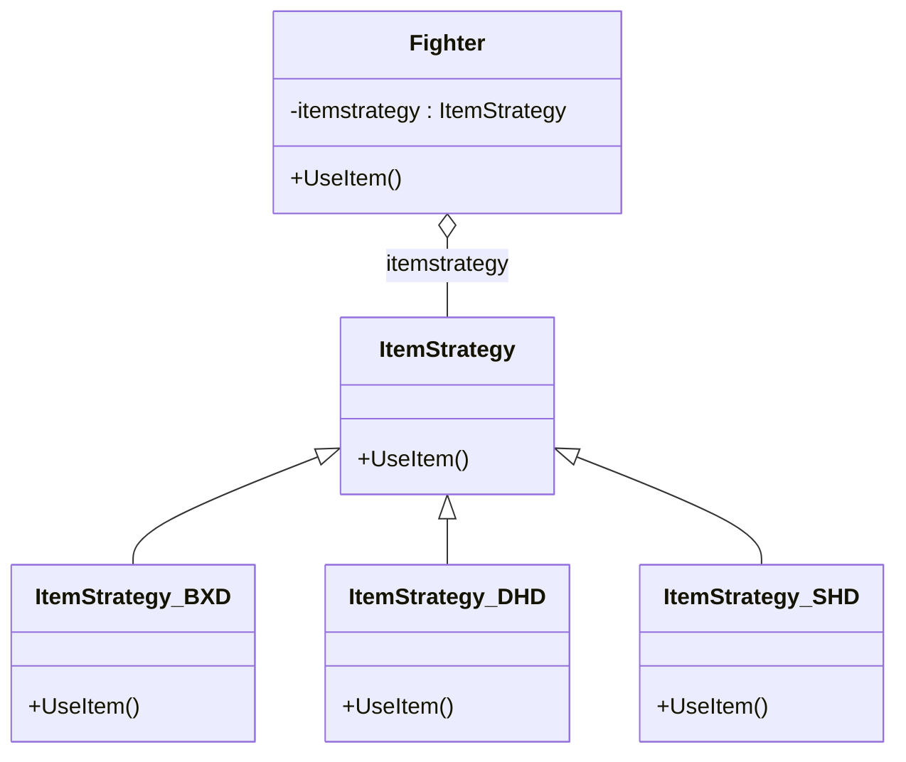

# 第 4 章 策略模式

&gt; 原书第 79–90 页 ｜ 本节内容：以"主角吃补血道具"范例的逐步重构讲解策略模式（Strategy），并引出依赖倒置原则（DIP）。

策略（Strategy）模式是一种行为型模式，其实现过程与模板方法模式非常类似——都是以扩展的方式支持未来的变化。本章通过对一个具体范例的逐步重构来详细讲解策略模式，在此基础之上，引出面向对象程序设计的一个重要原则——依赖倒置原则，并对该原则进行详细阐述。


## 4.1 一个具体实现范例的逐步重构

这里还是以前面提出的单机闯关打斗类游戏（类似街机打拳类游戏）为例继续进行讲解。

随着游戏研发工作的不断进行，游戏内容逐渐增多，策划准备引入为游戏主角补充生命值（补血）的道具，当主角走到某个特定的场景位置或者击杀某个大型怪物后，这些道具就会出现，主角通过走到该道具上就可以实现为自身补充生命值的目的。前期主要规划了 3 个道具（药品）：

（1）补血丹——可以补充 200 点生命值；

（2）大还丹——可以补充 300 点生命值；

（3）守护丹——可以补充 500 点生命值。

回忆前面讲解模板方法模式时，实现了游戏主角父类 Fighter 以及分别代表战士类型主角和法师类型主角的 F_Warrior 和 F_Mage 子类。为了看起来更接近一个真实项目，笔者把这 3 个类专门放入到新建立的 Fighter.h 文件中，并在 MyProject.cpp 的开头位置使用 `#include "Fighter.h"` 代码行将该文件包含进来。Fighter.h 文件的代码如下：

```cpp
#ifndef __FIGHTER__
#define __FIGHTER__

//战斗者父类
class Fighter
{
public:
    Fighter(int life, int magic, int attack) :m_life(life), m_magic(magic), m_attack(attack) {}
    virtual ~Fighter() {}

protected:
    int m_life;
    int m_magic;
    int m_attack;
};

//"战士"类，父类为 Fighter
class F_Warrior : public Fighter
{
public:
    F_Warrior(int life, int magic, int attack) :Fighter(life, magic, attack) {}
};

//"法师"类，父类为 Fighter
class F_Mage : public Fighter
{
public:
    F_Mage(int life, int magic, int attack) :Fighter(life, magic, attack) {}
};

#endif
```

根据策划需求，增加前述 3 个道具分别补充主角生命值，为此，可以在 Fighter 类中增加一个成员函数 UseItem 来处理通过吃药来补充生命值这件事。第一个版本这样来实现代码：首先，在类 Fighter 定义上面增加枚举类型的定义，其中的枚举值分别代表 3 个道具。

```cpp
//增加补充生命值道具
enum ItemAddlife
{
    LF_BXD,        //补血丹
    LF_DHD,        //大还丹
    LF_SHD,        //守护丹
};
```

接着，在 Fighter 类中实现 UseItem 成员函数：

```cpp
public:
    void UseItem(ItemAddlife djtype)        //吃药补充生命值
    {
        if (djtype == LF_BXD)               //道具类型：补血丹
        {
            m_life += 200;                  //补充200点生命值
        }
        else if (djtype == LF_DHD)          //大还丹
        {
            m_life += 300;                  //补充300点生命值
        }
        else if (djtype == LF_SHD)          //守护丹
        {
            m_life += 500;                  //补充500点生命值
        }
        //其他的一些判断逻辑，略...
    }
```

在 main 主函数中，增加如下代码：

```cpp
Fighter* prole_war = new F_Warrior(1000, 0, 200);    //这里没有采用工厂模式，如果主角很
                                                     //多，可以考虑采用工厂模式创建对象
prole_war->UseItem(LF_DHD);
delete prole_war;
```

从代码中可以看到，主角通过调用 UseItem 吃了一颗大还丹，为自己增加了 300 点生命值。从实现的功能上，上述代码本身没什么问题。但如果从长远角度或者从面向对象程序设计的角度来看，可能会发现这些实现代码存在一些问题：

（1）如果增加新的能补充生命值的道具（药），则要增加新的枚举类型，也要在 UseItem 中的 if…else… 语句中增加判断条件，这不符合开闭原则，而且一旦 if 条件特别多，对程序的运行效率和可维护性会造成影响。

（2）代码复用性差，如果将来游戏中的怪物也可以通过吃这些药为自己补充生命值，那么可能需要把 UseItem 中的这些判断语句复制到怪物类中去，甚至要把整个 UseItem 成员函数搬到怪物类中去，显然，这会导致很多重复的代码（代码级别的复制粘贴）。

（3）目前道具的功能比较简单，仅仅是给主角增加生命值，但如果将来道具功能特别复杂，例如能给主角同时增加生命值、魔法值，还能根据主角的角色和一些其他状态（例如主角中毒了）进行一些特殊的处理，甚至引入各种复杂功能的道具，那么上面的写法就会导致 UseItem 成员函数中的代码判断逻辑特别复杂，几乎可以肯定没人愿意看到下面这样的实现代码：

```cpp
if (djtype == LF_BXD)                //道具类型：补血丹
{
    m_life += 200;                   //补充200点生命值
    if (主角中毒了)
    {
        停止中毒状态，也就是主角吃药后就不再中毒
    }
    if (主角处于狂暴状态)
    {
        m_life += 400;               //额外再补充400点生命值
        m_magic += 200;              //魔法值也再补充200点
    }
    ...
}
```

通过策略模式，可以对上述代码进行改造。在策略模式中，可以把 UseItem 成员函数中的每个 if 条件分支中的代码（也称"算法"）写到一个个类中，那么每个封装了算法的类就可以称为一种策略（类不仅可以表示一种存在于真实世界的东西，也可以表示一种不存在于真实世界的东西），当然，应该为这些策略抽象出一个统一的父类以便实现多态。现在，看一看策略类父类及各个子类如何编写，专门创建一个 ItemStrategy.h 文件，代码如下：

```cpp
#ifndef __ITEMSTRATEGY__
#define __ITEMSTRATEGY__

//道具策略类的父类
class ItemStrategy
{
public:
    virtual void UseItem(Fighter* mainobj) = 0;
    virtual ~ItemStrategy() {}
};

//补血丹策略类
class ItemStrategy_BXD : public ItemStrategy
{
public:
    virtual void UseItem(Fighter* mainobj)
    {
        mainobj->SetLife(mainobj->GetLife() + 200);    //补充200点生命值
    }
};

//大还丹策略类
class ItemStrategy_DHD : public ItemStrategy
{
public:
    virtual void UseItem(Fighter* mainobj)
    {
        mainobj->SetLife(mainobj->GetLife() + 300);    //补充300点生命值
    }
};

//守护丹策略类
class ItemStrategy_SHD : public ItemStrategy
{
public:
    virtual void UseItem(Fighter* mainobj)
    {
        mainobj->SetLife(mainobj->GetLife() + 500);    //补充500点生命值
    }
};

#endif
```

从上面的代码中可以看到，UseItem 成员函数直接使用了 Fighter* 作为形参，意图是把主角所有必要的信息都传递到策略类中来，让策略类中的 UseItem 成员函数在需要时可以随时回调 Fighter 中的各种成员函数。这样做虽然策略类（ItemStrategy）和主角类（Fighter）耦合得比较紧密，但因为策略类的工作本身需要一些必要的数据（例如主角当前生命值、魔法值等），所以这样实现也未尝不可。

接着，需要对 Fighter.h 中的 Fighter 类进行改造，注释掉枚举类型的定义以及 UseItem 成员函数并增加如下代码行：

```cpp
public:
    void SetItemStrategy(ItemStrategy* strategy);    //设置道具使用的策略
    void UseItem();                                  //使用道具
    int GetLife();                                   //获取人物生命值
    void SetLife(int life);                          //设置人物生命值

private:
    ItemStrategy* itemstrategy = nullptr;            //C++11 中支持这样初始化
```

同时记得在 Fighter 类定义的前面位置增加针对类 ItemStrategy 的前向声明，因为 SetItemStrategy 的形参中用到了 ItemStrategy：

```cpp
class ItemStrategy;        //类前向声明
```

增加新文件 Fighter.cpp，并将该文件增加到当前的项目中。Fighter.cpp 的实现代码如下：

```cpp
#include <iostream>
#include "Fighter.h"
#include "ItemStrategy.h"
using namespace std;

//设置道具使用的策略
void Fighter::SetItemStrategy(ItemStrategy* strategy)
{
    itemstrategy = strategy;
}

//使用道具（吃药）
void Fighter::UseItem()
{
    itemstrategy->UseItem(this);
}

//获取人物生命值
int Fighter::GetLife()
{
    return m_life;
}

//设置人物生命值
void Fighter::SetLife(int life)
{
    m_life = life;
}
```

在 MyProject.cpp 的开头位置，增加如下 #include 语句：

```cpp
#include "ItemStrategy.h"
```

在 main 主函数中，注释掉原有代码，增加如下代码：

```cpp
//创建主角
Fighter* prole_war = new F_Warrior(1000, 0, 200);

//吃一颗大还丹
ItemStrategy* strategy = new ItemStrategy_DHD();      //创建大还丹策略
prole_war->SetItemStrategy(strategy);                 //主角设置大还丹策略，准备吃大还丹
prole_war->UseItem();                                 //主角吃大还丹

//再吃一颗补血丹
ItemStrategy* strategy2 = new ItemStrategy_BXD();     //创建补血丹策略
prole_war->SetItemStrategy(strategy2);                //主角设置补血丹策略，准备吃补血丹
prole_war->UseItem();                                 //主角吃补血丹

//释放资源
delete strategy;
delete strategy2;
delete prole_war;
```

跟踪调试程序不难发现，在吃了大还丹和补血丹后，主角的生命值已经从 1000 变成 1500 了。

从上面的代码中可以看到，通过引入策略模式，将算法（使用道具增加生命值这件事）本身独立到 ItemStrategy 的各个子类中，而不在 Fighter 类中实现。当增加新的道具时，只需要增加一个新的策略子类即可，这样就符合开闭原则了。

Fighter 类与 ItemStrategy 类相互作用实现指定的算法，当算法被调用时，Fighter 将算法需要的所有数据（这里其实是 Fighter 类对象自身）传递给 ItemStrategy，当然如果算法需要的数据比较少，则可以仅仅传递必需的数据（而不必将 Fighter 类对象本身传递给算法）。

引入"策略"设计模式的定义：定义一系列算法类（策略类），将每个算法封装起来，让它们可以相互替换。换句话说，策略模式通常把一系列算法封装到一系列具体策略类中作为抽象策略类的子类，然后根据实际需要使用这些子类。

针对前面的代码范例绘制策略模式的 UML 图，如图 4.1 所示。



*原书图 4.1（第 95 页）：*

在图 4.1 中，可以看到 Fighter 类和 ItemStrategy 类之间的关系是一种组合关系，因为在 Fighter 类定义中，有如下代码：

```cpp
ItemStrategy* itemstrategy = nullptr;
```

图 4.1 中的空心菱形在 Fighter 类这边，表示 Fighter 类中包含指向 ItemStrategy 类对象的指针（itemstrategy）作为成员变量。虚线下面框起来的部分代表注释。

策略模式的 UML 图中包含 3 种角色。

（1）Context（环境类）：也叫上下文类，是使用算法的角色，该类中维持着一个对抽象策略类的指针或引用。这里指 Fighter 类。

（2）Stategy（抽象策略类）〔原书如此，应为 Strategy〕：定义所支持的算法的公共接口，是所有策略类的父类。这里指 ItemStrategy 类。

（3）ConcreteStrategy（具体策略类）：抽象策略类的子类，实现抽象策略类中声明的接口。这里指 ItemStrategy_BXD、ItemStrategy_DHD、ItemStrategy_SHD 类。

策略模式具有如下优点：

（1）以往利用增加新的 if 条件分支来支持新算法的方式违背了开闭原则，引入策略模式后，通过增加新的策略子类实现了对开闭原则的完全支持，也就是以扩展的方式支持未来的变化。所以，如果读者今后在编写代码时遇到有多个 if 条件分支或者 switch 分支的语句，并且这些分支并不稳定、会经常改动时，则率先考虑能否通过引入策略模式加以解决。所以很多情况下，策略模式是 if 或者 switch 条件分支的取代者。

当然，如果 if 或者 switch 中的分支数量有限，而且比较稳定，例如一周七天、一年四季，这种情况下也没必要引入策略模式。例如，下面这种判断就没有必要引入策略模式：

```cpp
if (今天 == 春季) {}
else if (今天 == 夏季) {}
else if (今天 == 秋季) {}
else {}                                //这一定是冬季
```

（2）既然所有的算法都独立到策略类中去实现，这些算法就可以被复用。例如，将来其他的 Fighter 子类也可以使用，甚至如果 ItemStrategy 类和 Fighter 类耦合得并不紧密（ItemStrategy 类的 UseItem 成员函数不是以 Fighter* 类型作形参）的话，ItemStrategy 类也完全可以被 Monster（怪物）类使用来给怪物增加生命值。

（3）策略模式可以看成类继承的一种替代方案。当使用继承来定义类型时，子类一般会受限于父类（子类对象与父类对象之间是一个 is-a 关系，也就是子类对象同时也是一个父类对象，附录 A.3 中对 is-a 关系有详细的阐述，可以先行阅读），而使用策略模式，通过为环境类对象指定不同的策略就可以改变环境类对象的行为。

策略模式具有如下缺点：

（1）策略模式会导致引入许多新的策略类。

（2）使用策略时，调用者（也称客户端，这里指的就是 main 主函数中的代码）必须熟知所有策略类的功能并根据实际需要自行决定使用哪个策略类。

## 4.2 依赖倒置原则

通过对策略模式的讲解，引入面向对象程序设计的另外一个原则——依赖倒置原则（Dependency Inversion Principle，DIP）。

开发者普遍认为，面向对象程序设计的原则比设计模式本身更重要，遵循这些设计原则完全可以不局限于现有的二十多种常见设计模式，而是可以创造出新的设计模式。

依赖倒置原则贯穿于绝大部分设计模式，是一个非常重要的原则，是面向对象设计的主要实现方法，同时也是开闭原则的重要实现途径，该原则降低了客户与实现模块之间的耦合度。

依赖倒置原则是这样解释的：高层组件不应该依赖于低层组件（具体实现类），两者都应该依赖于抽象层。对于高层组件、低层组件、抽象层等词汇有的读者可能不太熟悉，这里笔者试举一例来说明。

继续前面的单机闯关打斗类游戏，在讲解简单工厂模式时，将怪物分成了亡灵类怪物（M_Undead）、元素类怪物（M_Element）和机械类怪物（M_Mechanic）。如果主角在闯关中要针对这 3 种怪物进行击杀，那么有的程序员可能会写出下面这样的代码，先定义 3 种怪物类：

```cpp
class M_Undead                 //亡灵类怪物
{
public:
    void getinfo()
    {
        cout << "这是一只亡灵类怪物" << endl;
    }
    //其他代码略...
};

class M_Element                //元素类怪物
{
public:
    void getinfo()
    {
        cout << "这是一只元素类怪物" << endl;
    }
    //其他代码略...
};

class M_Mechanic               //机械类怪物
{
public:
    void getinfo()
    {
        cout << "这是一只机械类怪物" << endl;
    }
    //其他代码略...
};
```

再定义一个战士主角类：

```cpp
//战士主角
class F_Warrior
{
public:
    void attack_enemy_undead(M_Undead* pobj)    //攻击亡灵类怪物
    {
        //进行攻击处理...
        pobj->getinfo();        //可以调用亡灵类怪物相关的成员函数
    }
    //其他代码略...
};
```

观察 F_Warrior 类的 attack_enemy_undead 成员函数，该成员函数的形参为 M_Undead*，这就是一种类与类之间的依赖关系——F_Warrior 类依赖于 M_Undead 类。

在 main 主函数中加入代码，让主角攻击一只亡灵类怪物：

```cpp
M_Undead* pobjud = new M_Undead();
F_Warrior* pobjwar = new F_Warrior();
pobjwar->attack_enemy_undead(pobjud);        //攻击一只亡灵类怪物
```

若让主角攻击一只元素类怪物，则需要为 F_Warrior 类增加一个新的成员函数：

```cpp
public:
    void attack_enemy_element(M_Element* pobj)    //攻击元素类怪物
    {
        //进行攻击处理...
        pobj->getinfo();        //可以调用元素类怪物相关的成员函数
    }
```

在 main 主函数中继续加入代码：

```cpp
M_Element* pobjelm = new M_Element();
pobjwar->attack_enemy_element(pobjelm);      //攻击一只元素类怪物
```

执行起来，看一看结果：

```text
这是一只亡灵类怪物
这是一只元素类怪物
```

当然，最后记得在 main 主函数中增加资源释放的代码：

```cpp
//资源释放
delete pobjwar;
delete pobjud;
delete pobjelm;
```

看这段 main 主函数中的代码，如果还要攻击一只机械类怪物，则需要为 F_Warrior 类增加新的成员函数，并且代码中涉及的类也会变得越来越多（F_Warrior、M_Undead、M_Element、M_Mechanic）。

main 主函数中这几行主角击杀怪物的业务逻辑代码就是高层组件，而 M_Undead、M_Element、M_Mechanic 都属于低层组件，也就是具体的实现类。高层组件与低层组件直接交互实现对怪物的击杀，组件之间的依赖关系如图 4.2 所示（箭头指向谁就依赖谁）。


针对击杀怪物这件事，如果设计一个 Monster 类作为所有怪物类（M_Undead、M_Element、M_Mechanic）的父类，那么 Monster 类代表的就是抽象层。下面为实现这个抽象层的代码：

```cpp
class Monster                 //作为所有怪物类的父类（抽象层）
{
public:
    virtual void getinfo() = 0;    //纯虚函数
    virtual ~Monster() {}          //作父类时析构函数应该为虚函数
};
```

重新实现低层组件（M_Undead、M_Element、M_Mechanic 类），让它们全部继承抽象层 Monster 类：

```cpp
class M_Undead : public Monster              //亡灵类怪物
{
public:
    virtual void getinfo()
    {
        cout << "这是一只亡灵类怪物" << endl;
    }
    //其他代码略...
};

class M_Element : public Monster             //元素类怪物
{
public:
    virtual void getinfo()
    {
        cout << "这是一只元素类怪物" << endl;
    }
    //其他代码略...
};

class M_Mechanic : public Monster            //机械类怪物
{
public:
    virtual void getinfo()
    {
        cout << "这是一只机械类怪物" << endl;
    }
    //其他代码略...
};
```

当然，也应该为 F_Warrior 这个战士主角类设计抽象层，在讲解模板方法模式时，已经这样做了，所以在这里读者可以自己动手为 F_Warrior 设计抽象层以作为对以往知识的复习，因为对怪物类抽象已经足以阐明依赖倒置原则，所以这里就不对 F_Warrior 类进行抽象了。

在对怪物类进行了抽象，产生了 Monster 类之后，在主角击杀各种怪物时，就可以把其中与击杀有关的 attack_enemy_undead、attack_enemy_element 等成员函数统一写成一个成员函数。改造之后的 F_Warrior 类代码如下：

```cpp
//战士主角
class F_Warrior
{
public:
    void attack_enemy(Monster* pobj)        //击杀怪物
    {
        //进行攻击处理...
        pobj->getinfo();        //可以调用怪物相关的成员函数
    }
    //其他代码略...
};
```

在 main 主函数中，注释掉原有代码，增加如下代码：

```cpp
Monster* pobjud = new M_Undead();
F_Warrior* pobjwar = new F_Warrior();
pobjwar->attack_enemy(pobjud);               //攻击一只亡灵类怪物

Monster* pobjelm = new M_Element();
pobjwar->attack_enemy(pobjelm);              //攻击一只元素类怪物

//资源释放
delete pobjwar;
delete pobjud;
delete pobjelm;
```

上面的代码组件之间的依赖关系如图 4.3 所示。


从图 4.3 可以看到，高层组件和低层组件之间不再有依赖关系，两者都依赖于抽象层（接口）。当然，诸如 main 主函数中下面这样的代码行：

```cpp
Monster* pobjud = new M_Undead();
```

虽然 new 后面用到了实现类 M_Undead，但这里所谈的依赖关系指的是 pobjud 的类型，也就是 Monster 类。所以，在 main 主函数中，对于要击杀怪物这个业务逻辑，实际上只涉及了 Monster 类（而图 4.2 中涉及的是 M_Undead、M_Element 两个类），即便日后增加新的怪物类型也不会导致依赖更多的类。

传统思考和解决问题的方式是自顶向下的结构化程序设计方法，这种设计方法往往在最后才会考虑低层组件的设计，而依赖倒置原则中的倒置是指以低层组件如何设计作为思考的入口来率先确定抽象层的设计，而后让高层组件和低层组件全部依赖于抽象层。

在学习了依赖倒置原则之后，结合图 4.1 思考一下讲解过的策略模式实现范例，不难想象，策略模式中将算法的实现放在各个策略子类（ItemStrategy_BXD、ItemStrategy_DHD、ItemStrategy_SHD）中，使用算法的 Fighter 类（也称为"环境类"，以表示使用算法的当前环境）只针对抽象策略类 ItemStrategy 进行编程，这种编码方式就符合依赖倒置原则。当增加一个新的补血道具时，可以增加一个新的策略子类来实现，这种编码方式同时也符合开闭原则。

依赖倒置原则是面向接口（抽象层）编程，而不是针对实现（实现类）编程，从而实现了高层组件和低层组件之间的解耦。
