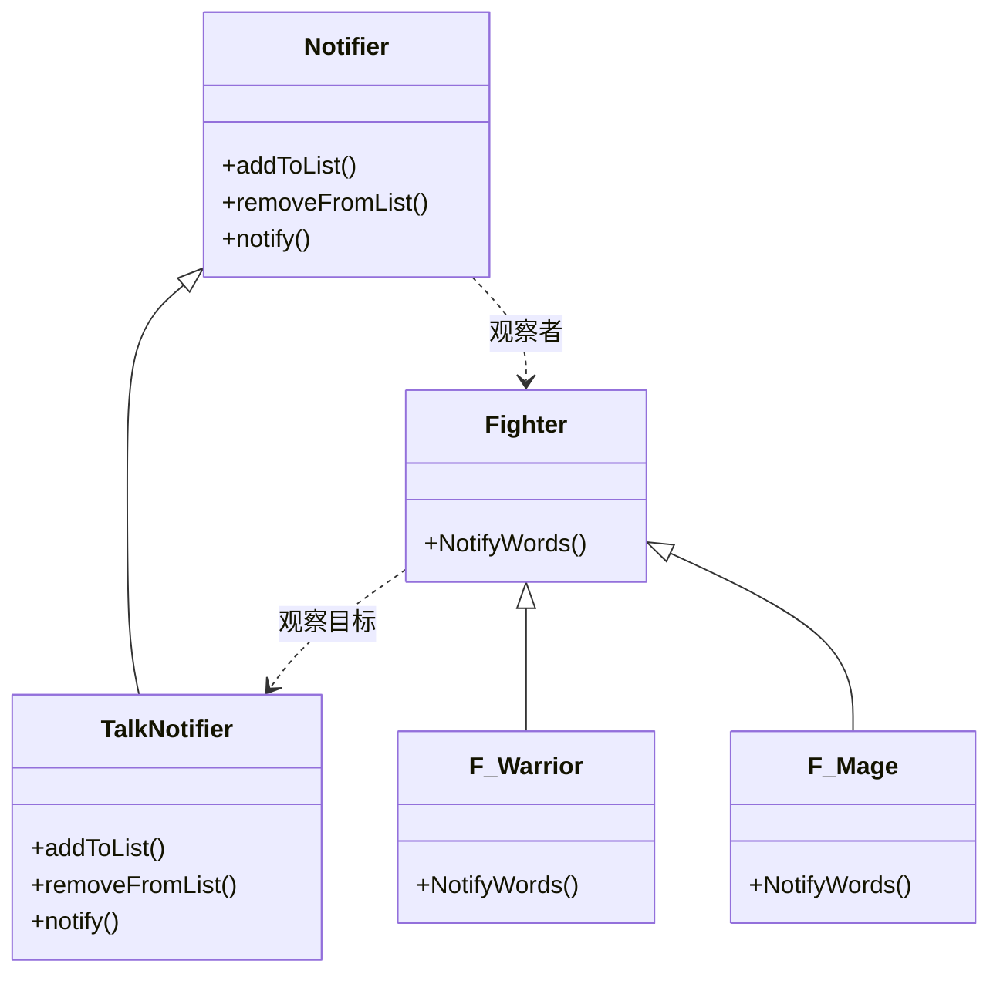
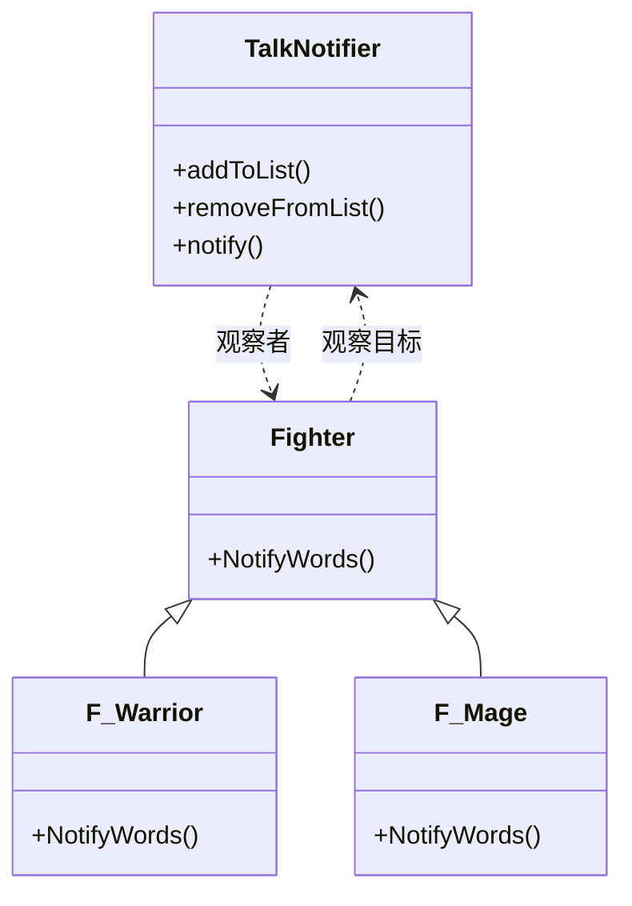

# 第 5 章 观察者模式

&gt; 原书第 91–101 页 ｜ 本节内容：以"家族成员聊天"功能从低效遍历到高效通知器的重构，引入观察者模式（Observer）的定义、UML 与应用联想。

在程序设计中，需要为某对象建立一种"通知依赖关系"，当该对象的状态发生变化时，通过公告或广播的方式通知一系列相关对象，实现对象之间的联动。但这种一对多的对象依赖关系往往又会造成该对象与其相关的一系列对象之间一种特别紧密的耦合关系。观察者（Observer）模式是一种使用频率较高的行为型设计模式，可以弱化上述的一对多依赖关系，实现对象之间关系的松耦合。观察者模式在工作中往往会在不知不觉中被用到。


## 5.1 一个遍历问题导致的低效率范例

A 公司开发的单机闯关打斗类游戏因为收益日渐减少，公司举步维艰。看到隔壁 B 公司开发的网络游戏做得风生水起，A 公司的老板决定将这款单机闯关打斗类游戏改造成类似于《魔兽世界》的大型多人角色扮演类游戏（网络游戏），以往单机游戏中的主角变成了游戏中的每个玩家。游戏本身是不收费的，但游戏中的各种道具（例如药品等）是要收费的。

这种对项目的改造要投入巨大的人力、物力以及时间成本，项目组又扩充了数名熟悉网络游戏开发的程序员。

某日，策划召集项目组全体人员开会增加新的游戏玩法，核心内容如下：

（1）为增加游戏收入，必须实现游戏中玩家群体之间的战争，因为战争会消耗游戏中的各种物资，例如补充生命值或补充魔法值的药品等。为此，引入"家族"概念，玩家可以自由加入某个家族，一个家族最多容纳 20 个玩家，不同家族的玩家之间可以根据游戏规则在指定时间和地点通过战斗获取利益。

（2）家族成员的聊天信息会被家族中的所有其他成员看到，当然，家族其他成员有权屏蔽家族的聊天信息。非本家族的玩家是看不到本家族成员聊天信息的。

策划要求程序率先实现家族成员聊天功能。于是，程序开始了第一版的开发工作，代码如下：

```cpp
//玩家父类（以往的战斗者父类）
class Fighter
{
public:
    Fighter(int tmpID, string tmpName) :m_iPlayerID(tmpID), m_sPlayerName(tmpName)    //构造函数
    {
        m_iFamilyID = -1;        //-1表示没加入任何家族
    }
    virtual ~Fighter() {}        //析构函数

public:
    void SetFamilyID(int tmpID)    //加入家族时设置家族ID
    {
        m_iFamilyID = tmpID;
    }

private:
    int m_iPlayerID;             //玩家ID，全局唯一
    string m_sPlayerName;        //玩家名字

    int m_iFamilyID;             //家族ID
};

//"战士"类玩家，父类为 Fighter
class F_Warrior : public Fighter
{
public:
    F_Warrior(int tmpID, string tmpName) :Fighter(tmpID, tmpName) {}    //构造函数
};

//"法师"类玩家，父类为 Fighter
class F_Mage : public Fighter
{
public:
    F_Mage(int tmpID, string tmpName) :Fighter(tmpID, tmpName) {}    //构造函数
};
```

从代码中可以看到，游戏中的每个玩家角色的父类依旧是 Fighter，角色仍然分为战士（F_Warrior）和法师（F_Mage）两种。

因为玩家在游戏中会创建很多家族，每个家族都用唯一的 ID 值（数字）来代表（在实际的游戏中，这些家族信息会被保存到数据库中）。Fighter 类中提供了成员函数 SetFamilyID，通过调用该函数设置某玩家的家族 ID 值以标记该玩家加入了该 ID 值所代表的家族。

还要引入一个全局的 list 容器，用来保存所有玩家的列表，以方便对玩家进行操作。在 Fighter 类定义的前面，增加如下代码：

```cpp
class Fighter;                     //类前向声明
list <Fighter*> g_playerList;      //在文件头增加 #include <list>
```

每个玩家来到游戏中之后，都需要加入这个列表中，后续代码会演示。

当一个玩家发送一条聊天信息时，同家族的其他玩家也应该收到这条聊天信息。在类 Fighter 中引入 SayWords 成员函数，表示某玩家说了一句话，在其中会调用 NotifyWords 成员函数把这条聊天信息发送给其他玩家。在 Fighter 类定义中加入如下代码：

```cpp
public:
    void SayWords(string tmpContent)         //玩家说了某句话
    {
        if (m_iFamilyID != -1)
        {
            //该玩家属于某个家族，应该把聊天内容信息传送给该家族的其他玩家
            for (auto iter = g_playerList.begin(); iter != g_playerList.end(); ++iter)
            {
                if (m_iFamilyID == (*iter)->m_iFamilyID)
                {
                    //同一个家族的其他玩家也应该收到聊天信息
                    NotifyWords((*iter), tmpContent);
                }
            }
        }
    }

private:
    void NotifyWords(Fighter* otherPlayer, string tmpContent)
                                             //其他玩家收到了当前玩家的聊天信息
    {
        //显示信息
        cout << "玩家：" << otherPlayer->m_sPlayerName << " 收到了玩家：" << m_sPlayerName
             << " 发送的聊天信息：" << tmpContent << endl;
    }
```

从代码中可以看到，当某个玩家说了一句话，那么只要是同一家族的玩家都可以收到这句话。在 main 主函数中加入如下测试代码：

```cpp
//创建游戏玩家
Fighter* pplayerobj1 = new F_Warrior(10, "张三");    //实际游戏中很多数据取自数据库
pplayerobj1->SetFamilyID(100);                       //假设该玩家所在的家族ID是100
g_playerList.push_back(pplayerobj1);                 //加入到全局玩家列表中

Fighter* pplayerobj2 = new F_Warrior(20, "李四");
pplayerobj2->SetFamilyID(100);
g_playerList.push_back(pplayerobj2);

Fighter* pplayerobj3 = new F_Mage(30, "王五");
pplayerobj3->SetFamilyID(100);
g_playerList.push_back(pplayerobj3);

Fighter* pplayerobj4 = new F_Mage(50, "赵六");
pplayerobj4->SetFamilyID(200);                       //赵六和前面三人属于两个不同的家族
g_playerList.push_back(pplayerobj4);

//某游戏玩家聊天，同族人都应该收到该信息
pplayerobj1->SayWords("全族人立即到沼泽地集结，准备进攻！");

//释放资源
delete pplayerobj1;
delete pplayerobj2;
delete pplayerobj3;
delete pplayerobj4;
```

执行起来，看一看结果：

```text
玩家：张三 收到了玩家：张三 发送的聊天信息：全族人立即到沼泽地集结，准备进攻！
玩家：李四 收到了玩家：张三 发送的聊天信息：全族人立即到沼泽地集结，准备进攻！
玩家：王五 收到了玩家：张三 发送的聊天信息：全族人立即到沼泽地集结，准备进攻！
```

从结果中可以看到，与张三同属一个家族的李四、王五（包括张三本人）都收到了张三发送过来的聊天信息，但因为赵六与这三个玩家不属于同一个家族，因此无法收到张三发送的聊天信息。

上面这段代码虽然实现了要求的功能，但是代码的运行效率并不高。试想：如果游戏中有上万个玩家，那么当玩家每说一句话时，Fighter 中的 SayWords 成员函数的 for 循环就要遍历上万个玩家并在其中找到相同家族的玩家来发送聊天信息。有没有什么手段可以让给相同家族的玩家发送聊天信息这件事变得更高效呢？

## 5.2 引入观察者模式

如果把隶属于某个家族的所有玩家收集到一个列表中，那么当该家族中的某个玩家发出一条聊天信息后，就只需要遍历该玩家所在家族的列表，并向列表中的所有玩家发送该玩家的聊天信息。因为一个家族最多容纳 20 个玩家，所以这个遍历最多循环 20 次，相比于在一万个玩家中遍历，效率高得多。注释掉原有代码，重新用以下代码来实现原来的功能：

```cpp
class Fighter;                                    //类前向声明
class Notifier                                    //通知器父类
{
public:
    virtual void addToList(Fighter* player) = 0;              //把要被通知的玩家加到列表中
    virtual void removeFromList(Fighter* player) = 0;         //把不想被通知的玩家从列表中去除
    virtual void notify(Fighter* talker, string tmpContent) = 0;    //通知的一些细节信息
    virtual ~Notifier() {}
};

class Fighter
{
public:
    Fighter(int tmpID, string tmpName) :m_iPlayerID(tmpID), m_sPlayerName(tmpName)    //构造函数
    {
        m_iFamilyID = -1;                    //-1表示没加入任何家族
    }
    virtual ~Fighter() {}                    //析构函数

public:
    void SetFamilyID(int tmpID)              //加入家族时设置家族ID
    {
        m_iFamilyID = tmpID;
    }
    int GetFamilyID()                        //获取家族ID
    {
        return m_iFamilyID;
    }

    void SayWords(string tmpContent, Notifier* notifier)      //玩家说了某句话
    {
        notifier->notify(this, tmpContent);
    }

    //通知该玩家接收到其他玩家发送来的聊天信息，这是虚函数，子类可以覆盖该虚函数以实现
    //不同的动作
    virtual void NotifyWords(Fighter* talker, string tmpContent)
    {
        //显示信息
        cout << "玩家：" << m_sPlayerName << " 收到了玩家：" << talker->m_sPlayerName
             << " 发送的聊天信息：" << tmpContent << endl;
    }

private:
    int m_iPlayerID;                         //玩家ID，全局唯一
    string m_sPlayerName;                    //玩家名字

    int m_iFamilyID;                         //家族ID
};

//"战士"类玩家，父类为 Fighter
class F_Warrior : public Fighter
{
public:
    F_Warrior(int tmpID, string tmpName) :Fighter(tmpID, tmpName) {}    //构造函数
};

//"法师"类玩家，父类为 Fighter
class F_Mage : public Fighter
{
public:
    F_Mage(int tmpID, string tmpName) :Fighter(tmpID, tmpName) {}    //构造函数
};

//----------------------------------------------
class TalkNotifier : public Notifier             //聊天信息通知器
{
public:
    //将玩家增加到家族列表中来
    virtual void addToList(Fighter* player)
    {
        int tmpfamilyid = player->GetFamilyID();
        if (tmpfamilyid != -1)                   //加入了某个家族
        {
            auto iter = m_familyList.find(tmpfamilyid);
            if (iter != m_familyList.end())
            {
                //该家族ID在map中已经存在
                iter->second.push_back(player);            //直接把该玩家加入到该家族
            }
            else
            {
                //该家族ID在map中不存在
                list<Fighter*> tmpplayerlist;
                m_familyList.insert(make_pair(tmpfamilyid, tmpplayerlist));
                                            //以该家族ID为key，增加条目到map中
                m_familyList[tmpfamilyid].push_back(player);    //向该家族中增加第一个玩家
            }
        }
    }

    //将玩家从家族列表中删除
    virtual void removeFromList(Fighter* player)
    {
        int tmpfamilyid = player->GetFamilyID();
        if (tmpfamilyid != -1)                   //加入了某个家族
        {
            auto iter = m_familyList.find(tmpfamilyid);
            if (iter != m_familyList.end())
            {
                m_familyList[tmpfamilyid].remove(player);
            }
        }
    }

    //家族中某玩家说了句话，调用该函数来通知家族中所有人
    virtual void notify(Fighter* talker, string tmpContent)       //talker是讲话的玩家
    {
        int tmpfamilyid = talker->GetFamilyID();
        if (tmpfamilyid != -1)
        {
            auto itermap = m_familyList.find(tmpfamilyid);
            if (itermap != m_familyList.end())
            {
                //遍历该玩家所属家族的所有成员
                for (auto iterlist = itermap->second.begin(); iterlist != itermap->second.end(); ++iterlist)
                {
                    (*iterlist)->NotifyWords(talker, tmpContent);
                }
            }
        }
    }

private:
    //map中的key表示家族ID，value代表该家族中所有玩家列表
    map<int, list<Fighter*>> m_familyList;        //增加 #include <map>
};
```

在 main 主函数中，注释掉原有代码，增加如下代码：

```cpp
//创建游戏玩家
Fighter* pplayerobj1 = new F_Warrior(10, "张三");
pplayerobj1->SetFamilyID(100);

Fighter* pplayerobj2 = new F_Warrior(20, "李四");
pplayerobj2->SetFamilyID(100);

Fighter* pplayerobj3 = new F_Mage(30, "王五");
pplayerobj3->SetFamilyID(100);

Fighter* pplayerobj4 = new F_Mage(50, "赵六");
pplayerobj4->SetFamilyID(200);

//创建通知器
Notifier* ptalknotify = new TalkNotifier();

//玩家增加到家族列表中来，这样才能收到家族聊天信息
ptalknotify->addToList(pplayerobj1);
ptalknotify->addToList(pplayerobj2);
ptalknotify->addToList(pplayerobj3);
ptalknotify->addToList(pplayerobj4);

//某游戏玩家聊天，相同家族的人都应该收到该信息
pplayerobj1->SayWords("全族人立即到沼泽地集结，准备进攻！", ptalknotify);

cout << "王五不想再收到家族其他成员的聊天信息了 --- " << endl;
ptalknotify->removeFromList(pplayerobj3);            //将王五从家族列表中删除

pplayerobj2->SayWords("请大家听从族长的调遣，前往沼泽地！", ptalknotify);

//释放资源
delete pplayerobj1;
delete pplayerobj2;
delete pplayerobj3;
delete pplayerobj4;
delete ptalknotify;
```

执行起来，看一看结果：

```text
玩家：张三 收到了玩家：张三 发送的聊天信息：全族人立即到沼泽地集结，准备进攻！
玩家：李四 收到了玩家：张三 发送的聊天信息：全族人立即到沼泽地集结，准备进攻！
玩家：王五 收到了玩家：张三 发送的聊天信息：全族人立即到沼泽地集结，准备进攻！
王五不想再收到家族其他成员的聊天信息了 ---
玩家：张三 收到了玩家：李四 发送的聊天信息：请大家听从族长的调遣，前往沼泽地！
玩家：李四 收到了玩家：李四 发送的聊天信息：请大家听从族长的调遣，前往沼泽地！
```

上面的代码同样实现了家族中一个人说话时，全家族的人都能看到聊天信息，同时也实现了不看家族其他人聊天信息的功能。

代码的实现并不复杂，将属于同一个家族的玩家放到一个 list 容器中，当该家族中的某个玩家说话时，通过遍历 list 容器将说话内容广播给该家族中的每个玩家。

当家族中某人说话时，main 中函数的调用关系大概如下（缩进 4 个字符的写法表示上面一行调用下面一行）：

```text
(i) pplayerobj1->SayWords("全族人立即到沼泽地集结，准备进攻！", ptalknotify);
(i)     notifier->notify(this, tmpContent);
(i)         int tmpfamilyid = talker->GetFamilyID();
(i)         auto itermap = m_familyList.find(tmpfamilyid);
(i)             for (auto iterlist = itermap->second.begin(); iterlist != itermap->second.end();
                     ++iterlist)                                    //遍历list容器
(i)                 (*iterlist)->NotifyWords(talker, tmpContent);
(i)                     cout << "玩家：" << m_sPlayerName << " 收到了玩家：" << talker->m_sPlayerName
                             << " 发送的聊天信息：" << tmpContent << endl;
```

上述范例实现了一个联动的动作：家族中某个玩家说话（SayWords）→ 触发通知器的通知机制（notify）→ 通知器通知每个家族中的人（NotifyWords）。

引入"观察者"设计模式的定义（实现意图）：定义对象间的一种一对多的依赖关系，当一个对象的状态发生改变时，所有依赖于它的对象都会自动得到通知。解释如下：

（1）对象之间是指 Notifier 类对象与 Fighter 类对象，也就是通知器类对象与玩家类对象之间。

（2）一对多的依赖关系是指一个通知器对应多个玩家，换句话说，就是多个玩家都依赖于该通知器，这些玩家处于同一家族中，甚至可以根据策划需求将不同家族的人也加入进来。

（3）当通知器类对象的状态发生改变时，所有依赖于这个通知器对象的玩家类对象都会收到说话内容，程序开发人员可以将说话内容显示到同一家族各个成员所代表玩家的游戏界面上。通知器类对象的状态改变也可以与玩家类对象无关。例如，通知器类对象状态的改变来自系统公告或来自游戏管理员主动发送的信息，而不是来自某个玩家说话。换句话说，玩家类对象也许无法知道通知器类对象的状态是如何发生变化的，只是知道了通知器类对象状态发生了变化这件事。

（4）所有的玩家都是"观察者"，观察目标（被观察对象）就是"通知器"。观察者实际上是被动地得到通知而不是主动去观察。所以，该模式中的"观察者"这 3 个字听起来并不是那么合适。

要进一步加深对该模式理解，通常会利用十字路口交通灯的例子进行说明。

十字路口通常都有交通信号灯，无论是行人还是车辆，都需要通过观察信号灯并依据绿灯走、红灯停的规则来决定是否通行。在这里，行人或者车辆就是观察者，而观察目标就是交通信号灯。交通信号灯与行人或车辆之间是一对多的依赖关系，因为一盏交通信号灯可以控制众多的行人或车辆。

针对前面的代码范例绘制观察者模式的 UML 图，如图 5.1 所示。



*原书图 5.1（第 110 页）：*

图 5.1 中的虚线箭头表示连接的两个类之间存在着依赖关系（一个类引用另一个类）。Notifier 和 Fighter 类属于稳定部分，而 TalkNotifier 类和 F_Warrior、F_Mage 类属于变化部分。

也可以不单独对通知器进行抽象，这主要取决于实际项目的需要，由程序员灵活决定。如果不单独对通知器进行抽象，则观察者模式的 UML 图可能如图 5.2 所示。



*原书图 5.2（第 110 页）：*

"观察者"设计模式也叫作"发布-订阅（Publish-Subscribe）"设计模式，如果用最通俗易懂的语言来描述，应该是这样：观察者（Fighter 子类）提供一个特定的成员函数（NotifyWords），并把自己加入到通知器（Notifier 子类）的一个对象列表中（订阅/注册），当通知器意识到有事件发生的时候，通过遍历对象列表找到每个观察者并调用观察者提供的特定成员函数（发布）来达到通知观察者某个事件到来的目的。观察者可以在特定的成员函数（NotifyWords）中编写实现代码来实现收到通知后想做的事情。

传统观点认为，观察者模式的 UML 图中包含 4 种角色。

（1）Subject（主题）：也叫作观察目标，指被观察的对象。这里指 Notifier 类。提供增加和删除观察者对象的接口（addToList、removeFromList）。

（2）ConcreteSubject（具体主题）：维护一个观察者列表，当状态发生改变时，调用 notify 向各个观察者发出通知。这里指 TalkNotifier 子类。

（3）Observer（观察者）：当被观察的对象状态发生变化时候，观察者自身会收到通知。这里指 Fighter 类。

（4）ConcreteObserver（具体观察者）：调用观察目标的 addToList 成员函数将自身加入到观察者列表中，当具体目标状态发生变化时自身会接到通知（NotifyWords 成员函数会被调用）。这里指 F_Warrior、F_Mage 子类。

图 5.3 展示了观察者模式下的角色关系图。


在图 5.3 中，主题的状态一旦发生变化，观察者就会被通知，观察者自然就可以借此通知来更新自身。

观察者模式具有如下特点：

（1）在观察者和观察目标之间建立了一个抽象的耦合（松耦合，即耦合度比较低）。观察目标只需要维持一个抽象的观察者列表，并不需要了解具体的观察者类。改变观察者和观察目标的一方，只要调用接口不发生改变，就不会影响另外一方。松耦合的双方都依赖抽象而不是具体类，满足依赖倒置原则。

（2）观察目标会向观察者列表中的所有观察者发送通知（而不是让观察者不断向观察目标查询状态的变化），从而简化一对多系统的设计难度。

（3）可以通过增加代码的方式来增加新的观察者或观察目标，满足开闭原则。

## 5.3 应用联想

本章针对观察者模式虽然只举了一个具体的范例，但实际上观察者模式的应用范围比较广泛，读者应该发挥想象力并举一反三。

（1）在前面的范例中，实现了家族中的一个人说话，家族中的其他人都能看到该人的聊天信息。此功能可以类推，例如家族的一个人受到了敌人的攻击，可以通知家族其他人以便前去救援。在国产游戏《征途》中，当家族成员运送的镖车被敌人攻击时，本家族的其他成员就会收到通知，单击通知中的"前往"按钮就可以瞬间出现在镖车被攻击的地方，通过直接攻击敌人来救援家族成员的镖车。

（2）设想一个门户网站，该网站会长期对大量用户的阅读习惯进行追踪，有些用户对国际新闻感兴趣，有些用户对娱乐明星感兴趣，有些用户对摄影美食感兴趣等。每个用户都被看作是一个观察者，而诸如国际新闻、娱乐明星、摄影美食可被看作是观察目标，当出现观察者感兴趣的观察目标时，例如撰写了一篇美食类的新闻，就可以利用观察者模式把这篇新闻推送给对摄影美食感兴趣的用户。

（3）设想一种场景，某公司手中掌握着今年该公司的详细产品销售数据，现在要求分别用饼图、柱状图、折线图来表现这些数据。在此场景中，饼图、柱状图、折线图就是观察者，而该公司的详细产品销售数据就是观察目标。如果观察目标的数据发生了变化，就要同时通知这几个观察者，观察者收到状态变化的通知后，就需要通过改变自身绘制的图形来真实地反映公司的销售数据。

（4）在一款射击类网络游戏中，游戏场景内有一个炮楼，炮楼会监视游戏中玩家与自身的距离，当距离小于 30 米时，炮楼就会主动向玩家射击。在这种情形下，玩家就是观察者，炮楼就是观察目标，炮楼会随时维持一份 30 米内的玩家列表，因玩家在不停地奔跑移动中，所以该列表随时都在发生变化（新的观察者可能随时被加入进来，已有的观察者也可能随时被移除出去），炮楼只会对这个列表中的玩家进行攻击。
