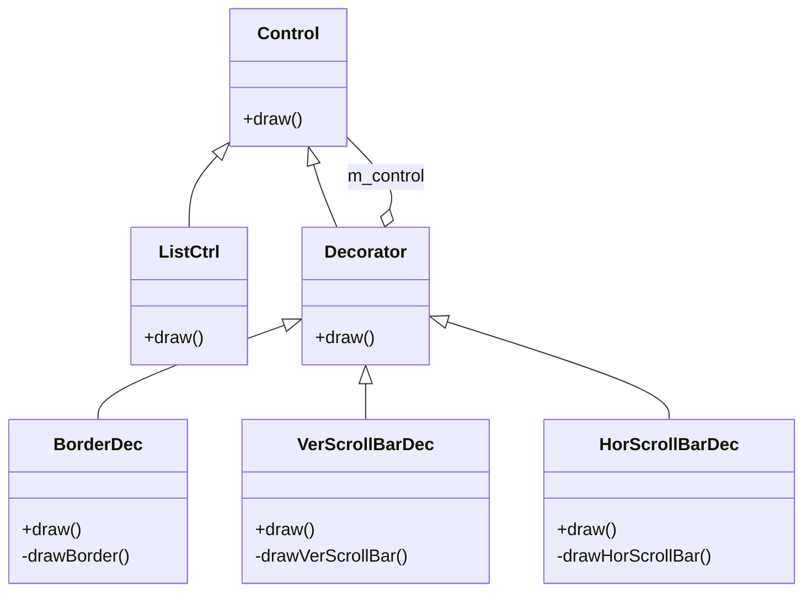
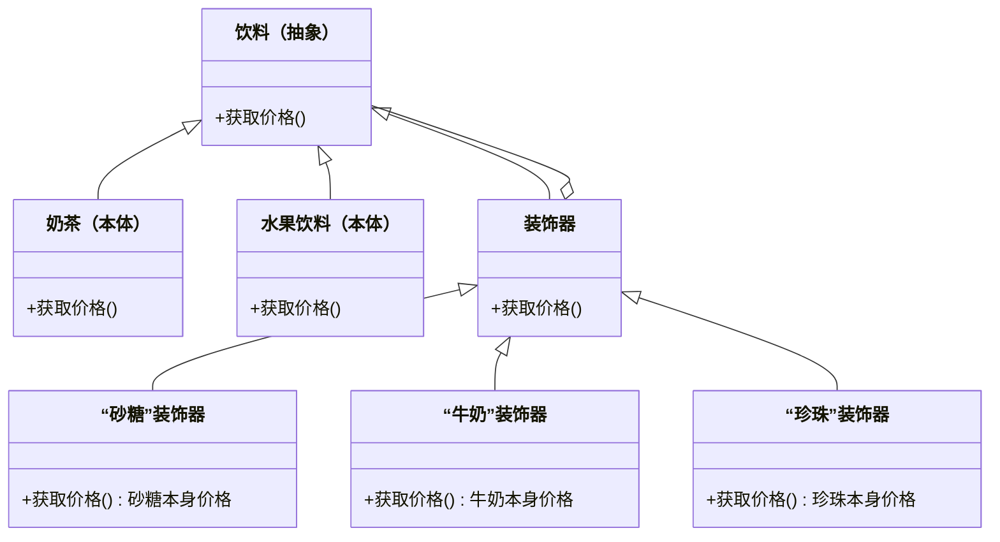

# 第 6 章 装饰模式

&gt; 原书第 102–112 页 ｜ 本节内容：以列表控件与水果饮料两个范例讲解装饰模式（Decorator），并引出组合复用原则（CRP）。

装饰（Decorator）模式也称为装饰器模式/包装模式，是一种结构型模式。这是一个非常有趣和值得学习的设计模式，该模式展现出了运行时的一种扩展能力，以及比继承更强大和灵活的设计视角和设计能力，甚至在有些场合下，不使用该模式很难解决问题。

在本模式的讲解过程中，会提及类与类之间的继承关系和组合关系，还会引出面向对象程序设计的一个重要原则——组合复用原则。


## 6.1 问题的提出

继续前面的闯关打斗类游戏。在游戏中，不但会出现各种人物、怪物，还会出现许多 UI（用户接口）界面。例如，主角一般会随身携带背包，背包中的每个格子用于放置一个物品，根据策划的规定，背包中格子数量比较多时，还会在背包右侧显示出滚动条，如图 6.1 所示。


再例如，有时需要显示一些公告信息，如图 6.2 所示。当公告信息太长时，也可能会出现滚动条等。


图 6.1 和图 6.2 这些看得见的 UI 界面元素称为控件。例如，要向其中输入文字可以使用文本控件，要显示多行信息可以使用列表控件等，当要显示的内容过长或者过宽时会显示出滚动条控件。

这里就以一个最简单的控件——列表控件为例，说明如何丰富该控件上所显示的内容，图 6.3 中第 1 幅子图是一个普通的列表控件，第 2 幅图增加了边框让其更有立体感，第 3 幅图增加了一个垂直滚动条，而第 4 幅图又增加了一个水平滚动条。

*原书图 6.3（第 114 页）：先后为普通列表控件增加边框、垂直滚动条、水平滚动条后的效果（第 2–4 幅子图）*


现在，希望在游戏中将上述这几个列表控件绘制出来（绘制工作一般会调用 DirectX 或者 OpenGL 绘制接口，细节不用关心）。读者都知道，使用继承机制是添加新功能或者特性的一种有效途径，子类通过继承父类并增加新的成员函数就可以增加新的功能。所以，传统的绘制方法可能如下：

（1）创建一个名字叫作 ListCtrl 的类代表普通列表控件，提供 draw 方法绘制自身。

（2）创建一个名字叫作 BorderListCtrl 的类，继承自 ListCtrl 类，用于表示增加了边框的列表控件，提供 draw 方法绘制自身。

（3）创建一个名字叫作 VerScBorderListCtrl 的类，继承自 BorderListCtrl，用于表示增加了边框又增加了垂直滚动条的列表控件，提供 draw 方法绘制自身。

（4）创建一个名字叫作 HorScVerScBorderListCtrl 的类，继承自 VerScBorderListCtrl，用于表示增加了边框又增加了垂直滚动条和水平滚动条的列表控件，提供 draw 方法绘制自身。

考虑下面两个问题：

（1）如果还需要给这个列表控件增加一些新的内容，例如增加阴影效果、外发光效果等，则需要不断地创建各种子类。

（2）如果希望创建一个没有边框但有垂直滚动条的列表控件，或者创建一个只有水平滚动条（没有边框，没有垂直滚动条）的列表控件，依然还是要继续创建更多的子类。

上面这两个问题都会导致子类数量的泛滥，灵活性也非常差，所以，采用继承机制创建子类来解决列表控件的绘制显然不是一个好的解决方案，换一种思路，可以采用组装的方式来解决该问题：

（1）首先创建一个名字叫作 ListCtrl 的类代表普通列表控件（最基本的列表控件），提供 draw 方法绘制自身。

（2）如果给这个普通的列表控件增加一个边框（看成是增加一种功能或者是一个装饰），则形成了一个带边框的列表控件。

（3）同理，如果给这个普通的列表控件增加一个垂直滚动条，则形成了一个带垂直滚动条的列表控件，再给这个带垂直滚动条的列表控件增加一个水平滚动条，又形成了一个既带垂直滚动条又带水平滚动条的列表控件，如图 6.4 所示。


（4）总之，通过增加不同的装饰，最终可以生成不同的列表控件。

上述通过增加装饰来组装新列表控件的方式非常灵活，可以组装出各种各样的列表控件，例如将边框组装到普通列表控件上，就会形成带有边框的列表控件；再将水平滚动条组装到这个带有边框的列表控件上，就会立即形成带有边框和水平滚动条的列表控件。这种通过组装方式将一个类的功能不断增强的思想（动态的增加新功能），就是装饰模式核心的设计思想。后续将给出实际的代码，在此之前，还需要掌握类之间的继承关系和组合关系相关知识，请读者率先阅读附录 A.3 到 A.3.1 之间的内容以及附录 A.4.1 对于 has-a 关系和 is-implemented-in-terms-of 关系的介绍。

## 6.2 引入装饰模式

首先引入组合复用原则（Composite Reuse Principle，CRP），该原则也称为合成复用原则/聚合复用原则，是面向对象程序设计的一个重要原则。

组合复用原则的核心思想是：若两个类使用继承进行设计（一个类是另一个类的子类），则父类代码的修改可能会影响子类的行为，而且，可能父类中的很多方法子类是用不上的，这显然是一种浪费。而若使用组合进行设计，则可以大大减弱两个类之间的依赖关系，也不会存在因继承关系而导致的浪费行为。所以如果继承和组合都能达到设计目的，那么优先考虑使用组合（组合优于继承）。在接下来的代码设计中，将充分利用组合复用原则。

针对前面提出的列表控件，这里将采用装饰模式进行设计，请仔细阅读实现代码。首先创建一个抽象的控件类：

```cpp
//抽象的控件类
class Control
{
public:
    virtual void draw() = 0;        //draw方法，用于将自身绘制到屏幕上
public:
    virtual ~Control() {}           //作父类时析构函数应该为虚函数
};
```

上面提到的列表控件 ListCtrl 以及其他控件，例如文本控件 TextCtrl 等，应该作为抽象控件的子类，也就是作为具体控件，这里以列表控件作为具体控件的代表，创建 ListCtrl 类：

```cpp
//列表控件类
class ListCtrl : public Control
{
public:
    virtual void draw()
    {
        cout << "绘制普通的列表控件！" << endl;    //具体可以用 DirectX 或 OpenGL 来绘制
    }
};
```

接着，装饰器类就要上场了，这是一个抽象的装饰器类（用于作具体装饰器的父类），其中有很多需要说明的内容，先将代码实现如下：

```cpp
//抽象的装饰器类
class Decorator : public Control
{
public:
    Decorator(Control* tmpctrl) :m_control(tmpctrl) {}    //构造函数
    virtual void draw()
    {
        m_control->draw();        //虚函数，调用的是哪个draw取决于m_control指向的对象
    }

private:
    Control* m_control;           //需要被装饰的其他控件，这里用的是父类指针 Control *
};
```

针对上面的代码，有以下几点说明：

（1）抽象装饰器类（Decorator 类）的父类依旧是 Control 类，这可能会造成一些理解上的困扰。试想，一个普通的列表控件经过装饰器装饰后生成一个新的列表控件（例如带边框的列表控件），该列表控件仍然要绘制自己，所以要有 draw 方法，因此，这个抽象的装饰器类会继承自 Control。从另外一个角度来理解，根据 public 继承的 is-a 特性，经过装饰器装饰过的列表控件依旧是列表控件（不要把装饰器单纯理解成装饰器，而是理解成经过包装之后的新控件），所以抽象装饰器类继承自 Control 类也合乎情理。

（2）Decorator 类中有一个 m_control 成员变量，其类型是 Control 类型的指针，Control 同时作为 Decorator 类的父类，所以从这个角度来讲，Decorator 类与 Control 类又是一种组合关系。

（3）构造函数的形参也是 Control 类型的指针，代表的当然是被装饰的控件。

（4）虚函数 draw 中的"m_control-&gt;draw();"调用的是哪个类的 draw 取决于 m_control 指向的是哪个对象。

完成抽象装饰器类后，就可以把前面谈到的除普通列表控件本体之外的其他附属控件，例如边框、滚动条等都作为具体装饰器类来实现，代码如下：

```cpp
//具体的"边框"装饰器类
class BorderDec : public Decorator
{
public:
    BorderDec(Control* tmpctrl) :Decorator(tmpctrl) {}    //构造函数
    virtual void draw()
    {
        Decorator::draw();        //调用父类的draw方法以保持以往已经绘制出的内容
        drawBorder();             //也要绘制自己的内容
    }

private:
    void drawBorder()
    {
        cout << "绘制边框！" << endl;
    }
};

//具体的"垂直滚动条"装饰器类
class VerScrollBarDec : public Decorator
{
public:
    VerScrollBarDec(Control* tmpctrl) :Decorator(tmpctrl) {}    //构造函数
    virtual void draw()
    {
        Decorator::draw();        //调用父类的draw方法以保持以往已经绘制出的内容
        drawVerScrollBar();       //也要绘制自己的内容
    }

private:
    void drawVerScrollBar()
    {
        cout << "绘制垂直滚动条！" << endl;
    }
};

//具体的"水平滚动条"装饰器类
class HorScrollBarDec : public Decorator
{
public:
    HorScrollBarDec(Control* tmpctrl) :Decorator(tmpctrl) {}    //构造函数
    virtual void draw()
    {
        Decorator::draw();        //调用父类的draw方法以保持以往已经绘制出的内容
        drawHorScrollBar();       //也要绘制自己的内容
    }

private:
    void drawHorScrollBar()
    {
        cout << "绘制水平滚动条！" << endl;
    }
};
```

在 main 主函数中，增加如下代码来创建两个列表控件：一个列表控件既带边框又带垂直滚动条；另一个列表控件只带水平滚动条。

```cpp
//(1)创建一个既带边框，又带垂直滚动条的列表控件
//首先绘制普通的列表控件
Control* plistctrl = new ListCtrl();
//plistctrl->draw();                //这里先不绘制了

//接着"借助普通的列表控件"，可以通过边框装饰器绘制出一个"带边框的列表控件"
Decorator* plistctrl_b = new BorderDec(plistctrl);    //注意形参，是普通列表控件，这里类型用
                                                      //Control* 而不用 Decorator* 也是可以的
//plistctrl_b->draw();

//接着"借助带边框的列表控件"，可以通过垂直滚动条装饰器绘制出一个"既带垂直滚动条又带边框
//的列表控件"
Decorator* plistctrl_b_v = new VerScrollBarDec(plistctrl_b);    //注意形参，是带边框的列表控件
plistctrl_b_v->draw();                //这里完成最终绘制

cout << "------------------------------ " << endl;
//(2)创建一个只带水平滚动条的列表控件
//首先绘制普通的列表控件
Control* plistctrl2 = new ListCtrl();
//plistctrl2->draw();                //这里先不绘制了

//接着借助普通的列表控件，通过水平滚动条装饰器绘制出一个"带水平滚动条的列表控件"
Decorator* plistctrl2_h = new HorScrollBarDec(plistctrl2);    //注意形参是普通列表控件
plistctrl2_h->draw();                 //这里完成最终绘制

//(3)释放资源
delete plistctrl_b_v;
delete plistctrl_b;
delete plistctrl;

delete plistctrl2_h;
delete plistctrl2;
```

执行起来，看一看结果：

```text
绘制普通的列表控件！
绘制边框！
绘制垂直滚动条！
------------------------------
绘制普通的列表控件！
绘制水平滚动条！
```

上面的代码比较长，但总结起来，只绘制了两个控件：一个既带边框又带垂直滚动条的列表控件；另一个只带水平滚动条的列表控件。

不妨回顾一下创建既带边框又带垂直滚动条的列表控件的过程：

（1）首先要创建一个普通的列表控件 plistctrl。

（2）借助这个普通的列表控件，才能进一步创建出带边框的列表控件，但应注意，普通的列表控件和带边框的列表控件是两个对象，分别用 plistctrl 和 plistctrl_b 代表，不要混为一谈。

（3）借助带边框的列表控件 plistctrl_b，才能更进一步创建出既带垂直滚动条又带边框的列表控件 plistctrl_b_v，最终调用 draw 方法将该控件绘制出来。也就是说，控件创建的整个过程中，每一步都要利用上一步的成果（对控件本体进行层层装饰），在上一步成果的基础之上继续进行创建。最终创建完毕后，就可以绘制出"既带垂直滚动条又带边框的列表控件"，而在这个过程中，创建出 3 个 Control* 类型的指针 plistctrl、plistctrl_b、plistctrl_b_v，最终进行资源释放的时候，不要遗漏。

针对前面的代码范例绘制装饰模式的 UML 图，如图 6.5 所示。



*原书图 6.5（第 119 页）：*

图 6.5 中的虚线右侧框起来的部分代表注释。类 Control 与类 Decorator 既是继承关系又是组合关系（装饰模式的一大主要特征）。对于组合关系来说，图 6.5 中的空心菱形在 Decorator 类这边，表示 Decorator 类中包含 Control 类的对象指针（m_control）作为成员变量。ListCtrl 代表着列表控件这个主体类，而其他继承自 Decorator 的子类都是装饰器类。

读者可以参考 ListCtrl 实现其他各种主体类，例如实现文本控件 TextCtrl 类，并且也可以将各种装饰器类作用于 TextCtrl 之上，构成诸如"带水平滚动条的文本控件"。

引入"装饰"设计模式的定义（实现意图）：动态地给一个对象添加一些额外的职责。就增加功能来说，该模式相比生成子类更加灵活。

装饰模式的 UML 图中包含 4 种角色。

（1）Control（抽象构件）：是具体构件 ListCtrl 和抽象装饰器类 Decorator 的共同父类，其中定义了必需的接口（draw），用来实现必需的业务。其引入的目的是让调用者（也称客户端，这里指的就是 main 主函数中的代码）以一致的方式处理未被修饰的对象以及经过修饰之后的对象，实现客户端的透明操作。

（2）ListCtrl（具体构件）：抽象构件 Control 的子类，定义具体的构件，实现抽象构件中定义的接口，此后，装饰器就可以给该构件增加额外的方法（职责）。

（3）Decorator（抽象装饰器类）：抽象构件 Control 的子类，在其中定义了一个与 Control 接口一致的接口（draw），子类通过对该接口的扩展，达到装饰的目的。拥有一个指向 Control 对象的指针（m_control），通过该指针可以调用到该构件被装饰之前的构建对象的接口方法（指的是 Decorator 类中 draw 的实现代码）。

（4）BorderDec、VerScrollBarDec、HorScrollBarDec（具体装饰器类）：作为抽象装饰器类的子类。每个具体装饰器类都增加了一些新的方法（例如 drawBorder、drawVerScrollBar、drawHorScrollBar 等）来修饰该构件或者说扩充该构件的能力，之后通过对 draw 接口的扩展，来达到最终的修饰目的。

对装饰器模式总结如下：

（1）该模式避免了传统继承方式导致的子类膨胀（继承被滥用）问题，让项目的设计具有了更好的灵活性和可扩展性，展现了运行时的一种扩展能力——只需要将新能力不断向本体上附着即可，另外还展现出了比继承更强的和更灵活的设计视角和设计能力，对于继承是一种更好的替代方案。同时，为对象增加新的装饰（职责/能力）只需要增加新的装饰器类，从而达到对对象进行扩展的目的，符合开闭原则。值得一提的是，对开闭原则的使用必须慎重。开闭原则往往应该用在最可能改变的地方，而不是到处都用，否则会导致滥用和浪费，也会使代码复杂度增加。

（2）装饰器（装饰者）对象和被装饰对象有相同的父类，这样装饰器就能够取代被装饰对象并且可以用一个或者多个装饰器包装一个对象，这样做的另外一个好处是 draw 接口也被正确地继承下来了。同时，该模式也通过组合使对象得到了新的能力。

（3）该模式的一个主要不足之处是会产生很多小对象。观察 main 主函数，plistctrl_b_v 对象是与 plistctrl_b，plistctrl 对象唇齿相依的，这些小对象区别又不是很大（大部分成员变量和成员函数都相同），小对象多了会导致占用资源，从而影响程序性能，而且也不太容易管理。例如，main 主函数中的代码行"plistctrl_b_v-&gt;draw();"的顺利执行需要 plistctrl_b_v、plistctrl_b、plistctrl 这 3 个对象同时有效，缺一不可。换句话说，在 main 主函数中，如果想最终绘制出"既带垂直滚动条又带边框的列表控件"对象 plistctrl_b_v，必须存在"带边框的列表控件"对象 plistctrl_b，而要想让 plistctrl_b 正常工作，又必须存在"普通的列表控件"对象 plistctrl。如果程序员在执行"plistctrl_b_v-&gt;draw();"代码行之前无意中使用"delete plistctrl;"把 plistctrl 所指向的对象删除了，那么整个程序运行就会崩溃，书写程序时务必小心认真，以免出现难以排查的错误。

## 6.3 另一个装饰模式的范例

为了增强读者对装饰模式的应用能力，在这里再举一个比较传统的也是被很多资料提及的关于计算水果饮料最终价格的范例，有如下说法：

（1）一杯单纯的水果饮料，售价为 10 元。

（2）如果向饮料中增加砂糖，则要额外多加 1 元。

（3）如果向饮料中增加牛奶，则要额外多加 2 元。

（4）如果向饮料中增加珍珠，则要额外多加 2 元。

显然还可以向饮料中增加各种其他调料……顾客需要额外加钱即可得到调配好的水果饮料，例如顾客希望向饮料中既加珍珠又加砂糖，则最终需要支付的价格是 10+2+1=13 元。

上述计算水果饮料最终价格的范例用装饰模式实现是比较合适的。可以把单纯的水果饮料看成是本体，把各种调料看成装饰器。仿照前面的范例，使用装饰模式实现本范例将非常简单，首先创建一个抽象的饮料类：

```cpp
//抽象的饮料类
class Beverage
{
public:
    virtual int getprice() = 0;        //获取价格
public:
    virtual ~Beverage() {}
};
```

再定义一个具体的饮料类：

```cpp
//水果饮料类
class FruitBeverage : public Beverage
{
public:
    virtual int getprice()
    {
        return 10;        //一杯单纯的水果饮料，售价为10元
    }
};
```

定义一个抽象的装饰器类：

```cpp
//抽象的装饰器类
class Decorator : public Beverage
{
public:
    Decorator(Beverage* tmpbvg) :m_pbvg(tmpbvg) {}    //构造函数
    virtual int getprice()
    {
        return m_pbvg->getprice();
    }

private:
    Beverage* m_pbvg;
};
```

再定义几个具体的装饰器类：

```cpp
//具体的"砂糖"装饰器类
class SugarDec : public Decorator
{
public:
    SugarDec(Beverage* tmpbvg) :Decorator(tmpbvg) {}    //构造函数
    virtual int getprice()
    {
        return Decorator::getprice() + 1;    //额外多加1元，要调用父类的getprice
                                             //方法以把以往的价格增加进来
    }
};

//具体的"牛奶"装饰器类
class MilkDec : public Decorator
{
public:
    MilkDec(Beverage* tmpbvg) :Decorator(tmpbvg) {}    //构造函数
    virtual int getprice()
    {
        return Decorator::getprice() + 2;    //额外多加2元，要调用父类的getprice
                                             //方法以把以往的价格增加进来
    }
};

//具体的"珍珠"装饰器类
class BubbleDec : public Decorator
{
public:
    BubbleDec(Beverage* tmpbvg) :Decorator(tmpbvg) {}    //构造函数
    virtual int getprice()
    {
        return Decorator::getprice() + 2;    //额外多加2元，要调用父类的getprice
                                             //方法以把以往的价格增加进来
    }
};
```

在 main 主函数中，增加如下代码来计算一杯增加了珍珠和砂糖的水果饮料的价格：

```cpp
//创建一杯单纯的水果饮料，价格10元
Beverage* pfruit = new FruitBeverage();
//向饮料中增加珍珠，价格多加了2元
Decorator* pfruit_addbubb = new BubbleDec(pfruit);
//再向饮料中增加砂糖，价格又多加了1元
Decorator* pfruit_addbubb_addsugar = new SugarDec(pfruit_addbubb);
//输出最终的价格
cout << "加了珍珠又加了砂糖的水果饮料最终价格是：" << pfruit_addbubb_addsugar->getprice()
     << "元人民币" << endl;

//释放资源
delete pfruit_addbubb_addsugar;
delete pfruit_addbubb;
delete pfruit;
```

执行起来，看一看结果：

```text
加了珍珠又加了砂糖的水果饮料最终价格是：13元人民币
```

如果不是一杯水果饮料，而是一杯奶茶，那么可以以奶茶作为本体，这些装饰器也同样可以用于装饰奶茶。用中文的表达方式绘制该范例的 UML 图，如图 6.6 所示。



*原书图 6.6（第 123 页）：*

可以使用装饰模式的范例还有很多，这需要读者开动脑筋，发挥想象力，才能恰当地运用装饰模式。
