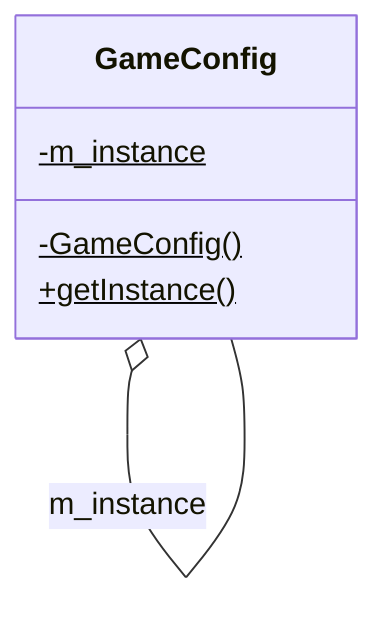

# 第 7 章 单件模式

&gt; 原书第 113–123 页 ｜ 本节内容：单件（Singleton）模式的动机与基本实现（私有构造函数 + 静态 getInstance）、多线程问题与双重锁定、饿汉式与懒汉式、Garbo 嵌套类实现自动内存释放、单件模式 UML 图及多种实现变体。

单件（Singleton）模式也称单例模式/单态模式，是一种创建型模式，用于创建只能产生一个对象实例的类。该模式比较特殊，其实现代码中没有用到设计模式中经常提起的抽象概念，而是使用了一种比较特殊的语法结构（私有的构造函数）实现类的定义。

该模式比较好理解，也比较常用，但要设计得好并不容易，有许多细节需要把握，本章将详细探讨。


## 7.1 单件类的基本概念和实现

在一个软件中，往往存在一些比较特殊的类，希望在整个软件中只存在该类的一个对象（实例）。继续讲解闯关打斗类游戏，策划要求游戏中有一些配置选项，能够对游戏的声音大小、图像质量等进行配置，为此，要创建一个游戏配置相关的类 GameConfig，代码如下：

```cpp
//游戏配置相关类
class GameConfig
{
    //... 待增加
};
```

为了使用该类，需要创建该类相关的对象，于是，可以通过下面的代码创建一个类对象：

```cpp
GameConfig g_config1;
```

当然，还可以创建该类的另外一个对象，甚至还可以创建更多的该类对象：

```cpp
GameConfig g_config2;
```

但是从项目需求来讲，整个游戏中只应该存在一个 GameConfig 类对象（对象可以在栈上创建也可以用 new 在堆上创建），该对象相当于一个全局的 GameConfig 类对象，统管游戏的配置。没必要创建多个 GameConfig 类对象，因为创建多个 GameConfig 类对象可能会造成混乱或实现的程序逻辑不正确（也可能造成性能问题）。

这种在项目中只应该存在某个类的单独一个对象的情形并不少见。例如，项目中只存在一个声音管理系统、一个配置系统、一个文件管理系统、一个日志系统、一个线程池，甚至如果把整个 Windows 操作系统看成一个项目，那么其中只存在一个任务管理器窗口等。

有的读者可能认为既然希望只创建一个 GameConfig 类对象，那么编写代码的时候不去创建额外的 GameConfig 类对象不就可以了吗？其实不是这样，C++ 软件开发专家 Scott Meyers 曾经说过："要使接口或者类型易于正确使用，难以错误使用。"这句话的意思就是说不要把保证不创建出多个 GameConfig 类对象的责任推到类的使用者身上，这本来应该是类的设计者的责任。试想一下，如果 GameConfig 类是第三方机构开发的并希望在整个项目中只能创建一个该类的对象，那么该机构应该做的是从 GameConfig 类的设计上入手来确保项目中只能创建一个该类的对象，而不是出一份文档告诉 GameConfig 类的使用者只允许创建一个该类的对象。

这种只能创建一个属于该类对象的类就称为单件类。那么这样的类应该如何设计呢？代码如下：

```cpp
//游戏配置相关类
class GameConfig
{
    //...
private:
    GameConfig() {};
    GameConfig(const GameConfig& tmpobj);
    GameConfig& operator = (const GameConfig& tmpobj);
    ~GameConfig() {};
public:
    static GameConfig* getInstance()
    {
        if (m_instance == nullptr)
        {
            m_instance = new GameConfig();
        }
        return m_instance;
    }
private:
    static GameConfig* m_instance;      //指向本类对象的指针
};

GameConfig* GameConfig::m_instance = nullptr;   //在类外，某个.cpp源文件的开头位置，
                                                //为静态成员变量赋值（定义并赋值）
```

在 main 主函数中，增加如下代码就可以创建一个单件类的对象：

```cpp
GameConfig* g_gc = GameConfig::getInstance();
```

后续随时可以通过调用 getInstance 成员函数拿到指向该对象的指针。例如下面代码行的 g_gc2 与 g_gc 指向的是同一个对象。

```cpp
GameConfig* g_gc2 = GameConfig::getInstance();
```

从上面代码中可以看到以下几个需要说明的问题。

（1）类的构造函数设置为私有。所以站在类外部的角度来讲，既无法在栈上也无法在堆上创建该类所属的对象。例如下面的代码都变得不合法了：

```cpp
GameConfig* g_gc = new GameConfig;
GameConfig gc;
```

（2）通过静态成员函数 getInstance 创建该单件类的对象，第一次执行该成员函数时 if 条件肯定成立，所以通过 new 创建了该类对象，并返回了指向该类对象的指针（静态成员变量 m_instance）。而第二次执行该成员函数时，if 条件就不再成立了，直接返回该类的对象指针（第一次 if 条件成立时 new 出来的对象）即可。这样就可以确保在整个项目中最多只能存在一个 GameConfig 类对象。

（3）将拷贝构造函数设置为私有，保证对象不可以被拷贝构造，例如下面的代码是不合法的：

```cpp
GameConfig g_gc3(*g_gc);
```

将拷贝赋值运算符设置为私有，保证了对象不可以被拷贝赋值，例如下面的代码是不合法的：

```cpp
(*g_gc2) = (*g_gc);
```

将析构函数设置为私有，保证了对象不可以在外界被随意删除，例如下面的代码是不合法的：

```cpp
delete g_gc2;
```

还有哪些是必须设置为私有的成员函数吗？请读者进一步思考。

## 7.2 单件类在多线程中可能导致的问题

思考前面的 GameConfig 类实现代码，如果在多个线程中同时调用 getInstance 成员函数的情况下，会产生什么问题呢？有可能导致 GameConfig 类对象被创建出超过一个的情况。

试想，如果程序在两个或者多个线程中同时调用 GameConfig 类的 getInstance 成员函数，那么当线程 1 刚好执行完判断代码行 `if(m_instance == nullptr)` 并且确认此 if 条件成立时，突然因为操作系统时间片调度问题切换到了线程 2，线程 2 也会执行 `if(m_instance == nullptr)` 并且也会确认此 if 条件成立，然后线程 2 就会直接执行 "m_instance = new GameConfig();" 代码行创建出了一个 GameConfig 对象，此时时间片切换回了线程 1，线程 1 接着刚才暂停处继续执行也就是刚好执行 "m_instance = new GameConfig();" 代码行，这种情况就会导致在两个线程中分别创建了一个 GameConfig 类对象（总共创建了两个 GameConfig 类对象），从而使代码逻辑违背了开发者意愿，产生了混乱。那么如何解决这个问题呢？

解决这个问题的第一个方法是为 getInstance 成员函数加锁，因为 C++11 新标准的引入，加锁变得比较方便，笔者在《C++新经典》一书的"并发与多线程"一章对加锁有非常详细的讲述。可以在 getInstance 成员函数的第一行（最开始行）增加类似如下的代码来实现加锁，这里不详述（因笔者认为该方案弊病比较大）：

```cpp
std::lock_guard<std::mutex> gcguard(my_mutex);
```

这样加锁之后，在一个线程执行完整个 getInstance 成员函数之前，其他的线程必须等待，从而避免了多个线程小概率同时创建多个 GameConfig 对象的问题。

虽然通过加锁实现的 getInstance 成员函数从代码逻辑上没有问题，实现了线程安全，但从执行效率上来说，是有大问题的。试想如果程序执行过程中，getInstance 被多个线程频繁调用，每次调用都会经历加锁解锁的过程，则会严重影响程序执行效率，更何况这种加锁机制，仅仅对第一次创建 GameConfig 对象有意义，该对象一旦被创建之后，其实就变成了一个只读的对象，在多线程中，对一个只读对象的访问进行加锁不但代价很大，更是毫无意义。所以，发展出来了一个**双重锁定**（双重检查）机制，基于这种机制的 getInstance 成员函数实现代码如下：

```cpp
static GameConfig* getInstance()
{
    if (m_instance == nullptr)
    {
        //这里加锁
        std::lock_guard<std::mutex> gcguard(my_mutex);
        if (m_instance == nullptr)
        {
            m_instance = new GameConfig();
        }
    }
    return m_instance;
}
```

从代码中可以看到，上个加锁版本是只要执行了 getInstance 成员函数，就立即加锁，而这个双重锁定机制用到了两个内容相同的 if 判断语句而且第一个 if 判断语句并没有加锁，第二个 if 判断语句之前才加了锁。

这样做的目的就是为了提高效率而采用的一种代码编写手段，具体解释如下：

（1）首先必须要承认一点，如果条件 `if(m_instance != nullptr)` 成立，则肯定代表 m_instance 已经被 new 过了。

（2）如果条件 `if(m_instance == nullptr)` 成立，不代表 m_instance 一定没被 new 过，因为很可能线程 1 刚要执行 "m_instance = new GameConfig();" 代码行，就切换到线程 2 去了（结果线程 2 可能就会 new 这个单件对象），但是一会切换回线程 1 时，线程 1 会立即执行 "m_instance = new GameConfig();" 来 new 这个单件对象（结果 new 了两次这个单件对象）。

所以笔者才会说：`if(m_instance == nullptr)` 成立，不代表 m_instance 一定没被 new 过。

那么，在 m_instance 可能被 new 过（也可能没被 new 过）的情况下，再去加锁。加锁后，只要这个锁能锁住，就再次判断条件 `if(m_instance == nullptr)`，如果这个条件依然满足，那么肯定表示这个单件对象还没有被初始化，这个时候就可以放心地用 new 来初始化。

平时常规调用 getInstance 的时候，因为最外面有一个条件判断 `if(m_instance == nullptr)`，这样就不会每次调用 getInstance 都加锁。也就是说，平常的调用根本就执行不到加锁代码，而是直接执行 "return m_instance;"，这样调用者就能够直接获得这个单件类的对象，所以提高了执行 getInstance 的效率。

上述双重锁定机制看起来比较完美，但实际上存在潜在的问题——**内存访问重新排序**（重新排列编译器产生的汇编指令）导致双重锁定失效的问题（因此不要在实际项目中使用这段代码）。以代码行 "m_instance = new GameConfig();" 来说明，当线程 1 执行该代码行时，通常认为大概要细分成 3 个步骤并按顺序来执行：首先调用 malloc 分配内存，然后执行 GameConfig 的构造函数来初始化这块内存，最后让 m_instance 指针指向这块内存。但是在 CPU 内部执行时，这 3 个执行步骤有可能会因为编译器的**优化**等原因被重新排序，例如，首先调用 malloc 分配内存，然后让 m_instance 指针指向这块内存，最后才执行 GameConfig 的构造函数来初始化这块内存（笔者还听说过编译器出于性能考虑甚至可能在加锁之前就进行第二个 if 条件的测试，这可是编译器的大 Bug）。这样麻烦就来了，因为 m_instance 一被赋值来指向这块内存，就表示 `m_instance != nullptr` 条件成立了，但这块内存还没被初始化（需要执行 GameConfig 的构造函数来初始化），是不应该拿来用的，若此时突然有另外一个线程（线程 2）执行 getInstance 成员函数，则线程 2 首先要执行的是代码行 `if(m_instance == nullptr)`，而这个判断会成立并立即执行 "return m_instance;" 代码行，把 m_instance 返回去直接使用。这时候就出现了在线程 1 中未被初始化完的 GameConfig 类对象被线程 2 拿去使用了的尴尬局面，这就是双重锁定代码有可能导致的问题。

这个问题在 C++ 语言中解决起来比较复杂（在其他语言，例如 Java、C# 中，可以通过 volatile 关键字来提示编译器不要进行内存访问重新排序），需要借助 C++11 新标准的一些新特性、新类型来使内存不会出现重新排序。这里给出实现了新版本双重锁定的 GameConfig 类代码（这段代码没有经过严格的测试验证，仅供参考），有兴趣的读者可以自行研究。

```cpp
#include <atomic>       //＃include的头文件加在源文件顶部位置
#include <mutex>
//游戏配置相关类
class GameConfig
{
private:
    GameConfig() {};
    GameConfig(const GameConfig& tmpobj);
    GameConfig& operator = (const GameConfig& tmpobj);
    ~GameConfig() {};
public:
    static GameConfig* getInstance()
    {
        GameConfig* tmp = m_instance.load(std::memory_order_relaxed);
        std::atomic_thread_fence(std::memory_order_acquire);
        if (tmp == nullptr)
        {
            std::lock_guard<std::mutex> lock(m_mutex);
            tmp = m_instance.load(std::memory_order_relaxed);
            if (tmp == nullptr)
            {
                tmp = new GameConfig();
                std::atomic_thread_fence(std::memory_order_release);
                m_instance.store(tmp, std::memory_order_relaxed);
            }
        }
        return tmp;
    }
private:
    static atomic<GameConfig*> m_instance;
    static std::mutex m_mutex;
};
std::atomic<GameConfig*> GameConfig::m_instance;
std::mutex GameConfig::m_mutex;
```

一个好的解决多线程创建 GameConfig 类对象问题的方法是在**main 主函数（程序执行入口）中，在创建任何其他线程之前，先执行一次 "GameConfig::getInstance();" 来把这个单独的 GameConfig 类对象创建出来**，这样，后续再对 GameConfig 类的 getInstance 成员函数进行调用时就相当于只读取 m_instance 成员变量，对 getInstance 成员函数的调用就不再需要加锁了。

## 7.3 饿汉式与懒汉式

单件类的实现代码在多线程中可能导致出现问题的另外一种解决方案，就是在 .cpp 源文件中给静态成员变量赋初值时不赋值成 nullptr，而是直接 new 一个 GameConfig 类对象，这样也就不会存在多线程的加锁问题，重新实现的 GameConfig 代码如下：

```cpp
class GameConfig
{
    //...
private:
    GameConfig() {};
    GameConfig(const GameConfig& tmpobj);
    GameConfig& operator = (const GameConfig& tmpobj);
    ~GameConfig() {};
public:
    static GameConfig* getInstance()
    {
        return m_instance;
    }
private:
    static GameConfig* m_instance;      //指向本类对象的指针
};
GameConfig* GameConfig::m_instance = new GameConfig();
                                        //趁静态成员变量定义的时机直接初始化是被允
                                        //许的，即便GameConfig构造函数用private修饰
```

因为用 new 创建 GameConfig 对象的代码行会早于 main 主函数（程序执行入口）被执行，所以在 main 中，GameConfig::m_instance 已经有了有效值，后续对 getInstance 成员函数的调用就不需要加锁了。

这种单件类代码的实现方式也被称为"**饿汉式**"（很饥渴、很迫切之意）——程序一执行，不管是否调用了 getInstance 成员函数，这个单件类对象就已经被创建了（对象创建将不受多线程问题困扰）。还有一种实现方式称为"**懒汉式**"（很懒惰之意），前面实现的单件类代码采用的就是该种方式——程序执行后该单件类对象并不存在，只有第一次调用 getInstance 成员函数时该单件类对象才会被创建，这种方式能够更好地控制单件类对象的创建时机，以免过早加载可能导致对内存等资源的不必要消耗（假如类 GameConfig 非常庞大的话）。

在饿汉式单件类代码的实现中必须要注意，如果一个项目中有多个 .cpp 源文件，而且这些源文件中（例如，文件开头位置）包含对全局变量的初始化代码，例如某个 .cpp 源文件中可能存在如下代码：

```cpp
int g_test = GameConfig::getInstance()->m_i;    //m_i为一个int型成员变量
```

那么这样的代码是不安全的，因为多个源文件中全局变量的初始化顺序是不确定的，很可能上述代码先于 "GameConfig* GameConfig::m_instance = new GameConfig();" 代码行执行而造成 GameConfig::getInstance() 返回的是 nullptr，此时去访问 m_i 成员变量肯定会导致程序执行异常。所以，对饿汉式单件类对象的使用，应该在程序入口函数开始执行后，例如 main 主函数开始执行后。

## 7.4 单件类对象内存释放问题

单件对象的生命周期一般贯穿整个程序，当整个程序执行结束时，该对象所占用的内存可以由操作系统回收。但也有许多开发者希望在程序执行结束前能够主动回收单件对象所占用的内存，当然可以写一个如下的 GameConfig 成员函数并在程序结束之前手工调用：

```cpp
public:
    static void freeInstance()
    {
        if (m_instance != nullptr)
        {
            delete GameConfig::m_instance;
            GameConfig::m_instance = nullptr;
        }
    }
```

但这种手工调用 freeInstance 来释放单件类对象内存的方式增加了额外的调用步骤，并不方便，能否做到程序执行结束时单件类对象所占用的内存被自动释放呢？可以做到，需要一些代码编写技巧——在类 GameConfig 定义中增加一个名字叫作 Garbo 的类（嵌套类），代码如下：

```cpp
private:
    //手工释放单件类对象引入的GameConfig类中的嵌套类（垃圾回收）
    class Garbo
    {
    public:
        ~Garbo()
        {
            if (GameConfig::m_instance != nullptr)
            {
                delete GameConfig::m_instance;
                GameConfig::m_instance = nullptr;
            }
        }
    };
```

如果单件类代码是以"饿汉式"实现的，则意味着不管程序是否调用过 getInstance 成员函数，该单件类对象都已经 new 出来了，都需要释放，此时应该按如下步骤释放内存。

（1）在类 GameConfig 定义中，增加一个 private 修饰的静态成员变量：

```cpp
private:
    static Garbo garboobj;
```

（2）在类外，某个 .cpp 源文件的开头位置，对上述静态成员变量进行定义：

```cpp
GameConfig::Garbo GameConfig::garboobj;
```

经过上述步骤后，如果在 Garbo 类的析构函数中增加断点，则可以观察到代码行 "delete GameConfig::m_instance;" 被执行了，这表示单件类对象占用的内存已被成功释放。程序代码的实现原理比较简单：静态成员变量 garboobj 所分配的内存会在程序执行结束前由操作系统回收，该回收动作会导致 garboobj 所属类 Garbo 析构函数的执行，在该析构函数中，正好释放单件类对象。

如果单件类代码是以"懒汉式"实现的，则意味着如果不调用 getInstance 成员函数，则单件类对象不会被 new 出来，自然也就不需要释放。具体的实现代码相对简单，只需要在 getInstance 成员函数中的 new 语句行下面增加一个局部静态变量定义即可：

```cpp
static GameConfig* getInstance()
{
    if (m_instance == nullptr)
    {
        m_instance = new GameConfig();
        static Garbo garboobj;
    }
    return m_instance;
}
```

经过上述步骤后，如果程序调用过 getInstance 为单件类分配了内存，自然也就相当于 garboobj 局部静态变量被构造出来了，该局部静态变量所分配的内存会在程序执行结束前由操作系统回收，该回收动作会导致 garboobj 所属类 Garbo 析构函数的执行，在该析构函数中，正好释放单件类对象。

## 7.5 单件类定义、UML图及另外一种实现方法

单件类除只能创建一个该类对象外，在使用方面与普通类没什么区别，读者在使用时也无须有太多顾虑。

引入"**单件**"设计模式的**定义**（实现意图）：保证一个类仅有一个实例存在，同时提供能对该实例访问的全局方法（getInstance 成员函数）。

针对前面的代码范例绘制单件模式的 UML 图，如图 7.1 所示。



*原书图 7.1（第 132 页）：*

在图 7.1 中，带下画线的成员表示类中的静态成员。图 7.1 中的空心菱形所引出的箭头指向了自己，表示类中的 m_instance 指向的是其自身所属类类型的对象。

下面说明单件类对象与全局变量的区别。从某种角度来看，单件类对象似乎与全局变量有些类似，例如一个类的对象可以是一个全局变量，而单件类对象可以看成一个经过改进的全局变量。但其实两者所表达的概念侧重点不同：程序员并不能阻止创建多个代表类（指普通类）对象的全局变量，而单件类却做到了通过自身来保存唯一的实例而阻止创建多个单件类对象。

因为运用了单件模式的类只能创建一个类对象，所以比较节省系统资源，但因为这种模式不涉及抽象层，所以扩展起来比较困难，例如很难为其创建子类（要创建子类应考虑使用 protected 来修饰构造函数，而且作为父类要考虑把析构函数设置为虚函数）等，当然，一般情况下也不需要为单件类创建子类。

在前面的范例中，读者已经看到了创建单件类对象的方法是通过 new 一个 GameConfig 类对象的方式实现的。可能此时有些读者灵机一动，想到了另外一种实现方法，即将 m_instance 从指针类型修改为对象类型，代码如下：

```cpp
class GameConfig
{
    //...
private:
    GameConfig() {};
    GameConfig(const GameConfig& tmpobj);
    GameConfig& operator = (const GameConfig& tmpobj);
    ~GameConfig() {};
public:
    static GameConfig* getInstance()
    {
        return &m_instance;
    }
private:
    static GameConfig m_instance;
};
GameConfig GameConfig::m_instance;
```

上面这个版本也相当于饿汉式编码，m_instance 的创建和初始化工作也是在程序运行时就进行了。同样，如果一个项目中有多个 .cpp 源文件，其中某个 .cpp 源文件中可能存在如下对全局变量 g_test 进行初始化的代码：

```cpp
int g_test = GameConfig::getInstance()->m_i;
```

那么这行代码可能会出现问题（多个源文件中全局变量/静态成员变量的初始化顺序不确定），即编译器无法保证初始化 g_test 全局变量时 m_instance 已经被创建和初始化。

下面再简单介绍另外一种单件类的实现方法——让 getInstance 返回局部静态变量的引用。在原有懒汉编码方式下对类 GameConfig 的 getInstance 成员函数进行改造，完整的 GameConfig 实现代码如下：

```cpp
class GameConfig
{
private:
    GameConfig() {};
    GameConfig(const GameConfig& tmpobj);
    GameConfig& operator = (const GameConfig& tmpobj);
    ~GameConfig() {};
public:
    static GameConfig& getInstance()
    {
        static GameConfig instance;
        return instance;
    }
};
```

这个版本的代码实现更简洁，焦点集中在 getInstance 成员函数上，注意，其返回的类型是 GameConfig&（局部静态变量的引用）。

在代码中，系统会保证 instance 局部静态变量在第一次 getInstance 成员函数被调用时被初始化（执行构造函数）。这里要注意区别"**函数第一次执行时被初始化的静态变量**"与"**通过编译期常量进行初始化的基本类型静态变量**"这两种情况，上述 instance 属于第一种情况，而如下函数 myfunc 中的静态变量 stcs 就属于第二种（后一种）情况：

```cpp
int myfunc()
{
    static int stcs = 100;      //不需要调用myfunc函数，stcs就已经等于100了
    stcs += 180;
    return stcs;
}
```

在上述 myfunc 函数中，stcs 的初始化是程序一运行就进行的，根本无须调用 myfunc 函数，想测试的读者可以在程序中手工调用 myfunc 函数，就会发现 "static int stcs = 100;" 代码行根本没产生汇编代码，而且通过调试可以看到没执行到该行代码时将鼠标放到 stcs 时 stcs 显示的已经是 100 了，如图 7.2 所示。


这一点和 getInstance 中的 instance 这种类类型的静态成员变量不同（instance 的初始化是在 getInstance 被第一次调用时进行），当然，instance 的析构（释放），也会在整个程序执行结束后（例如 main 主函数执行完毕后）进行。

在 main 主函数中，可以加入如下代码使用这个版本的单件类：

```cpp
GameConfig& g_gc40 = GameConfig::getInstance();
```

这个版本的单件类实现也存在多线程问题，因此笔者同样建议在创建任何其他线程之前，先执行 "GameConfig::getInstance();"，把这个 instance 局部静态变量构造出来，这样，后续再对 GameConfig 类的 getInstance 成员函数进行调用时就很安全，不再有多线程问题。

另外一个让人困扰的问题就是多个单件类之间的相互引用问题，例如，还有另一个负责写日志的单件类 Log，假设 Log 单件类对象和 GameConfig 单件类对象都通过 getInstance 被构造并初始化了，但是在程序执行结束时，两个对象的析构顺序是不确定的，读者可以尝试在 Log 和 GameConfig 类的析构函数中增加一些输出代码，可以看到，程序在退出执行时，Log 和 GameConfig 这两个单件类的析构函数都会被系统调用，但是这两个单件类对象究竟谁先被析构掉（摧毁）的顺序并不可知，如果 Log 对象被先摧毁，但在 GameConfig 类的析构函数中为了记录一些日志信息用到了 Log 类对象，就会导致代码执行出错。因为一旦进入单件类对象的析构阶段就表示程序要执行结束（此时程序员也就无法控制程序的执行流程了），所以解决这个问题的最简单的方法就是：**不要在单件类的析构函数中引用其他单件类对象**。
