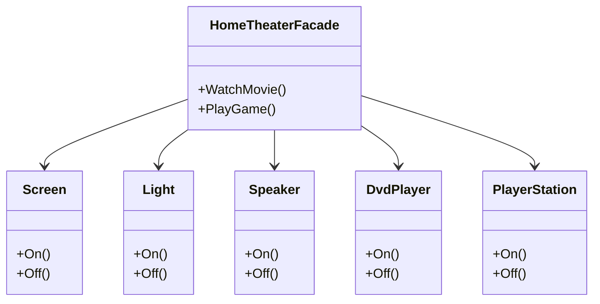

# 第 8 章 外观模式

&gt; 原书第 124–134 页 ｜ 本节内容：外观（Facade）模式的动机（游戏配置项范例）、迪米特法则的引出、模式角色与定义说明、家庭影院范例（HomeTheaterFacade）与结构图。

外观（Facade）模式也称为门面模式，是一种结构型模式。这是一个非常简单的设计模式，该模式的目的用于隔离接口，换句话说，就是扮演中间层的角色，把本来结合紧密的两部分模块（系统）隔离开来，让这两部分内容通过中间层来打交道（类似于依赖倒置原则：高层和低层都依赖于抽象层），从而极大地降低了两部分模块之间的耦合性并通过中间层对许多操作进行简化。

本章详细描述外观模式，在讲解过程中，还会引出面向对象程序设计的一个重要原则——迪米特法则。


## 8.1 一个配置相关的范例

常玩网络游戏的读者都知道，一款游戏可玩的内容越多，或者说功能越多，它的配置项也越多。以《魔兽世界》这款网游为例，其配置项就分好多类，例如有图形、声音、语音聊天等，而每个配置项都会有很多可供配置的细节内容，例如：

（1）图形——是否全屏显示、是否开启特效、窗口分辨率、是否开启抗锯齿等。

（2）声音——是否开启背景声音、是否开启环境音效、是否开启表情声音、音量大小设置等。

（3）语音聊天设置——麦克风音量、麦克风灵敏度、聊天音量等。

现在，策划希望在闯关打斗类游戏项目中也引入这些配置项。程序经过思考，准备创建 3 个类来分别实现图形、声音、语音聊天相关功能，因为这些类在整个项目中只保持一个对象就可以，因此准备将这 3 个类设置为单件类（不采用单件类当然也可以），代码如下：

```cpp
//图形相关类
class graphic
{
    // ---------------- 单件类实现相关 begin ----------------
private:
    graphic() {};
    graphic(const graphic& tmpobj);
    graphic& operator = (const graphic& tmpobj);
    ~graphic() {};
public:
    static graphic& getInstance()
    {
        static graphic instance;
        return instance;
    }
    // ---------------- 单件类实现相关 end ----------------
public:
    void display(bool enable)           //是否全屏显示(true: 是)
    {
        cout << "图形 ->是否全屏显示 ->" << enable << endl;
        //其他代码略…
    }
    void effect(bool enable)            //是否开启特效(true: 是)
    {
        cout << "图形 ->是否开启特效 ->" << enable << endl;
    }
    void resolution(int index)          //设置窗口分辨率
    {
        cout << "图形 ->分辨率设置选项 ->" << index << endl;
    }
    void antialiasing(bool enable)      //是否开启抗锯齿(true: 是)
    {
        cout << "图形 ->是否开启抗锯齿 ->" << enable << endl;
    }
    //其他接口略…
};

//声音相关类
class sound
{
    // ---------------- 单件类实现相关 begin ----------------
private:
    sound() {};
    sound(const sound& tmpobj);
    sound& operator = (const sound& tmpobj);
    ~sound() {};
public:
    static sound& getInstance()
    {
        static sound instance;
        return instance;
    }
    // ---------------- 单件类实现相关 end ----------------
public:
    void bgsound(bool enable)           //是否开启背景声音(true: 是)
    {
        cout << "声音 ->是否开启背景声音 ->" << enable << endl;
    }
    void envirsound(bool enable)        //是否开启环境音效(true: 是)
    {
        cout << "声音 ->是否开启环境音效 ->" << enable << endl;
    }
    void expsound(bool enable)          //是否开启表情声音(true: 是)
    {
        cout << "声音 ->是否开启表情声音 ->" << enable << endl;
    }
    void setvolume(int level)           //音量大小设置(0～100)
    {
        cout << "声音 ->音量大小为 ->" << level << endl;
    }
    //其他接口略…
};

//语音聊天相关类
class chatvoice
{
    // ---------------- 单件类实现相关 begin ----------------
private:
    chatvoice() {};
    chatvoice(const chatvoice& tmpobj);
    chatvoice& operator = (const chatvoice& tmpobj);
    ~chatvoice() {};
public:
    static chatvoice& getInstance()
    {
        static chatvoice instance;
        return instance;
    }
    // ---------------- 单件类实现相关 end ----------------
public:
    void micvolume(int level)           //麦克风音量大小设置(0～100)
    {
        cout << "语音聊天 ->麦克风音量大小为 ->" << level << endl;
    }
    void micsens(int level)             //麦克灵敏度设置(0～100)
    {
        cout << "语音聊天 ->麦克风灵敏度为 ->" << level << endl;
    }
    void chatvolume(int level)          //聊天音量设置(0～100)
    {
        cout << "语音聊天 ->聊天音量为 ->" << level << endl;
    }
    //其他接口略…
};
```

从上面的代码中可以看到一个问题，一个项目中可能有多个单件类，从而造成了一些代码冗余，例如这些单件类的构造函数、拷贝构造函数、拷贝赋值运算符以及析构函数只有名字不同，每个单件类也都需要有 getInstance 成员函数。所以实际上可以实现一个**单件类模板**，通过单件类模板可以避免多个单件类的定义中造成的代码冗余。为了简化问题，也考虑到有些读者对模板编程不太熟悉，此处不具体介绍单件类模板的实现，有兴趣的读者可以通过搜索引擎寻找相关实现代码。

另外，这个范例的单件类的使用没有多线程问题的困扰，所以设计单件类时不考虑多线程安全问题，如果读者的程序项目涉及多线程，请参考第 7 章提出的解决方案来应对单件类的多线程问题。

在 main 主函数中加入如下代码对上述 3 个单件类进行使用，从而达到对游戏中的图形、声音、语音聊天进行设置的目的。

```cpp
graphic &g_gp = graphic::getInstance();
g_gp.display(false);
g_gp.effect(true);
g_gp.resolution(2);
g_gp.antialiasing(false);

cout << "----------------" << endl;
sound& g_snd = sound::getInstance();
g_snd.setvolume(80);
g_snd.envirsound(true);
g_snd.bgsound(false);

cout << "----------------" << endl;
chatvoice& g_cv = chatvoice::getInstance();
g_cv.chatvolume(70);
g_cv.micsens(65);
```

执行起来，看一看结果：

```text
图形 ->是否全屏显示 ->0
图形 ->是否开启特效 ->1
图形 ->分辨率设置选项 ->2
图形 ->是否开启抗锯齿 ->0
----------------
声音 ->音量大小为 ->80
声音 ->是否开启环境音效 ->1
声音 ->是否开启背景声音 ->0
----------------
语音聊天 ->聊天音量为 ->70
语音聊天 ->麦克风灵敏度为 ->65
```

## 8.2 引入外观模式

可以把 graphic、sound、chatvoice 这些具体的类称为业务类，把 main 主函数中调用这些业务类接口的代码称为客户端代码。上述代码比较简单，实际上业务类彼此之间还可能有相互调用关系（图 8.1 中右下位置虚线部分），而且客户端代码也不仅仅出现在 main 主函数中，可能还会出现在很多其他地方。总而言之，客户端代码与业务类直接交互，是比较烦琐和复杂的，如图 8.1 所示。


如果业务类代码是第三方机构或开发小组编写，则可以建议该第三方机构或开发小组设计一个新类（conffacade），隔在客户端代码和业务类之间，扮演中间层的角色，客户端代码不再需要直接与业务类打交道而改为与这个新类打交道。这个新类所扮演的就是外观模式的角色——对客户端提供一些简单的调用接口（这些接口往往可以实现一系列动作），通过接口与业务类打交道来大大简化客户端代码直接与业务类打交道时的复杂性，接口示意图如图 8.2 所示。


这里首先要意识到一点，外观模式强调的是一种程序设计思想，并不是一种特殊的编程手法。conffacade 类在这里采用单件类的模式来实现（不采用单件类当然也可以），在这个类中，提供两个供客户端调用的简单接口（成员函数）：第一个接口适合于配置比较低的计算机客户端调用，第二个接口适合于配置比较高的计算机客户端调用，代码如下：

```cpp
//扮演外观模式角色的类
class conffacade
{
    // ---------------- 单件类实现相关 begin ----------------
private:
    conffacade() {};
    conffacade(const conffacade& tmpobj);
    conffacade& operator = (const conffacade& tmpobj);
    ~conffacade() {};
public:
    static conffacade& getInstance()
    {
        static conffacade instance;
        return instance;
    }
    // ---------------- 单件类实现相关 end ----------------
public:
    void LowConfComputer()              //对于低配置计算机，只开启一些低配置选项
    {
        graphic& g_gp = graphic::getInstance();
        g_gp.display(true);             //全屏耗费资源更低
        g_gp.effect(false);
        g_gp.resolution(2);
        g_gp.antialiasing(false);

        sound& g_snd = sound::getInstance();
        g_snd.bgsound(false);
        g_snd.envirsound(false);
        g_snd.expsound(false);
        g_snd.setvolume(15);

        chatvoice& g_cv = chatvoice::getInstance();
        g_cv.micvolume(20);
        g_cv.micsens(50);
        g_cv.chatvolume(60);
    }

    void HighConfComputer()             //对于高配置计算机，能达到最好效果的项全部开启
    {
        graphic& g_gp = graphic::getInstance();
        g_gp.display(false);
        g_gp.effect(true);
        g_gp.resolution(0);
        g_gp.antialiasing(true);

        sound& g_snd = sound::getInstance();
        g_snd.bgsound(true);
        g_snd.envirsound(true);
        g_snd.expsound(true);
        g_snd.setvolume(50);

        chatvoice& g_cv = chatvoice::getInstance();
        g_cv.micvolume(100);
        g_cv.micsens(100);
        g_cv.chatvolume(100);
    }
};
```

在 main 主函数中，注释掉原有代码，增加如下代码：

```cpp
conffacade& g_cffde = conffacade::getInstance();
cout << "低配置计算机，调用LowConfComputer接口" << endl;
g_cffde.LowConfComputer();
cout << "----------------" << endl;
cout << "高配置计算机，调用HighConfComputer接口" << endl;
g_cffde.HighConfComputer();
```

执行起来，看一看结果：

```text
低配置计算机，调用LowConfComputer接口
图形 ->是否全屏显示 ->1
图形 ->是否开启特效 ->0
图形 ->分辨率设置选项 ->2
图形 ->是否开启抗锯齿 ->0
声音 ->是否开启背景声音 ->0
声音 ->是否开启环境音效 ->0
声音 ->是否开启表情声音 ->0
声音 ->音量大小为 ->15
语音聊天 ->麦克风音量大小为 ->20
语音聊天 ->麦克风灵敏度为 ->50
语音聊天 ->聊天音量为 ->60
----------------
高配置计算机，调用HighConfComputer接口
图形 ->是否全屏显示 ->0
图形 ->是否开启特效 ->1
图形 ->分辨率设置选项 ->0
图形 ->是否开启抗锯齿 ->1
声音 ->是否开启背景声音 ->1
声音 ->是否开启环境音效 ->1
声音 ->是否开启表情声音 ->1
声音 ->音量大小为 ->50
语音聊天 ->麦克风音量大小为 ->100
语音聊天 ->麦克风灵敏度为 ->100
语音聊天 ->聊天音量为 ->100
```

外观模式体现了面向对象程序设计的一个原则——**迪米特法则**（Law of Demeter，LoD），有些资料也称之为得墨忒耳法则或最少知识原则（Least Knowledge Principle，LKP）。该原则是这样描述的：一个对象对其他对象的了解应尽可能少，从而降低各个对象之间的耦合，提高系统的可维护性。例如，在一个程序中，模块之间调用时通过提供一个统一的接口来实现，这样其他模块就不需要了解另外一个模块内部的实现细节，当一个模块内部的实现发生改变时，也不会影响到其他模块的使用。

在本范例中，如果客户端代码和业务类之间直接进行交互，那么两者的耦合度就会比较高，当对业务类代码进行修改时，可能也需要同时修改客户端的代码。通过引入扮演外观模式角色的类 conffacade，将客户端与具体的复杂业务类接口分隔开，客户端只需要与外观角色打交道，而不需要与业务类内部的很多接口打交道，这就降低了客户端和业务类之间的代码耦合度。

一般来讲，在外观模式中包含两种角色。

（1）Facade（外观角色）：conffacade 类扮演着这个角色，客户端可以调用这个角色的方法（成员函数），该方法将客户端的请求传递到业务类中去处理。

（2）Subsystem（子系统角色）：子系统就是前面提到的业务类（graphic、sound、chatvoice），项目中可以有多个子系统，每个子系统既可以是一个单独的类，也可以是彼此之间协作（具有耦合关系）的多个类。这些子系统可以被外观角色调用，当然也依旧可以被客户端直接调用。

引入"**外观**"设计模式的**定义**（实现意图）：提供了一个统一的接口，用来访问子系统中的一群接口。外观定义了一个高层接口，让子系统更容易使用。

该模式没有一个具体的 UML 图，一般采用图 8.2 示意，有几点说明如下。

（1）外观模式定义一组高层接口或者说提供子系统的一个到多个简化接口让子系统更容易使用以及让操作变得更直接，让客户端和子系统实现**解耦**。当子系统发生改变时，一般只需要修改外观类而基本不需要修改客户端代码（虽然这种修改有点违背开闭原则）。

（2）外观模式提供的接口给客户端调用带来了很大的方便，使客户端无须关心子系统的工作细节，但这些接口也许缺乏灵活性，当然，如果客户端认为有必要对子系统进行最灵活的控制，那么依然可以绕过外观模式类而直接使用子系统。

（3）一个项目中可以有多个外观类，每个外观类都负责与一些特定的子系统进行交互（当然，毫不相关的类也不应该归到同一个子系统中采用同一个外观类进行交互），即便是同一个子系统，也可以有多个外观类。外观模式为客户端和子系统之间提供了一种简化的交互渠道，但并**没有为子系统增加新的行为**，如果希望增加新的行为，则应该通过修改子系统角色来实现。

（4）外观模式是一种使用频率比较高的设计模式，这里给出一些比较常见的扮演外观模式角色的例子：

① 自己泡茶与到茶馆去让茶馆服务员为自己泡茶比较而言，茶馆服务员就扮演着外观模式的角色，直接帮助消费者把泡好的茶呈上来。

② 购买股票与购买基金相比，基金公司就扮演着外观模式的角色，基金公司帮助投资者购买合适的理财产品，例如股票、期货、国债等以在更小的风险和更好的收益之间取得平衡。

③ 普通照相机与傻瓜照相机相比，傻瓜照相机就扮演着外观模式的角色，傻瓜照相机不需要拍照者调整光圈、焦距等，只需要直接按下快门即可拍照。

## 8.3 另一个外观模式的范例

在这个范例中实现一个家庭影院外观模式的类 HomeTheaterFacade，该类与许多电气设备相关联，包括屏幕（Screen）、灯光（Light）、音箱（Speaker）、DVD 播放器（DvdPlayer）和游戏机（PlayerStation）。该类提供两个接口：

（1）看电影（WatchMovie）模式——屏幕打开，灯光熄灭，音箱打开，DVD 播放器打开，游戏机关闭。

（2）玩游戏（PlayGame）模式——屏幕打开，灯光打开，音箱打开，DVD 播放器关闭，游戏机打开。

针对该家庭影院外观模式，相关结构图如图 8.3 所示。



*原书图 8.3（第 143 页）：*

根据图 8.3，家庭影院外观模式的实现代码如下：

```cpp
//屏幕
class Screen
{
public:
    void On()
    {
        cout << "屏幕打开了!" << endl;
    }
    void Off()
    {
        cout << "屏幕关闭了!" << endl;
    }
};

//灯光
class Light
{
public:
    void On()
    {
        cout << "灯光打开了!" << endl;
    }
    void Off()
    {
        cout << "灯光关闭了!" << endl;
    }
};

//音箱
class Speaker
{
public:
    void On()
    {
        cout << "音箱打开了!" << endl;
    }
    void Off()
    {
        cout << "音箱关闭了!" << endl;
    }
};

//DVD播放器
class DvdPlayer
{
public:
    void On()
    {
        cout << "DVD播放器打开了!" << endl;
    }
    void Off()
    {
        cout << "DVD播放器关闭了!" << endl;
    }
};

//游戏机
class PlayerStation
{
public:
    void On()
    {
        cout << "游戏机打开了!" << endl;
    }
    void Off()
    {
        cout << "游戏机关闭了!" << endl;
    }
};

//家庭影院外观模式类
class HomeTheaterFacade
{
public:
    void WatchMovie()           //看电影
    {
        //屏幕打开，灯光熄灭，音箱打开，DVD播放器打开，游戏机关闭
        scnobj.On();
        lgobj.Off();
        spkobj.On();
        dpobj.On();
        psobj.Off();
    }
    void PlayGame()             //玩游戏
    {
        //屏幕打开，灯光打开，音箱打开，DVD播放器关闭，游戏机打开
        scnobj.On();
        lgobj.On();
        spkobj.On();
        dpobj.Off();
        psobj.On();
    }
private:
    Screen scnobj;
    Light lgobj;
    Speaker spkobj;
    DvdPlayer dpobj;
    PlayerStation psobj;
};
```

在 main 主函数中，注释掉原有代码，增加如下代码：

```cpp
HomeTheaterFacade htfacobj;
cout << "开始看电影 ----------------" << endl;
htfacobj.WatchMovie();
cout << "开始玩游戏 ----------------" << endl;
htfacobj.PlayGame();
```

执行起来，看一看结果：

```text
开始看电影 ----------------
屏幕打开了!
灯光关闭了!
音箱打开了!
DVD播放器打开了!
游戏机关闭了!
开始玩游戏 ----------------
屏幕打开了!
灯光打开了!
音箱打开了!
DVD播放器关闭了!
游戏机打开了!
```

在这个范例中，通过引入 HomeTheaterFacade 类扮演外观模式角色，成功达成了客户端与家庭影院中的各个子系统（Screen、Light、Speaker、DvdPlayer、PlayerStation）解耦的目的。
