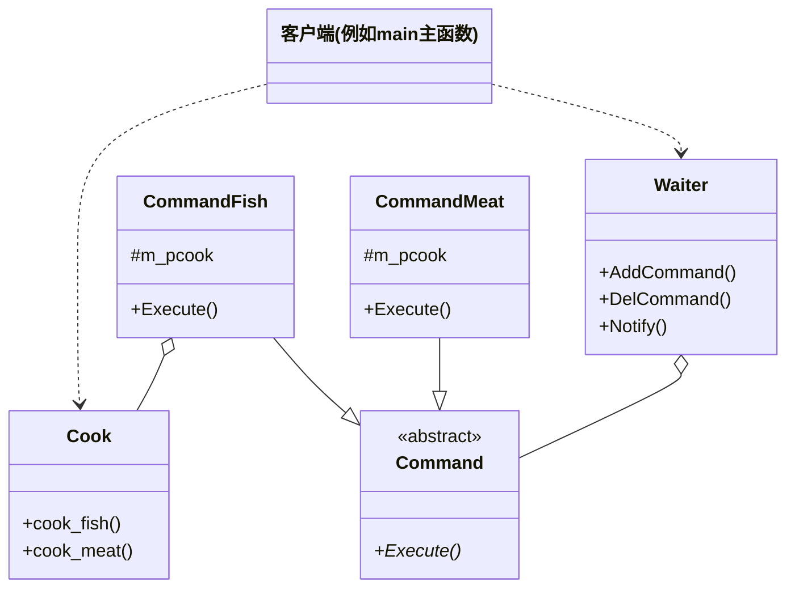

# 第 9 章 命令模式

&gt; 原书第 135–147 页 ｜ 本节内容：通过饭馆点菜范例引出命令模式（Cook/Command/Waiter 及命令队列改造）、命令模式 UML 图与 5 种角色、定义与实现意图、用途研究（绘图软件撤销、遥控器解耦、任务调度、游戏回放）及特点总结、命令对象与现代 C++ 可调用对象的比较。

命令（Command）模式是一种行为型模式，其实现有些烦琐，适用于一些比较专用的场合。本章首先通过一个采用命令模式编写的范例引入命令模式的概念，然后具体阐述命令模式适用的场景，达到让读者对该模式活学活用的目的。在本章的最后，还将阐述命令模式的特点以及一些值得深入思考的话题。


## 9.1 通过一个范例引出命令模式代码编写方法

命令模式有什么用处，不是现在要解决的问题，眼下要解决的是命令模式代码如何编写的问题。

设想来到一家饭馆，点两个菜吃——红烧鱼和锅包肉，编写一下这个饭馆的相关代码，非常简单，如下：

```cpp
//厨师类
class Cook
{
public:
    //做红烧鱼
    void cook_fish()
    {
        cout << "做一盘红烧鱼菜品" << endl;
    }

    //做锅包肉
    void cook_meat()
    {
        cout << "做一盘锅包肉菜品" << endl;
    }
    //做其他各种菜品…
};
```

这个饭馆没有服务员，只有一个厨师，所以顾客直接把菜品报给厨师，厨师直接开始做菜。在 main 主函数中，增加如下代码来让厨师做菜：

```cpp
Cook* pcook = new Cook();
pcook->cook_fish();
pcook->cook_meat();

//释放资源
delete pcook;
```

执行起来，看一看结果：

```text
做一盘红烧鱼菜品
做一盘锅包肉菜品
```

试想一下，如果饭馆里来的顾客比较多，每位顾客都直接把菜品报给厨师，那么厨师就容易记错而产生混乱，所以需要引入一个服务员（一个新类），服务员给每位顾客一个便签，顾客把需要的菜品写在便签上，然后服务员把便签拿给厨师，厨师依据收到的便签顺序以及每个便签上标记的菜品依次做菜，这样，饭馆的点菜步骤就显得井然有序。相关的实现代码采取的就是命令模式。

首先，将厨师能做的每样菜（Cook 类中的每个成员函数）都看成一个命令（顾客所写的便签中的某个菜品），先创建命令对应的抽象父类 Command（抽象菜单），代码如下：

```cpp
//厨师做的每样菜品对应的抽象类
class Command
{
public:
    Command(Cook* pcook)
    {
        m_pcook = pcook;
    }
    //作父类时析构函数应该为虚函数
    virtual ~Command() {}
    virtual void Execute() = 0;
protected:
    Cook* m_pcook;          //子类需要访问
};
```

由上面的代码可以看到，因为 Command 类要作为父类，因此析构函数为虚函数。Execute 是一个纯虚函数，子类要在其中实现厨师制作某个菜品（执行某个命令）的代码，在命令模式中习惯这样命名，当然不叫 Execute 而叫其他名字也完全可以。

有了 Command 抽象类，就可以针对厨师能做的**每样菜**都实现一个具体的命令子类：

```cpp
//做红烧鱼菜品命令（顾客下的红烧鱼菜品便签）
class CommandFish : public Command
{
public:
    CommandFish(Cook* pcook) : Command(pcook) {}
    virtual void Execute()
    {
        m_pcook->cook_fish();
    }
};

//做锅包肉菜品命令（顾客下的锅包肉菜品便签）
class CommandMeat : public Command
{
public:
    CommandMeat(Cook* pcook) : Command(pcook) {}
    virtual void Execute()
    {
        m_pcook->cook_meat();
    }
};
```

以上实现了两个继承自 Command 的子类 CommandFish 和 CommandMeat，当然，厨师如果还做其他菜品，则应该继续创建其他 Command 子类。值得注意的是，每个子类的 Execute 调用的其实还是厨师类中对应的制作相关菜品的成员函数。这里有一个有意思的事，例如创建一个 CommandMeat 对象（命令对象），该对象意味着让厨师做一盘锅包肉菜品这样一个动作，显然是**将一个动作封装成了一个对象**，该对象可以通过诸如函数参数等方式进行传递，**将一个动作当作参数进行传递**。

既然上述 Command 及其子类相当于顾客要点的菜品的便签，那么此时如果直接用如下代码驱动厨师做菜也是可以的。在 main 主函数中，注释掉原有代码，增加如下代码：

```cpp
Cook cook;
Command* pcmd1 = new CommandFish(&cook);
pcmd1->Execute();               //做红烧鱼

Command* pcmd2 = new CommandMeat(&cook);
pcmd2->Execute();               //做锅包肉

//释放资源
delete pcmd1;
delete pcmd2;
```

执行起来，看一看结果：

```text
做一盘红烧鱼菜品
做一盘锅包肉菜品
```

上述代码相当于顾客在每个便签上点了一个菜品，然后将便签交到厨师手里让厨师开始做菜，这样做有个问题，如果要点 10 个不同的菜品，那就要 new 10 次 Command 子类对象，很不方便，也就是说，顾客点 10 个菜没必要写 10 张便签并逐一拿给厨师，只需要在一张便签上写下 10 个菜名即可，为了支持这种点菜的便利性，有必要引入一个可以与顾客直接接触的服务员类，顾客只需要在一张便签上写下 10 个菜品的名字，直接拿给服务员，服务员替顾客下单让厨师做菜。现在先来实现初步的服务员类：

```cpp
//服务员类
class Waiter
{
public:
    void SetCommand(Command* pcommand)      //顾客将便签交给服务员
    {
        m_pcommand = pcommand;
    }
    void Notify()               //服务员将便签交到厨师手里让厨师开始做菜
    {
        m_pcommand->Execute();
    }
private:
    Command* m_pcommand;        //服务员手中握着顾客书写的菜品便签
};
```

现在，顾客只需要与服务员打交道，就可以最终实现点菜的目的。在 main 主函数中，注释掉原有代码，增加如下代码：

```cpp
Cook cook;
Waiter* pwaiter = new Waiter();

Command* pcmd1 = new CommandFish(&cook);
pwaiter->SetCommand(pcmd1);
pwaiter->Notify();              //做红烧鱼

Command* pcmd2 = new CommandMeat(&cook);
pwaiter->SetCommand(pcmd2);
pwaiter->Notify();              //做锅包肉

//释放资源
delete pcmd1;
delete pcmd2;
delete pwaiter;
```

执行起来，看一看结果：

```text
做一盘红烧鱼菜品
做一盘锅包肉菜品
```

在这里看一看，main 中函数的调用关系大概如下：

```text
(i) Cook cook;
(i) Waiter* pwaiter = new Waiter();
(i) Command* pcmd1 = new CommandFish(&cook);
(i) pwaiter->SetCommand(pcmd1);
(i)     m_pcommand = pcommand;
(i) pwaiter->Notify();          //做红烧鱼
(i)     m_pcommand->Execute();
(i)         m_pcook->cook_fish();
(i)             cout << "做一盘红烧鱼菜品" << endl;
(i) Command* pcmd2 = new CommandMeat(&cook);
(i) pwaiter->SetCommand(pcmd2);
(i)     m_pcommand = pcommand;
(i) pwaiter->Notify();          //做锅包肉
(i)     m_pcommand->Execute();
(i)         m_pcook->cook_meat();
(i)             cout << "做一盘锅包肉菜品" << endl;
(i) delete pcmd1;
(i) delete pcmd2;
(i) delete pwaiter;
```

根据代码，可以用文字描述一下顾客点菜的整个过程：

（1）顾客将要点的菜品写在便签上，对应代码行 "Command* pcmd1 = new CommandFish(&cook);"。

（2）顾客将便签交给了服务员，对应代码行 "pwaiter-&gt;SetCommand(pcmd1);"。

（3）服务员将便签交给厨师让厨师开始做菜，对应代码行 "pwaiter-&gt;Notify();"。

上述代码有一个问题尚未解决，顾客如果在一个便签上写下多道菜品的名字交给服务员或者服务员一次收集多位顾客的便签并需要一次性地通知厨师做多道菜，如何做到呢？这需要对现有的服务员类（Waiter）做相应的修改（创建一个新类也可以）。在 MyProject.cpp 的开头位置，首先使用 `#include <list>` 代码行将 list 文件包含进来，然后修改 Waiter 类，修改后的代码如下：

```cpp
class Waiter
{
public:
    //将顾客的便签增加到便签列表中，即便一个便签中包含多道菜品，这也相当于一道一道菜品
    //加入到列表中
    void AddCommand(Command* pcommand)
    {
        m_commlist.push_back(pcommand);
    }
    void DelCommand(Command* pcommand)      //如果顾客想撤单则将便签从列表中删除
    {
        m_commlist.remove(pcommand);
    }
    void Notify()       //服务员将所有便签一次性交到厨师手里让厨师开始按顺序做菜
    {
        //依次让厨师做每一道菜品
        for (auto iter = m_commlist.begin(); iter != m_commlist.end(); ++iter)
        {
            (*iter)->Execute();
        }
    }
private:
    //一个便签中可以包含多个菜品甚至可以一次收集多个顾客的便签，达到一次性通知厨师做多
    //道菜的效果
    std::list<Command*> m_commlist;     //菜品列表，每道菜品作为一项，如果一个便签中
                                        //有多个菜品，则这里将包含多项
};
```

在 main 主函数中，注释掉原有代码，增加如下代码：

```cpp
Cook cook;
//一次性在便签上写下多道菜品
Command* pcmd1 = new CommandFish(&cook);
Command* pcmd2 = new CommandMeat(&cook);

Waiter* pwaiter = new Waiter();
//把多道菜品分别加入到菜品列表中
pwaiter->AddCommand(pcmd1);
pwaiter->AddCommand(pcmd2);

//服务员一次性通知厨师做多道菜
pwaiter->Notify();

//释放资源
delete pcmd1;
delete pcmd2;
delete pwaiter;
```

执行起来，看一看结果：

```text
做一盘红烧鱼菜品
做一盘锅包肉菜品
```

## 9.2 引入命令模式

前面范例所实现的代码采取的就是命令模式。针对前面的代码范例绘制一下命令模式的 UML 图，如图 9.1 所示。



*原书图 9.1（第 151 页）：*

笔者参考了诸多命令模式 UML 图，画法大同小异，例如有的资料在客户端和 CommandFish、CommandMeat 之间也有一条带箭头的虚线，表示客户端代码中也涉及对 CommandFish、CommandMeat 等对象的创建工作。有的资料客户端与 Cook 之间的虚线箭头并不存在，表示顾客是通过服务员以便签的形式点菜而不需要与厨师打交道，从而实现了客户端与厨师的解耦，但实际上客户端代码行 "Cook cook;" 还是会涉及客户端与厨师打交道，只是两者的耦合度已经变得很低了（客户端不需要直接调用 Cook 类的成员函数，因此属于松耦合）。

命令模式的 UML 图中包含 5 种角色。

（1）Receiver（接收者类）：知道如何实施与执行一个请求相关的操作。这里指 Cook 类。提供了对请求的业务进行处理的接口（cook_fish、cook_meat）。

（2）Invoker（调用者类）：请求的发送者，通过命令对象来执行请求。这里指 Waiter 类。该类只与抽象命令类（Command）之间存在关联关系。

（3）Command（抽象命令类）：声明执行操作的接口。这里指的正是 Command 类。在其中声明了用于执行请求的 Execute 方法（成员函数），用于调用接收者类中的相关操作。

（4）ConcreteCommand（具体命令类）：抽象命令类的子类。这里指的是 CommandFish 类和 CommandMeat 类。类中实现了执行请求的 Execute 方法来调用接收者类 Cook 中的相关操作（cook_fish 和 cook_meat 方法）。

（5）Client（客户端）：创建具体的命令类对象并设定它的接收者，这里指 main 主函数中的如下几行代码。

```cpp
Cook cook;
Command* pcmd1 = new CommandFish(&cook);
Command* pcmd2 = new CommandMeat(&cook);
```

当然，客户端还创建了调用者类对象并驱动该对象去执行具体命令类对象所代表的动作，这里指 main 主函数中的如下几行代码。

```cpp
Waiter* pwaiter = new Waiter();
pwaiter->AddCommand(pcmd1);
pwaiter->AddCommand(pcmd2);
pwaiter->Notify();
```

把前面范例中的代码脉络梳理一下：

（1）调用者 Waiter 和接收者 Cook 是解耦的，也就是说，**发出请求的对象和接收请求的对象是解耦的**，服务员并不关心厨师怎样做菜，只是把顾客的便签交到厨师手中（调用 Notify 成员函数），和厨师沟通的实际是便签。

（2）顾客的点菜便签就是命令对象，也就是 Command 类对象，用来请求厨师做菜，该对象可以被当作参数从顾客手中传递到服务员手中，再从服务员手中传递到厨师手中，Command 类只包含一个 Execute 接口（成员函数），该接口封装了做菜所需的动作。

（3）服务员不关心便签中的内容，只需要接下顾客的便签，当便签累积到一定数量后，调用 Notify 成员函数将便签交到厨师手中即可。当然，服务员需要知道便签中有 Execute 方法（所有便签都支持该方法），因为在 Waiter 类的 Notify 中需要调用便签中的 Execute 方法。

（4）客户端负责创建命令对象，并调用 Waiter 类的 AddCommand 方法将命令对象保存在 Waiter 对象（调用者）中。在命令对象中，**命令（动作）以及 Cook 对象（接收者）**被绑在了一起，命令对象中也包含了接收者应该做的动作（制作的相关菜品）。在未来的某个时间点（说明做菜的动作可以延迟执行），服务员通过调用 Notify 方法就可以达到调用命令对象 Execute 方法的目的，Execute 方法驱动厨师完成制作某个具体的菜品。

引入"**命令**"设计模式的**定义**（实现意图）：将一个请求或者命令（做红烧鱼或做锅包肉）封装为一个对象（CommandFish 类对象或 CommandMeat 类对象），以便这些请求可以以对象的方式通过参数进行传递（参数化：调用者不关心具体是什么命令对象，只把这些对象当作参数一样看待），对象化了的请求还可以排队执行或者根据需要将这些请求录入日志供查看和排错，以及支持请求执行后的可撤销操作。

上述命令模式的定义可能并不是特别好理解，9.3 节会进一步阐述该定义的含义。

落实到编码实现，命令模式最核心的实现手段，就是将对成员函数的调用封装成命令对象，也就是**对请求进行封装**，命令对象将**动作**和**接收者**包裹到了对象中并且只暴露出了一个 **Execute** 方法以让接收者执行动作。想一下 C 语言中支持的函数指针可以把函数当作变量传来传去。但是，在许多编程语言中，函数无法作为参数传递给其他函数，也无法赋值给其他变量。借助命令模式，可以将函数（Cook 类中的 cook_fish 和 cook_meat）封装成类（CommandFish 和 CommandMeat）对象，实现把函数像对象一样使用——对象使用起来非常灵活，例如通过函数参数来传递、存储、序列化等。

main 主函数如下代码行中的 pcmd1 和 pcmd2，就是典型的将命令对象通过函数参数传递的例子：

```cpp
pwaiter->AddCommand(pcmd1);
pwaiter->AddCommand(pcmd2);
```

## 9.3 命令模式用途研究

命令模式可能让人产生的疑惑是认为该模式是过度设计，并没有实际的用途。所以，这里要重点讲解一下这个模式的设计意图，搞清楚到底什么情况下才真正需要使用该模式。

总的来说，当把函数调用封装成对象之后会更加便于存储和传播，也更加便于控制。所以，诸如异步执行、延迟执行、排队执行、撤销、执行过程中增加日志记录等，都是命令模式能发挥独特作用的地方，是命令模式的主要应用场景。

### 9.3.1 改造范例增加对象使用时的独立性

在前面的范例中，当构造 Command 对象时，往往需要通过参数传递一个事先构造好的 Cook 对象，考虑到 Command 对象独立使用时的方便性，也调整一下 Command 的代码，在 Command 类的析构函数中释放 m_pcook 所指向的内存，调整后的 Command 类析构函数代码如下（读者可以根据实际用途和需要来决定是否这样调整）：

```cpp
//作父类时析构函数应该为虚函数
virtual ~Command()
{
    if (m_pcook != nullptr)
    {
        delete m_pcook;
        m_pcook = nullptr;
    }
}
```

经过上面的改造后，在 main 主函数中构造 Command 对象时给构造函数传递的参数考虑直接用 new 来构造了。

另外，前面的范例中在 Waiter 类开始时作为调用者，无法一次向厨师提交多道菜品的便签，经过给 Waiter 类增加 AddCommand 和 DelCommand 成员函数，达到了一次能够向厨师提交多道菜品的效果。在实际的应用中，有时服务员需要一次只提交写有一道菜品的便签给厨师，因为这样方便逐一对命令对象进行处理，所以，在这里重新引入一个实习服务员类 Traineewaiter，该类实现**初始**的 Waiter 类版本所实现的功能——一次只提交写有一道菜品的便签给厨师，方便针对单个命令对象的处理。同样，使用 Traineewaiter 对象时往往需要一个 Command 对象，考虑到 Traineewaiter 对象独立使用时的方便性，取消 SetCommand 成员函数并增加构造和析构函数，在构造函数中直接实现"顾客将便签交给实习服务员"功能，在析构函数中释放 m_pcommand 所指向的内存，完整的 Traineewaiter 类代码如下：

```cpp
//实习服务员类
class Traineewaiter
{
public:
    Traineewaiter(Command* pcommand) : m_pcommand(pcommand) {}      //构造函数
    void Notify()           //实习服务员将便签交到厨师手里让厨师开始做菜
    {
        m_pcommand->Execute();
    }
    ~Traineewaiter()        //析构函数
    {
        if (m_pcommand != nullptr)
        {
            delete m_pcommand;
            m_pcommand = nullptr;
        }
    }
private:
    Command* m_pcommand;    //实习服务员手中握着顾客书写的菜品便签
};
```

在 main 主函数中，注释掉原有代码，增加如下代码来使用 Traineewaiter：

```cpp
Traineewaiter* pwaitersx1 = new Traineewaiter(new CommandFish(new Cook()));
pwaitersx1->Notify();               //做红烧鱼
Traineewaiter* pwaitersx2 = new Traineewaiter(new CommandMeat(new Cook()));
pwaitersx2->Notify();               //做锅包肉

//释放资源
delete pwaitersx1;
delete pwaitersx2;
```

执行起来，看一看结果：

```text
做一盘红烧鱼菜品
做一盘锅包肉菜品
```

当然，上述结果相当于两个不同的实习服务员通知厨师分别做一道不同的菜品。如果需要实现**同一个**实习服务员通知厨师做两道不同的菜品，则需要参考第一个版本的 Waiter 类并为 Traineewaiter 类增加 SetCommand 成员函数。

另外，一次收集多位顾客的便签并需要一次性通知厨师做多道菜的功能目前是放在 Waiter 类中实现的，也可以创建一个继承自 Command 的子类来实现，如下代码供参考：

```cpp
//宏命令：把多个命令组合
class CommandMacro : public Command
{
public:
    void AddCommand(Command* pcommand)
    {
        m_commlist.push_back(pcommand);
    }
    virtual void Execute()
    {
        for (auto iter = m_commlist.begin(); iter != m_commlist.end(); ++iter)
        {
            (*iter)->Execute();
        }
    }
private:
    std::list<Command*> m_commlist;
};
```

总之，只要弄清楚命令模式的工作流程及各个角色的任务，就可以根据业务的需要自由调整代码。

### 9.3.2 命令模式使用场景与特点总结

命令模式适合于一些比较特定的场景中。

**1. 在一些绘图软件中**

比较复杂的绘图软件，例如 Photoshop，相对比较简单的 Windows 自带的画图软件，例如 mspaint 等，在使用中经常要在一块画布（一个窗口）上进行各种绘制工作，例如，绘制一个形状、用吸管吸取颜色、选择一块区域、用橡皮擦除一块区域等。

这些绘制工作，一般都可以通过多次按下 Ctrl+Z 快捷键来撤销，这种撤销工作是如何实现的呢？只要将这些绘制工作的每一个都作为一个命令对象保存下来，例如保存到一个 list 容器（**命令队列**），那么对于这些命令对象的撤销工作就不难实现，可以考虑给 Command 类增加一个 Undo 接口，形如 "virtual void Undo() = 0;"，然后在每个 Command 子类中实现 Undo 的代码。当然，对调用者类（例如 Waiter 类）也要做相应的修改，一个 Notify 接口显得不太够用，可以增加一个新的接口来实现撤销动作。当然，绘制动作可能还需要很多额外的参数，例如执行保存绘制形状命令时还需要额外保存绘制的位置信息（此时可能需要在创建 Command 子类对象时把位置信息传递进去）等，这些细节需要由程序员自行考虑设计和实现。

此外，将这些绘制工作的每一个都作为一个命令对象保存到容器中的另一个好处是将来能够重新绘制，例如，**重复**某一个绘制动作或者在一些需要演示的场合进行自动绘制演示。另外，如果需要对大批（数百上千个）文件执行一系列相同的动作（这点不限于绘图软件），显然通过命令模式实现起来是比较合适的。

当然，如果将这些绘制命令保存成历史记录供查看或保存成日志文件供留存，也是非常简单的事情，只需要在 Command 子类的 Execute 或者 Undo 实现代码中，加入日志输出或者日志写文件相关的代码即可。

**2. 遥控器实现对控制设备的解耦**

很多资料在讲解命令模式时经常会举一个通过遥控器实现对各种家用电器进行控制的例子。例如遥控器上有 5 个按钮，有 5 个家用电器分别是电扇、电灯、电视、音箱、洗衣机。

如果按常规的设计方法，每个遥控器按钮如果固定对应控制一个家用电器，例如按钮 1 控制电扇，按钮 2 控制电灯，诸如此类，那么遥控器和家用电器之间就属于**紧耦合**，非常缺乏灵活性，如果将来增加新的家用电器，则可能意味着必须更换新的遥控器来支持新的家用电器，或者如果将来按钮 1 需要控制电视而不再是电扇时也必须修改按钮 1 的控制代码（修改源码）。

这个应用案例的解决方案是采用命令模式来设计，命令模式的关键点在于该模式中调用者/发送者（遥控器）和接收者（各种家用电器）之间是**解耦**的，例如，通过使用命令模式进行设计，遥控器按钮 1（其他遥控器按钮同理）可以通过编程来控制任意家用电器而不再是把遥控器按钮 1 仅仅绑定在电扇上。

请读者对使用命令模式来设计遥控器按钮的方式加强理解，从而对命令模式有更深入的认识。

**3. 任务的定期调度执行**

如果把命令对象保存到容器中构成一个命令队列，那么即便这个命令队列被创建了很长时间之后也依然可以随时被使用，命令对象中包含的各种动作依旧可以被执行（一个 Command 对象可以有一个与初始请求无关的生存周期），那么用命令模式来实现类似 Windows 中的任务调度程序（Task Scheduler）就非常合适，Windows 中的任务调度程序是一个定时运行的程序，换句话说，当某个时间达到的时候，该程序可以执行一系列的动作，甚至可以把命令队列中的每条命令放到线程池中去逐个执行，因为调用者和接收者之间是解耦的，所以每个线程所执行的命令完全不同，例如线程 1 执行图形绘制工作，线程 2 执行打印工作，但每个线程的执行代码都相同（从命令队列中取得一个命令，调用该命令的 Execute 成员函数）。

**4. 游戏中时光倒流系统和回放系统的实现**

有些游戏中有时光倒流系统，就是将游戏的剧情恢复到某个之前的节点。例如，人物从墙上掉下来摔死了，有了时光倒流系统，就可以把玩家状态恢复到在墙上的那个时刻，这种功能的实现，其实与前面在绘图软件中谈到的 Undo 功能是很类似的，用命令模式可以比较好地应对。

另外，很多的游戏（例如《守望先锋》《刀塔 2》）中都有一些录像系统，支持玩家在死之前的一些情景回放（让玩家更清楚死亡原因），这种情景回放功能，就可以借助命令模式来实现，只需要将玩家的一系列动作以命令对象的方式记录到一个命令集合中构成命令流，甚至可以将这些命令集合保存到文件中，就可以在游戏中进行解析和回放了。

命令模式是一个比较有趣的模式，应充分发挥想象力，尝试寻找适合该模式应用的场景。命令模式具有如下特点：

- 命令模式由于请求的发送者和接收者之间的完全解耦，达到相同的请求者可以对应不同的接收者的效果（设想同一个遥控器按钮可以遥控电扇，也可以遥控电灯）。当然，不同的请求者也可以对应同一个接收者。
- 扩充系统功能时，对接收者类进行修改和功能扩充是不可避免的，但可以通过增加新的 Command 子类支持对接收者类的修改和功能扩充，从这点来讲，是满足开闭原则的。
- 命令模式的实现不可避免地引入了 Command 子类，从而造成 Command 子类过多。

命令模式早期的提出和实现是致力于解决编辑器中编辑动作的 Undo（撤销）和 Redo（重做）工作。例如在《设计模式——可复用面向对象软件的基础》一书中，设计者将应用程序中一个菜单（Menu）中的每个子菜单项（MenuItem）都实现为一个请求的发送者，通过调用对应的 Command 子类对象的 Execute 成员函数实现具体的菜单功能，MenuItem 不知道使用的是 Command 的哪个子类，Command 子类中保存着请求的接收者，Execute 操作调用接收者的一个或者多个操作（参考 CommandFish、CommandMacro 等类的 Execute 成员函数），如果想实现一个按钮与该菜单具有同样的功能，只需要让该按钮和该菜单共享同一个 Command 子类对象。

总之，在使用命令模式前，请首先进行充分的思考和评估，再决定是否采用。

建议考虑如下几个问题：

（1）命令对象作为回调函数的替代。

回调函数一般是指先在某个地方注册（通过参数传递的方式），稍后在某条件成立时再被调用的一类函数。命令模式中的命令对象也同样可以通过参数进行传递，所以，有一种说法叫作 Command 模式是回调机制的一个面向对象的替代品。

（2）极端情形。

一种比较极端的应用情形是命令模式不引入调用者类，另一种比较极端的应用情形是 Command 子类自己实现相关功能，无须引入接收者类。其实，只要能够确保命令对象能够找到最终的命令接收者，这些极端的情况就是被允许的。

（3）命令模式中命令对象与现代 C++ 中可调用对象的比较。

C++ 中有可调用对象的概念，可调用对象有很多种，其中有一种可调用对象是重载了()运算符的类对象，请看如下代码：

```cpp
class TC
{
public:
    void operator()(int tv)
    {
        cout << "TC::operator(int tv)执行了,tv = " << tv << endl;
    }
};
```

可以利用如下代码来演示该可调用对象是如何使用的：

```cpp
TC tc;
tc(20);     //调用的是()操作符，这就是个可调用对象，等价于tc.operator()(20);
```

命令模式中的命令对象是对象，可调用对象中的对象也是对象，所以两者比较类似。但在命令模式中，所有 Command 子类都必须遵循 Command 类中定义的 Execute 接口规范，这里的规范是指 Execute 中定义的参数类型以及返回值类型。另外 Execute 是虚函数，命令模式正是使用该虚函数在运行时动态决定对哪个接收者成员函数进行调用。当然，虚函数的执行效率相对差一些。而可调用对象可以随时向所属类中增加不同参数和不同返回值类型的重载()运算符。例如，向 TC 类中增加如下成员函数：

```cpp
public:
    int operator()(int tv1, int tv2)
    {
        cout << "TC::operator(int tv1,int tv2)执行了,tv1 = " << tv1 << ",tv2 = " << tv2 << endl;
        return 1;
    }
```

然后可以继续利用如下代码使用该可调用对象：

```cpp
cout << tc(30, 50) << endl;
```

显然，可调用对象因为不涉及虚函数的调用，所以性能或者说执行效率更高。另外，可调用对象与模板编程结合使用能够体现可调用对象更高的灵活性。参考如下代码行，将可调用对象当作参数进行传递：

```cpp
template <class T>              //T代表可调用对象的类型
void functmptest(T callobj)     //callobj是个可调用对象
{
    callobj(100);
    return;
}
```

可以继续利用如下代码使用该可调用对象：

```cpp
functmptest(tc);
```

所以，在使用命令模式和使用可调用对象都合适的场合中，应优先考虑使用可调用对象。命令模式在许多编程语言中都有应用，其实现思想深具学习和实用价值。
