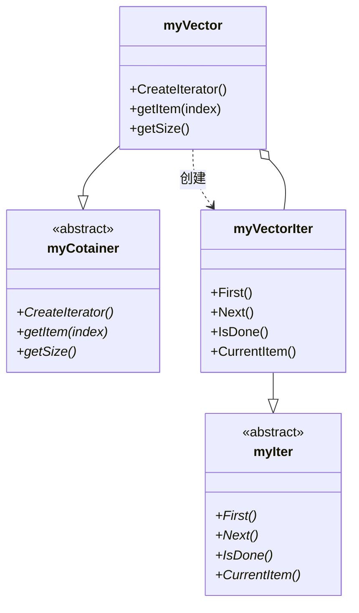

# 第 10 章 迭代器模式

&gt; 原书第 148–155 页 ｜ 本节内容：vector/list 容器与迭代器的简单范例、容器与迭代器解耦的演化、单一职责原则（SRP）与内聚耦合、迭代器模式完整范例（myIter/myCotainer/myVectorIter/myVector 与多态迭代）、迭代器模式 UML 图与 4 种角色、现代 C++ 中迭代器的实现对比与"该模式在 C++ 中已过时"的评价。

迭代器（Iterator）模式是一种行为型模式，用来遍历集合（容器）中的元素。C++ 标准库中内置了很多容器并提供适合这些容器的迭代器，在这种情形下，自己去实现迭代器的机会并不太多，所以该模式较少在实际的项目中使用，但其设计初衷和设计思想仍具备很多值得学习和借鉴的地方。


## 10.1 容器和迭代器的简单范例

读者对 C++ 标准库中的容器，例如 vector、list 等都非常熟悉。首先举个例子分别演示一下 vector 和 list 容器以及相关迭代器的使用。为演示方便，首先在 MyProject.cpp 的最上面，包含两个必需的 C++ 标准库提供的头文件：

```cpp
#include <vector>
#include <list>
```

在 main 主函数中，加入如下代码：

```cpp
std::vector<int> msgVector;
msgVector.push_back(1);     //末尾插入1，vector中内容：1
msgVector.push_back(2);     //末尾插入2，vector中内容：1,2
msgVector.push_back(3);     //末尾插入3，vector中内容：1,2,3
for (std::vector<int>::iterator pos = msgVector.begin(); pos != msgVector.end(); ++pos)
{
    cout << *pos << endl;
}
cout << "--------------------" << endl;

std::list<int>  msgList;
msgList.push_back(1);       //末尾插入1，list中内容：1
msgList.push_front(2);      //开头插入2，list中内容：2,1
msgList.push_back(3);       //末尾插入3，list中内容：2,1,3
for (std::list<int>::iterator pos = msgList.begin(); pos != msgList.end(); ++pos)
{
    cout << *pos << endl;
}
```

执行起来，看一看结果：

```text
1
2
3
--------------------
2
1
3
```

上面范例演示了 vector、list 容器及其相关迭代器的使用。迭代器是用来遍历容器中的元素的，迭代器模式也正是用来设计和书写迭代器的。

迭代器的设计方式有很多种，也经过了多年的演化，而且不同的容器对应的迭代器实现也会非常不同。在早期，人们在设计容器（通常用类模板来实现容器）的时候，会把迭代器的功能代码放到容器中一并实现（在容器内部实现迭代器功能）。例如要实现一个名为 myVector 的容器，代码可能会像下面的样子：

```cpp
template<typename T>
class myVector
{
    //容器功能，例如插入数据等
    //迭代器功能，例如遍历数据等
    //…其他各种功能
};
```

后来发现上述代码的实现方式缺乏灵活性，影响了容器的可扩展性和可维护性。如果将迭代器单独实现为一个类模板，与具体的容器解耦，那么将来如果迭代器的代码发生改变，容器的代码就不必跟着一起改变；反之亦然。这种将迭代器单独实现为一个类模板的方式得到了广泛支持并沿用至今，迭代器模式正是使用这种方式设计和开发迭代器的。

## 10.2 单一职责原则

### 10.2.1 单一职责原则的定义

引入面向对象程序设计的一个原则——单一职责原则（Single Responsibility Principle，SRP），它是这样解释的：**一个类应该只有一个引起变化的原因**，通俗地说，就是一个类的职责应该单一，应该只做一类事情或者对外只提供一种功能。

单一职责原则告诉程序员，在设计类时，要尽量少地指定类中的方法，让类的职责尽量单一。例如，上面如果将容器和迭代器的实现放到一个类中，那么在其中实现从头到尾遍历元素的基础之上，希望增加从尾到头的元素遍历或者跳过几个元素的遍历，可能就会非常不便；如果将迭代器的实现从容器中分离出来，那么修改迭代器或者增加新的迭代器时就不会影响到容器，从而提高了程序的可维护性。

### 10.2.2 内聚与耦合

内聚性用于衡量一个模块（或类）内部各组成部分之间彼此结合紧密程度，是指从功能角度来度量模块内的联系。当一个模块被设计成只支持一组相关功能时，就称它具有高内聚；反之，如果设计成支持一组不相关功能时，称之为具有低内聚。

耦合性是指模块间相互关联的程度，取决于两者间的接口的复杂程度、相互间的调用方式以及调用时哪些信息需要交互。模块间的耦合性可以分为以下几种类型，它们之间的耦合度由高到低排列如下（内容偏理论，简单理解即可）：

（1）内容耦合——当一个模块直接修改或操作另一个模块的数据或一个模块不通过正常入口而转入另一个模块时，称为内容耦合。内容耦合的耦合程度最高，应避免使用。

（2）公共耦合——两个或两个以上的模块共同引用一个全局数据项（全局数据结构、共享的通信区、内存的公共覆盖区等），称为公共耦合。在具有大量公共耦合的结构中，确定哪个模块对全局数据项进行了操作十分困难。

（3）外部耦合——一组模块都访问同一全局简单变量而不是同一全局数据结构，而且不是通过参数表传递该全局变量的信息，称为外部耦合。

（4）控制耦合——一个模块通过传送开关、标志、名字等控制信息（统称控制信号），明显地控制选择另一模块的功能，称为控制耦合。

（5）标记耦合——指两个模块间传递的是数据结构，例如，高级语言中的数组名、记录名、文件名等，其实传递的是该数据结构的地址。

（6）数据耦合——模块之间通过参数传递数据，称为数据耦合。数据耦合的耦合程度最低，这种耦合方式大量存在于程序代码中，例如，程序中往往需要将某些模块的输出数据（返回结果）作为另一些模块的输入数据（通过参数传递）。

耦合性影响软件的复杂程度和设计质量，如果模块间必须存在耦合，那么尽量使用数据耦合，少用控制耦合，限制公共耦合的范围，尽量避免使用内容耦合。

从整体而言，程序设计讲究的**高内聚、低耦合**，如图 10.1 所示。一个类职责越单一，内聚度就越高，而要达到低耦合的目的，也要尽量遵循依赖倒置原则——高层组件和低层组件都依赖于抽象层或者说尽量使用抽象耦合来代替具体耦合。


*图 10.1 高内聚、低耦合表现形式图（原书第 150 页）*

在单一职责原则指导下的类开发，可以有效降低类的复杂度，一个类只负责一个职责，其实现逻辑会比负责多个职责简单得多，不但提高了类设计代码的可读性与可维护性，也极大地降低了代码变更时引起的风险。考虑到软件设计中需求变更的频繁性，单一职责原则可以在修改一个功能时显著降低对其他功能的影响。

单一职责原则说起来简单，但真正落实并不容易，在设计中区分哪些是类应该做的事情（类的责任）很困难，必须不断地努力去思考和改进。特别值得一提的是，单一职责原则不是面向对象程序设计所独有的，而是普遍适用于模块化的程序设计中。

## 10.3 迭代器模式的范例及现代 C++ 中的迭代器

### 10.3.1 迭代器模式范例

迭代器模式虽然是用来设计和书写迭代器的，但一个完整的迭代器模式一般会涉及容器和迭代器两部分内容。为了遵循依赖倒置原则，对容器类（类模板）和迭代器类的实现又分别运用了抽象。

现在，采用迭代器模式来实现一个范例，范例中包含抽象和具体的容器以及迭代器的实现代码，代码做了很多简化，只采用了一个固定大小的数组作为容器，一并实现该容器相关的迭代器。首先创建一个抽象迭代器（请特别留意代码中的注释）：

```cpp
//抽象迭代器类模板
template<typename T>
class myIter
{
public:
    virtual void First() = 0;           //指向容器中第一个元素
    virtual void Next() = 0;            //指向下一个元素
    virtual bool IsDone() = 0;          //是否遍历完
    virtual T& CurrentItem() = 0;       //获取当前的元素
    virtual ~myIter(){}                 //作父类时析构函数应该为虚函数
};
```

上述抽象迭代器只实现了 4 个接口，这 4 个接口一般被认为是迭代器应该实现的最小接口。当然，也可以根据实际需要，增加更多的接口。接着，创建一个抽象容器：

```cpp
//抽象容器类模板
template<typename T>
class myCotainer
{
public:
    virtual myIter<T>* CreateIterator() = 0;    //创建迭代器
    virtual T& getItem(int index) = 0;          //获取当前元素
    virtual int getSize() = 0;                  //容器中元素数量
    virtual ~myCotainer() {}                    //作父类时析构函数应该为虚函数
};
```

从上面的代码中可以看到，为了支持所谓的**多态迭代**，在抽象容器类模板中定义了一个 CreateIterator 接口（成员函数），后续在具体的容器子类模板中，会在该接口中运用工厂模式创建相应的迭代器。再创建一个具体的迭代器：

```cpp
//具体迭代器类模板，为简单起见，本迭代器针对的是大小为10个元素的数组
template<typename T>
class myVectorIter :public myIter<T>
{
public:
    myVectorIter(myCotainer<T>* tmpc) :myvector(tmpc)
    {
        m_current = 0;
    }
    virtual void First()
    {
        m_current = 0;      //容器(数组)中的第一个元素下标为0
    }
    virtual void Next()
    {
        m_current++;        //下标+1，意味着数组中的下一个元素
    }
    virtual bool IsDone()
    {
        if (m_current >= myvector->getSize())
        {
            return true;
        }
        return false;
    }
    virtual T& CurrentItem()
    {
        return myvector->getItem(m_current);
    }
private:
    myCotainer<T>* myvector;
    int m_current;          //记录数组的当前下标(迭代器在当前容器中的位置)
};
```

最后创建一个具体的容器：

```cpp
//具体容器类模板
template<typename T>
class myVector :public myCotainer<T>
{
public:
    myVector()
    {
        //将数组中元素进行初始化
        for (int i = 0; i < 10; ++i)
        {
            m_elem[i] = i;
        }
    }
    virtual myIter<T>* CreateIterator()
    {
        //工厂模式，注意实参传递进去的是该容器的指针this
        return new myVectorIter<T>(this);       //要考虑在哪里释放的问题
    }
    virtual T& getItem(int index)
    {
        return m_elem[index];
    }
    virtual int getSize()
    {
        return 10;      //为简化代码，返回固定数字
    }
private:
    //为了简化代码，将容器实现为固定装入10个元素的数组
    T m_elem[10];
};
```

在上述代码中，CreateIterator 接口使用了工厂模式来创建一个具体的迭代器，从而实现了多态迭代（这意味着可以增加创建其他迭代器的接口来支持不同的迭代器，例如，再支持一个反向迭代器来从最后一个元素向前遍历等）。

本范例中迭代器所实现的功能有限，读者可以通过增加新的接口来扩展迭代器的功能，例如增加插入数据的接口等。另外，C++ 标准库中的容器和迭代器实现代码非常复杂，尤其是容器中涉及各种不同的数据结构和算法等。

在 main 主函数中，增加如下代码：

```cpp
myCotainer<int>* pcontainer = new myVector<int>();
myIter<int>* iter = pcontainer->CreateIterator();

//遍历容器中的元素
for(iter->First(); !iter->IsDone(); iter->Next())       //多态机制的遍历，效率不高，尽量考虑栈机制
{
    cout << iter->CurrentItem() << endl;
}

//释放资源
delete iter;
delete pcontainer;
```

执行起来，看一看结果：

```text
0
1
2
3
4
5
6
7
8
9
```

从结果中可以看到，通过迭代器，顺利遍历得到了容器中的元素。从整个程序代码可以看到，迭代器接口实际上还是通过调用容器中提供的各种接口来完成对元素的遍历的。

此外，上述代码中的 for 循环，所调用的迭代器接口 First、IsDone、Next、CurrentItem 都是多态机制，显然，如果容器中的元素数量非常庞大，则会非常影响程序的运行效率，所以，如果不是必须使用迭代器的多态机制，则可以将迭代器的内存在栈中分配，这对改善程序运行性能将起到很好的作用。修改 main 主函数中的代码，具体如下：

```cpp
myCotainer<int>* pcontainer = new myVector<int>();
myVectorIter<int> iter(pcontainer);

//遍历容器中的元素
for(iter.First(); !iter.IsDone(); iter.Next())      //非多态机制，可以明显改善程序性能
{
    cout << iter.CurrentItem() << endl;
}

//释放资源
delete pcontainer;
```

结合上面的代码，再联想到 C++ 标准库。C++ 标准库中的容器（集合）内部数据结构各不相同（例如，vector 容器内部实现方式是一个内存连续的动态数组，而 list 容器内部实现方式是一个双向链表，map 容器内部实现方式是一个树结构等）。对于这些容器，迭代器模式做到了在不暴露容器内部结构的情况下，让外部代码（迭代器）透明地遍历（访问）其包含元素的效果。另外值得一提的是，虽然不同的容器内部实现方式不同，但是通过迭代器来访问它们的方式却相同。

引入**"迭代器"设计模式的定义**：提供一种方法顺序访问一个聚合对象（容器）中各个元素，而又不暴露该对象的内部表示（实现代码）。

迭代器模式的核心思想就是把容器中对元素访问的代码放入迭代器中实现，与容器本身的功能代码相分离（容器是一个对象，迭代器是另一个对象），从而简化容器的设计。容器和迭代器之间彼此独立，从而使整个系统的设计更加灵活，可以定义不同的迭代器实现不同的遍历策略，例如常规迭代器、反向迭代器、const 迭代器等都可以分别实现（读者应该不希望容器的接口中充斥着各种不同的遍历操作）。

针对前面的代码范例绘制迭代器模式的 UML 图，如图 10.2 所示。



图中 myVector 类的 CreateIterator 方法通过工厂模式返回一个具体的迭代器对象：`return new myVectorIter<T>(this);`。

*原书图 10.2（第 165 页）：*

迭代器模式的 UML 图包含 4 种角色。

（1）Iterator（抽象迭代器）：用于定义访问和遍历容器中元素的接口。这里指 myIter 类模板。

（2）ConcreteIterator（具体迭代器）：实现了抽象迭代器的接口，完成对聚合对象（容器）中元素的遍历，记录当前元素的位置。这里指 MyVectorIter 类模板。

（3）Aggregate（抽象聚合）：将聚合理解成容器。用于存储和管理元素对象，声明一个 CreateIterator 方法用于创建一个迭代器对象，充当创建迭代器的工厂角色。这里指 MyContainer 类模板。

（4）ConcreteAggregate（具体聚合）：实现了抽象聚合的 CreateIterator 方法以创建相应的迭代器，该方法返回 ConcreteIterator 的一个适当的实例。这里指 MyVector 类模板。

### 10.3.2 现代 C++ 中的迭代器

在 C++ 标准库中，针对各种容器都提供了相应的迭代器，而且迭代器的功能十分强大，所以已经很少需要进行迭代器的编写工作了，尤其是本章介绍的迭代器模式使用的是面向对象程序设计的方法进行编程（面向对象编程），大量用到了虚函数这种多态技术，这种多态也叫作传统多态或者动态多态，是一种运行时的多态技术，因为要访问虚函数表指针，所以如果容器中有数量庞大的元素（例如数十万个），那么遍历效率会非常低。C++ 标准库中迭代器的实现在采用模板编程的同时，不会引入动态多态技术。

迭代器设计模式中将容器与迭代器分开设计和实现的思想，在 C++ 标准库中仍旧一直被遵循。当然，C++ 标准库中对迭代器的设计和实现还有着更严格的规范，同时，C++ 标准库中也对迭代器进行了详细的分类，不同种类的迭代器都支持一系列不同的操作，例如，双向迭代器支持前移和后退一个元素的操作，而随机访问迭代器除支持双向迭代器的全部功能外，还额外支持前进和后退 N 个元素的操作等。这些知识在笔者的《C++ 新经典》一书中进行过详细的阐述。此外，笔者的《C++ 新经典：模板与泛型编程》一书中，有一个针对 list 容器和其相关迭代器的源码实现，有兴趣的读者可以参考借鉴。

总之，本章的迭代器模式作为研究和学习有相应的价值和意义，在其他不支持泛型编程的程序设计语言中，该模式可能被广泛使用，但因多态导致的效率原因，不要用于 C++ 程序的实际开发中，因为这种设计模式在 C++ 中已过时。另外，即便是因为特殊需要而开发自己的迭代器功能，也应该多借鉴现代 C++ 标准库中迭代器的源代码，以拓展思路和视野，从而写出更优质、更通用和效率更高的迭代器实现代码。
