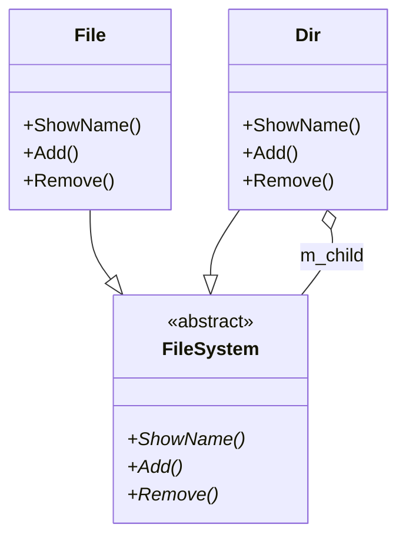
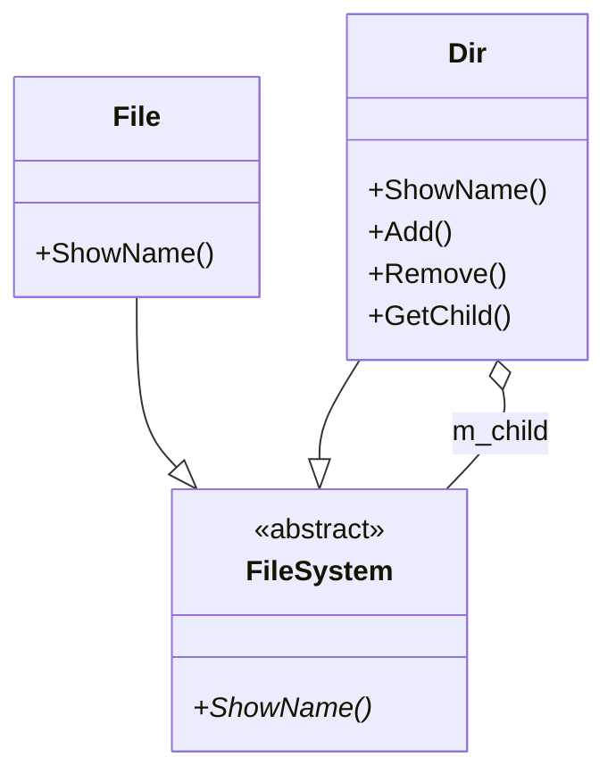
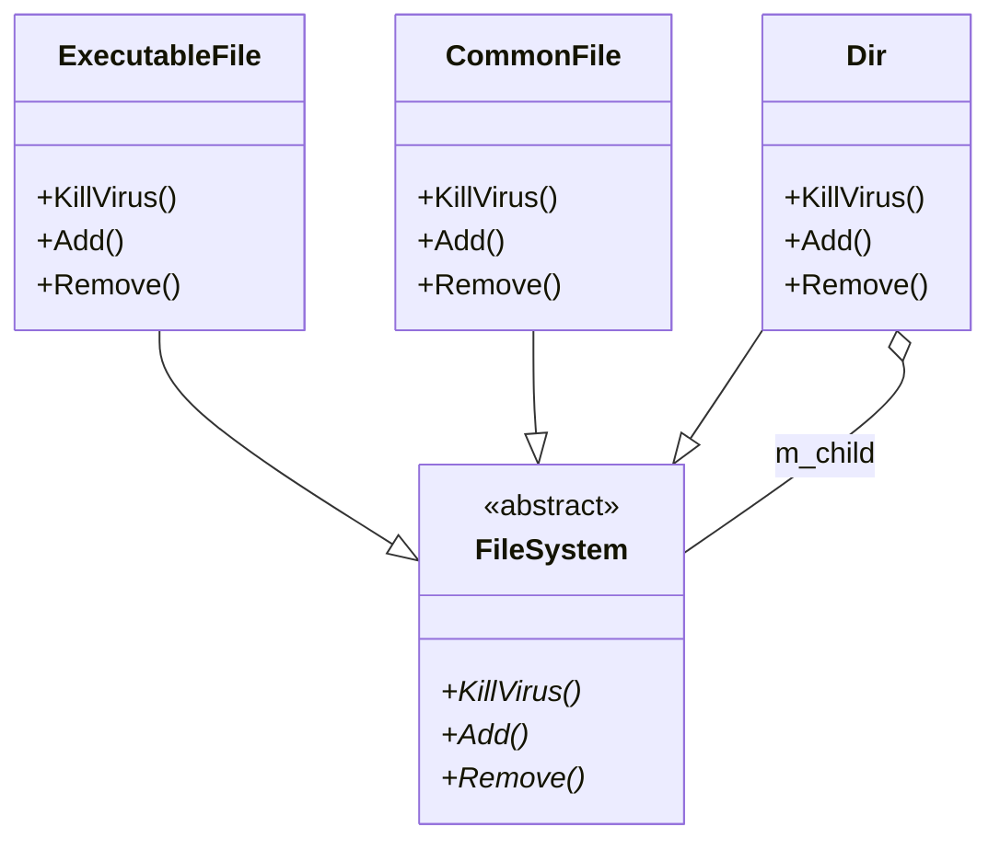
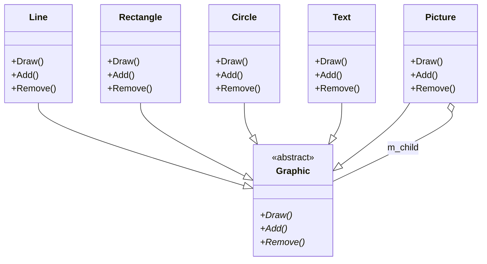

# 第 11 章 组合模式

&gt; 原书第 156–171 页 ｜ 本节内容：目录内容遍历范例（File/Dir 类 + 递归显示）、用组合模式（FileSystem 抽象父类）改造范例、组合模式定义与 UML 图及 3 种角色、优缺点与注意事项、透明组合模式与安全组合模式的取舍、countNumOfFiles 递归统计、公司组织架构 / 杀毒软件 / 图形编辑器等应用场景。

组合（Composite）模式是一种结构型模式，理解上稍微有点难度，代码实现中涉及了递归调用。组合模式与传统上读者所知的"类与类之间的组合关系"没有关联，不要混为一谈。组合模式主要用来处理树形结构的数据，例如 Windows 或者类 UNIX 操作系统中文件的组织方式就是典型的树形结构。这里所指的数据就是这些文件或者文件夹，而处理树形结构数据是指例如可以对它们进行遍历以显示目录或文件名（查看目录文件结构）、进行某些动作（例如信息统计、文件杀毒）等操作。

当然，如果所要表达的数据并不是通过树形结构进行组织，那么不适合使用组合模式。


## 11.1 一个基本的目录内容遍历范例

组合模式主要是用来表达和处理树形结构数据的，作为树形结构的数据，显然要有一个树根，树根下面可以有**树枝和树叶**两种节点，而树枝下面又可能进一步生长出新的树枝和树叶（树叶属于末端节点，其上不会生长出任何其他内容），以此类推，如图 11.1 所示。


*图 11.1 树形结构示意图（原书第 156 页）*

人们熟知的 Windows 操作系统和 Linux 操作系统的目录结构组织方式就是典型的树形结构，例如，在 Windows 操作系统的 C 盘下有一个 root 目录，该目录下有 common.mk、config.mk、makefile 3 个文件以及 app、signal、_include 3 个子目录（每个子目录中都有一些文件），当然这些子目录中还可以包含更深的子目录以及文件：

```text
C:\root
├─common.mk
├─config.mk
├─makefile
│
├─app
│  ├──nginx.c
│  └──ngx_conf.c
│
├─signal
│  └──ngx_signal.c
│
├─_include
│  ├──ngx_func.h
│  └──ngx_signal.h
```

将上述这种目录结构组织方式绘制成树形结构，如图 11.2 所示。


*图 11.2 root 目录结构树形结构示意图（原书第 157 页）*

看一看如何用程序来把这个目录层次结构组织并输出（绘制出来），输出的结果类似于用 tree 命令显示 root 目录产生的结果（考虑到组合模式不太好理解，可以先抛开这个模式），这个范例的难点在于目录中还会包含更深层次的目录和文件，而这些目录和文件的名字都要求输出出来，所以实现思路应该涉及递归编程。首先创建一个用于表示文件的类 File，代码如下，注意代码中的注释：

```cpp
//文件相关类
class File
{
public:
    //构造函数
    File(string name) :m_sname(name){}
    //显示文件名
    void ShowName(string lvlstr)                    //lvlstr:为了显示层次关系的缩进字符串内容
    {
        cout << lvlstr << " - " << m_sname << endl;     //显示" - "代表是一个文件,属末端节点
                                                        //(不会再有子节点)
    }
private:
    string m_sname;                                 //文件名
};
```

接着创建一个用于表示目录的类 Dir：

```cpp
//目录相关类
class Dir
{
public:
    //构造函数
    Dir(string name) :m_sname(name) {}

public:
    //目录中可以增加其他文件
    void AddFile(File* pfile)
    {
        m_childFile.push_back(pfile);
    }

    //目录中可以增加其他目录
    void AddDir(Dir* pdir)
    {
        m_childDir.push_back(pdir);
    }

    //显示目录名,同时也要负责其下面的文件和目录名的显示工作
    void ShowName(string lvlstr)                    //lvlstr:为了显示层次关系的缩进字符串内容
    {
        //(1)输出本目录名
        cout << lvlstr << " + " << m_sname << endl;     //显示" + "代表是一个目录,其中会包含其他内容
        //(2)输出所包含的文件名
        lvlstr += "    ";                       //本目录中的文件和目录的显示,要缩进一些来显示
        for (auto iter = m_childFile.begin(); iter != m_childFile.end(); ++iter)
        {
            (*iter)->ShowName(lvlstr);          //显示文件名
        }
        //(3)输出所包含的目录名
        for (auto iter = m_childDir.begin(); iter != m_childDir.end(); ++iter)
        {
            (*iter)->ShowName(lvlstr);          //显示目录名,这里涉及了递归调用
        }
    }
private:
    string          m_sname;                    //目录名
    list<File*>     m_childFile;                //目录中包含的文件列表,记得在源文件上面
                                                //增加代码 #include <list>
    list<Dir*>      m_childDir;                 //目录中包含的子目录列表
};
```

在 main 主函数中，首先构建（表达）出这些文件和目录相关的对象：

```cpp
//(1)创建各种目录,文件对象
Dir* pdir1 = new Dir("root");
// -------
File* pfile1 = new File("common.mk");
File* pfile2 = new File("config.mk");
File* pfile3 = new File("makefile");
// -------
Dir* pdir2 = new Dir("app");
File* pfile4 = new File("nginx.c");
File* pfile5 = new File("ngx_conf.c");
// -------
Dir* pdir3 = new Dir("signal");
File* pfile6 = new File("ngx_signal.c");
// -------
Dir* pdir4 = new Dir("_include");
File* pfile7 = new File("ngx_func.h");
File* pfile8 = new File("ngx_signal.h");

//(2)构造树形目录结构
pdir1->AddFile(pfile1);
pdir1->AddFile(pfile2);
pdir1->AddFile(pfile3);
// -------
pdir1->AddDir(pdir2);
    pdir2->AddFile(pfile4);
    pdir2->AddFile(pfile5);
// -------
pdir1->AddDir(pdir3);
    pdir3->AddFile(pfile6);
// -------
pdir1->AddDir(pdir4);
    pdir4->AddFile(pfile7);
    pdir4->AddFile(pfile8);
```

接着，只需要用树根所代表 的对象调用一下 ShowName 成员函数，即可把整个树的层次结构输出（显示）出来，继续在 main 中增加如下代码：

```cpp
//(3)输出整个目录结构,只要调用根目录的 ShowName 方法即可,每个子目录都有自己的 ShowName 方
//法负责自己的文件和目录的显示
pdir1->ShowName("");                //缩进字符刚开始可以为空
```

最后，不要忘记在 main 主函数中释放资源：

```cpp
//(4)释放资源
delete pfile8;
delete pfile7;
delete pdir4;
// -------
delete pfile6;
delete pdir3;
// -------
delete pfile5;
delete pfile4;
delete pdir2;
// -------
delete pfile3;
delete pfile2;
delete pfile1;
delete pdir1;
```

执行起来，看一看结果：

```text
+ root
    - common.mk
    - config.mk
    - makefile
    + app
        - nginx.c
        - ngx_conf.c
    + signal
        - ngx_signal.c
    + _include
        - ngx_func.h
        - ngx_signal.h
```

从结果中可以看到，只要执行代码行 "pdir1-&gt;ShowName("");"，就会以 pdir1（root）所代表的树节点为根绘制出树的层次结构。同理，如果只想绘制出以 pdir2（app）所代表的树节点为根的树层次结构，只需要执行 "pdir2-&gt;ShowName("");"。

这个范例具有如下主要特点：

（1）将诸多对象以树形结构的形式来组织（目录和文件以树形结构来组织，合乎情理）。

（2）以一个树根为起点，可以**遍历**（访问）到所有该根下的树节点（既包含树枝，又包含树叶）。

（3）同时对这些树节点**调用一个被称为 ShowName 的成员函数**（名字当然可以任意）做了一些事情（这里是用于显示名字），当然，在本范例中，File 类和 Dir 类的 ShowName 函数虽然名字相同，但它们做的事情并不相同，因为 Dir 类的 ShowName 不但要显示自身的名字，还要显示其下的文件和目录名字，而其下目录名字的显示，使用的正是递归调用，当然这里所说的递归区别于传统意义上的递归（函数调用自身），而是一种针对对象本身的递归。

上面这个范例代码中存在的问题是：为了区分文件和目录，分别创建了 File 和 Dir 两个类，这种区分比较多余，为此，引入了组合模式，该模式专门针对以树形结构的形式组织对象时，不再将 File 和 Dir 类单独分开，而是引入一个新的抽象类（例如 FileSystem）并提供公共的接口（成员函数），而后让 File 和 Dir 类分别继承自 FileSystem 类。看一看如何采用组合模式改造上述范例代码。

## 11.2 使用组合模式改造目录内容遍历范例

首先注释掉原有代码，创建抽象父类 FileSystem，代码如下：

```cpp
//抽象父类FileSystem(抽象接口)
class FileSystem
{
public:
    virtual void ShowName(int level) = 0;               //显示名字,参数level用于表示显示的层
                                                        //级,用于显示对齐
    virtual int Add(FileSystem* pfilesys) = 0;          //向当前目录中增加文件或子目录
    virtual int Remove(FileSystem* pfilesys) = 0;       //从当前目录中移除文件或子目录
    virtual ~FileSystem() {}                            //作父类时析构函数应该为虚函数
};
```

接着创建一个用于表示文件的类 File，继承自 FileSystem：

```cpp
//文件相关类
class File :public FileSystem
{
public:
    //构造函数
    File(string name) :m_sname(name) {}
    //显示名字
    virtual void ShowName(int level)
    {
        for (int i = 0; i < level; ++i) { cout << "    "; }     //显示若干空格用于对齐
        cout <<  " - " << m_sname << endl;
    }
    virtual int Add(FileSystem* pfilesys)
    {
        //文件中其实是不可以增加其他文件或者目录的,所以这里直接返回 -1,但父类中定义了
        //该接口,所以子类中也必须实现该接口
        return -1;
    }
    virtual int Remove(FileSystem* pfilesys)
    {
        //文件中不包含其他文件或者目录,所以这里直接返回 -1
        return -1;
    }
private:
    string m_sname;                     //文件名
};
```

接着创建一个用于表示目录的类 Dir（继承自 FileSystem）：

```cpp
//目录相关类
class Dir :public FileSystem
{
public:
    //构造函数
    Dir(string name) :m_sname(name) {}
    //显示名字
    virtual void ShowName(int level)
    {
        //(1)显示若干空格用于对齐
        for (int i = 0; i < level; ++i) { cout << "    "; }
        //(2)输出本目录名
        cout << " + " << m_sname << endl;
        //(3)显示的层级向下走一级
        level++;
        //(4)输出所包含的子内容(可能是文件,也可能是子目录)
        //遍历目录中的文件和子目录
        for (auto iter = m_child.begin(); iter != m_child.end(); ++iter)
        {
            (*iter)->ShowName(level);
        }                               //end for
    }
    virtual int Add(FileSystem* pfilesys)
    {
        m_child.push_back(pfilesys);
        return 0;
    }
    virtual int Remove(FileSystem* pfilesys)
    {
        m_child.remove(pfilesys);
        return 0;
    }
private:
    string m_sname;                     //文件名
    list<FileSystem*> m_child;          //目录中包含的文件或其他目录列表
};
```

在 main 主函数中，注释掉原有代码，增加如下代码：

```cpp
//(1)创建各种目录,文件对象
FileSystem* pdir1 = new Dir("root");
// -------
FileSystem* pfile1 = new File("common.mk");
FileSystem* pfile2 = new File("config.mk");
FileSystem* pfile3 = new File("makefile");
// -------
FileSystem* pdir2 = new Dir("app");
FileSystem* pfile4 = new File("nginx.c");
FileSystem* pfile5 = new File("ngx_conf.c");
// -------
FileSystem* pdir3 = new Dir("signal");
FileSystem* pfile6 = new File("ngx_signal.c");
// -------
FileSystem* pdir4 = new Dir("_include");
FileSystem* pfile7 = new File("ngx_func.h");
FileSystem* pfile8 = new File("ngx_signal.h");

//(2)构造树形目录结构
pdir1->Add(pfile1);
pdir1->Add(pfile2);
pdir1->Add(pfile3);
// -------
pdir1->Add(pdir2);
pdir2->Add(pfile4);
pdir2->Add(pfile5);
// -------
pdir1->Add(pdir3);
pdir3->Add(pfile6);
// -------
pdir1->Add(pdir4);
pdir4->Add(pfile7);
pdir4->Add(pfile8);

//(3)输出整个目录结构,只要调用根目录的 ShowName 方法即可,每个子目录都有自己的 ShowName 方
//法负责自己的文件和目录的显示
pdir1->ShowName(0);

//(4)释放资源
delete pfile8;
delete pfile7;
delete pdir4;
// -------
delete pfile6;
delete pdir3;
// -------
delete pfile5;
delete pfile4;
delete pdir2;
// -------
delete pfile3;
delete pfile2;
delete pfile1;
delete pdir1;
```

执行起来，看一看结果：

```text
+ root
    - common.mk
    - config.mk
    - makefile
    + app
        - nginx.c
        - ngx_conf.c
    + signal
        - ngx_signal.c
    + _include
        - ngx_func.h
        - ngx_signal.h
```

上面使用组合模式对目录内容遍历的范例进行了改造。下面就用这个范例引入组合模式的基本概念。

## 11.3 引入组合模式

树形结构是一种常见的结构，例如：

（1）操作系统中的目录结构；

（2）各种软件工具中的菜单结构；

（3）办公软件中的公司组织结构（公司中包含多个部门，公司下设分公司，分公司依旧包含各种部门）；

（4）窗口程序中包含若干子窗口以及各种组成窗口的其他控件；

（5）编程时可能会用到的 TreeCtrl 和 TreeView UI 控件等。

组合模式正适合处理这种树形结构，该模式只需要执行一行代码 "pdir1-&gt;ShowName(0);"，就可以通过遍历树形结构（运用了递归调用）中的各个节点达到一致性地处理树形结构的目的（例如上述对所有节点，无论树枝还是树叶，都调用 ShowName 成员函数就是一致性处理的体现）。

引入**"组合"设计模式的定义**：将一组对象（文件和目录）组织成树形结构以表示"部分-整体"的层次结构（目录中包含文件和子目录）。使得用户对单个对象（文件）和组合对象（目录）的操作/使用/处理（递归遍历并执行 ShowName 逻辑等）具有一致性。

在上述定义中，用户是指 main 主函数中的调用代码，一致性指不用区分树叶还是树枝，两者都继承自 FileSystem，都具有相同的接口，可以做相同的调用。可以看到，组合模式的设计思路其实就是用树形结构来组织数据，然后通过在树中递归遍历各个节点并在每个节点上统一地调用某个接口（例如，都调用 ShowName 成员函数）或进行某些运算。

总之，组合模式之所以称为结构型模式，是因为该模式提供了一个结构，可以同时包容单个对象和组合对象。**组合模式发挥作用的前提是具体数据必须能以树形结构的方式表示，树中包含了单个对象和组合对象。**该模式专注于树形结构中单个对象和组合对象的递归遍历（只有递归遍历才能体现出组合模式的价值），能把相同的操作（**FileSystem 定义的接口**）应用在单个以及组合对象上，并且可以忽略单个对象和组合对象之间的差别。从模式命名上，笔者认为命名成组合模式其实并不太恰当，命名成树形模式似乎更好。

针对前面的代码范例绘制组合模式的 UML 图，如图 11.3 所示。



*原书图 11.3（第 176 页）：*

组合模式的 UML 图中包含 3 种角色。

（1）Component（抽象组件）：为树枝和树叶定义接口（例如，增加、删除、获取子节点等），可以是抽象类，包含所有子类公共行为的声明或默认实现体。这里指 FileSystem 类。

（2）Leaf（叶子组件）：用于表示树叶节点对象，这种对象没有子节点，因此抽象组件中定义的一些接口（例如 Add、Remove）实际在这里没有实现的意义。这里指 File 类。

这种叶子组件（类）对于组合模式可能不止一个，例如，若对某个目录进行杀毒，可以在抽象组件中提供 KillVirus 成员函数（与上述范例中的 ShowName 成员函数类似），而后可以定义若干个不同的叶子类，例如定义 ExeFile 类并实现 KillVirus 专门灭杀可执行文件中的病毒，定义 ImgFile 类并实现 KillVirus 专门灭杀图像文件中的病毒等。

（3）Composite（树枝组件）：用于表示一个容器（树枝）节点对象，可以包含子节点，子节点可以是树叶，也可以是树枝，其中提供了一个集合用于存储子节点（以此形成一个树形结构，可以通过递归来访问所有节点）。实现了抽象组件中定义的接口。这里指 Dir 类。

Dir 类中提供的集合是一个用于存储子节点的 list 容器，当然用其他容器保存子节点也完全可以。

在《设计模式——可复用面向对象软件的基础》一书中提出这个设计模式时，主要解决的是所编写的绘图编辑器中的图形显示问题，例如，一个顶层的组件（Frame 或者 Panel 等），内部包含着各种其他组件，例如文本、线、矩形等基本图形元素以及按钮、菜单、滚动条等基本 UI 元素，每个元素都可以写成一个叶子组件，当要显示整个组件时，只需要调用顶层组件的某个方法，顶层组件就会负责显示所有其内部的各种组件的显示工作。

组合模式具有如下主要优点：

（1）使客户端可以忽略单个对象与组合对象的层次差异，客户端可以一致地使用单个对象和组合对象（客户端不知道也不关心处理的是单个对象还是组合对象），简化了代码的书写。

（2）无论是增加新的叶子组件还是树枝组件，都很方便，只需要增加继承自抽象组件的新类即可，这也符合开闭原则。

（3）组合模式为树形结构的面向对象实现方式提供了一种灵活的解决方案。通过对单个对象以及组合对象的递归遍历，可以处理复杂的树形结构。

当然，使用组合模式时也需要额外考虑一些问题：

（1）组合模式的主要目的之一是使客户端不知道它们正在使用的是单个对象还是组合对象，所以，抽象组件应该为叶子组件和树枝组件尽量多定义一些公共操作（类似于 ShowName 这样的成员函数），抽象组件可以为这些操作提供默认实现代码，而叶子组件和树枝组件也可以对这些公共操作进行重定义。

（2）根据业务的需要，组件可以有一个指向父节点的指针，以便更方便地进行节点遍历时，尤其是如果涉及某个节点的删除操作，往往需要用到指向其父节点的指针。

（3）学习过编译原理或从事编译器设计的读者会接触到语法分析树，语法分析树适合用组合模式来表示，但这里存在树形结构中各节点的遍历顺序问题，这可能需要在增加和删除子节点时做一些更复杂的管理工作（指的是也许有必要修改 Dir 类的 Add 和 Remove 代码来做一些更精细的代码编写工作）。类似地，在以二叉树的形式计算表达式的值时，也同样涉及该问题。在这里只是提出这些话题，从事这方面工作的读者，可以自行深入研究。

与遍历顺序相关的，当然还有上述已经提过的存储子节点时所使用的容器问题，范例中使用的是 list 这种顺序容器，当然也可以采用其他顺序容器。此外，C++ 标准库中还提供关联容器和无序容器，可以从使用便利性和访问效率这两个角度根据实际情况选用。

## 11.4 透明组合模式与安全组合模式

组合模式使项目的设计更具弹性，可以通过增加更多的叶子组件类来扩展出新的功能。但是，在 FileSystem 类中，诸如 Add、Remove 这些用于管理和访问子节点的成员函数（接口）只对树枝组件（Dir 类）才有意义，对叶子组件（File 类）毫无意义。

这种在抽象组件（FileSystem 类）中声明了所有用于管理和访问子节点的成员函数的实现手段称为**透明组合模式**。上述范例采用的正是这种透明组合模式，这也是组合模式的标准实现形式。采用透明组合模式的好处是确保所有的组件（File 类、Dir 类）都有相同的接口，但也是有缺点的：

（1）必须在叶子组件中实现这些接口，哪怕在其中增加的代码毫无实际意义（除非在抽象组件中提供了默认实现）。

（2）还有一个关键的问题是容易被误用，不够安全。叶子组件和树枝组件毕竟不同，叶子组件不可以有子节点。当向一个叶子组件中加入子节点时，目前的范例程序中仅仅返回 -1（File 类中的 Add 成员函数），这也许没有办法让程序员立即知道这种行为是错误的，当然可以考虑增加一些错误提示或者抛出异常来提醒程序员，但至少在程序编译阶段，向叶子组件中增加子节点的错误是没有办法被发现的。

鉴于透明组合模式所产生的问题，又引入了安全组合模式。在安全组合模式中，抽象组件中用于管理和访问子节点的成员函数（接口）被转移到了树枝组件中。安全组合模式的 UML 图，如图 11.4 所示。



*原书图 11.4（第 178 页）：*

安全组合模式不够透明，用于管理和访问子节点的成员函数（接口）并没有在抽象组件中定义，所以客户端（例如 main 主函数）无法完全针对抽象进行编程，必须调整代码来区别对待叶子组件和树枝组件（因为树枝和叶子具有不同的接口）。这里按照安全组合模式对前述范例进行修改，修改后的代码如下：

```cpp
//抽象父类FileSystem(抽象接口)
class FileSystem
{
public:
    virtual void ShowName(int level) = 0;   //显示名字,参数level用于表示显示的层级,用于显示对齐
    virtual ~FileSystem() {}                //作父类时析构函数应该为虚函数
};

//文件相关类
class File :public FileSystem
{
public:
    //构造函数
    File(string name) :m_sname(name) {}

    //显示名字
    void ShowName(int level)
    {
        for (int i = 0; i < level; ++i) { cout << "    "; }     //显示若干空格用于对齐
        cout << " - " << m_sname << endl;
    }
private:
    string m_sname;             //文件名
};

class Dir :public FileSystem
{
    //该类内容基本没变,把Add和Remove成员函数前面的virtual修饰符去掉即可
    //…略
};
```

在 main 主函数中，注释掉原有代码，增加如下代码：

```cpp
//(1)创建各种目录,文件对象
Dir* pdir1 = new Dir("root");
// -------
FileSystem* pfile1 = new File("common.mk");
FileSystem* pfile2 = new File("config.mk");
FileSystem* pfile3 = new File("makefile");
// -------
Dir* pdir2 = new Dir("app");
FileSystem* pfile4 = new File("nginx.c");
FileSystem* pfile5 = new File("ngx_conf.c");
// -------
Dir* pdir3 = new Dir("signal");
FileSystem* pfile6 = new File("ngx_signal.c");
// -------
Dir* pdir4 = new Dir("_include");
FileSystem* pfile7 = new File("ngx_func.h");
FileSystem* pfile8 = new File("ngx_signal.h");

//(2)构造树形目录结构
//这部分内容基本没变
//…略

//(3)输出整个目录结构,只要调用根目录的 ShowName 方法即可,每个子目录都有自己的 ShowName 方
//法负责自己旗下的文件和目录的显示
pdir1->ShowName(0);

//(4)释放资源
//这部分内容基本没变
//…略
```

这样修改代码后，如果再向单个对象中加入其他对象的代码，编译时就会报错。例如：

```cpp
pfile1->Add(pfile2);        //错误,不可以向单个对象中加入其他对象
```

当然，在安全组合模式实现中，也因为树枝和叶子具有不同的接口，所以编码中也可以判断某个节点是不是组合对象（树枝）。在 FileSystem 类定义之前增加对 Dir 类的前向声明，代码如下：

```cpp
class Dir;
```

然后为 FileSystem 增加一个新的 public 修饰的虚函数：

```cpp
public:
    virtual Dir* ifCompositeObj() { return nullptr; }
```

在 Dir 中重写该虚函数：

```cpp
public:
    virtual Dir* ifCompositeObj() { return this; }
```

然后就可以用下面的语句判断对象是否是组合对象：

```cpp
Dir* pdir2 = new Dir("app");
if (pdir2->ifCompositeObj() != nullptr)
{
    //是组合对象,可以向其中增加单个对象和其他组合对象
}
```

如果不增加 ifCompositeObj 成员函数，而使用 dynamic_cast 类型转换运算符，也能达到同样的效果：

```cpp
if (dynamic_cast<Dir*>(pdir2) != nullptr)
{
    //是组合对象,可以向其中增加单个对象和其他组合对象
}
```

总之，组合模式的安全性和透明性两者不可兼得，在选择时必须做出权衡，笔者更倾向选择前者。

如果想扩展上述程序的功能——统计目录下所包含的文件个数，则可以在 FileSystem 类中增加新的调用接口（成员函数），其代码如下：

```cpp
public:
    virtual int countNumOfFiles() = 0;      //统计目录下包含的文件个数
```

在 File 子类中，countNumOfFiles 接口实现代码如下：

```cpp
public:
    virtual int countNumOfFiles()
    {
        return 1;       //文件节点,做数量统计时按1计算
    }
```

在 Dir 子类中，countNumOfFiles 接口实现代码如下（这段代码值得仔细研究）：

```cpp
public:
    virtual int countNumOfFiles()
    {
        int iNumOfFiles = 0;
        for (auto iter = m_child.begin(); iter != m_child.end(); ++iter)
        {
            iNumOfFiles += (*iter)->countNumOfFiles();      //递归调用
        }
        return iNumOfFiles;
    }
```

之后在 main 主函数中，可以增加代码行，以统计某个目录下所包含的文件个数，例如统计 pdir1 所代表的 root 目录下包含的所有文件数量（包含子目录中的文件数量）：

```cpp
cout << "文件的数量为: " << pdir1->countNumOfFiles() << endl;
```

类似地，如果统计某个目录下所有文件的尺寸之和，实现代码也非常类似，请读者自己尝试实现。

## 11.5 其他使用组合模式的场景探讨

为了帮助读者进一步理解组合模式的具体运用，这里进一步举几个常用的采用了组合模式设计的范例。

（1）在公司组织结构中采用组合模式，公司组织架构如图 11.5 所示。


*图 11.5 公司组织架构示意图（原书第 170 页）*

在公司组织架构中，人力资源部、财务部、技术部等可以作为叶子组件来分别创建继承自一个抽象类的单独的类，而北京分公司（以及其他各个分公司）可以作为树枝组件来创建一个类（继承自抽象类）。而后就可以利用组合模式这种"牵一发而动全身"的能力，完成诸如向所有部门发送通告、统计所有部门人数、计算整个公司薪资成本等工作，当然，统计人数以及计算薪资成本的代码编写方法可以参考前述 countNumOfFiles 成员函数的代码实现。

（2）对某个目录下的所有文件（包括子目录的文件）进行杀毒工作。

假设这是一款 Windows 操作系统平台下的杀毒软件，可以检查各种文件中是否带有病毒。因为可执行文件（扩展名为 .exe 和 .com 等的文件）是查杀病毒的重点，为此，可以将可执行文件与其他普通文件区别开来，专门为可执行文件创建单独的类。相关的 UML 图如图 11.6 所示。



*原书图 11.6（第 181 页）：*

在图 11.6 中，设计了 FileSystem 作为抽象组件，ExecutableFile 作为叶子组件，专门处理针对可执行文件的病毒查杀工作，而其他类型的文件可以用 CommonFile 叶子组件来处理。针对上述 UML 图，实现这些类非常简单，此处不一一实现了。唯一值得注意的是，遇到 .exe、.com 等可执行文件时创建的是 ExecutableFile 类型的对象：

```cpp
FileSystem* pdir = new Dir("root");
//…略
FileSystem* pfileexe = new ExecutableFile("run.exe");
pdir->Add(pfileexe);
```

当使用组合模式组织好整个目录结构后，只需要使用诸如下面的语句就可以对整个目录进行杀毒：

```cpp
pdir->KillVirus();
```

KillVirus 成员函数中的代码是真正的杀毒相关代码，与本章讲解的组合模式无关，读者可以在测试中使用一条 cout 输出语句作为 KillVirus 的函数体来表示对文件进行了杀毒。最后，记得使用 delete 释放相关的资源。

另外，如果需要对某种特殊类型的文件，例如声音类、视频类文件等进行专门的处理，可以继续增加新的叶子组件类来实现，在组合模式中，并不限定叶子组件类的数量。

（3）利用图元进行图形的绘制工作。

在一个用基本图元（线、矩形、圆形、文本）绘图的简单图形编辑器中，就可以把一个绘制好的图形以树形结构通过组合模式来表达。再回顾一下：因为组合模式使对单个对象和组合对象的操作具有一致性，这就意味着抽象组件类既可以代表一个图元，又可以代表容纳这些图元的容器（用图元绘制出的整个图形）。如图 11.7 所示的 UML 图描述了图元绘制需求。



*原书图 11.7（第 182 页）：*

在图 11.7 中，设计了 Graphic（图形）作为抽象组件，Line、Rectangle、Circle、Text 作为叶子组件分别表示线、矩形、圆形、文本等图元，Draw 方法代表对该图元的绘制动作，Picture（图片）作为树枝组件，其下又可以包含其他的各种叶子组件以及树枝组件。所以从整体来看，这构成了一个树形结构，适合用组合模式来表达这种树形结构并完成整个图形的绘制工作。一个典型的由递归组合而成的图形（Graphic）对象结构可能如图 11.8 所示。


*图 11.8 图形对象结构示意图（原书第 171 页）*
