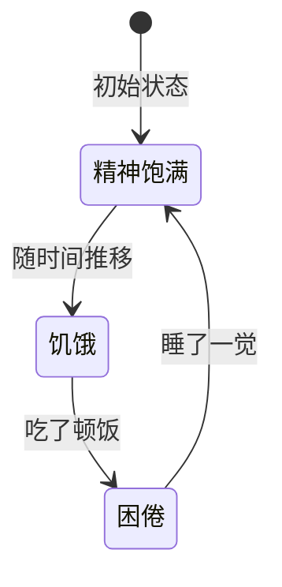
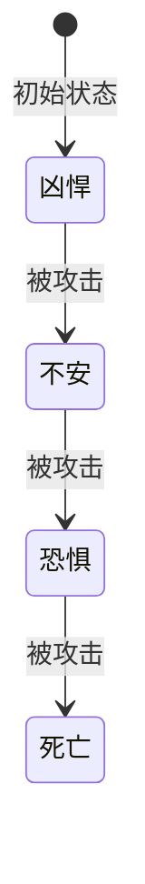
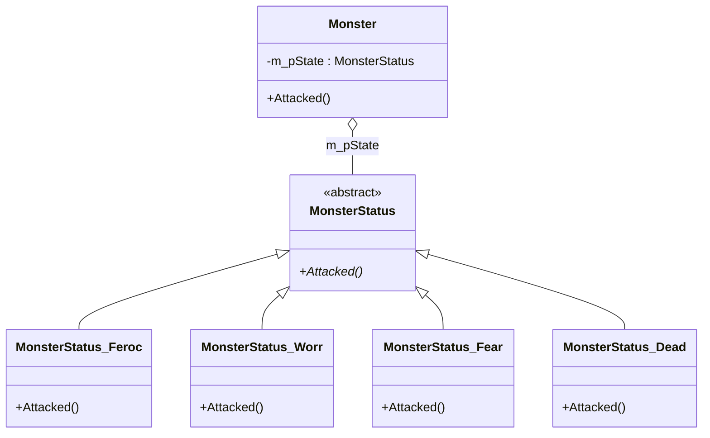

# 第 12 章 状态模式

&gt; 原书第 172–187 页 ｜ 本节内容：有限状态机概念与状态转换图、怪物状态传统 if…else 实现及其维护难题、用状态模式改造（MonsterStatus 状态类族 + 委托机制）、状态转换代码移入具体状态类的改进版、状态模式定义与 UML 图及 3 种角色、状态模式与策略模式的区别、状态类的单件实现方式。

状态（State）模式是一种行为型模式，其实现可完成类似有限状态机的功能。换句话说，一个对象可以处于多种不同的状态（当然，同一时刻只能处于某一种状态），从而让对象产生不同的行为。通过状态模式可以表达出这些不同的状态并实现对象在这些状态之间的转换。**状态模式最突出的特点是用类来表示状态**，这一点与策略模式有异曲同工之妙（**策略模式中用类来表示策略**）。状态模式与策略模式从 UML 图上看完全相同，只不过两者所运用的场合以及所表达的目的不同。

状态模式有一定的难度，不太好理解，请读者认真分析和理解范例代码。


## 12.1 一个基本的状态转换范例

状态模式一般用于实现有限状态机。有限状态机（Finite State Machine，FSM）简称状态机。状态机有 3 部分组成：状态（State）、事件（Event）、动作（Action）。当某个事件（转移条件）发生时，会根据当前状态决定执行哪种动作，然后进入下一种状态，当然，有时不一定会执行某种动作，只是单纯地进入下一种状态。有限状态机的实现方式有多种，例如用 if…else…条件判断分支，也可以用状态模式等。

要理解状态转换，可以设想一下生活中的人类或者说某个人，开始工作时状态是精神饱满，随着时间的推移，逐渐从精神饱满变成饥饿状态，吃了饭之后，状态变为困倦，睡了一觉后又恢复到了精神饱满状态，于是又开始了工作。在这段描述中，可以将某个人看成系统中的某个对象，这个人存在多种状态，例如精神饱满、饥饿、困倦等。人可以在这些种状态之间转换，处于不同的状态下要做的事情不同，例如精神饱满时可以认真工作，饥饿和困倦时都无法正常工作等。状态转换图如图 12.1 所示。



*原书图 12.1 一个基本的状态转换图（第 184 页，转写自原书插图）*

在图 12.1 中，随时间推移、吃了顿饭、睡了一觉都属于发生的事件（转移条件，也可以看成是**触发状态发生变化的行为或动作**），而精神饱满、饥饿、困倦是不同的状态，当然，在图 12.1 中，状态变化后，并没有执行什么具体动作。请注意区分触发状态发生变化的动作与状态发生变化后的动作并不是一回事。例如我揍你，你感觉疼（从不疼到疼，你的状态发生了变化），于是擦了点药。这里"揍你"这个动作是转移条件，而擦了点药是状态变化后执行的具体动作。

这里还是以闯关打斗类游戏的开发为例，游戏中主角的主要任务是杀怪。为了简单起见，约定怪物的生命值是 500 点血。当主角对怪物进行攻击时，怪物会损失血量并有如下行为：

（1）当怪物血量多于 400 点时，怪物处于**凶悍**状态，此时怪物会对主角进行反击。

（2）当怪物血量小于或等于 400 点但多于 100 点时，怪物处于**不安**状态，此时怪物会对主角进行反击并开始呼唤附近的其他怪物支援。

（3）当怪物血量小于或等于 100 点时，怪物处于**恐惧**状态，此时怪物开始逃命。

（4）当怪物血量小于或等于 0 点时，怪物处于**死亡**状态，此时怪物不能再被攻击。

这里怪物一共涉及了 4 种状态，分别是凶悍、不安、恐惧、死亡，而促使怪物状态发生变化的唯一事件是主角对怪物的攻击。当怪物处于各个状态时，也会做出不同的动作，例如，怪物处于凶悍状态时会对主角进行反击，而当怪物处于不安状态时不但会对主角进行反击还会求援，当怪物处于恐惧状态时会开始逃跑，当然怪物处于死亡状态时就不会做出什么动作了。状态转换图如图 12.2 所示。



*原书图 12.2 怪物被主角攻击后的状态转换图（第 184 页，转写自原书插图）*

从图 12.2 中可以看到，怪物的初始状态是凶悍，随着被不断攻击，最后会变成死亡状态，状态之间的转换不一定是一个闭合的环。怪物如果逃跑成功没有被攻击死，则可能就一直处于恐惧状态。当然如果游戏策划约定怪物一段时间不被攻击血量会慢慢恢复，那么只要怪物不死亡，其状态也会慢慢从其他状态恢复到凶悍状态。另外，怪物的状态转换也不一定是按照顺序进行，例如，刚开始怪物是凶悍状态，如果主角攻击力特别强，攻击一下就打掉了怪物 450 点血，那么怪物就剩 50 点血了，这时怪物一下子就变成恐惧状态了。所以图 12.2 的状态转换图只是一个示意图，实际的状态转换可能比较复杂。图中促使怪物状态发生变化的唯一事件是攻击怪物，如果给主角增加一种给怪物加血的能力（只要游戏策划允许这么干），那么怪物从恐惧状态恢复到凶悍状态也没什么不可以。

可以看看用传统的代码实现方式，如何实现怪物被攻击时的反应以及怪物状态的转换。首先简单的定义几个代表怪物状态的枚举值：

```cpp
//怪物状态枚举值
enum MonsterState
{
    MonS_Fer,       //凶悍
    MonS_Worr,      //不安
    MonS_Fear,      //恐惧
    MonS_Dead       //死亡
};
```

然后创建一个怪物类 Monster 并提供一个成员函数 Attacked 用于表示怪物被攻击时的表现。Monster 类的实现代码如下：

```cpp
//怪物类
class Monster
{
public:
    //构造函数,怪物的初始状态从"凶悍"开始
    Monster(int life) :m_life(life), m_status(MonS_Fer) {}

public:
    void Attacked(int power)        //怪物被攻击。参数power表示主角对怪
                                    //物的攻击力(即怪物丢失的血量)
    {
        m_life -= power;            //怪物剩余的血量
        if(m_status == MonS_Fer)
        {
            if(m_life > 400)
            {
                cout << "怪物受到" << power << "点伤害并对主角进行疯狂的反击!" << endl;
                //处理其他动作逻辑,例如反击
            }
            else if(m_life > 100)
            {
                cout << "怪物受到" << power << "点伤害并对主角进行反击,怪物变得焦躁不安并开始呼唤支援!" << endl;
                m_status = MonS_Worr;
                //处理其他动作逻辑,例如反击和呼唤支援
            }
            else if (m_life > 0)
            {
                cout << "怪物受到" << power << "点伤害,怪物变得恐惧并开始逃跑!" << endl;
                m_status = MonS_Fear;
                //处理其他动作逻辑,例如逃跑
            }
            else
            {
                cout << "怪物受到" << power << "点伤害,已经死亡!" << endl;
                m_status = MonS_Dead;
                //处理怪物死亡后事宜,例如怪物尸体定时消失等
            }
        }
        else if (m_status == MonS_Worr)     //目前怪物已经处于不安状态,这说明怪物
                                            //的血量 <= 400 并且 > 100
        {
            if (m_life > 100)
            {
                cout << "怪物受到" << power << "点伤害并对主角进行反击,并继续急促的呼唤支援!" << endl;
                //处理其他动作逻辑,例如反击和呼唤支援
            }
            else if (m_life > 0)
            {
                cout << "怪物受到" << power << "点伤害,怪物变得恐惧并开始逃跑!" << endl;
                m_status = MonS_Fear;
                //处理其他动作逻辑,例如逃跑
            }
            else
            {
                cout << "怪物受到" << power << "点伤害,已经死亡!" << endl;
                m_status = MonS_Dead;
                //处理怪物死亡后事宜,例如怪物尸体定时消失等
            }
        }
        else if (m_status == MonS_Fear)
        {
            if (m_life > 0)
            {
                cout << "怪物受到" << power << "点伤害,怪物继续逃跑!" << endl;
                //处理其他动作逻辑,例如逃跑
            }
            else
            {
                cout << "怪物受到" << power << "点伤害,已经死亡!" << endl;
                m_status = MonS_Dead;
                //处理怪物死亡后事宜,例如怪物尸体定时消失等
            }
        }
        else                    //怪物已经处于死亡状态
        {
            cout << "怪物已死亡,不能再被攻击!" << endl;
        }
    }
private:
    int            m_life;      //血量(生命值)
    MonsterState   m_status;    //初始状态
};
```

在 main 主函数中，增加如下代码：

```cpp
Monster monster(500);
cout << "怪物出生,当前处于凶悍状态,500点血!" << endl;
monster.Attacked(20);
monster.Attacked(100);
monster.Attacked(200);
monster.Attacked(170);
monster.Attacked(100);
monster.Attacked(100);
```

执行起来，看一看结果：

```text
怪物出生,当前处于凶悍状态,500点血!
怪物受到20点伤害并对主角进行疯狂的反击!
怪物受到100点伤害并对主角进行反击,怪物变得焦躁不安并开始呼唤支援!
怪物受到200点伤害并对主角进行反击,并继续急促的呼唤支援!
怪物受到170点伤害,怪物变得恐惧并开始逃跑!
怪物受到100点伤害,已经死亡!
怪物已死亡,不能再被攻击!
```

从上述代码可以看到，Attacked 的实现逻辑比较复杂，主要问题有以下几点：

（1）其中用到了诸多的 if…else…语句来进行各种条件判断。

（2）诸如反击、呼唤支援、逃跑、死亡后续处理等事宜可能会涉及相当多的业务逻辑代码编写工作，这些业务逻辑代码如果一并放在 Attacked 成员函数中实现，可能会导致 Attacked 成员函数的实现代码达到数百甚至数千行，非常难以维护。

（3）如果日后为怪物增加新的状态，那么又会导致增加 Attacked 中 if…else…语句的条件判断，进一步加剧了 Attacked 的维护难度。

通过状态模式，可以对上述的代码进行改造。在状态模式中，怪物的**每个状态都写成一个状态类**（类似的情形，例如在策略模式中是将每个策略写成一个策略类），当然，应该为这些状态类抽象出一个统一的父类以便实现多态，然后在每个状态类中实现相关的业务逻辑。例如，对于怪物的"不安"状态可以实现为一个名字叫作 Status_Worr 的类，在该类中实现相关的业务逻辑，例如怪物对主角的反击和呼唤支援。这样就相当于把上述 Monster 类的 Attacked 成员函数的业务逻辑代码拆分到各个状态类中去实现，不但大大简化了 Attacked 成员函数的实现代码，也实现了**委托**机制，即 Attacked 成员函数把本该自己实现的功能委托给了各个状态类（中的成员函数）去实现。当然，必须持有该类的一个指针，才能把功能委托给该类。

现在看一看状态类父类及各个子类如何书写。专门创建一个 MonsterStatus.h 文件，代码如下：

```cpp
#ifndef __MONSTERSTATUS__
#define __MONSTERSTATUS__

class Monster;                      //类前向声明

//怪物状态类的父类
class MonsterStatus
{
public:
    virtual void Attacked(int power, Monster* mainobj) = 0;
    virtual ~MonsterStatus() {}
};

//凶悍状态类
class MonsterStatus_Feroc :public MonsterStatus
{
public:
    //传递进来的参数是否有必要使用,开发者自行斟酌
    virtual void Attacked(int power, Monster* mainobj)
    {
        std::cout << "怪物处于凶悍状态中,对主角进行疯狂的反击!" << std::endl;
        //处理其他动作逻辑,例如反击
    }
};

//不安状态类
class MonsterStatus_Worr :public MonsterStatus
{
public:
    virtual void Attacked(int power, Monster* mainobj)
    {
        std::cout << "怪物处于不安状态中,对主角进行反击并呼唤支援!" << std::endl;
        //处理其他动作逻辑,例如反击和不停地呼唤支援
    }
};

//恐惧状态类
class MonsterStatus_Fear :public MonsterStatus
{
public:
    virtual void Attacked(int power, Monster* mainobj)
    {
        std::cout << "怪物处于恐惧状态中,处于逃跑之中!" << std::endl;
        //处理其他动作逻辑,例如逃跑
    }
};

//死亡状态类
class MonsterStatus_Dead :public MonsterStatus
{
public:
    virtual void Attacked(int power, Monster* mainobj)
    {
        std::cout << "怪物死亡!" << std::endl;
        //处理怪物死亡后事宜,例如怪物尸体定时消失等
    }
};
#endif
```

从上面的代码中可以看到，原本在 Monster 类 Attacked 成员函数中实现的业务逻辑全部挪到了各个状态子类中去实现，这就大大简化了 Attacked 成员函数中的业务逻辑代码，而且每个状态子类也只需要实现它自己的转移条件（动作）。

接着，需要重写原来的 Monster 类（可以将当前的 Monster 类实现代码注释掉）。为了看起来更接近一个真实项目，笔者把该类专门放入到新建立的 Monster.h 文件中，并在 MyProject.cpp 的开头位置使用 "#include "Monster.h"" 代码行将该文件包含进来。Monster.h 文件的代码如下：

```cpp
#ifndef __MONSTER__
#define __MONSTER__

class MonsterStatus;            //类前向声明

//怪物类
class Monster
{
public:
    Monster(int life);
    ~Monster();

public:
    void Attacked(int power);           //怪物被攻击

private:
    int            m_life;              //血量(生命值)
    MonsterStatus* m_pState;            //持有状态对象
};
#endif
```

增加新文件 Monster.cpp，并将该文件增加到当前的项目中。Monster.cpp 的实现代码如下：

```cpp
#include <iostream>
#include "Monster.h"
#include "MonsterStatus.h"

using namespace std;

//构造函数,怪物的初始状态从"凶悍"开始
Monster::Monster(int life) :m_life(life), m_pState(nullptr)
{
    m_pState = new MonsterStatus_Feroc();
}

//析构函数
Monster::~Monster()
{
    delete m_pState;
}

//怪物被攻击
void Monster::Attacked(int power)
{
    int orglife = m_life;               //暂存原来的怪物血量值用于后续比较
    m_life -= power;                    //怪物剩余的血量
    if (orglife > 400)                  //怪物原来处于凶悍状态
    {
        if (m_life > 400)               //状态未变
        {
            //cout << "怪物受到" << power << "点伤害并对主角进行疯狂的反击!" << endl;
            m_pState->Attacked(power, this);    //其他的逻辑代码被本Monster类委托给
                                                //了具体状态类来处理
        }
        else if (m_life > 100)          //状态从凶悍改变到不安
        {
            //cout << "怪物受到" << power << "点伤害并对主角进行反击,怪物变得焦躁不安并开
            //始呼唤支援!" << endl;
            delete m_pState;            //释放原有的状态对象
            m_pState = new MonsterStatus_Worr;      //怪物转到不安状态
            m_pState->Attacked(power, this);
        }
        else if (m_life > 0)            //状态从凶悍状态改变到恐惧状态,主角的
                                        //攻击太恐怖了
        {
            //cout << "怪物受到" << power << "点伤害,怪物变得恐惧并开始逃跑!" << endl;
            delete m_pState;            //释放原有的状态对象
            m_pState = new MonsterStatus_Fear;      //怪物转到恐惧状态
            m_pState->Attacked(power, this);
        }
        else                            //状态从凶悍改变到死亡
        {
            //cout << "怪物受到" << power << "点伤害,已经死亡!" << endl;
            delete m_pState;            //释放原有的状态对象
            m_pState = new MonsterStatus_Dead;      //怪物转到死亡状态
            m_pState->Attacked(power, this);
        }
    }
    else if (orglife > 100)             //怪物原来处于不安状态
    {
        if (m_life > 100)               //状态未变
        {
            //cout << "怪物受到" << power << "点伤害并对主角进行反击,并继续急促的呼唤支
            //援!" << endl;
            m_pState->Attacked(power, this);
        }
        else if (m_life > 0)            //状态从不安改变到恐惧
        {
            //cout << "怪物受到" << power << "点伤害,怪物变得恐惧并开始逃跑!" << endl;
            delete m_pState;            //释放原有的状态对象
            m_pState = new MonsterStatus_Fear;      //怪物转到恐惧状态
            m_pState->Attacked(power, this);
        }
        else                            //状态从不安改变到死亡
        {
            //cout << "怪物受到" << power << "点伤害,已经死亡!" << endl;
            delete m_pState;            //释放原有的状态对象
            m_pState = new MonsterStatus_Dead;      //怪物转到死亡状态
            m_pState->Attacked(power, this);
        }
    }
    else if (orglife > 0)               //怪物原来处于恐惧状态
    {
        if (m_life > 0)                 //状态未变
        {
            //cout << "怪物受到" << power << "点伤害,怪物继续逃跑!" << endl;
            m_pState->Attacked(power, this);
        }
        else                            //状态从恐惧改变到死亡
        {
            //cout << "怪物受到" << power << "点伤害,已经死亡!" << endl;
            delete m_pState;            //释放原有的状态对象
            m_pState = new MonsterStatus_Dead;      //怪物转到死亡状态
            m_pState->Attacked(power, this);
        }
    }
    else                                //怪物已经死亡
    {
        //已经死亡的怪物,状态不会继续发生改变
        //cout << "怪物已死亡,不能再被攻击!" << endl;
        m_pState->Attacked(power, this);
    }
}
```

main 主函数中的代码不变，执行起来，看一看结果：

```text
怪物出生,当前处于凶悍状态,500点血!
怪物处于凶悍状态中,对主角进行疯狂的反击!
怪物处于不安状态中,对主角进行反击并呼唤支援!
怪物处于不安状态中,对主角进行反击并呼唤支援!
怪物处于恐惧状态中,处于逃跑之中!
怪物死亡!
怪物死亡!
```

从结果可以看到，通过将业务逻辑代码委托给状态类，可以有效减少 Monster 类 Attacked 成员函数中的代码量。这就是状态类存在的价值——使业务逻辑代码更加清晰和易于维护。

思考一下，上述的实现代码是否可以进一步改进呢？代码改进这件事见仁见智，每位程序员都可以有自己的想法。这里有几个值得思考的问题：

（1）Monster 类的 Attacked 成员函数中仍旧有诸多的 if…else…语句来进行各种条件判断，看起来比较繁杂。

（2）如果引入一个怪物的新状态例如"自爆"状态——怪物的血量如果小于 10 但大于 0 时会进入该状态。在该状态下怪物若再被攻击致死，则如果主角离怪物距离过近，可能会因为怪物自爆而受到反向伤害。此时不但要引入新的状态类，还要修改 Monster 类的 Attacked 成员函数，增加新的 if…else…判断分支，使程序代码变得更加繁杂。

（3）此时的怪物状态转换代码全部集中在 Monster 类的 Attacked 成员函数中。

考虑到每次攻击怪物的血量都会减少（怪物应该会逐步经历凶悍、不安、恐惧、死亡中的某一个），所以能否基于本范例对代码进行改进，简化 Monster 类的 Attacked 成员函数的 if…else…判断分支，把怪物状态转换代码放到各个具体的状态子类中去实现呢？请注意，怪物的**状态转换代码是放在 Monster 类中**（Monster 类此时扮演状态管理器角色），还是放在具体的状态类，例如 MonsterStatus_Feroc、MonsterStatus_Worr、MonsterStatus_Fear、MonsterStatus_Dead 中去实现，没有固定的套路，完全可以由程序开发人员根据业务需要**自由决定**。这里笔者尝试对代码进行改进，**将怪物的状态转换放到具体状态类中**（具体状态类此时扮演状态管理器的角色），当然这种实现方法也有其缺点——状态类之间不可避免地会出现依赖关系。

首先在 Monster.h 中，为 Monster 类新增 4 个成员函数（接口）。

```cpp
public:
    int GetLife()                       //获取怪物血量
    {
        return m_life;
    }
    void SetLife(int life)              //设置怪物血量
    {
        m_life = life;
    }
    MonsterStatus* getCurrentState()    //获取怪物当前状态
    {
        return m_pState;
    }
    void setCurrentState(MonsterStatus* pstate)     //设置怪物当前状态
    {
        m_pState = pstate;
    }
```

接着，为了方便，需要将 MonsterStatus.h 中的一些实现代码放入一个新的 .cpp 源文件中，增加新文件 MonsterStatus.cpp，并将该文件增加到当前的项目中。MonsterStatus.cpp 的实现代码如下：

```cpp
#include <iostream>
#include "Monster.h"
#include "MonsterStatus.h"
using namespace std;

//各个状态子类的 Attacked 成员函数实现代码
void MonsterStatus_Feroc::Attacked(int power, Monster* mainobj)
{
    int orglife = mainobj->GetLife();               //暂存原来的怪物血量值用于后续比较
    if ((orglife - power) > 400)                    //怪物原来处于凶悍状态,现在依旧处于凶悍状态
    {
        //状态未变
        mainobj->SetLife(orglife - power);          //怪物剩余的血量
        cout << "怪物处于凶悍状态中,对主角进行疯狂的反击!" << std::endl;
        //处理其他动作逻辑,例如反击
    }
    else
    {
        //不管下一个状态是什么,总之不会是凶悍状态,只可能是不安、恐惧、死亡状态之一,先无
        //条件转到不安状态去(在不安状态中会进行再次判断)
        delete mainobj->getCurrentState();
        mainobj->setCurrentState(new MonsterStatus_Worr);
        mainobj->getCurrentState()->Attacked(power, mainobj);
    }
}

void MonsterStatus_Worr::Attacked(int power, Monster* mainobj)
{
    int orglife = mainobj->GetLife();
    if ((orglife - power) > 100)                    //怪物原来处于不安状态,现在依旧处于不安状态
    {
        //状态未变
        mainobj->SetLife(orglife - power);          //怪物剩余的血量
        cout << "怪物处于不安状态中,对主角进行反击并呼唤支援!" << std::endl;
        //处理其他动作逻辑,例如反击和不停地呼唤支援
    }
    else
    {
        //不管下一个状态是什么,总之不会是凶悍和不安状态,只可能是恐惧、死亡状态之一,先无
        //条件转到恐惧状态去
        delete mainobj->getCurrentState();
        mainobj->setCurrentState(new MonsterStatus_Fear);
        mainobj->getCurrentState()->Attacked(power, mainobj);
    }
}

void MonsterStatus_Fear::Attacked(int power, Monster* mainobj)
{
    int orglife = mainobj->GetLife();
    if ((orglife - power) > 0)                      //怪物原来处于恐惧状态,现在依旧处于恐惧状态
    {
        //状态未变
        mainobj->SetLife(orglife - power);          //怪物剩余的血量
        cout << "怪物处于恐惧状态中,处于逃跑之中!" << std::endl;
        //处理其他动作逻辑,例如逃跑
    }
    else
    {
        //不管下一个状态是什么,总之不会是凶悍、不安和恐惧状态,只可能是死亡状态
        delete mainobj->getCurrentState();
        mainobj->setCurrentState(new MonsterStatus_Dead);
        mainobj->getCurrentState()->Attacked(power, mainobj);
    }
}

void MonsterStatus_Dead::Attacked(int power, Monster* mainobj)
{
    int orglife = mainobj->GetLife();
    if(orglife > 0)
    {
        //还要把怪物生命值减掉
        mainobj->SetLife(orglife - power);          //怪物剩余的血量
        //处理怪物死亡后事宜,例如怪物尸体定时消失等
    }
    cout << "怪物死亡!" << std::endl;
}
```

MonsterStatus.h 文件的内容也需要作出改变，全新的 MonsterStatus.h 文件内容如下：

```cpp
#ifndef __MONSTERSTATUS__
#define __MONSTERSTATUS__

class Monster;                      //类前向声明

//怪物状态类的父类
class MonsterStatus
{
public:
    virtual void Attacked(int power, Monster* mainobj) = 0;
    virtual ~MonsterStatus() {}
};

//凶悍状态类
class MonsterStatus_Feroc :public MonsterStatus
{
public:
    virtual void Attacked(int power, Monster* mainobj);
};

//不安状态类
class MonsterStatus_Worr :public MonsterStatus
{
public:
    virtual void Attacked(int power, Monster* mainobj);
};

//恐惧状态类
class MonsterStatus_Fear :public MonsterStatus
{
public:
    virtual void Attacked(int power, Monster* mainobj);
};

//死亡状态类
class MonsterStatus_Dead :public MonsterStatus
{
public:
    virtual void Attacked(int power, Monster* mainobj);
};
#endif
```

接着，修改 monster.cpp 文件中 Monster 类的 Attacked 成员函数，修改后的该成员函数代码已经大量减少，再也看不到以往各种 if…else…判断分支，代码如下：

```cpp
//怪物被攻击
void Monster::Attacked(int power)
{
    m_pState->Attacked(power, this);
}
```

main 主函数中的代码不变，执行起来，结果不变：

```text
怪物出生,当前处于凶悍状态,500点血!
怪物处于凶悍状态中,对主角进行疯狂的反击!
怪物处于不安状态中,对主角进行反击并呼唤支援!
怪物处于不安状态中,对主角进行反击并呼唤支援!
怪物处于恐惧状态中,处于逃跑之中!
怪物死亡!
怪物死亡!
```

上面举的这个怪物的状态转换范例，状态相对比较简单，通过改善代码将 Monster 类的 Attacked 成员函数中的 if…else…判断分支进行了大量的消除，但这种消除工作不是绝对的，即使运用了状态模式，有些必需的 if…else…判断分支也是无法消除掉的，尤其是在某些实际项目中，涉及对象（例如这里的怪物）状态比较繁多，而引发状态变化的事件也比较多（本范例事件比较单一，只有主角攻击怪物这一个事件）的时候，事件不同，可能会导致状态产生不同的变化，此时，也许必须用到 if…else…判断分支来判断即将进入的下一个状态是哪一个。

## 12.2 引入状态模式

从上面的代码中可以看到，通过引入状态模式，将怪物的反击、呼唤支援、逃跑、怪物死亡后尸体定时消失等业务逻辑独立到 MonsterStatus 的各个子类中，而不在 Monster 类中实现。

当为怪物增加新的状态时，需要增加一个新的状态子类。如果状态转换代码是放在 Monster 类中，那么当然增加新状态要修改 Monster 类中的代码，这种情况下增加新状态对已有的状态类没什么影响，如果状态转换代码放在具体的状态类中，那么增加新状态可能要修改某些具体的状态类中代码（不算完全符合开闭原则，只能算基本符合）。

在必要的情况下，Monster 类可以将自身传递给 MonsterStatus，以便 MonsterStatus 子类能够对 Monster 类对象做必要的修改，例如，设置怪物剩余血量等。

引入**"状态"设计模式的定义**：允许一个对象（怪物）在其内部状态改变（例如，从凶悍状态改变为不安状态）时改变它的行为（例如，从疯狂反击变成反击并呼唤支援），**对象看起来似乎修改了它的类**。

上述定义的前半句不难理解，因为状态模式将各种状态封装为了独立的类，并将对主体的动作（这里指对怪物的攻击）委托给当前状态对象来做（调用每个状态子类的 Attacked 成员函数）。这个定义的后半句是什么意思呢？怪物对象因为状态的变化其行为也发生了变化（例如，从反击变为逃跑），从表面看起来就好像是这个怪物对象已经不属于当前这个类而是属于一个新类了（因为类对象行为都发生了变化），而实际上怪物对象只是通过引用不同的状态对象造成看起来像是怪物对象所属类发生改变的假象。

状态模式允许一个对象基于各种内部状态来拥有不同的行为，它将一个对象的状态从对象中分离出来，封装到一系列状态类中，达到状态的使用以及扩充都很灵活的效果。客户端（指 main 主函数中的调用代码）不用关心当前对象处于何种状态以及状态如何转换。对象在同一时刻只能处于某一种状态下。

针对前面的代码范例绘制状态模式的 UML 图，如图 12.3 所示。



图中 Monster 类的 Attacked 方法体为 `m_pState->Attacked(power, this);`。

*原书图 12.3（第 196 页）：*

状态模式的 UML 图中包含 3 种角色。

（1）Context（环境类）：也叫上下文类，该类的对象拥有多种状态以便对这些状态进行维护。这里指 Monster 类。

（2）State（抽象状态类）：定义接口以封装与环境类的一个特性状态相关的行为，在该类中声明各种不同状态对应的方法，在子类中实现这些方法，当然，如果有相同或者默认的实现方法，也可以实现在抽象状态类中。这里指 MonsterStatus 子类。

（3）ConcreteState（具体状态类）：抽象状态类的子类，用以实现与环境类该状态相关的行为（环境类将行为委托给状态类实现），每个子类实现一个行为。这里指 MonsterStatus_Feroc、MonsterStatus_Worr、MonsterStatus_Fear、MonsterStatus_Dead 类。当然，一般来说，每个具体状态类所实现的行为应该是不同的。

这里再次提醒，一个状态类中可能会包含多种业务逻辑接口，而上述范例中只演示了一种业务逻辑接口（即每个状态子类的用来攻击怪物的 Attacked 成员函数）。即便是把状态转换代码放到具体的状态类中，当状态比较复杂时，仍不可避免地要在状态类中使用条件判断（if…else…）确定下一个要转换到的状态（参考每个状态子类的 Attacked 成员函数）。

在如下两种情况下，可以考虑使用状态模式：

（1）对象的行为取决于其状态，该对象需要根据其状态来改变行为。

（2）一个操作中含有庞大的条件分支语句，而这些分支语句的执行依赖于对象的当前状态。

状态模式虽然将对象在某种状态下的行为放到了状态类中实现，避免了产生巨大的条件判断语句块（因为在各种条件下要执行的逻辑非常多），在某种程度上大量减少了条件分支语句，但是增加了多个状态类来表示对象的多种状态，对于系统的开发、维护以及执行效率还是会产生一定的影响。另外，状态模式的实现代码有一定的复杂度，如果编写不当容易产生错误，所以当条件判断不多，条件成立时要执行的业务逻辑也不太复杂时，不需要用状态模式来实现。如果一个项目中某对象的状态特别复杂，则可以考虑一种叫作**查表法**的方式进行对象状态的转换（对这方面内容有兴趣的读者可以通过搜索引擎深入研究），这也是为了避免引入过多状态类而造成代码难以维护。

下面讨论状态模式与策略模式的区别。状态模式的 UML 图与策略模式是相同的，但这两种模式的运用场合以及所表达的含义并不相同。虽然两者都可以改变环境类对象的行为，但在策略模式中，客户端（例如 main 函数）通常需要主动指定环境类对象所要使用的**策略**对象是哪个，而在状态模式中，环境类对象在各个状态之间切换（改变），客户端基本不需要了解各种**状态对象**，也不需要和状态对象交互。

## 12.3 状态类的单件实现方式

在上面的范例中，每迁移到一个新的状态，就用 new 创建了一个新的状态对象，这样做不是十分必要，关键是状态类中没有成员变量，只有成员函数，所以可以考虑以单件类的方式来使用状态类，这样对于每个状态类只需要创建出一个状态类对象即可，提升了系统执行效率，实现了**状态类对象的共享**。单件类具体实现方式及注意事项（例如多线程安全问题）请参见前面章节的介绍，这里简单实现一下代码。

在 MonsterStatus.h 文件的 MonsterStatus_Feroc 类定义中，加入 public 修饰的 getInstance 成员函数：

```cpp
public:
    static MonsterStatus_Feroc* getInstance()
    {
        static MonsterStatus_Feroc instance;
        return &instance;
    }
```

在 MonsterStatus_Worr 类的定义中也这样做：

```cpp
public:
    static MonsterStatus_Worr* getInstance()
    {
        static MonsterStatus_Worr instance;
        return &instance;
    }
```

在 MonsterStatus_Fear 类的定义中：

```cpp
public:
    static MonsterStatus_Fear* getInstance()
    {
        static MonsterStatus_Fear instance;
        return &instance;
    }
```

在 MonsterStatus_Dead 类的定义中：

```cpp
public:
    static MonsterStatus_Dead* getInstance()
    {
        static MonsterStatus_Dead instance;
        return &instance;
    }
```

这样修改后，在 monsterStatus.cpp 中的 MonsterStatus_Feroc、MonsterStatus_Worr、MonsterStatus_Fear、MonsterStatus_Dead 类的 Attacked 成员函数中，就需要对以往用 new 来创建各个状态子类对象的代码做出修改，例如，将 MonsterStatus_Feroc 类成员函数 Attacked 中的如下两行代码：

```cpp
delete mainobj->getCurrentState();
mainobj->setCurrentState(new MonsterStatus_Worr);
```

修改为一行代码：

```cpp
mainobj->setCurrentState(MonsterStatus_Worr::getInstance());
```

其他几处修改请读者自行完成。

当然，不要忘记将 Monster.cpp 中 Monster 类构造函数中的如下代码行：

```cpp
m_pState = new MonsterStatus_Feroc();
```

修改为：

```cpp
m_pState = MonsterStatus_Feroc::getInstance();
```

而将 Monster 类析构函数中的如下代码行注释掉：

```cpp
delete m_pState;
```

main 主函数中的代码不变，执行起来，结果不变。
