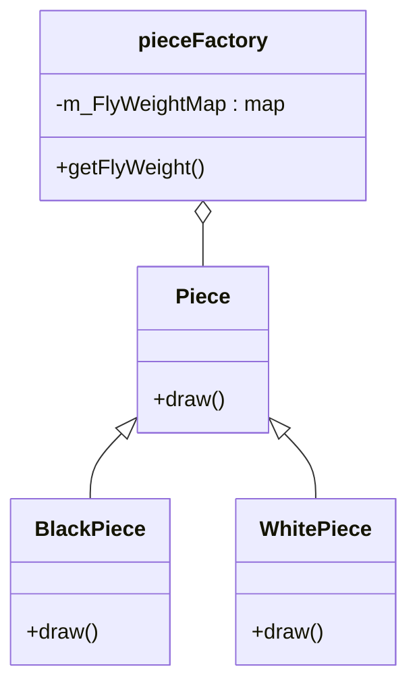

# 第 13 章 享元模式

&gt; 原书第 188–195 页 ｜ 本节内容：以围棋棋子范例引出享元模式（Flyweight），讲解内部状态与外部状态的区分、享元工厂与享元池，并辨析享元模式与对象池等池技术的差异。

享元（Flyweight）模式也称蝇量模式，是一种结构型模式，解决的是面向对象程序设计的性能问题。所谓享元——被共享的单元或被共享的对象，其英文名 Flyweight 是"轻量级"的意思，指拳击比赛中选手体重比较轻。所以，该模式的作用是为了让对象变"轻"（占用的内存更少），其设计思想是：当需要某个对象时，尽量共用已经创建出的同类对象，从而避免频繁使用 new 创建同类或者相似的对象；在同类对象数量非常多的情况下，可以达到节省内存占用以及提升程序运行效率的目的。蝇量这个词也同样表示通过减少不必要的对象创建以减小系统运行时的负荷。


## 13.1 从一个典型的范例开始

学习享元模式，从一个典型的范例也就是围棋范例开始特别合适。围棋是一种策略类型的双人棋类游戏，流行于多个国家。围棋的棋盘如图 13.1 所示。


围棋游戏有白黑两种颜色的棋子，整个围棋棋盘是 19×19（横 19 条线，竖 19 条线）大小，一共 361 个交叉点，意味着如果整个棋盘摆满了棋子，需要 361 颗棋子。如果想实现一个围棋游戏，代码并不复杂，这里为了简化范例，突出要讲的内容，就不绘制棋盘了，只绘制棋子。现在来编写一下围棋游戏这个范例，因为棋子有两种颜色，所以可以定义一个枚举类型，代码如下：

```cpp
enum EnumColor                    //棋子颜色
{
    Black,                        //黑
    White                         //白
};
```

接着，为了表达每次落子时棋子的位置，可以定义一个结构：

```cpp
struct Position                   //棋子位置
{
    int m_x;
    int m_y;
    Position(int tmpx, int tmpy) : m_x(tmpx), m_y(tmpy) {}   //构造函数
};
```

其实，一个 unsigned short（数值范围为 0～65535）就足以表达位置信息，不是非要定义 Position 结构，但为了演示更清晰，还是进行这样的结构定义。

接着，定义一个类来表示棋子：

```cpp
class Piece                       //棋子
{
public:
    Piece(EnumColor tmpcolor, Position tmppos) : m_color(tmpcolor), m_pos(tmppos) {}
                                      //构造函数

    void draw()                       //棋子的绘制
    {
        if (m_color == Black)
        {
            cout << "在位置：(" << m_pos.m_x << "," << m_pos.m_y << ")处绘制了一个黑色棋子!"
                 << endl;
            //这里可以是一系列用于具体绘制的代码…
        }
        else
        {
            cout << "在位置：(" << m_pos.m_x << "," << m_pos.m_y << ")处绘制了一个白色棋子!"
                 << endl;
            //这里可以是一系列用于具体绘制的代码…
        }
    }

private:
    EnumColor m_color;                //棋子颜色
    Position  m_pos;                  //棋子位置
};
```

如果愿意，这里也可以让 Piece 作父类，然后分别创建诸如 BlackPiece 和 WhitePiece 子类来代表黑色棋子和白色棋子，但这里就不创建子类了（后面演示享元模式时会创建子类）。

在 main 主函数中，增加如下代码：

```cpp
Piece* p_piece1 = new Piece(Black, Position(3, 3));   //黑子落子到3,3位置
p_piece1->draw();

Piece* p_piece2 = new Piece(White, Position(5, 5));   //白子落子到5,5位置
p_piece2->draw();

Piece* p_piece3 = new Piece(Black, Position(4, 6));   //黑子落子到4,6位置
p_piece3->draw();

Piece* p_piece4 = new Piece(White, Position(5, 7));   //白子落子到5,7位置
p_piece4->draw();
//…

//释放资源
delete p_piece1;
delete p_piece2;
delete p_piece3;
delete p_piece4;
```

执行起来，看一看结果：

```text
在位置：(3,3)处绘制了一个黑色棋子!
在位置：(5,5)处绘制了一个白色棋子!
在位置：(4,6)处绘制了一个黑色棋子!
在位置：(5,7)处绘制了一个白色棋子!
```

当然，为了悔棋或者将来复盘棋局方便，可以用一个 list 容器把下棋的步骤信息保存起来，参考如下代码行：

```cpp
std::list<Piece*> piecelist;          //在文件头增加 #include <list>
piecelist.push_back(p_piece1);
piecelist.push_back(p_piece2);
piecelist.push_back(p_piece3);
piecelist.push_back(p_piece4);
```

随着棋局的不断进行，不难想象，每落下一颗棋子，就要创建一个 Piece 对象，程序中将会创建越来越多的 Piece 对象，而这些 Piece 对象之间，除了颜色和显示位置不同之外，其他并没有什么不同。这样看起来就没有必要创建这么多的 Piece 对象，如果只创建一个代表黑色棋子的 Piece 对象和一个代表白色棋子的 Piece 对象，那么在绘制棋子的时候，只需要借用（被共享）这两个对象并向其中传递代表棋子的位置信息，这样就可以只用创建两个对象的成本来取代创建越来越多的 Piece 对象，这就是享元模式的设计思想，代表黑色棋子的 Piece 对象和代表白色棋子的 Piece 对象被称为享元对象（被共享的对象）。

通过享元模式，可以对上述代码进行改造。在享元模式中，首先创建一个代表棋子的新抽象类 Piece（对刚刚的 Piece 类改造，去掉其中的位置信息，因为位置信息是可变的，不适合放在被共享的对象中），代码如下：

```cpp
class Piece                           //棋子抽象类
{
public:
    virtual ~Piece() {}               //作父类时析构函数应该为虚函数

public:
    virtual void draw(Position tmppos) = 0;
};
```

接着，分别定义继承自 Piece 类的 BlackPiece 和 WhitePiece 类来代表黑色棋子和白色棋子，代码如下：

```cpp
class BlackPiece : public Piece       //黑色棋子
{
public:
    virtual void draw(Position tmppos)
    {
        cout << "在位置：(" << tmppos.m_x << "," << tmppos.m_y << ")处绘制了一个黑色棋子!"
             << endl;
    }
};

class WhitePiece : public Piece       //白色棋子
{
public:
    virtual void draw(Position tmppos)
    {
        cout << "在位置：(" << tmppos.m_x << "," << tmppos.m_y << ")处绘制了一个白色棋子!"
             << endl;
    }
};
```

然后，引入一个工厂类（简单工厂），该工厂类负责创建并返回黑色和白色棋子对象：

```cpp
class pieceFactory                    //创建棋子的工厂
{
public:
    ~pieceFactory()                   //析构函数
    {
        //释放内存
        for (auto iter = m_FlyWeightMap.begin(); iter != m_FlyWeightMap.end(); ++iter)
        {
            Piece* tmpfw = iter->second;
            delete tmpfw;
        }
        m_FlyWeightMap.clear();       //这句其实可有可无
    }

public:
    Piece* getFlyWeight(EnumColor tmpcolor)   //获取享元对象，也就是获取被共享
                                              //的棋子对象
    {
        auto iter = m_FlyWeightMap.find(tmpcolor);
        if (iter == m_FlyWeightMap.end())
        {
            //没有该享元对象，那么就创建出来
            Piece* tmpfw = nullptr;
            if (tmpcolor == Black)            //黑子
            {
                tmpfw = new BlackPiece();
            }
            else                              //白子
            {
                tmpfw = new WhitePiece();
            }
            m_FlyWeightMap.insert(make_pair(tmpcolor, tmpfw));  //以棋子颜色枚举值为key,
                                                                //增加条目到map中
            return tmpfw;
        }
        else
        {
            return iter->second;
        }
    }

private:
    //在文件头增加 #include <map>
    std::map<EnumColor, Piece*> m_FlyWeightMap;   //用map容器来保存所有的享元对象，一共
                                                  //就两个享元对象(黑色棋子一个,白色棋子一个)；
};
```

在 main 主函数中，注释掉原有代码，增加如下代码：

```cpp
pieceFactory* pfactory = new pieceFactory();

Piece* p_piece1 = pfactory->getFlyWeight(Black);
p_piece1->draw(Position(3, 3));       //黑子落子到3,3位置

Piece* p_piece2 = pfactory->getFlyWeight(White);
p_piece2->draw(Position(5, 5));       //白子落子到5,5位置

Piece* p_piece3 = pfactory->getFlyWeight(Black);
p_piece3->draw(Position(4, 6));       //黑子落子到4,6位置

Piece* p_piece4 = pfactory->getFlyWeight(White);
p_piece4->draw(Position(5, 7));       //白子落子到5,7位置

//释放资源
delete pfactory;
```

执行起来，看一看结果：

```text
在位置：(3,3)处绘制了一个黑色棋子!
在位置：(5,5)处绘制了一个白色棋子!
在位置：(4,6)处绘制了一个黑色棋子!
在位置：(5,7)处绘制了一个白色棋子!
```

上述改造后的围棋范例的写法就是享元模式的一个典型范例，其中核心的代码是 pieceFactory 类中的 getFlyWeight 成员函数代码。当在 main 主函数中第一次调用该成员函数时，该成员函数会根据传递进来的棋子枚举值参数来创建相应的棋子对象（黑色棋子对象或白色棋子对象），并将棋子对象（享元对象）保存到 map 容器 m_FlyWeightMap 中，后续当 getFlyWeight 成员函数再被调用时，直接从 map 容器中以棋子颜色枚举值作为 key 直接取得棋子对象并利用该对象完成棋子的绘制工作。所以，在 main 主函数中，p_piece1 和 p_piece3 所指向的对象完全相同（代表黑棋对象），p_piece2 和 p_piece4 所指向的对象完全相同（代表白棋对象）。

可以看到，在一盘棋局中，只创建了两个棋子对象并将这两个棋子对象作为共享对象，通过给它们传递不同的位置信息以便在不同的位置绘制棋子。相比于第一种写法（每落一个棋子都要创建一个棋子对象），可以节省大量因创建多个类似（仅仅是位置或颜色不同）的棋子对象导致的对内存的不必要的消耗，这就是利用享元模式的好处。

## 13.2 引入享元模式

当一个程序运行时产生的对象数目过多时，将导致内存消耗过大和程序运行性能的下降（而且使用诸如 new 等创建对象也会占用程序运行时间），享元模式的出现避免了程序中出现大量相同或相似的对象，该模式通过共享对象的方式实现相似对象的重用。

引入"享元"设计模式的定义：**运用共享技术有效地支持大量细粒度的对象（的复用）**。这意味着只使用少量的对象并复用它们就能够达到使用大量相似对象同样的效果。

享元模式中一般包含了对简单工厂模式的使用，该工厂（pieceFactory 类）一般用于创建享元对象并把这些享元对象保存在一个容器（本范例是 map 容器 m_FlyWeightMap）中，这个容器也称为享元池（专门保存一个或多个享元对象），其中保存了一个白棋对象和一个黑棋对象。

针对前面的代码范例绘制享元模式的 UML 图，如图 13.2 所示。



*原书图 13.2（第 204 页）：*

享元对象最重要的就是对"内部状态"和"外部状态"做出了明确的区分，这是享元对象能够被共享的关键所在。

（1）内部状态。存储在享元对象内部的、一直不会发生改变的状态，这种状态可以被共享。例如，对于 BlackPiece 类对象，它的内部状态就是黑棋子，它一直代表黑棋子，不会发生改变。而对于 WhitePiece 类对象，它的内部状态就是白棋子，它一直代表白棋子，不会发生改变。内部状态一般可以作为享元类的成员变量（本范例中并没有体现）而存在。

（2）外部状态。随着外部环境和各种动作因素的改变而发生改变的状态，这种状态不可以被共享。例如，黑棋子或者白棋子的位置信息就属于外部状态。当一个享元对象被创建之后，这种外部状态可以在需要的时候传到享元对象内部，例如，在需要绘制棋子的时候，通过调用 BlackPiece 或 WhitePiece 类的 draw 成员函数并向该成员函数传递位置信息作为参数以达到在不同位置绘制棋子的目的。

这样一来，将内部状态相同的对象保存在享元池中以备随时取出以共享（复用）。当将共享的对象取出后，为其传递不同的外部状态，从而达到生成多个相似对象的效果，而实际上这些相似的对象在内存中只保存一份。在确定享元类的内部状态时，要仔细思考，只将真正需要在多个地方共享的成员变量作为享元对象的内部状态。回想前面的范例，如果把棋子的颜色也作为外部状态来传递，那么 BlackPiece 和 WhitePiece 类可以合二为一，用一个类来表示。如果读者有兴趣，可以自行改造范例代码来实现这种想法。

总之，设计享元模式时，要重点考虑哪些是对象的内部状态，哪些是对象的外部状态，内部状态固定不变，外部状态可变，通过共享不变的部分达到享元模式的目的——减少对象数量、节省内存、提高程序运行效率。

享元模式的 UML 图中包含 3 种角色。

（1）Flyweight（抽象享元类）。通常是一个接口或者抽象类。在该类中声明各种享元类的方法，在子类中实现这些方法，外部状态可以作为参数传递到这些方法中来。这里的抽象享元类指 Piece 类，而方法是指 draw 方法，外部状态（棋子的位置信息）通过 draw 方法的 tmppos 形参即可传递进来。

（2）ConcreteFlyweight（具体享元类）。抽象享元类的子类，用这些类创建的对象就是享元对象，有时候也可以考虑以单件类实现享元对象。这里指 BlackPiece 和 WhitePiece 类。

（3）FlyWeightFactory（享元工厂类）。用于创建并管理享元对象，在该类中存在一个享元池（一般使用 map 这种存储键值对的容器来实现），享元对象会放入其中。当用户请求一个享元对象时，该工厂返回一个已经创建的享元对象或者如果用户请求的享元对象不存在，则新创建一个并将该享元对象放入享元池，然后将该享元对象返回给请求者。其实享元工厂对象也可以考虑以单件的形式实现。这里指 pieceFactory 类。

关于享元模式的使用场合请读者发挥想象力，虽然本范例即便不采用享元模式最多也就创建 361 个棋子对象，占用不了多少内存，但在实际项目中，可能会面对创建几万、几十万个相似对象的情形，此时使用享元模式所节省的内存就相当可观了。例如，在很多的游戏场景中，会有大量用于装饰游戏氛围的树木，成片成片地构成森林，这些树木大概也就是有限的数种到数十种，例如枫树、柳树、桦树等，而且它们的大小（缩放）、方向可能不同，此时，就可以利用享元模式来实现，分别针对枫树、柳树、桦树创建 3 个享元对象，并将大小、方向等参数作为外部状态传递，这样就可以实现用少量的树木对象来表达大片森林的目的。当然，实际游戏中对树林的渲染（显示）涉及图形学的问题，而且针对提高渲染性能这件事可能享元模式并不能起到帮助作用（因为虽然可以用少量对象表达森林，但要渲染到屏幕的树木内容并没有减少），这一点请读者不要误解。

享元模式虽然有诸多优点，但也使系统的实现变得更为复杂，只有经过验证使用享元模式能有效减少内存和提升程序运行效率时才加以采用。在如下情形时可考虑使用享元模式：

（1）程序中有大量相同或者相似的对象造成内存的大量消耗。

（2）对象的大部分状态都是或者都可以转变成外部状态，通过参数传入到对象中。

（3）享元池的引入增加了程序实现的复杂性，当然也有一定的内存开销，使用享元模式时要衡量性价比。

此外，必须提醒读者的是，不要将享元模式与对象池、连接池、线程池等混为一谈，虽然这几种技术都可以看成是对象的**复用**，但对象池、连接池、线程池等技术中的"复用"和享元模式中的"复用"并不相同。采用各种池技术时所讲的复用主要目的是节省时间和提高效率，例如，使用完的对象、连接、线程放入到池中而不是通过 delete 等释放掉，下次需要创建新对象、连接或线程时可以直接从池中取出来再次使用而不是使用诸如 new 等重新创建，但在每一时刻，池中的每个对象、连接、线程都会被一个使用者独占而不会在多处使用，当使用完毕后，再次放回到池中，其他使用者才可以取出来重复使用。而享元模式中的复用指的是享元对象在存在期间被所有使用者共享使用，从而达到节省内存空间的目的。
