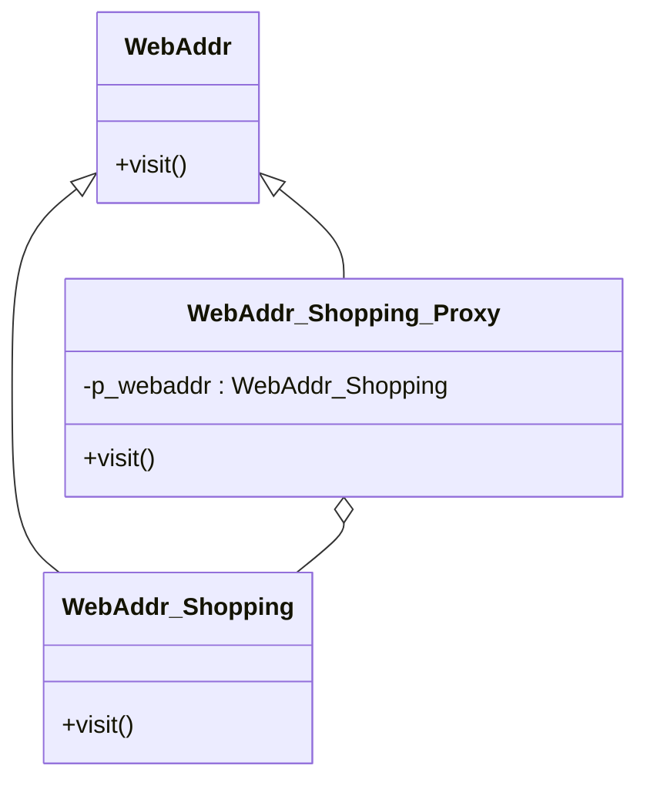

# 第 14 章 代理模式

&gt; 原书第 196–205 页 ｜ 本节内容：以浏览器访问网站范例引出代理模式（Proxy），讲解代理类为被代理类增加额外能力，归纳远程、虚拟、保护、缓存等常见代理类型，并给出缓存/缓冲代理的完整范例。

代理（Proxy）模式是一种结构型模式，在很多不同的场合具有广泛的分类和应用。其主要实现思想是在客户端和真正要访问的对象之间引入一个代理对象（间接层），于是，以往客户端对真正对象的访问现在变成了通过代理对象进行访问，代理对象在这里起到了一个中介或者桥梁作用。引入代理对象的主要目的是可以为客户端增加额外的功能、约束或针对客户端的调用屏蔽一些复杂的细节问题。

不妨站在日常生活的角度来理解一下代理。试想一下，玩家在玩角色扮演类网络游戏（例如《魔兽世界》）中，自己练级可能太枯燥无味，于是找了一个游戏代练帮自己练级，这里游戏代练就扮演了代理的角色。再例如海外代购，对于在本地买不到或者价格太高的物品，可以通过海外代购进行购买，这里海外代购也扮演了代理的角色。


## 14.1 基本概念和范例

代理模式的实质是通过引入一个代理类来为原始类（被代理类）增加额外的能力，这些额外的能力可能是指一些新功能、新服务，也可能是一些约束或限制（例如，只有特定用户才能使用原始类）等。

考虑这样一个范例——通过浏览器访问某个网站，最简单的方式就是在浏览器中输入网站的地址来直接访问。首先可以创建一个基类 WebAddr 代表要访问的网站，代码如下：

```cpp
class WebAddr
{
public:
    virtual void visit() = 0;       //执行访问网站的动作，子类中重新实现
    virtual ~WebAddr() {}           //作父类时析构函数应该为虚函数
};
```

创建两个网站类 WebAddr_Shopping 和 WebAddr_Video，继承自 WebAddr，代码如下：

```cpp
//某购物网站
class WebAddr_Shopping : public WebAddr
{
public:
    virtual void visit()
    {
        //…访问该购物网站，可能涉及复杂的网络通信
        cout << "访问WebAddr_Shopping购物网站!" << endl;
    }
};

//某视频网站
class WebAddr_Video : public WebAddr
{
public:
    virtual void visit()
    {
        //…访问该视频网站，可能涉及复杂的网络通信
        cout << "访问WebAddr_Video视频网站!" << endl;
    }
};
```

在 main 主函数中增加一些代码，模拟浏览器的动作去访问上述网站：

```cpp
WebAddr* wba1 = new WebAddr_Shopping();
wba1->visit();                      //访问该购物网站

WebAddr* wba2 = new WebAddr_Video();
wba2->visit();                      //访问该视频网站

//资源释放
delete wba1;
delete wba2;
```

执行起来，看一看结果：

```text
访问WebAddr_Shopping购物网站!
访问WebAddr_Video视频网站!
```

上述实现代码是直接访问某个或者某些网站。如果引入一个代理类，让代理类来帮助我们访问这些网站，看看代码需要做怎样的调整呢？至于引入这个代理类有什么好处，后续会有专门的探讨。这里首先从代码实现的层面看一看如何实现这个代理类：

```cpp
//网站代理类
class WebAddrProxy : public WebAddr
{
public:
    //构造函数，引入的目的是传递进来要访问的具体网站
    WebAddrProxy(WebAddr* pwebaddr) : mp_webaddr(pwebaddr) {}

public:
    virtual void visit()
    {
        mp_webaddr->visit();
    }

private:
    WebAddr* mp_webaddr;            //代表要访问的具体网站
};
```

上述代码实现了一个叫作 WebAddrProxy 的网站代理类。注意，它仍旧继承自 WebAddr 类，该代理类有一个 WebAddr* 类型的成员变量 mp_webaddr，该成员变量的值是通过 WebAddrProxy 类构造函数的初始化列表得到的，这意味着只要 mp_webaddr 所代表的网站不同，调用 WebAddrProxy 类的 visit 成员函数时就会去访问不同的网站。

在 main 主函数中，注释掉原有代码，增加如下代码：

```cpp
WebAddr* wba1 = new WebAddr_Shopping();
WebAddr* wba2 = new WebAddr_Video();

WebAddrProxy* wbaproxy1 = new WebAddrProxy(wba1);
wbaproxy1->visit();                 //通过代理去访问WebAddr_Shopping购物网站

WebAddrProxy* wbaproxy2 = new WebAddrProxy(wba2);
wbaproxy2->visit();                 //通过代理去访问WebAddr_Video视频网站

//资源释放
delete wba1;
delete wba2;
delete wbaproxy1;
delete wbaproxy2;
```

执行起来，看一看结果：

```text
访问WebAddr_Shopping购物网站!
访问WebAddr_Video视频网站!
```

在上述范例中，通过代理类对象 wbaproxy1 和 wbaproxy2 来访问 WebAddr_Shopping 购物网站和 WebAddr_Video 视频网站。

从表面上看，引入代理类 WebAddrProxy 似乎让程序代码变得更加复杂，但实际上，引入代理类能够为原始类（WebAddr_Shopping、WebAddr_Video）增加额外的能力。就以上述范例来说，可以在 WebAddrProxy 类的 visit 成员函数中，在代码行"mp_webaddr-&gt;visit();"的前后增加很多额外的代码来对网站的访问进行额外的限制，例如访问的合法性检查、流量限制、返回数据过滤，等等。WebAddrProxy 类的 visit 成员函数可以进行如下功能扩充（注意代码中的注释）：

```cpp
public:
    virtual void visit()
    {
        //在这里进行访问的合法性检查、日志记录或者流量限制…
        mp_webaddr->visit();
        //在这里可以进行针对返回数据的过滤…
    }
```

上述代码通过为网站代理类 WebAddrProxy 的构造函数传入不同的实参，达到了让 WebAddrProxy 类对象（代理对象）来代理访问某购物网站或者某视频网站的目的（一个代理类可以为多个实际的类服务）。

在实际的应用中，往往也存在某个代理类专门代理一个固定的实际类的情形，例如，创建一个 WebAddr_Shopping_Proxy 代理类，专门用来代理对购物网站 WebAddr_Shopping 的访问。该代理类的实现代码如下：

```cpp
//专门针对某购物网站WebAddr_Shopping的代理
class WebAddr_Shopping_Proxy : public WebAddr
{
public:
    virtual void visit()
    {
        //在这里进行访问的合法性检查、日志记录或者流量限制…
        WebAddr_Shopping* p_webaddr = new WebAddr_Shopping();
        p_webaddr->visit();
        //在这里可以进行针对返回数据的过滤…

        //释放资源
        delete p_webaddr;
    }
};
```

在 main 主函数中，注释掉原有代码，增加如下代码：

```cpp
WebAddr_Shopping_Proxy* wbasproxy = new WebAddr_Shopping_Proxy();
wbasproxy->visit();                 //访问的实际是某购物网站

//资源释放
delete wbasproxy;
```

执行起来，看一看结果：

```text
访问WebAddr_Shopping购物网站!
```

此刻，可能有些读者仍旧不能理解引入代理类的目的。就拿上述范例来说，如果希望增加一些合法性检查、流量限制、针对返回数据的过滤等，完全可以通过诸如在 WebAddr_Shopping、WebAddr_Video 的 visit 成员函数中增加代码来实现，为什么还要多引入一个代理类呢？这就需要更深入地理解引入代理类的背景。

首先，很多代理类的实现可能是非常复杂的，甚至可能是借助某些工具来生成的，而且往往使用这个代理类的程序员与开发这个代理类的程序员并不是同一个甚至可能是两个不同公司的程序员。

在图 14.1 中，假设 A 公司有一个内部 Web 网站（图中最右侧），该 Web 网站提供一个 visit 接口，A 公司的对外业务服务器程序可以以网络通信方式触发对该 Web 网站 visit 接口的调用，以获取该网站中的信息。A 公司允许其他公司通过对外业务服务器程序获取内部 Web 网站的信息，但每个月要收取一定的费用并且有一定的流量限制。

假设开发者是 B 公司的程序员，负责开发一个应用程序来获取 A 公司内部 Web 网站上的信息，在 B 公司支付给 A 公司一定的费用之后，A 公司给 B 公司分配了一个账号/密码并为 B 公司提供了一个库文件用作开发使用，该库文件中实现了 WebAddr_Shopping_Proxy 类，当然，B 公司的程序员只能根据公司 A 提供的开发文档来使用 WebAddr_Shopping_Proxy 类，但无法看到该类的实现源码。


如果读者是 B 公司的程序员，那么在使用 WebAddr_Shopping_Proxy 类时可能需要提供账号/密码信息，然后调用 WebAddr_Shopping_Proxy 类的 visit 接口就可以最终实现从 A 公司的内部 Web 网站获取信息的目的。但如果读者是 A 公司的程序员并且负责实现 WebAddr_Shopping_Proxy 这个代理类，那么可能问题就会复杂得多——显然 WebAddr_Shopping_Proxy 代理类要通过网络与 A 公司的对外业务服务器程序交换信息。

通过以上说明，不难看到，往往真实的类（图 14.1 中的 WebAddr_Shopping 类）、代理类（图 14.1 中 WebAddr_Shopping_Proxy 类）以及要使用 WebAddr_Shopping_Proxy 代理类的应用程序的实现代码并不是由同一个程序员完成的，甚至可能是由多个公司的程序员来完成，所以程序员往往只能通过代理类来间接访问真实的类。而且在图 14.1 中，WebAddr_Shopping_Proxy 代理类极大地简化了 B 公司应用程序的实现难度，否则 B 公司的程序员就要手工编写代码实现与 A 公司的对外业务服务器的通信，这个难度可比简单地调用 WebAddr_Shopping_Proxy 类的 visit 接口获取信息高太多。

## 14.2 引入代理模式

引入"代理"设计模式的定义（实现意图）：**为其他对象提供一种代理，以控制对这个对象的访问**。

代理模式通过创建代理对象来代表真实对象，客户端（这里指 main 函数）操作代理对象与操作真实对象并没有什么不同。当然，最核心、最本质的功能，最终还是需要代理对象操纵真实对象来完成。

针对前面的代码范例绘制代理模式的 UML 图，如图 14.2 所示。



*原书图 14.2（第 212 页）：（代理主题的 visit 成员函数中通过 `p_webaddr->visit();` 调用真实主题的接口）*

代理模式的 UML 图中包含 3 种角色。

（1）Subject（抽象主题）。该类定义真实主题与代理主题的共同接口，这样，在使用真实主题的地方都可以使用代理主题，但是后面会讲到，因为代理的种类繁多，目的各异，所以代理主题并不一定必须与真实主题有共同的接口甚至抽象主题也不是必须存在的，这一点请读者灵活理解。这里指 WebAddr 类。

（2）Proxy（代理主题）。该类内部包含了对真实主题的引用，从而可以对真实主题进行访问。代理主题中一般会提供与真实主题相同的接口（这里指 visit），以达到可以取代真实主题的目的。代理主题可以对真实主题的访问进行约束和限制，也能够控制只在必要的时候才创建/删除真实的主题（一般通过在 visit 中增加额外的代码来实现）。这里指 WebAddr_Shopping_Proxy 类。

（3）RealSubject（真实主题）。定义代理主题所代表的真实对象，真正的业务是在真实主题中实现的，客户端（例如 main 主函数中）通过代理主题间接访问真实主题中的接口。这里指 WebAddr_Shopping 类。

代理模式和装饰模式有类似之处，但是这两个模式要解决的问题不同或者说立场不同。代理模式主要是**代表**真实主题并给真实的主题增加一些新的能力或责任，例如，在后面代理模式的应用场合中谈到的代理主题可能具备的权限控制、远程访问、数据缓存、智能引用等功能，这些功能与真实主题要实现的功能彼此之间可能没有什么相关性，主要是**控制对真实主题的访问**。而装饰模式是通过引入装饰类来装饰各种构件，为具体构件类增加一些相关的能力，与原有构件能力具有相关性，是对原有构件能力或行为的**扩展（增强）**。

## 14.3 代理模式的应用场合探究

### 14.3.1 代理模式常用应用场景

代理模式的 UML 图看起来非常简单，总结起来也很简单——在软件设计中，增加间接层来获取更大的灵活性和增加更多的控制。在实际的实现代码中，代理模式可能会在许多场合得到应用，并且其实现可能也会非常复杂，并不是上述一个简单范例就能够涵盖的。

代理模式有很多应用场景，被代理的对象也是五花八门，例如，可以是远程对象、创建开销大的对象以及需要安全控制或者访问限制的对象。所以，常见的代理包括但不限于如下类型。

- 远程代理（Remote Proxy）：为一个在不同地址空间的对象提供一个局部代表（本地代理对象）。这里不同的地址空间可以是同一个计算机上的两个不同程序，也可以是运行在两个不同计算机上的通过网络通信的程序（例如，可以通过 socket 实现网络通信）。当涉及网络通信时，代理类必须要封装网络通信代码，所以实现起来会比较复杂。图 14.1 展示的就是一个远程代理。当然，如果再通用一些，一个典型的远程代理可以如图 14.3 所示。


- 虚拟代理（Virtual Proxy）：如果需要创建的对象需要消耗非常多的资源，那么可以先创建一个消耗相对较小的对象来代表（扮演真实对象的替身角色），真实的对象直至被真正需要时才创建。设想通过浏览器访问一个网页时，网页中包含一张巨大的图片，短时间内无法通过网络传输到本地浏览器中，浏览器中会短暂地显示一个小图标来标示有一张大图片正在传输中，等几秒钟大图片传输完成后才会在浏览器中显示出来。这个短暂显示的小图标就是虚拟代理产生的。虚拟代理一般会使用多线程进行工作，一个线程用于显示代理对象对应的小图标，一个线程用于加载真实的图片，等真实的图片加载完成之后再替换掉小图标，如果不使用多线程来实现，就会导致网络传输图像过程中界面显示的内容被卡住，非常影响用户体验。

  另外，对于一些创建开销很大、十分耗费资源的对象，也可以暂时使用虚拟代理来代替，将真正对象的创建工作推迟到必须创建的时刻再进行，这可以提高程序运行效率并节省程序运行资源。

- 保护代理（Protect Proxy）：在访问原始对象之前或者之后，可以执行许多额外的操作来控制对原始对象的访问。例如，给不同的用户提供不同级别的访问权限——限制张三这个账户对原始对象的访问是 10kb/s 的网络流量，而李四这个账户对原始对象的访问是 20kb/s 的网络流量，再比如，限制张三能访问某些内容而李四不能访问，限制每个账户只能修改和自己账户相关的一些信息等。

- 缓存/缓冲代理（Cache Proxy）：针对某个目标操作的结果提供临时存储空间，以便多个客户端可以共享这些结果。考虑若某个文件中的内容需要被多个客户端读取，则代理可以调用真实对象的接口将文件中的数据读入内存，这样每个客户端取这些数据时就不再需要频繁地调用真实对象的接口到文件中去取。

- 智能引用代理（Smart Reference Proxy）：当一个对象被引用时，提供额外的一些操作，例如记录引用次数（听起来与保护代理有些类似）。智能指针 shared_ptr 就是一个典型的智能引用代理，它用于包装裸指针（对象），记录引用计数，当引用计数为 0 时，自动释放自己所管理的裸指针。当然，智能指针的实现比较复杂，一般都会采用模板与泛型编程技术来实现，有兴趣的读者可以参考和借鉴 shared_ptr 的实现源码。智能引用代理的实现代码不一定遵从代理模式的 UML 图，也就是说，不一定会明确地存在抽象主题，但把裸指针看成真实主题，把智能指针看成是代理主题是完全没问题的。

- 写时复制（Copy-on-write）优化代理：例如，string 类由 C++ 标准库提供，用于代表一个字符串，所以，可以把 string 类看成是对原始字符串的代理。某些开发商实现的 string 类采用了 copy-on-write 优化技术来存储字符串——当把字符串 A（string 类型）赋值给字符串 B 时，因为它们的内容相同，所以这两个字符串指向同一块代表字符串内容的内存。不难想象，如果字符串内容比较长并且指向相同内存的 string 字符串变量数目比较多，那么这种保存字符串内容的方式会节省大量内存。如果此时字符串 A 内容发生改变，那么就要单独为字符串 A 所指向的字符串内容开辟出一块新内存（因为字符串 B 指向的内存和字符串 A 指向的内存内容已经不同了），这种技术就叫作写时复制（延迟复制技术）。代码实现上相对复杂，在本书的附录 B 中，针对写时复制技术给出了一个清晰的实现范例。

有些资料上还出现过防火墙代理（控制对网络资源的访问，阻止恶意用户对资源的入侵和破坏）、同步代理（在多线程环境中提供对真实对象的安全访问）、复杂隐藏代理（隐藏一些复杂的事物并进行访问控制）等，相信读者在看到这些代理的名字后，大概就可以知道这些代理做了什么事情。在这里就不详细介绍了。

### 14.3.2 缓存/缓冲代理范例

在这里举一个缓存/缓冲代理（Cache Proxy）的范例，该范例将使用到一个名为 test.txt 的文本文件，其内容非常简单，只有 3 行内容，如下（test.txt 文件的放置位置后面有说明）：

```text
1----- 1 -- line ----------------
2----- 2 -- line ----------------
3----- 3 -- line ----------------
```

在范例中，第一次调用代理主题（ReadInfoProxy 类）的 read 方法时，该方法会调用真实主题（ReadInfoFromFile 类）的 read 方法从 test.txt 文件中读入内容并放入内存中缓存起来，后续再调用代理主题的 read 方法来取得 test.txt 文件中内容时，只需要从内存中直接获取这些数据。代理主题在这个范例中存在的意义就是避免了频繁调用真实主题的 read 方法来获取 test.txt 文件中的内容，从而提高了程序运行效率。

首先定义一个全局量：

```cpp
//缓存/缓冲代理（Cache Proxy）范例
vector<string> g_fileItemList;      //包含头文件"vector"和"string"
```

接着，定义抽象主题，代码如下：

```cpp
//抽象主题
class ReadInfo
{
public:
    virtual void read() = 0;
    virtual ~ReadInfo() {}
};
```

再定义真实主题：

```cpp
//真实主题
class ReadInfoFromFile : public ReadInfo
{
public:
    virtual void read()             //从文件中读取信息(读取test.txt的内容)
    {
        ifstream fin("test.txt");   //包含头文件"fstream"，ifstream(文件输入流)
                                    //用于从磁盘读文件到内存
        if (!fin)
        {
            cout << "文件打开失败" << endl;
            return;
        }

        string linebuf;
        while (getline(fin, linebuf))        //系统函数，从文件中逐行读入内容
        {
            if (!linebuf.empty())            //读入的不是空行
            {
                g_fileItemList.push_back(linebuf);   //将文件中的每一行都保存到vector容器中
                //cout << linebuf << endl;
            }
        }
        fin.close();                // 关闭文件输入流
    }
};
```

然后，实现代理主题：

```cpp
//代理主题
class ReadInfoProxy : public ReadInfo
{
public:
    virtual void read()
    {
        if (!m_loaded)
        {
            //没有从文件中载入信息，则载入
            m_loaded = true;        //标记信息已经从文件中被载入进来，这样下次再获
                                    //取这些数据时就不需要再去读文件了
            cout << "从文件中读取了如下数据-------------：" << endl;
            ReadInfoFromFile* rf = new ReadInfoFromFile();
            rf->read();             //将文件中的数据读入全局容器g_fileItemList中
            delete rf;              //释放资源
        }
        else
        {
            cout << "从缓存中读取了如下数据-------------：" << endl;
        }
        //现在数据一定在g_fileItemList中，开始显示
        for (auto iter = g_fileItemList.begin(); iter != g_fileItemList.end(); ++iter)
        {
            cout << *iter << endl;
        }
    }

private:
    bool m_loaded = false;          //false表示还没有从文件中读出数据到内存
};
```

在 main 主函数中，注释掉原有代码，增加如下代码：

```cpp
ReadInfo* preadinfoproxy = new ReadInfoProxy();
preadinfoproxy->read();     //第一次调用read是借助代理使用真实的主题到文件中读数据
preadinfoproxy->read();     //后续调用read都是直接从缓存中读数据
preadinfoproxy->read();     //从缓存中读数据

//资源释放
delete preadinfoproxy;
```

执行起来，看一看结果：

```text
从文件中读取了如下数据-------------：
1----- 1 -- line ----------------
2----- 2 -- line ----------------
3----- 3 -- line ----------------
从缓存中读取了如下数据-------------：
1----- 1 -- line ----------------
2----- 2 -- line ----------------
3----- 3 -- line ----------------
从缓存中读取了如下数据-------------：
1----- 1 -- line ----------------
2----- 2 -- line ----------------
3----- 3 -- line ----------------
```

特别值得一提的是，该范例中打开的 test.txt 文件，要注意该文件的放置位置：如果直接运行本范例所生成的可执行文件，那么 test.txt 一般应该与可执行文件位于相同的目录中，如果利用诸如 Visual Studio 2019 等编译器进行代码的跟踪调试，那么 test.txt 一般应放在项目所在的目录（例如 C:\Users\KuangXiang\Desktop\c++\MySolution\MyProject），否则就可能出现无法找到 test.txt 文件的情形。
