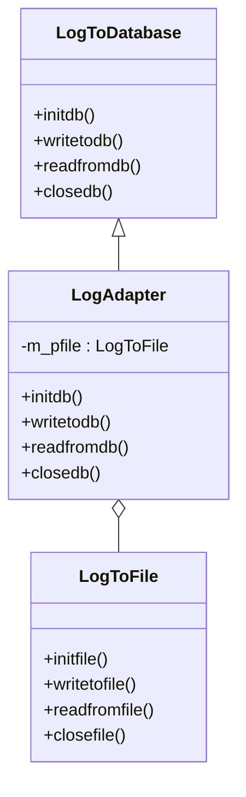
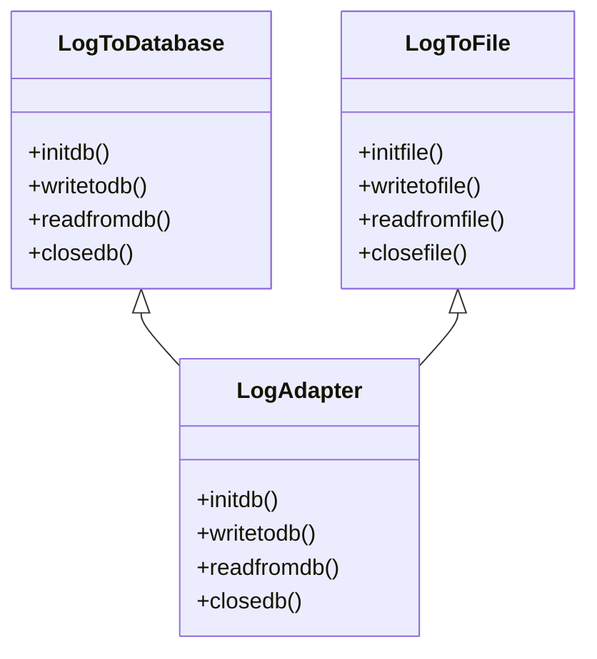

# 第 15 章 适配器模式

&gt; 原书第 206–216 页 ｜ 本节内容：以日志系统从文件改为数据库的范例引出适配器模式（Adapter），讲解对象适配器与类适配器（多重继承）、Target/Adaptee/Adapter 三种角色，并介绍 C++ 标准库中的容器、算法、迭代器适配器。

适配器（Adapter）模式是一种结构型模式。生活中有很多适配器思想的实际应用，例如，各种转接头（usb 转接头、hdmi 转接头）、电源适配器（变压器）等，主要是用来解决不兼容的接口之间的兼容问题。设想一下，220V 的市电不能直接给手机充电，引入一个电源适配器，把 220V 的市电转换为 5V 的电压，就可以给手机充电了。在软件开发领域，两个类之间也存在这种不兼容的问题，于是，就可以像生活中引入电源适配器那样引入一个适配器角色的类来解决这两个类之间的兼容性问题。


## 15.1 一个简单的范例

考虑到公司某个对外提供服务的项目需要记录一些日志信息，以方便运营人员查看或者日后对项目的某些行为进行追溯。日志准备写到一个固定的文件中，于是，程序开发人员向项目中增加了一个 LogToFile 类来实现日志文件的相关操作（日志系统），代码如下：

```cpp
//日志文件操作相关类
class LogToFile
{
public:
    void initfile()
    {
        //做日志文件初始化工作，例如打开文件等
        //…
    }
    void writetofile(const char* pcontent)
    {
        //将日志内容写入文件
        //…
    }
    void readfromfile()
    {
        //从日志中读取一些信息
        //…
    }
    void closefile()
    {
        //关闭日志文件
        //…
    }
    //…可能还有很多其他成员函数，略
};
```

在 main 主函数中可以增加如下测试代码，一切正常：

```cpp
LogToFile* plog = new LogToFile();
plog->initfile();
plog->writetofile("向日志文件中写入一条日志");      //写一条日志到日志文件中
plog->readfromfile();
plog->closefile();
delete plog;
```

随着项目规模的不断增加，要记录的日志信息也逐渐增多，单纯地向日志文件中记录日志信息会导致日志文件膨胀得过大，不方便管理和查看，于是准备对项目中的日志系统进行升级改造，从原有的将日志信息写入文件改为将日志信息写入到数据库。改造后的代码如下：

```cpp
//日志操作相关类(数据库版本)
class LogToDatabase
{
public:
    void initdb()
    {
        //连接数据库，做一些基本的数据库连接设置等
        //…
    }
    void writetodb(const char* pcontent)
    {
        //将日志内容写入数据库
        //…
    }
    void readfromdb()
    {
        //从数据库中读取一些日志信息
        //…
    }
    void closedb()
    {
        //关闭到数据库的连接
        //…
    }
};
```

在 main 主函数中可以增加如下测试代码，一切正常：

```cpp
LogToDatabase* plogdb = new LogToDatabase();
plogdb->initdb();
plogdb->writetodb("向数据库中写入一条日志");        //写一条日志到数据库中
plogdb->readfromdb();
plogdb->closedb();
delete plogdb;
```

新的日志系统（LogToDatabase 类）是将所有日志信息写入到数据库或者从数据库中读取日志信息，代码中凡是涉及与日志相关的类，也全部从以往的使用 LogToFile 类变成了使用 LogToDatabase 类。

但有一天，突然遇到了一些意外的情况或者出现了一些特殊需求，例如：

- 机房突然断电导致数据库中的数据发生了损坏无法正确读写，或者网络电缆突然遭到破坏导致数据库无法成功连接。
- 要从以往使用 LogToFile 类所生成的日志文件中读取一些日志信息。

从上述两种情况来看，所有使用了 LogToDatabase 类的代码行要么无法应付意外发生的情况，要么无法实现特殊需求。所以在这种情况下使用回 LogToFile 类可以解决上面的两个问题，至少是能够临时解决。但问题是现在所有项目中的代码使用的都是 LogToDatabase 类，而 LogToDatabase 类的接口（成员函数）与 LogToFile 类的接口又完全不同，怎么办呢？

除非把所有接口全部改回使用 LogToFile 类，显然这样改比较麻烦，改动量很大，而且将来恢复对 LogToDatabase 类的使用时又要改回去。另外一个简单粗暴的方法就是修改 LogToDatabase 类（新类），增加新的接口来支持对日志文件的读写，换句话说，就是把以往 LogToFile 类（旧类）中实现的功能融合到 LogToDatabase 类中来（当然，这种做法也必须要修改 main 主函数中与 LogToDatabase 类相关的代码），但是这样做的可行性受到了下列因素的限制：

- LogToFile 类的实现源码很复杂，如果当初的开发者离职了，而当前的开发者因为使用的是 LogToDatabase 类，并不熟悉 LogToFile 类，所以把 LogToFile 类的代码搬到 LogToDatabase 类中可能需要很长时间，这会影响项目对外提供服务。
- LogToFile 类可能是以库的方式提供给项目使用，其源码可能已经遗失或源码是由第三方开发公司开发，拿不到其源码。换句话说，LogToFile 类只能使用，不能修改。

如果上述两个因素中的任何一个存在，那么修改 LogToDatabase 类来融合 LogToFile 类中功能的想法都是难以实现的。

当然，即便能修改 LogToDatabase 类增加新接口，还要面对的第二个问题是所有针对 LogToDatabase 类 writetodb、readfromdb 等成员函数的调用（见上面范例中 main 主函数中的代码）都要修改，这种改动工作可能涉及很多代码，而代码的修改则可能会导致测试部门工作量的增加。

解决这个问题一个比较好且简单的思路是借助适配器模式。在该模式中，通过引入适配器类，把 LogToDatabase 类中，诸如对 writetodb、readfromdb 等成员函数的调用转换成对 LogToFile 类中，诸如对 writetofile、readfromfile 等成员函数的调用，从而达到直接使用 LogToFile 类中的接口的目的。这样做之后，main 主函数中与 LogToDatabase 类相关的代码行只需要做非常小的调整，所调用的成员函数名都不需要改变。

看一看采用适配器模式后代码如何修改。首先重新实现 LogToDatabase 类，但在适配器模式中该类并不是用于读写数据库日志，而是用于作为父类提供一些供子类使用的接口，代码如下：

```cpp
class LogToDatabase
{
public:
    virtual void initdb() = 0;                      //不一定非是纯虚函数
    virtual void writetodb(const char* pcontent) = 0;
    virtual void readfromdb() = 0;
    virtual void closedb() = 0;

    virtual ~LogToDatabase() {}                     //作父类时析构函数应该为虚函数
};
```

上述的 LogToDatabase 中定义了一些接口，这些接口都是当前项目中使用的操作日志的接口，我们可以称这些接口为目标接口（新接口）。

LogToFile 类的内容不变，其中的成员函数（接口）可以称为老接口。

接着引入适配器类 LogAdapter，其父类为 LogToDatabase，应注意该类的构造函数中的形参类型（LogToFile* 类型）：

```cpp
//适配器类
class LogAdapter : public LogToDatabase
{
public:
    //构造函数
    LogAdapter(LogToFile* pfile)                    //形参是老接口所属类的指针
    {
        m_pfile = pfile;
    }

    virtual void initdb()
    {
        cout << "在LogAdapter::initdb()中适配LogToFile::initfile()" << endl;
        //其中也可以加任何的其他代码…
        m_pfile->initfile();
    }

    virtual void writetodb(const char* pcontent)
    {
        cout << "在LogAdapter::writetodb()中适配LogToFile::writetofile()" << endl;
        m_pfile->writetofile(pcontent);
    }

    virtual void readfromdb()
    {
        cout << "在LogAdapter::readfromdb()中适配LogToFile::readfromfile()" << endl;
        m_pfile->readfromfile();
    }

    virtual void closedb()
    {
        cout << "在LogAdapter::closedb()中适配LogToFile::closefile()" << endl;
        m_pfile->closefile();
    }

private:
    LogToFile* m_pfile;
};
```

在 main 主函数中，注释掉原有代码，增加如下代码：

```cpp
LogToFile* plog2 = new LogToFile();
LogToDatabase* plogdb2 = new LogAdapter(plog2);
plogdb2->initdb();
plogdb2->writetodb("向数据库中写入一条日志,实际是向日志文件中写入一条日志");
plogdb2->readfromdb();
plogdb2->closedb();
delete plogdb2;
delete plog2;
```

执行起来，看一看结果：

```text
在LogAdapter::initdb()中适配LogToFile::initfile()
在LogAdapter::writetodb()中适配LogToFile::writetofile()
在LogAdapter::readfromdb()中适配LogToFile::readfromfile()
在LogAdapter::closedb()中适配LogToFile::closefile()
```

通过代码可以看到，在 main 主函数中的代码仅仅做了很小的变动，其中对接口，例如 initdb、writetodb、readfromdb、closedb 的调用更是没有发生改动，通过引入适配器类，实际调用的接口是 LogToFile 类的 initfile、writetofile、readfromfile、closefile。

上述新接口、老接口的概念是笔者人为加上去的（实现了把老接口放到新环境中使用），目的是帮助读者更容易地理解适配器模式的工作原理和细节。实际上，适配器模式的能力简而言之就是能够将对一种接口的调用转换成对另一种接口的调用。有几点说明：

- 首先是存在这种转换的可能。例如，这两种接口之间有一定的关联关系（例如，writetodb 和 writetofile），肯定不应该把某个接口转换成另一个风马牛不相及的接口——这种转换显然毫无道理。当然，如果 LogToFile 类和 LogToDatabase 类实现的功能毫无类似或者关联之处，也不可能进行接口的转化，就好比自来水管无论如何也不能和煤气管道接到一起一样。
- 虽然范例中的接口转换代码很简单，但实际项目中转换的代码可能相当烦琐复杂。例如，可能要增加很多额外的转换代码。接口的转换也很可能不是一对一而是一对多的关系（例如，LogToDatabase 中的某个接口并不是正好对应 LogToFile 中的某个接口）。

## 15.2 引入适配器模式

目前的情况是使用新日志系统（LogToDatabase 类）的项目与老的日志系统（LogToFile 类）无法一起工作，严格来说，应该是新项目中使用的各种调用接口（initdb、writetodb、readfromdb、closedb）老的日志系统并不提供，如图 15.1 所示。

在不改变老日志系统源码的情况下，通过引入适配器，将使用新日志系统的项目与老日志系统接驳起来，此时，适配器扮演一个中间人的角色，将项目中针对新日志系统的接口调用转换成对应的老日志系统的接口调用，从而达到新接口适配老接口的目的，这就是适配器模式的工作，如图 15.2 所示。


引入适配器模式的定义（实现意图）：**将一个类的接口转换成客户希望的另外一个接口**。该模式使得原本因为接口不兼容而不能一起工作的类可以一起工作（在上述范例中，不能一起工作的类指的就是 LogToDatabase 和 LogToFile 类）。适配器模式还有一个别名叫作包装器（Wrapper）。

根据上述"对 LogToDatabase 类接口的调用转换为对 LogToFile 类接口的调用"范例，绘制适配器模式的 UML 图，如图 15.3 所示。使用适配器模式实现将"对 LogToDatabase 类接口的调用转换为对 LogToFile 类接口的调用"，从而达到使用 LogToFile 类接口的目的。简言之，适配器模式就是把一个接口转换成另一个客户端需要真正使用的接口。当需要把被适配的接口（initfile、writetofile、readfromfile、closefile）应用到当前项目（新环境）中时，就需要适配器。

参照上述简单范例，结合适配器模式 UML 图，可以看到，适配器模式中包含 3 种角色。

（1）Target（目标抽象类）：该类定义所需要暴露的接口（诸如 initdb、writetodb、readfromdb、closedb 等）。这些接口其实就是未来的接口或者说是调用者希望使用的接口，将被客户端或说调用者（例如，上述范例中 main 主函数中的调用代码）调用。这里指 LogToDatabase 类。

（2）Adaptee（适配者类）：该类扮演着被适配的角色，其中定义了一个或多个已经存在的接口（老接口），这些接口需要适配（对其他接口的调用转换成对这些接口的调用）。这里指 LogToFile 类（旧类）。在适配器模式中，适配者类不限于一个，也可以有多个。

（3）Adapter（适配器类）：注意英文字母的拼写区别于 Adaptee（适配者类）。适配器类是一个包装类，扮演着转换器的角色，是适配器模式的实现核心，用于调用另一个接口（包装适配者）。该类对 Adaptee 和 Target 进行适配，这里所说的适配，指的就是把客户端针对 LogToDatabase 类中接口的调用转换成对 LogToFile 类中接口的调用。适配器类这里指 LogAdapter 类。



*原书图 15.3（第 223 页）：（LogAdapter 的各接口内部分别通过 `m_pfile->initfile();`、`m_pfile->writetofile();`、`m_pfile->readfromfile();`、`m_pfile->closefile();` 调用 LogToFile 的接口）*

一般来讲，适配器模式的主要功能是进行接口转换，其能力是在基本不改变现有代码（对于上述范例，指 main 主函数中对 LogToDatabase 类的各种成员函数的调用代码不需要改动）的前提下使用老接口（指 LogToFile 类中的接口），而且不需要程序员手中有老接口的相关源码。适配器模式把不兼容的接口转换成客户端期望的接口，从而实现了**复用已有的功能**，通常不会实现新的接口，但这也不是绝对的。当然，接口转换过程可能比较复杂，引入一些额外的操作步骤或者功能有时不可避免（例如，参数的传递、调整、限制等），甚至有时有些必需的、但被匹配的接口没有提供的功能，也需要适配器类来提供。

下面打一个比方来帮助理解适配器模式：

- 张三脾气暴躁，不改变做事方法（指 main 主函数中对各种成员函数调用代码不想发生改变）。
- 李四脾气同样暴躁，不改变做事方法（指老的类 LogToFile 中各种成员函数名称不想发生改变）。
- 要想让张三和李四在一个团队中工作而不发生矛盾，必须有个"和事佬"能够把张三这个暴脾气说的话缓和一下再传达给李四，让李四容易接受；把李四这个暴脾气说的话缓和一下再传达给张三，让张三更容易接受，这个"和事佬"就是 LogAdapter 类。

适配器模式与装饰模式有类似的地方，两者都使用了类与类之间的组合关系，但两者的实现意图是不同的，适配器模式是将原有的接口适配成另外一个接口，而装饰模式是对原有功能的增强，而且无论装饰多少层，装饰模式的调用接口始终不发生改变。

## 15.3 类适配器

适配器模式依据实现方式分为两种：一种是对象适配器，另一种是类适配器。前面所讲述的适配器模式是对象适配器（主要说的是 LogAdapter 类），这种适配器模式的实现使用了类与类之间的**组合关系**（见附录 A.4 的介绍），也就是一个类的定义中含有其他类类型的成员变量。这种关系实现了委托机制（即成员函数把功能的实现委托给了其他类的成员函数，当然需要持有一根其他类的指针，才能实现委托）。在前面的范例中，LogAdapter 类的定义中有如下代码行：

```cpp
LogToFile* m_pfile;
```

这种组合关系可以理解为 LogAdapter 对象中包含着一个 LogToFile 对象（指针）或者也可以认为 LogToFile 对象（指针）是 LogAdapter 对象的一部分。

而对于类适配器，则是通过类与类之间的**继承关系**来实现接口的适配（适配器类和适配者类之间是继承关系）。经过改造后符合类适配器的 LogAdapter 类代码如下：

```cpp
//类适配器
class LogAdapter : public LogToDatabase, private LogToFile
{
public:
    virtual void initdb()
    {
        cout << "在LogAdapter::initdb()中适配LogToFile::initfile()" << endl;
        //其中也可以加任何的其他代码…
        initfile();
    }

    virtual void writetodb(const char* pcontent)
    {
        cout << "在LogAdapter::writetodb()中适配LogToFile::writetofile()" << endl;
        writetofile(pcontent);
    }

    virtual void readfromdb()
    {
        cout << "在LogAdapter::readfromdb()中适配LogToFile::readfromfile()" << endl;
        readfromfile();
    }

    virtual void closedb()
    {
        cout << "在LogAdapter::closedb()中适配LogToFile::closefile()" << endl;
        closefile();
    }
};
```

在 main 主函数中，注释掉原有代码，增加如下代码：

```cpp
LogAdapter* plogdb3 = new LogAdapter();
plogdb3->initdb();
plogdb3->writetodb("向数据库中写入一条日志,实际是向日志文件中写入一条日志");
plogdb3->readfromdb();
plogdb3->closedb();
delete plogdb3;
```

执行起来，结果不变。

从代码中可以看到，LogAdapter 使用了多重继承，以 public（公有继承）的方式继承了 LogToDatabase，在附录 A.3 中介绍类之间的继承关系时，读者已经知道，public 继承所代表的是一种 is-a 关系，也就是通过子类产生的对象一定也是一个父类对象（子类继承了父类的接口）。LogAdapter 还以 private（protected 也可以）的方式继承了 LogToFile 类，private 继承关系就不是一种 is-a 关系了，而是一种组合关系，更明确地说，是组合关系中的 is-implemented-in-terms-of（根据……实现出）关系（见附录 A.4 和附录 A.5 的介绍），这里的 private 继承就表示想通过 LogToFile 类实现出 LogAdapter 的意思。有些资料在实现类适配器时不使用 private 继承被适配的类而使用 public 继承，这种继承方式不严谨。

类适配器模式 UML 图如图 15.4 所示。



*原书图 15.4（第 225 页）：（LogAdapter 的各接口内部直接调用继承而来的 `initfile();`、`writetofile();`、`readfromfile();`、`closefile();`）*

一般来讲，不提倡使用类适配器。从灵活性上来讲，类适配器不如对象适配器，因为 private 继承方式限制了 LogAdapter 能调用的 LogToFile 中的接口，而对象适配器中采用 m_pfile 指针则灵活得多。设想一下，如果为 LogToFile 类生成一个抽象父类：

```cpp
class ParClass{…};
class LogToFile : public ParClass{…};
```

然后 m_pfile 的类型定义为 ParClass* 类型：

```cpp
ParClass* m_pfile;
```

那么 m_file 可以指向任何 ParClass 的子类对象（原书此处写作 m_file，应为前文定义的 m_pfile），因此对象适配器比类适配器更加灵活。

当然，对于类适配器，因为 LogAdapter 是 LogToFile 的子类，所以 LogAdapter 可以重定义 LogToFile 的部分行为。另外，在某些情况下，作父类时类中的析构函数必须是虚析构函数的情形也要给予充分考虑，这一点在附录 A.8 中也有详细探讨。

## 15.4 适配器模式的扩展运用

一般来说，过多使用适配器模式并不见得是一件好事，因为从表面上看，调用的是 A 接口，但内部被适配成了调用 B 接口，这比较容易让人迷惑，一般都是在开发后期不得已才使用这种设计模式。所以，在很多情况下，如果方便对系统进行重构的话，那么以重构来取代适配也许更好。但软件开发中也存在时常要发布新版本的情况，新版本也存在与老版本的兼容性问题，有时完全抛弃老版本并不现实，所以才借助适配器模式使新老版本兼容。在遗留代码的复用、类库的迁移等工作方面，适配器模式仍旧能发挥巨大的作用。

从上面这些描述可以看到，适配器模式的使用似乎有那么一点无奈，好像不得不使用的感觉，是在项目中调用的接口名（以及参数）不希望被修改，而被适配的接口也不希望被修改的情形之下不得不采用的设计模式。但也不尽然，有些情况下，采用适配器模式则是为了更容易地实现一些实质性的功能，这在 C++ 标准库中体现得更为明显。

C++ 标准库有大量的适配器，一般分成容器适配器、算法（函数）适配器、迭代器适配器。对这些适配器应该这样理解：把一个既有的东西进行适当的改造，例如增加或者减少一点内容就成为了一个适配器。

（1）容器适配器：对于容器中的双端队列 deque，它既包含了堆栈 stack 的能力也包含了队列 queue 的能力，在实现 stack 和 queue 源码时，只需要利用既有的 deque 源码并进行适当的改造（减少一些东西）。因此 stack 和 queue 都可以看作容器适配器。这里不妨看一下 queue 的实现源码的核心部分：

```cpp
// CLASS TEMPLATE queue(queue类模板)
template <class _Ty,
    class _Container = deque < _Ty>>     //queue和deque有关
class queue{    //FIFO queue implemented with a container(用容器实现FIFO队列)
public:
    ...
    void push(value_type&& _Val) {
            c.push_back(_STD move(_Val));
    }
protected:
    _Container c;               //the underlying container(底层容器)
};
```

通过 queue 的源码，可以看到它与 deque 是有密切关系的，其中的 push 成员函数用于把数据扔到队列的末尾。push 成员函数直接调用的是"c. push_back(…);"，而 c 就是 _Container，_Container 就是 deque，也就是说，queue 的 push 功能就是 deque 的 push_back 功能。这也是一种适配器模式的应用，虽然与适配器模式 UML 图比较，可能无法找到 Target（目标抽象类）角色，也没有使用指向适配者类的指针（直接使用的是"_Container c;"），但学习设计模式更应该掌握的是设计模式的思想，不应该被该模式的 UML 图和具体的代码实现形式束缚，程序的写法总体上符合适配器模式。

（2）算法适配器：例如，std::bind（绑定器）就是一个典型的算法适配器，但因为实现比较复杂，这里就不多说了，有兴趣的读者可以自行研究。

（3）迭代器适配器：例如 reverse_iterator（反向迭代器），其实现只是对迭代器 iterator 的一层简单封装。
