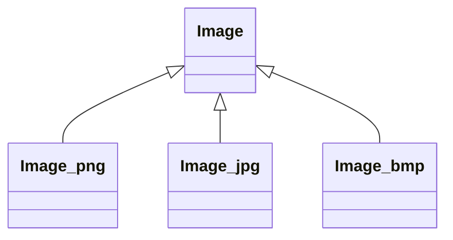
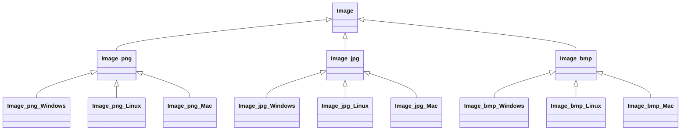
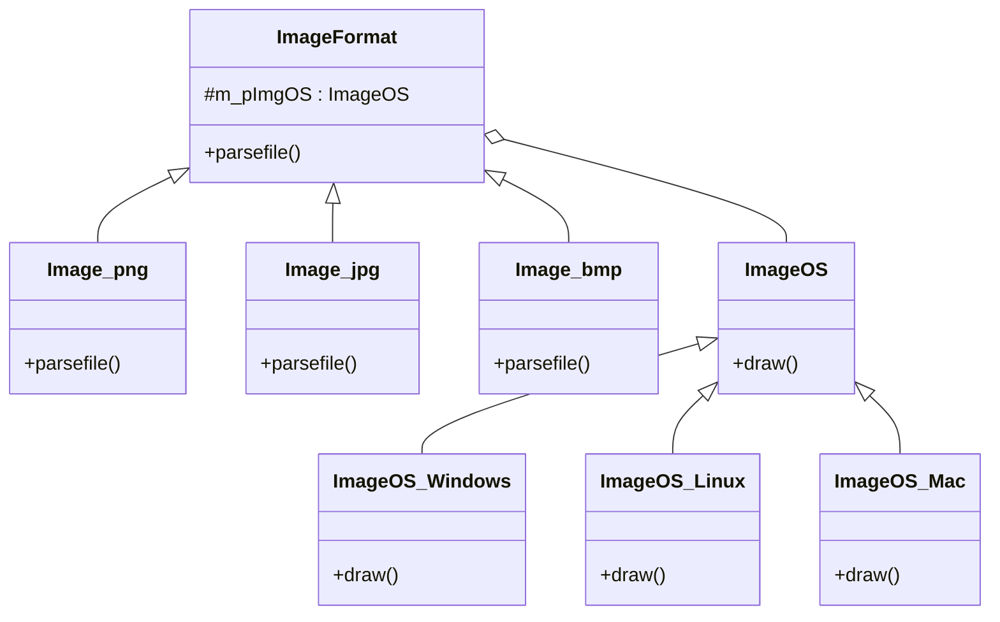

# 第 16 章 桥接模式

&gt; 原书第 217–226 页 ｜ 本节内容：以图像文件读取与显示范例从继承结构重构为委托结构，引出桥接模式（Bridge）的定义、UML 图与四种角色，并讲解"独立变化维度"的识别、模式得名由来与退化形式。

桥接（Bridge）模式也叫桥梁模式，简称桥模式，是一种结构型模式。这是一个并不复杂并且比较有用的模式，该设计模式体现了众多面向对象程序设计的原则（后面会具体说明）。该模式所解决的问题非常简单，即根据单一职责原则，在一个类中，不要做太多事，如果事情很多，尽量拆分到多个类中去，然后在一个类中包含指向另外一个类对象的指针，当需要执行另外一个类中的动作时，用指针直接去调用另外一个类的成员函数。本章将以通俗的语言细致讲解该设计模式。


## 16.1 一个传统的继承范例导致子类数量爆炸式增长

继续前面的闯关打斗类游戏。在游戏中，不可避免地要显示各种图像，例如，人物头像、血条、人物背包、各种物品道具等，这些图像源自各种图像文件，从图像文件中把数据读出来并按照一个**事先约定好的格式规范**保存到一个缓冲区中以方便后续统一的显示处理。

现在的问题是图像文件有多种格式，常用的包括 png、jpg、bmp 等，为了把数据从这些不同格式的图像文件中读出（注意，不管文件是什么格式，读出到事先约定好的缓冲区中后都变成遵循相同规范的数据，此时这些数据不再有来自不同文件的区别）并显示，程序创建了一个叫作 Image 的父类以及分别叫作 Image_png、Image_jpg、Image_bmp 的子类，代码如下：

```cpp
//图像显示相关类
class Image
{
public:
    //根据pData(缓冲区)中的内容以及iDataLen所指示的缓冲区的长度,将这些数据显示出来
    void draw(const char* pfilename)
    {
        int iLen = 0;
        char* pData = parsefile(pfilename, iLen);
        if (iLen > 0)
        {
            cout << "显示pData所指向的缓冲区中的图像数据." << endl;
            //...
            delete pData;   //模拟代码中因为pData的内存是new出来的,这里需要释放该内存
        }
    }

    virtual ~Image() {}     //作父类时析构函数应该为虚函数
private:
    //根据文件名分析文件内容,每个子类因为图像文件格式不同,会有不同的读取和处理代码
    virtual char* parsefile(const char* pfilename, int& iLen) = 0;
};

//处理png格式图像文件的显示
class Image_png :public Image
{
private:
    //读取png文件内容并进行解析,最终整理成统一的二进制数据格式返回
    virtual char* parsefile(const char* pfilename, int& iLen)
    {
        //以下是模拟代码:模拟从图像文件中读取到了数据,最终转换成了100字节的数据格式
        //(事先约定好的格式规范)并返回
        cout << "开始分析png文件中的数据并将分析结果放到pData中,";
        iLen = 100;
        char* presult = new char[iLen];
        return presult;
    }
};

//处理jpg格式图像文件的显示
class Image_jpg :public Image
{
private:
    virtual char* parsefile(const char* pfilename, int& iLen)
    {
        cout << "开始分析jpg文件中的数据并将分析结果放到pData中,";
        //...
    }
};

//处理bmp格式图像文件的显示
class Image_bmp :public Image
{
private:
    virtual char* parsefile(const char* pfilename, int& iLen)
    {
        cout << "开始分析bmp文件中的数据并将分析结果放到pData中,";
        //...
    }
};
```

在 main 主函数中可以加入如下代码进行测试：

```cpp
Image* pImg = new Image_png();
pImg->draw("c:\\somedir\\filename.jpg");

//释放资源
delete pImg;
```

执行起来，看一看结果：

```text
开始分析png文件中的数据并将分析结果放到pData中,显示pData所指向的缓冲区中的图像数据。
```

目前整个类的继承层次图比较简单，如图 16.1 所示。



*原书图 16.1（第 230 页）：*

为了扩大游戏的受众面，进一步增加营收，公司决定，这个闯关打斗类游戏不但要能在当前的 Windows 操作系统平台上运行，也要能够在 Linux（图形界面）以及 Macos（苹果）平台上运行（当然这涉及跨平台开发和条件编译）。对于程序员来讲，这里面临一个问题——每种不同的操作系统，Windows、Linux、Mac 显示缓冲区中图像数据的实现代码都不相同，也就是说，**parsefile 成员函数的实现代码与操作系统无关，而 draw 成员函数中用于显示 pData 所指向的缓冲区中的图像数据的代码却与操作系统相关**（不同的操作系统要写不同的实现代码）。程序员不得不扩展现有的 Image 类的子类（Image_png、Image_jpg、Image_bmp），进一步为每个子类继续产生针对不同操作系统平台的 3 个子类。此时，类的继承层次图就会变成如图 16.2 所示。

与图 16.1 比较，不难发现，采用**继承结构**来设计类时，图 16.2 整整多出了 9 个新类，达到了 13（1+3+3×3）个类之多。如果要多支持一个新的图像文件格式，例如 gif 文件格式，则会变成 17（1+4+4×3）个类，若在 17 个类的基础上再多支持一个新的操作系统例如手机上的安卓操作系统，则要达到 21（1+4+4×4）个类。显然，采用继承结构来设计类在这种情况下不是一个好主意——当增加对新的图像文件格式的支持或者增加对新的操作系统平台的支持时都会导致类数量的急速增长。



*原书图 16.2（第 231 页）：*

## 16.2 将类与类之间的继承关系改为委托关系

通过对附录 A.4 的学习，读者知道了类与类之间的关系一般为**继承**或**组合**关系，而组合关系还可以细分出一种叫作**委托**的关系。如果将图 16.2 中采用继承关系设计类修改为采用委托关系设计类，则可以有效地避免在增加新图像文件格式支持或增加对新操作系统平台支持时子类数量的急速增长。

要采用委托关系来设计类，首先锻炼的是程序员的眼光。在上述范例中，所支持的**图像文件格式包括 3 种——png、jpg、bmp，所支持的操作系统类型也有 3 种——Windows、Linux、Macos**。但有两点特别重要的说明，这些说明是下一步能够使用新的方式改造代码的前提：

- parsefile 成员函数用于从各种格式的图像文件中读取数据并放入到一个缓冲区中，这个成员函数与操作系统类型无关（parsefile 的实现代码不会因为不同的操作系统而有所不同）。
- draw 成员函数用于显示 parsefile 成员函数所返回的缓冲区中的图像，该成员函数与操作系统有关，不同的操作系统，draw 成员函数的实现代码不同。

在进行类设计时，应大胆发挥想象力。不难发现，其实没有必要把**图像文件格式和操作系统类型**掺和到一起通过继承设计出一系列类（例如 Image_jpg_Linux 这种类），这样设计是违反单一职责原则的，可以像下面这样做：

- 把图像文件格式单独设计成一个继承关系的类，在其中实现 parsefile 成员函数（因为该成员函数只与图像文件格式有关）。
- 把操作系统类型也单独设计成一个继承关系的类，在其中实现 draw 成员函数（因为该成员函数只与操作系统类型有关）。

这样无论是**扩充图像文件格式**还是**操作系统类型**这两组类中的哪一组，都不会影响另外一组类，也就不会造成子类数量的急速增长。当然，在图像文件格式表示的类中有一个指向操作系统类型表示的类对象的指针，从而构成这两个类之间的委托关系。下面给出改造后的代码（当然，成员函数的参数等信息可能要根据需要做适当变动）。首先看一看操作系统类型相关类：

```cpp
//操作系统类型相关类
class ImageOS
{
public:
    virtual void draw(char* pData, int iLen) = 0;
    virtual ~ImageOS() {}       //作父类时析构函数应该为虚函数
};

//Windows操作系统
class ImageOS_Windows :public ImageOS
{
public:
    virtual void draw(char* pData, int iLen)
    {
        cout << "在Windows操作系统下显示pData所指向的缓冲区中的图像数据。" << endl;
        //...具体处理代码略
    }
};

//Linux操作系统
class ImageOS_Linux :public ImageOS
{
public:
    virtual void draw(char* pData, int iLen)
    {
        cout << "在Linux操作系统下显示pData所指向的缓冲区中的图像数据。" << endl;
        //...具体处理代码略
    }
};

//Macos
class ImageOS_Mac :public ImageOS
{
public:
    virtual void draw(char* pData, int iLen)
    {
        cout << "在Mac操作系统下显示pData所指向的缓冲区中的图像数据。" << endl;
        //...具体处理代码略
    }
};
```

接着，看一看图像文件格式相关类：

```cpp
//图像文件格式相关类
class ImageFormat
{
public:
    //构造函数
    ImageFormat(ImageOS* pimgos) :m_pImgOS(pimgos) {}
    virtual void parsefile(const char* pfilename) = 0;   //根据文件名分析文件内容,每个子
                                                         //类因为图像文件格式不同,会有不
                                                         //同的读取和处理代码
    virtual ~ImageFormat() {}       //作父类时析构函数应该为虚函数
protected:
    ImageOS* m_pImgOS;              //委托
};

//png格式的图像文件
class Image_png :public ImageFormat
{
public:
    //构造函数
    Image_png(ImageOS* pimgos) :ImageFormat(pimgos) {}
    virtual void parsefile(const char* pfilename)
    {
        cout << "开始分析png文件中的数据并将分析结果放到pData中,";
        //以下是模拟代码:模拟从图像文件中读取到了数据,最终转换成了100字节的数据格式
        //(事先约定好的格式规范)并返回
        int iLen = 100;
        char* presult = new char[iLen];
        m_pImgOS->draw(presult, iLen);

        //释放资源
        delete presult;
    }
};

//jpg格式的图像文件
class Image_jpg :public ImageFormat
{
public:
    //构造函数
    Image_jpg(ImageOS* pimgos) :ImageFormat(pimgos) {}
    virtual void parsefile(const char* pfilename)
    {
        cout << "开始分析jpg文件中的数据并将分析结果放到pData中,";
        //...
    }
};

//bmp格式的图像文件
class Image_bmp :public ImageFormat
{
public:
    //构造函数
    Image_bmp(ImageOS* pimgos) :ImageFormat(pimgos) {}
    virtual void parsefile(const char* pfilename)
    {
        cout << "开始分析bmp文件中的数据并将分析结果放到pData中,";
        //...
    }
};
```

在 main 主函数中，注释掉原有代码，增加如下代码：

```cpp
ImageOS* pimgos_windows = new ImageOS_Windows();        //针对Windows操作系统
ImageFormat* pimg_png = new Image_png(pimgos_windows);  //运行时把图像文件格式(png)和操
                                                        //作系统(Windows)动态组合到一起
pimg_png->parsefile("c:\somedir\filename.png");

//释放资源
delete pimg_png;
delete pimgos_windows;
```

执行起来，看一看结果：

```text
开始分析png文件中的数据并将分析结果放到pData中,在Windows操作系统下显示pData所指向的缓冲区中的图像数据。
```

## 16.3 引入桥接模式

首先，根据上述改造后的范例，绘制相关的 UML 图，如图 16.3 所示，其实，该图就是桥接模式 UML 图。



*原书图 16.3（第 234 页）：（图中各 ImageFormat 子类的 parsefile() 内部都通过 `m_pImgOS->draw();` 调用 ImageOS 子类的 draw 成员函数）*

一会再详细解释桥接模式，先比较一下图 16.2 与图 16.3，不难看到，采用继承关系设计类时，需要创建 13 个类，而使用委托关系设计类时，只需要创建 8（(1+3)+(1+3)）个类。如果要多支持一个新的图像文件格式，例如 gif 文件格式，那么采用继承关系设计类会变成 17 个类，而采用委托关系设计类只须要为 ImageFormat 增加一个诸如 Image_gif 这样的子类，也就是一共只需要 9（(1+4)+(1+3)）个类。

前面谈到程序员的眼光问题。眼光在解决本范例所涉及的问题时显得尤为重要。在这个范例中，存在着两个**独立变化维度**：第一个独立变化维度是图像文件格式，例如，可以有 png、jpg、bmp 等；第二个独立变化维度是所支持的操作系统类型，例如，可以有 Windows、Linux、MacOS，如图 16.4 所示。


之所以重点强调"独立变化维度"，是因为变动（扩展）这两个维度中的任意一个维度都不会对另外一个维度产生影响，也就是说，每个维度都可以分别地、独立地扩展（从而也大大提高了整个项目的可扩展性）。例如，增加一个对 .gif 文件格式的支持，只需要增加一个 Image_gif 子类（以 ImageFormat 作父类），而不需要改动 ImageOS 和其子类，这主要得益于 ImageFormat 子类中的 parsefile 成员函数得到的是一个事先约定好格式规范的缓冲区数据，这些缓冲区数据已经脱离了原始的图像文件格式（png、jpg、bmp 等），采用了一种**统一的格式**来表达，所以在执行 ImageFormat 子类的 parsefile 成员函数时，所遇到的 "m_pImgOS-&gt;draw(presult, iLen);" 代码行会直接调用 ImageOS 子类的 draw 成员函数，在这个 draw 成员函数中，并不需要区分原始的图像数据来自何种格式的图像文件。这就是笔者所说的图像文件格式维度和操作系统类型维度可以独立变化。而独立变化，才是能够顺利使用桥接模式的前提。

其实变化的维度不正限于两个，可以更多，只要这些维度之间彼此的变化是独立的，就可以像范例中引入 m_pImgOS 指针那样在某个类中包含指向另一个类对象的指针，从而调用另一个类的成员函数来处理所需要的业务。

引入"**桥接**"设计模式的**定义**：**将抽象部分与其实现部分分离，使它们都可以独立地变化和扩展**。

相当一部分读者会因为这个定义而感觉特别疑惑，什么叫抽象部分？什么叫实现部分？

- 抽象部分一般指业务**功能**，例如 ImageFormat 类，用于解析各种不同的图像文件格式，这就归为业务功能。
- 实现部分一般指具体的**平台实现**，例如 ImageOS 类，用于根据不同的操作系统来绘制图像，这就归为平台实现。
- 如果读者还不理解桥接模式定义中谈到的**抽象部分**和**实现部分**也完全没关系，就把抽象部分理解成范例中的"图像文件格式维度"，把实现部分理解成"所支持的操作系统类型"维度。桥接模式定义的意思就是把这两个维度分开，每个维度可以独立的变化，例如，增加新的图像文件格式的支持是在图像文件格式这一维度的变化，而对新操作系统类型的支持是在所支持的操作系统类型这一维度的变化，就是如此简单。当然，抽象部分和实现部分的内部并不是毫无关联的，往往需要两者配合来实现指定的功能（例如，本范例中图像的最终显示）。

所以，在进行开发时，如果遇到有多个独立变化维度的业务需求，进行类设计时应优先考虑使用桥接模式（委托方式）而不是继承方式。

观察图 16.3 不难发现，桥接模式中桥接的得名，源自桥接模式的 UML 图中 ImageFormat 和 ImageOS 类之间的连线（m_pImgOS 指向 ImageOS 类对象），这个连线像一座**连接**两个独立继承结构（指 ImageFormat 和 ImageOS）的桥，而诸多子类，例如 Image_png、Image_jpg、Image_bmp 以及 ImageOS_Windows、ImageOS_Linux、ImageOS_Mac 可以看成是诸多桥墩（支起了这座桥），如图 16.5 所示。


ImageFormat 类和 ImageOS 之间的关系就叫桥接。用"桥接"设计模式定义中用到的术语来说，桥接就在抽象部分与实现部分之间担当着桥梁作用，桥梁两侧的每一部分又都可以独立变化。

桥接模式的 UML 图中包含 4 种角色。

（1）Abstraction（抽象部分相关接口）：定义抽象类的接口，其中包含一根指向 Implementor 类型对象的指针。这里指 ImageFormat 类。

（2）RefinedAbstraction（扩充抽象部分接口）：实现在 Abstraction 中定义的接口，还可以在其中调用在 Implementor 中定义的方法。这里指 Image_png、Image_jpg、Image_bmp 类。

（3）Implementor（实现部分相关接口）：定义实现类的接口，这些接口可能与 Abstraction 中的接口一致，也可能完全不同。通常 Implementor 中定义的接口仅提供基本操作，而 Abstraction 中定义的接口会实现更多、更复杂的功能。这里指 ImageOS 类。

（4）ConcreteImplementor（实现部分具体类）：实现在 Implementor 中定义的接口。这里指 ImageOS_Windows、ImageOS_Linux、ImageOS_Mac 类。

桥接模式用组合关系解决了传统继承关系存在的类数量爆炸式增长的问题，使用对象组合方式解决问题，使代码更灵活、更易于扩展。桥接模式的实现代码不仅体现了单一职责原则，还体现了开闭原则、组合复用原则、依赖倒置原则等。当然，使用桥接模式所付出的代价是增加了代码的设计和理解难度。

要使用好桥接模式，难点在于正确识别出一个事物中所具有的两个或者多个能够独立变化的维度（这两个或者多个维度之间完全解耦），这可能需要长期的练习和经验的积累。只要能够正确做到这一点，就可以将每个维度设计为独立的继承结构并在它们之间搭一座桥。而对于桥接模式定义中提到的抽象部分与实现部分，如果将一个维度当成抽象部分，那么将另外一个维度当成实现部分就可以了。

桥接模式还有一种退化的形式，也就是如果 Implementor 仅有一个实现，那么就不需要创建抽象的 Implementor 类，而是直接创建和使用 ConcreteImplementor 类，当然，此时仍旧要保持 Abstraction 和 ConcreteImplementor 处于分离状态（仍旧是两个维度）以方便将来的扩展。

桥接模式可以连续组合使用，例如一个桥接模式的实现部分，可以作为下一个桥接模式的抽象部分，这样就很容易做到支持超过两个独立变化的维度。
