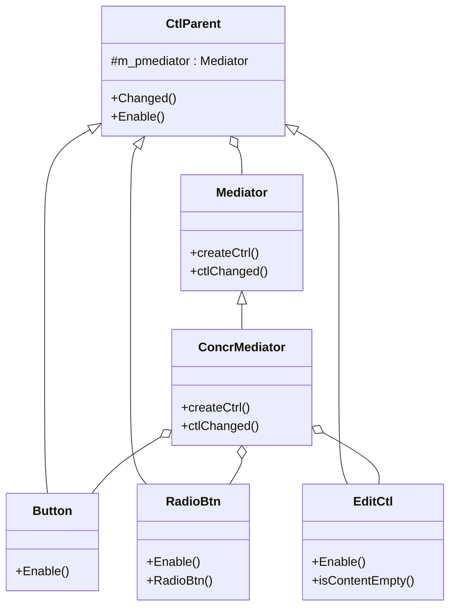

# 第 17 章 中介者模式

&gt; 原书第 227–242 页 ｜ 本节内容：以主板、QQ 群、塔台三个生活场景介绍中介者（Mediator）的基本概念，再以网游登录界面 UI 控件联动范例从网状结构重构为星状结构，引出中介者模式的定义、UML 图、四种角色以及优缺点与适用场景。

中介者（Mediator）模式还有一个名字叫作调停者模式，是一种行为型模式。显然，中介者扮演的是一个中间人的角色。现实生活中的媒人就是一个典型的中间人角色，青年男女互相认识要通过媒人，男人或者女人有什么话要带给对方也需要通过媒人来转达。该模式思想简单，容易理解，实现代码相对烦琐但并不复杂。


## 17.1 中介者的基本概念

为进一步了解中介者的基本概念以及中介者所扮演的角色，不妨设想如下几类比较常见且典型的存在中介者角色的场景。

**1. 计算机的各个组成部件**

典型的计算机是由 CPU、内存、硬盘、声卡、显卡、网卡等配件构成，这些配件都插在**主板**上，主板对于这些计算机配件来讲，就是一个中介者，各个配件之间的数据通信和交互都通过主板进行。设想一下从硬盘上读一个图形文件并显示到屏幕上，涉及计算机配件可能包括硬盘、CPU、内存、显卡等，通过主板，这些配件可以协调工作。但是，如果没有主板，配件之间的数据交换就麻烦了。从理论上来说，每个计算机配件之间都存在着数据交换的可能，这种数据交换看起来非常杂乱，呈现一种**网状结构**，这种网状结构体现的是一种多对多的关系（一个配件可能要跟其他多个配件进行交互，注意双向箭头表示双向依赖），如图 17.1 所示。


图 17.1 的结构看起来非常复杂（注意这只是个示意图，可能现实中并不是每个配件都会与所有其他配件进行数据交换），但如果有了主板这个中介者的存在，每个配件只需要与主板打交道，主板可以把某个配件的信息发送给其他配件，**配件之间不再需要打交道**，那么此时数据的交换就呈现出了一种**星状结构**，这种结构看起来就简单和清晰多了，如图 17.2 所示。


**2. QQ 聊天**

QQ 是腾讯公司开发的一款聊天软件，全世界有数亿人在使用它。在 QQ 中，有两种常见的聊天方式：

- 可以与好友或者陌生人单独聊天（私聊）；
- 加入到了一个 QQ 群中，那么我们所发送的聊天信息可以被其他群友看到，其他群友发送的聊天信息也可以被我们看到。

QQ 用户之间的关系是烦琐和复杂的。从理论上讲，任何两个用户之间都可以私聊，在无须探究用户之间私聊的数据通信内部如何完成的情况下，这种用户之间的关系看起来就是一种杂乱无章的网状结构。如果用户加入了一个 QQ 群，那么通过 QQ 群聊天的时候，就可以把这个 QQ 群想象成一个中介者，QQ 用户之间不再需要单独聊天，每个用户只需要把自己的聊天信息发送到 QQ 群中，由 QQ 群把这条聊天信息转发给其他 QQ 用户，然后这条聊天信息就会被该 QQ 群中的所有人看到。设想一下，如果没有这个 QQ 群，某个 QQ 用户要给 100 个其他 QQ 用户发送消息的话，那么该用户就要与 100 个其他 QQ 用户打交道，通信关系就会变得非常复杂，实现步骤也将烦琐很多。

**3. 飞机的安全飞行与安全着陆**

空中交通是非常繁忙的，从原则上说，每架飞机必须时刻知道其他飞机所处的位置、高度等信息才能保证自身的飞行安全。如果没有塔台的统一调度和指挥，那么每个飞机都需要实时与其他飞机进行通信，这种通信的数据量和通信网络的复杂程度超乎想象，而且显然还会产生很多不必要的通信信息（例如，两架飞机距离相距十万八千里，那么彼此之间实时保持通信根本没有必要）。在这里，塔台就扮演着中介者的角色，每架飞机只需要与塔台打交道，实时报告自身当前的位置、高度等信息，塔台就可以把这些信息实时发送给附近的其他飞机，以做到让其他飞机知晓以及合理避让，通过塔台对飞机的统一调度指挥，飞机之间不再需要彼此通信，大大减少了通信信息的传递，也大大简化了通信网络的复杂程度。

## 17.2 中介者模式范例的引入

前面谈到了在实际的工作和生活中可能扮演中介者的角色，在实际的开发中，中介者模式在事件驱动类的软件中有比较广的应用，尤其是常常运用在程序的 UI 界面设计中。

设想当前正在开发一个网络游戏的登录界面，如图 17.3 所示。

在图 17.3 中，玩家可以以两种方式登录游戏：一种是"游客登录"，另一种是"账号登录"，这两种登录方式只能二选一。

选择"游客登录"的好处是不用输入账号和密码就可以直接单击"登录"按钮来登录游戏，坏处是游戏进度只能保存在当前计算机中，如果换一台计算机，游戏进度信息将全部丢失。选择"账号登录"的麻烦之处是需要输入账号和密码后才能单击"登录"按钮来登录游戏，好处是即便换一台计算机，输入同样的账号和密码登录游戏后游戏的进度信息会全部保留。

看起来，如图 17.3 所示的对话框实现起来并不复杂，但想实现则要注意很多细节，例如：

- "游客登录"和"账号登录"是两个单选按钮并且同在一个组中，这意味着当"游客登录"单选按钮被选中时，"账号登录"单选按钮必然不能被选中；反之，当"账号登录"单选按钮被选中时，"游客登录"单选按钮必然不能被选中。
- 在任意时刻，要么"游客登录"单选按钮被选中，要么"账号登录"单选按钮被选中，两者必居其一。
- 当"游客登录"单选按钮被选中时，"账号"和"密码"编辑框应该处于禁用（灰色无效）状态，用来提醒玩家此时不需要输入账号和密码就可以登录游戏。而若玩家单击"账号登录"单选按钮切换回账号登录时，"账号"和"密码"编辑框应该还原回启用状态，以表明玩家需要输入账号和密码才能登录游戏，如图 17.4 所示。


- 当"账号登录"单选按钮被选中时，如果"账号"或"密码"这两个编辑框之一为空（没有任何字符输入），则禁用"登录"按钮以提示玩家账号和密码都不能为空才能尝试登录游戏，只有"账号"和"密码"编辑框都有内容时，"登录"按钮才有效，如图 17.5 所示。


- "退出"按钮表示退出当前游戏的登录界面（其实就是退出整个游戏），该按钮始终允许被单击。如果有其他描述方面的遗漏，读者也可以自行补充。

看起来上述界面的实现比较烦琐，多个 UI 控件（包括单选按钮、编辑框、普通按钮等）之间有比较复杂的关联和约束关系（联动关系），如果不采用中介者模式来编写代码，可以尝试看看如何编写代码来实现 UI 控件之间的联动。

首先创建一个所有 UI 控件的父类，代码如下：

```cpp
//UI控件类的父类
class CtlParent
{
public:
    CtlParent(string caption) :m_caption(caption) {}    //构造函数
    virtual ~CtlParent() {}                             //作父类时析构函数应该为虚函数

public:
    //当UI控件发生变化时该成员函数会被调用
    virtual void Changed(map<string, CtlParent*>& tmpuictllist) = 0;
    //形参所代表的map容器中包含着所有对话框中涉及的UI控件,注意文件头要有 #include <map>
    //设置UI控件启用或禁用
    virtual void Enable(bool sign) = 0;

protected:
    string m_caption;   //控件上面显示的文字内容,本范例假设每个UI控件上的文字都不同
};
```

接着，分别创建普通按钮、单选按钮、编辑控件相关的类，它们都继承自 CtlParent 类：

```cpp
//普通按钮相关类
class Button :public CtlParent
{
public:
    Button(string caption) :CtlParent(caption) {}       //构造函数
public:
    //设置按钮的启用或禁用
    virtual void Enable(bool sign)
    {
        if (sign == true)
        {
            cout << "按钮" << m_caption << "被设置为了\"启用\"状态" << endl;
        }
        else
        {
            cout << "按钮" << m_caption << "被设置为了\"禁用\"状态" << endl;
        }
        //具体实现按钮启用或者禁用的代码略...
    }
    //按钮被按下时该成员函数会被调用
    virtual void Changed(map<string, CtlParent*>& tmpuictllist);
};

//单选按钮相关类
class RadioBtn : public CtlParent
{
public:
    RadioBtn(string caption) :CtlParent(caption) {}     //构造函数
public:
    //设置单选按钮的启用或禁用
    virtual void Enable(bool sign)
    {
        //本范例用不到该功能,实现代码略...
    }
    //设置单选按钮为被选中或者被取消选中,被选中的单选按钮中间有个黑色实心圆点
    void Selected(bool sign)
    {
        if (sign == true)
        {
            cout << "单选按钮" << m_caption << "被选中" << endl;
        }
        else
        {
            cout << "单选按钮" << m_caption << "被取消选中" << endl;
        }
        //具体实现单选按钮被选中或者被取消选中的代码略...
    }
    //单选按钮被单击时该成员函数会被调用
    virtual void Changed(map<string, CtlParent*>& tmpuictllist);
};

//编辑框相关类
class EditCtl : public CtlParent
{
public:
    EditCtl(string caption):CtlParent(caption) {}       //构造函数
public:
    //设置编辑框的启用或禁用
    void Enable(bool sign)
    {
        if (sign == true)
        {
            cout << "编辑框" << m_caption << "被设置为了\"启用\"状态" << endl;
        }
        else
        {
            cout << "编辑框" << m_caption << "被设置为了\"禁用\"状态" << endl;
        }
        //具体实现编辑框启用或者禁用的代码略...
    }
    //是否编辑框中的内容为空
    bool isContentEmpty()
    {
        return m_content.empty();
    }
    //编辑框内容发生变化时该成员函数会被调用
    virtual void Changed(map<string, CtlParent*>& tmpuictllist);
private:
    string m_content = "";      //编辑框中的内容
};
```

有了 Button、RadioBtn、EditCtl 子类的定义，接下来就可以实现这些子类的 Changed 成员函数了。因为这些子类之间有千丝万缕的联系，涉及相互之间的调用，所以在前面必须率先把这些子类定义出来。

```cpp
//按钮被按下时该成员函数会被调用
void Button::Changed(map<string, CtlParent*>& tmpuictllist)
{
    if (m_caption == "登录")
    {
        //按下的是登录按钮
        cout << "开始游戏登录验证,根据验证结果决定是进入游戏之中还是验证失败给出提示!" << endl;
    }
    else if (m_caption == "退出")
    {
        //按下的是退出按钮,则退出整个游戏
        cout << "游戏退出,再见!" << endl;
    }
}

//单选按钮被单击时该成员函数会被调用
void RadioBtn::Changed(map<string, CtlParent*>& tmpuictllist)
{
    if (m_caption == "游客登录")
    {
        (static_cast<RadioBtn*>(tmpuictllist["游客登录"]))->Selected(true);      //"游客登录"单选按钮设置为选中
        (static_cast<RadioBtn*>(tmpuictllist["账号登录"]))->Selected(false);     //"账号登录"单选按钮设置为取消选中

        tmpuictllist["账号"]->Enable(false);        //"账号"编辑框设置为禁用
        tmpuictllist["密码"]->Enable(false);        //"密码"编辑框设置为禁用

        tmpuictllist["登录"]->Enable(true);         //"登录"按钮设置为启用
    }
    else if (m_caption == "账号登录")
    {
        (static_cast<RadioBtn*>(tmpuictllist["游客登录"]))->Selected(false);     //"游客登录"单选按钮设置为取消选中
        (static_cast<RadioBtn*>(tmpuictllist["账号登录"]))->Selected(true);      //"账号登录"单选按钮设置为选中

        tmpuictllist["账号"]->Enable(true);         //"账号"编辑框设置为启用
        tmpuictllist["密码"]->Enable(true);         //"密码"编辑框设置为启用

        if ((static_cast<EditCtl*>(tmpuictllist["账号"]))->isContentEmpty() || (static_cast<EditCtl*>(tmpuictllist["密码"]))->isContentEmpty())
        {
            //如果"账号"编辑框或者"密码"编辑框有一个为空,则不允许登录
            tmpuictllist["登录"]->Enable(false);    //"登录"按钮设置为禁用
        }
        else
        {
            tmpuictllist["登录"]->Enable(true);     //"登录"按钮设置为启用
        }
    }
}

//编辑框内容发生变化时该成员函数会被调用
void EditCtl::Changed(map<string, CtlParent*>& tmpuictllist)
{
    if ((static_cast<EditCtl*>(tmpuictllist["账号"]))->isContentEmpty() || (static_cast<EditCtl*>(tmpuictllist["密码"]))->isContentEmpty())
    {
        //如果"账号"编辑框或者"密码"编辑框有一个为空,则不允许登录
        tmpuictllist["登录"]->Enable(false);        //"登录"按钮设置为禁用
    }
    else
    {
        tmpuictllist["登录"]->Enable(true);         //"登录"按钮设置为启用
    }
}
```

在 main 主函数中可以增加如下测试代码来模拟"账号登录"单选按钮被单击选中时的情形。首先，创建各种 UI 控件：

```cpp
//创建各种UI控件
map<string, CtlParent*> uictllist;      //将所有创建的UI控件保存到map容
                                        //器中,方便进行参数传递
uictllist["登录"] = new Button("登录");
uictllist["退出"] = new Button("退出");

uictllist["游客登录"] = new RadioBtn("游客登录");
uictllist["账号登录"] = new RadioBtn("账号登录");

uictllist["账号"] = new EditCtl("账号");
uictllist["密码"] = new EditCtl("密码");
```

接着，需要设置一下对话框刚开始出现时（默认状态），各个 UI 控件的状态：

```cpp
//设置一下默认的UI控件状态
//因为只有子类型才有Selected成员函数,所以这里需要用到强制类型转换
(static_cast<RadioBtn*>(uictllist["游客登录"]))->Selected(true);     //"游客登录"单选按钮设置为选中
(static_cast<RadioBtn*>(uictllist["账号登录"]))->Selected(false);    //"账号登录"单选按钮设置为取消选中

uictllist["账号"]->Enable(false);       //"账号"编辑框设置为禁用
uictllist["密码"]->Enable(false);       //"密码"编辑框设置为禁用

uictllist["登录"]->Enable(true);        //"登录"按钮设置为启用
uictllist["退出"]->Enable(true);        //"退出"按钮设置为启用
```

当然，可能还需要设置 UI 控件的位置等代码，不过这些代码与本章所讨论的设计模式无关，因此不做介绍。下面模拟"账号登录"单选按钮被单击选中时的情形，继续在 main 主函数中增加代码：

```cpp
cout << "-------------------------" << endl;
uictllist["账号登录"]->Changed(uictllist);      //模拟"账号登录"单选按钮被单击选中
```

上面这行调用 Changed 成员函数的代码会执行 RadioBtn 类的 Changed 成员函数，根据前面的分析，该成员函数中的代码实现了当"账号登录"单选按钮被选中时，如果"账号"或"密码"这两个编辑框之一为空（没有任何字符输入），则禁用"登录"按钮，以提示玩家账号和密码都不能为空才能尝试登录游戏，只有"账号"和"密码"编辑框都有内容时，"登录"按钮才有效。

当然，不要忘记释放资源，养成良好的习惯，在 main 主函数中增加如下代码：

```cpp
//释放资源
for(auto iter = uictllist.begin(); iter != uictllist.end(); iter++)
{
    delete iter->second;
    iter->second = nullptr;
}
```

执行起来，看一看结果：

```text
单选按钮"游客登录"被选中
单选按钮"账号登录"被取消选中
编辑框"账号"被设置为了"禁用"状态
编辑框"密码"被设置为了"禁用"状态
按钮"登录"被设置为了"启用"状态
按钮"退出"被设置为了"启用"状态
-------------------------
单选按钮"游客登录"被取消选中
单选按钮"账号登录"被选中
编辑框"账号"被设置为了"启用"状态
编辑框"密码"被设置为了"启用"状态
按钮"登录"被设置为了"禁用"状态
```

结果中的最后 5 行显示了当"账号登录"单选按钮被选中时，对其他 UI 控件所做的状态调整。

可以看到，整个的实现代码比较烦琐，当"账号登录"单选按钮被选中时，会影响到许多其他控件的状态（调用了许多其他控件所属类的成员函数），读者能看到的是 Button、RadioBtn、EditCtl 类的 Changed 成员函数中还包含各种代码，这属于典型的网状结构——一个对象（控件）发生改变时会与许多其他对象进行交互，对象之间彼此耦合，相互纠缠、制约和依赖，大大降低了对象的可复用性。如果新增或删除一个 UI 控件类，那么与该 UI 控件交互的其他 UI 控件类也必须进行修改，而这就违反了开闭原则。

此时，就可以使用中介者模式。在中介者模式中会引入一个中介者对象，各个 UI 控件之间不再需要彼此通信，只与中介者对象进行通信，中介者会把某个 UI 控件发送来的信息传达给其他 UI 控件，这样，以往分散在各个 UI 控件子类中的逻辑处理代码（Button、RadioBtn、EditCtl 类的 Changed 成员函数中的代码）就可以统一写在中介者类中，中介者负责控制和协调一组对象之间的交互，某个对象不需要知道其他对象的存在，只需要知道中介者的存在并与其打交道即可。

下面使用中介者模式来重新实现一下上述范例，然后再正式引入中介者模式的定义以及该模式的 UML 图。

首先，按照中介者设计模式的编写惯例，会先创建一个中介者抽象父类 Mediator，其中会声明一个成员函数（ctlChanged）接口，UI 控件通过调用这个成员函数与中介者对象进行交互。同时，中介者对象为了能够与所有的 UI 控件交互，也会持有所有 UI 控件的指针（createCtrl 成员函数）。Mediator 类的代码如下：

```cpp
//类前向声明
class CtlParent;

//中介者父类
class Mediator
{
public:
    virtual ~Mediator() {}      //作父类时析构函数应该为虚函数

public:
    virtual void createCtrl() = 0;              //创建所有需要用到的UI控件
    virtual void ctlChanged(CtlParent*) = 0;    //当某个UI控件发生变化时调用中介
                                                //者对象的该成员函数来通知中介者
};
```

接着，定义 UI 控件类的父类 CtlParent，为了与中介者类对象交互，该类中必须有一个指向中介者类对象的指针 m_pmediator，同时应注意其中的 Changed 成员函数，控件就是通过该成员函数与中介者对象进行交互的，代码如下：

```cpp
//UI控件类的父类
class CtlParent
{
public:
    CtlParent(Mediator* ptmpm, string caption) :m_pmediator(ptmpm), m_caption(caption) {}
                                                //构造函数
    virtual ~CtlParent() {}                     //作父类时析构函数应该为虚函数

public:
    //当UI控件发生变化时该成员函数会被调用
    virtual void Changed()
    {
        m_pmediator->ctlChanged(this);          //通知中介者对象,所有事情让中介者对象去做
    }

    //设置UI控件启用或禁用
    virtual void Enable(bool sign) = 0;

protected:
    Mediator* m_pmediator;      //指向中介者对象的指针
    string  m_caption;          //控件上面显示的文字内容,可能并不是所有
                                //控件都需要,但这里为显示方便依旧引入
};
```

接着，分别创建普通按钮、单选按钮、编辑控件相关的类，它们都继承自 CtlParent 类，注意，每个类中构造函数的第一个参数都是用于指向中介者类对象的指针：

```cpp
//普通按钮相关类
class Button: public CtlParent
{
public:
    Button(Mediator* ptmpm, string caption) :CtlParent(ptmpm, caption) {}
                                                //构造函数
    //设置按钮的启用或禁用
    virtual void Enable(bool sign)
    {
        if (sign == true)
        {
            cout << "按钮" << m_caption << "被设置为了\"启用\"状态" << endl;
        }
        else
        {
            cout << "按钮" << m_caption << "被设置为了\"禁用\"状态" << endl;
        }
        //具体实现按钮启用或者禁用的代码略...
    }
};

//单选按钮相关类
class RadioBtn: public CtlParent
{
public:
    RadioBtn(Mediator* ptmpm, string caption) :CtlParent(ptmpm, caption) {}
                                                //构造函数
    //设置单选按钮的启用或禁用
    virtual void Enable(bool sign)
    {
        //用不到该功能,实现代码略...
    }

    //设置单选按钮为被选中或者被取消选中,被选中的单选按钮中间有个黑色实心圆点
    void Selected(bool sign)
    {
        if (sign == true)
        {
            cout << "单选按钮" << m_caption << "被选中" << endl;
        }
        else
        {
            cout << "单选按钮" << m_caption << "被取消选中" << endl;
        }
        //具体实现单选按钮被选中或者被取消选中的代码略...
    }
};

//编辑框相关类
class EditCtl: public CtlParent
{
public:
    EditCtl(Mediator* ptmpm, string caption) :CtlParent(ptmpm, caption) {}
                                                //构造函数
    //设置编辑框的启用或禁用
    void Enable(bool sign)
    {
        if (sign == true)
        {
            cout << "编辑框" << m_caption << "被设置为了\"启用\"状态" << endl;
        }
        else
        {
            cout << "编辑框" << m_caption << "被设置为了\"禁用\"状态" << endl;
        }
        //具体实现编辑框启用或者禁用的代码略...
    }
    //是否编辑框中的内容为空
    bool isContentEmpty()
    {
        return m_content.empty();
    }
    //其他成员函数略...
private:
    string m_content = "";      //编辑框中的内容
};
```

有了上述这些 UI 控件类，按照中介者设计模式的编写惯例，就可以编写具体的中介者类 concrMediator，该类继承自中介者抽象父类 Mediator，代码如下：

```cpp
//具体中介者类
class concrMediator : public Mediator
{
public:
    ~concrMediator()        //析构函数
    {
        //释放资源
        if (mp_login) { delete mp_login; mp_login = nullptr; }
        if (mp_logout) { delete mp_logout; mp_logout = nullptr; }

        if (mp_rbtn1) { delete mp_rbtn1; mp_rbtn1 = nullptr; }
        if (mp_rbtn2) { delete mp_rbtn2; mp_rbtn2 = nullptr; }

        if (mp_edtctl1) { delete mp_edtctl1; mp_edtctl1 = nullptr; }
        if (mp_edtctl2) { delete mp_edtctl2; mp_edtctl2 = nullptr; }
    }
    //创建各种UI控件
    virtual void createCtrl()
    {
        //当然,各种UI控件对象在外面创建,然后把地址传递进来也可以
        mp_login = new Button(this, "登录");
        mp_logout = new Button(this, "退出");

        mp_rbtn1 = new RadioBtn(this, "游客登录");
        mp_rbtn2 = new RadioBtn(this, "账号登录");

        mp_edtctl1 = new EditCtl(this, "账号编辑框");
        mp_edtctl2 = new EditCtl(this, "密码编辑框");

        //设置一下默认的UI控件状态
        mp_rbtn1->Selected(true);           //"游客登录"单选按钮设置为选中
        mp_rbtn2->Selected(false);          //"账号登录"单选按钮设置为取消选中

        mp_edtctl1->Enable(false);          //"账号"编辑框设置为禁用
        mp_edtctl2->Enable(false);          //"密码"编辑框设置为禁用

        mp_login->Enable(true);             //"登录"按钮设置为启用
        mp_logout->Enable(true);            //"退出"按钮设置为启用

        //UI控件的位置设置等代码略...
    }

    //当某个UI控件发生变化时调用中介者对象的该成员函数来通知中介者
    virtual void ctlChanged(CtlParent* p_ctrl)
    {
        if (p_ctrl == mp_login)             //登录按钮被单击
        {
            cout << "开始游戏登录验证,根据验证结果决定是进入游戏之中还是验证失败给出提示!" << endl;
        }
        else if (p_ctrl == mp_logout)       //退出按钮被单击
        {
            //退出整个游戏
            cout << "游戏退出,再见!" << endl;
        }

        if (p_ctrl == mp_rbtn1)             //游客登录单选按钮被单击
        {
            mp_rbtn1->Selected(true);           //"游客登录"单选按钮设置为选中
            mp_rbtn2->Selected(false);          //"账号登录"单选按钮设置为取消选中

            mp_edtctl1->Enable(false);          //"账号"编辑框设置为禁用
            mp_edtctl2->Enable(false);          //"密码"编辑框设置为禁用

            mp_login->Enable(true);             //"登录"按钮设置为启用
        }
        else if (p_ctrl == mp_rbtn2)        //账号登录单选按钮被单击
        {
            mp_rbtn1->Selected(false);          //"游客登录"单选按钮设置为取消选中
            mp_rbtn2->Selected(true);           //"账号登录"单选按钮设置为选中

            mp_edtctl1->Enable(true);           //"账号"编辑框设置为启用
            mp_edtctl2->Enable(true);           //"密码"编辑框设置为启用

            if (mp_edtctl1->isContentEmpty() || mp_edtctl2->isContentEmpty())
            {
                //如果"账号"编辑框或者"密码"编辑框有一个为空,则不允许登录
                mp_login->Enable(false);        //"登录"按钮设置为禁用
            }
            else
            {
                mp_login->Enable(true);         //"登录"按钮设置为启用
            }
        }
        if (p_ctrl == mp_edtctl1 || p_ctrl == mp_edtctl2)   //账号或密码编辑框内容发生改变
        {
            if (mp_edtctl1->isContentEmpty() || mp_edtctl2->isContentEmpty())
            {
                //如果"账号"编辑框或者"密码"编辑框有一个为空,则不允许登录
                mp_login->Enable(false);        //"登录"按钮设置为禁用
            }
            else
            {
                mp_login->Enable(true);         //"登录"按钮设置为启用
            }
        }
    }

public:     //为方便外界使用,这里以public修饰,实际项
            //目中可以写一个成员函数来return这些指针
    Button* mp_login = nullptr;         //登录按钮
    Button* mp_logout = nullptr;        //退出按钮

    RadioBtn* mp_rbtn1 = nullptr;       //游客登录单选按钮
    RadioBtn* mp_rbtn2 = nullptr;       //账号登录单选按钮

    EditCtl* mp_edtctl1 = nullptr;      //账号编辑框
    EditCtl* mp_edtctl2 = nullptr;      //密码编辑框
};
```

在 main 主函数中，注释掉原有代码，增加如下代码：

```cpp
concrMediator mymedia;
mymedia.createCtrl();
cout << "------------- 当\"账号登录\"单选按钮被按下时: -------------" << endl;
mymedia.mp_rbtn2->Changed();        //模拟"账号登录"单选按钮被按下,则去通知
                                    //中介者,由中介者实现具体的逻辑处理
```

执行起来，看一看结果：

```text
单选按钮"游客登录"被选中
单选按钮"账号登录"被取消选中
编辑框"账号编辑框"被设置为了"禁用"状态
编辑框"密码编辑框"被设置为了"禁用"状态
按钮"登录"被设置为了"启用"状态
按钮"退出"被设置为了"启用"状态
------------- 当"账号登录"单选按钮被按下时: -------------
单选按钮"游客登录"被取消选中
单选按钮"账号登录"被选中
编辑框"账号编辑框"被设置为了"启用"状态
编辑框"密码编辑框"被设置为了"启用"状态
按钮"登录"被设置为了"禁用"状态
```

分析重新实现后的代码，不难看到，当执行代码行 "mymedia.mp_rbtn2-&gt;Changed();" 来模拟"账号登录"单选按钮被按下时，该行代码的调用关系大概如下：

```text
(i) mymedia.mp_rbtn2->Changed();                    //执行CtlParent::Changed函数
(i)     m_pmediator->ctlChanged(this);              //执行concrMediator::ctlChanged函数通知中介者
(i)         ...
(i)         else if (p_ctrl == mp_rbtn2)            //本条件成立,表示账号登录单选按钮被单击
(i)             mp_rbtn1->Selected(false);          //"游客登录"单选按钮设置为取消选中
(i)             mp_rbtn2->Selected(true);           //"账号登录"单选按钮设置为选中
(i)             mp_edtctl1->Enable(true);           //"账号"编辑框设置为启用
(i)             mp_edtctl2->Enable(true);           //"密码"编辑框设置为启用
(i)             if (mp_edtctl1->isContentEmpty() || mp_edtctl2->isContentEmpty())
(i)                 mp_login->Enable(false);        //"登录"按钮设置为禁用
(i)             else
(i)                 mp_login->Enable(true);         //"登录"按钮设置为启用
```

从上述调用关系可以看到，"账号登录"单选按钮被选中时，会通知中介者处理，所有核心的处理代码都在中介者类中，因为中介者类中有所有 UI 控件对象的指针，所以中介者可以通过这些指针调用这些 UI 控件对象的成员函数，以达到正确设置这些 UI 控件状态的目的，这就相当于通知其他 UI 控件某个 UI 控件发生了变动。

## 17.3 引入中介者模式

引入"**中介者**"模式的**定义**：**用一个中介对象（中介者）来封装一系列的对象交互。中介者使各个对象不需要显式地相互引用，从而使其耦合松散，而且可以独立地改变它们之间的交互方式**。

根据上述改造后的范例，绘制中介者模式的 UML 图，如图 17.6 所示。



*原书图 17.6（第 252 页）：（ConcrMediator 分别通过 mp_login、mp_logout、mp_rbtn1、mp_rbtn2、mp_edtctl1、mp_edtctl2 六个指针与各个 UI 控件关联）*

从图 17.6 中可以看到，**CtlParent 类**中持有一个指向中介者对象的指针（m_pmediator），这样当 UI 控件自身发生变化时可以通过这个指针通知中介者对象（调用中介者类的成员函数）。此外，**具体中介者类 ConcrMediator** 持有所有指向 UI 控件的指针（mp_login、mp_logout、mp_rbtn1、mp_rbtn2、mp_edtctl1、mp_edtctl2），这样，当中介者对象知道某个 UI 控件发生变化时，可以把这些变化通知任何其他的 UI 控件（调用这些 UI 控件所属类的成员函数）。

中介者模式的 UML 图中包含 4 种角色。

（1）Mediator（抽象中介者类）：定义一些接口（抽象方法），后面谈到的各个同事对象（各个 UI 控件）可以调用这些接口来与中介者进行通信。这里指 Mediator 类。

（2）ConcreteMediator（具体中介者类）：继承自抽象中介者类，实现父类中定义的抽象方法，其中保存了各个同事对象的指针用于与同事对象进行通信实现协作行为。这里指 concrMediator 类。

（3）Colleague（抽象同事类）：定义同事类共有的方法（例如 Changed）和一些需要子类实现的抽象方法（例如 Enable），同时维持了一个指向中介者对象的指针（m_pmediator），用于与中介者对象通信。这里指 CtlParent 类。

（4）ConcreteColleague（具体同事类）：继承自抽象同事类，实现父类中定义的抽象方法。以往同事类对象之间的通信在引入中介者模式后，具体的同事类对象就不再需要与其他同事类对象通信（不需要了解其他同事类对象），只需要与中介者通信，中介者会根据实际情况完成与其他同事类对象的通信。这里指 Button、RadioBtn、EditCtl 类。

面向对象程序设计鼓励将行为分布到各个对象中，虽然将一个系统分隔成许多对象通常可以增强复用性，但是对象之间相互连接（交互）的增加又会降低对象的复用性。大量的相互连接使多个对象之间必须协同才能完成工作，整个系统变得难以分隔，代码的调整和改动也变得困难。这正是中介者出场的好时机，中介者模式一般用于**一组对象以定义良好但复杂的方式进行通信**的场合，由中介者负责控制和协调一组对象间的交互。

值得注意的是，如果中介者的实现只有一个，并不需要扩展出多个具体中介者，那么可以不创建抽象中介者类，直接使用具体中介者类也可以。另外，在前面的范例中，抽象同事类 CtlParent 中 Changed 成员函数通过调用中介者的 ctlChanged 成员函数将控件发生变化的消息通知中介者，其实也可以采用观察者模式来实现，即将中介者实现为一个观察者，而各个同事类实现为观察目标，这样，当同事类对象发生改变时会通知中介者，中介者就可以在接到通知后与其他同事类对象进行通信交互。这些代码改造的工作，就交由读者来完成。

该模式具有如下优缺点：

（1）中介者将对象之间复杂的沟通和控制方式集中起来处理，将以往对象之间复杂的多对多关系转化为简单的一对多关系。让系统有更好的灵活性和可扩展性。

（2）中介者模式将同事对象进行解耦，同事对象之间不再是一种紧耦合关系，它们仅知道中介者，从而减少相互连接的数目。每个同事类对象都可以独立地改变而不会影响到其他同事类对象，更符合开闭原则，进一步增加了对象的复用性。

（3）将各种控制逻辑的代码（同事类对象之间的交互）都集中（转移）到了中介者类中实现，这为集中修改提供了便利，而且若将来需要引入**新的中介者行为**，则可以创建**新具体中介者类**来实现。代码的集中实现简化了项目的维护，同时类对象之间传递消息的通路变得简单，消除了对象之间错综复杂的关系，但这也会使中介者类的实现变得非常复杂甚至难以维护，尤其是当同事对象之间的交互非常多时，所以，要平衡好同事对象之间交互的复杂度和中介者对象的实现复杂度，再决定是否使用中介者模式，如果中介者的实现太复杂，可能会抵消掉使用该模式在其他方面带来的好处。

在下列情况下可考虑使用中介者模式：

- 对象之间的引用关系过于复杂，某个对象发生变化会导致大量其他对象产生变化，不引入中介者模式，可能会导致代码的分散甚至混乱，极大地提升维护成本。
- 某个对象与大量其他对象进行连接或通信，从而造成该对象很难被复用。
- 希望将多个类（同事类）中的行为封装到一个类（中介者类）中来实现。
