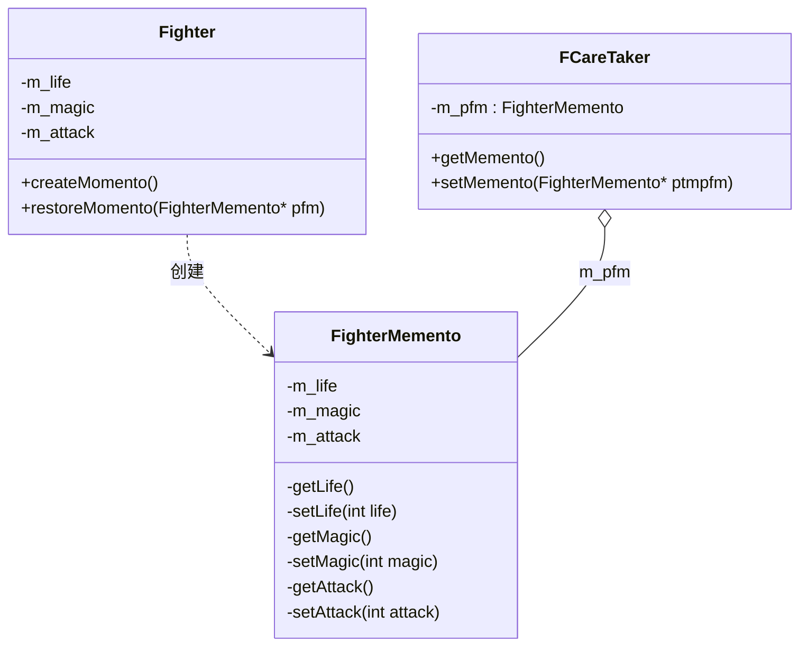

# 第 18 章 备忘录模式

&gt; 原书第 243–251 页 ｜ 本节内容：以游戏中保存/载入进度对抗 BOSS 的需求引入备忘录（Memento）模式，Fighter 与 FighterMemento 范例的实现、管理者类 FCareTaker 与多次快照 FCareTaker2、备忘录模式定义与 UML 图及 3 种角色、快照与完全存储/增量存储等经验说明。

备忘录（Memento）模式也称为快照（Snapshot）模式，是一种行为型模式，是为防止数据丢失而对数据进行备份以备将来恢复这些数据所采用的一种设计模式。换句话说，该模式可以将某个时间点的对象内部的状态保存下来，后续在必要时，根据保存的内容将该对象恢复到当时的状态。备忘录模式结构比较简单，使用频率不算太高。


## 18.1 一个具体实现范例

本节继续以 A 公司所开发的单机（非网络）闯关打斗类游戏为例进行讲解。策划要求，游戏中每个关卡的末尾都有一个 BOSS（游戏中战斗力很强的怪物）等待玩家挑战，只有成功击败该 BOSS，玩家才能进入下一关，游戏才能继续进行。但是 BOSS 是游戏中由计算机控制的具有人工智能且非常厉害的角色，在与其进行的战斗中，玩家所操控的角色非常容易被 BOSS 击败从而导致整个游戏结束，此时玩家必须从头开始进行游戏。这让玩家挫败感非常强，甚至有部分玩家想要放弃这款游戏。

为了解决这个问题，策划提出在快进入游戏关卡末尾之前（快遇到 BOSS 时），在游戏场景中摆放一个 NPC（非玩家角色），玩家可以通过鼠标与该 NPC 进行交互，花费一定的金钱来保存此时此刻的游戏进度，如果玩家在与 BOSS 战斗中被击败则可以利用游戏中的"载入进度"功能将刚才保存过的游戏进度重新载入，这样玩家就可以立即再次尝试与该 BOSS 进行战斗而不至于从头开始进行游戏。

本节要解决的问题就是如何保存玩家的游戏进度信息的问题。这里的游戏进度信息是指玩家信息，包括玩家当前的生命值、魔法值、攻击力等信息（其他信息读者可以自行添加，例如玩家在游戏世界中的位置、玩家已经通关的关卡编号等）。

本范例直接按照备忘录模式的书写方式来实现。首先设计一个玩家类，为尽量不涉及与本章无关的内容，这里直接用一个 Fighter 类而不采用一系列继承自 Fighter 类的子类来代表玩家，代码如下：

```cpp
//玩家主角类
class Fighter
{
public:
    //构造函数
    Fighter(int life, int magic, int attack) :m_life(life), m_magic(magic), m_attack(attack) {}

private:
    //角色属性
    int m_life;         //生命值
    int m_magic;        //魔法值
    int m_attack;       //攻击力
    //...其他数据略
};
```

为了将游戏进度进行保存，换句话说，为了保存玩家的生命值、魔法值、攻击力等信息，引入一个与 Fighter 类相关的备忘录类，取名为 FighterMemento，需要保存的玩家信息可以保存到该备忘录中。FighterMemento 类代码如下（将该类的定义写在 Fighter 类之前）：

```cpp
//玩家主角相关的备忘录类
class FighterMemento
{
private:
    //构造函数,用private修饰以防止在外部被随意创建
    FighterMemento(int life, int magic, int attack) :m_life(life), m_magic(magic), m_attack(attack) {}

private:
    //提供一些供Fighter类来访问的接口,用private修饰防止被任意类访问
    friend class Fighter;               //友元类Fighter可以访问本类的私有成员函数
    int getLife() const     { return m_life; }
    void setLife(int life)  { m_life = life; }
    int getMagic() const    { return m_magic; }
    void setMagic(int magic){ m_magic = magic; }
    int getAttack() const   { return m_attack; }
    void setAttack(int attack) { m_attack = attack; }

private:
    //玩家主角类中要保存起来的数据,就放在此处
    int m_life;         //生命值
    int m_magic;        //魔法值
    int m_attack;       //攻击力
};
```

可以看到，上述备忘录类 FighterMemento 中大多数字段都是用 private 进行修饰，以避免其内部的数据被轻易更改，尤其是将构造函数也用 private 修饰，以防止该类对象被随意创建，但是将 Fighter 声明为了友元类，这表示 Fighter 类对象可以随意访问 FighterMemento，而其他类却不行。

有了备忘录类，就可以将玩家类对象的数据保存到备忘录类对象中。在 Fighter 类中，增加 public 修饰的如下成员函数，用于将玩家数据写入备忘录以及从备忘录中恢复玩家数据：

```cpp
public:
    //将玩家数据写入备忘录(创建备忘录,并在其中存储了当前状态)
    FighterMemento* createMomento()
    {
        return new FighterMemento(m_life, m_magic, m_attack);
    }

    //从备忘录中恢复玩家数据
    void restoreMomento(FighterMemento* pfm)
    {
        m_life = pfm->getLife();
        m_magic = pfm->getMagic();
        m_attack = pfm->getAttack();
    }

    //为测试目的引入的接口,设置玩家的生命值为0(玩家死亡)
    void setToDead()
    {
        m_life = 0;
    }

    //用于输出一些信息
    void displayInfo()
    {
        cout << "玩家主角当前的生命值、魔法值、攻击力分别为: " << m_life << "," << m_magic << "," << m_attack << endl;
    }
```

在 main 主函数中增加如下代码：

```cpp
Fighter* p_fighter = new Fighter(800, 200, 300);
//(1)显示玩家主角在与BOSS战斗之前的信息
p_fighter->displayInfo();

//(2)为玩家主角类对象创建一个备忘录对象(其中保存了当前主角类对象中的必要信息)
FighterMemento* p_fighterMemo = p_fighter->createMomento();

//(3)玩家与BOSS开始战斗
cout << "玩家主角与BOSS开始进行激烈的战斗 ------- " << endl;
p_fighter->setToDead();     //玩家主角在与BOSS战斗中,生命值最终变成0而死亡(被BOSS击败)
p_fighter->displayInfo();   //显示玩家主角在与BOSS战斗之后的信息

//(4)因为在与BOSS战斗之前已经通过NPC保存了游戏进度,这里模拟载入游戏进度,恢复玩家主角
//类对象的数据,让其可以与BOSS再次战斗
cout << "玩家主角通过备忘录恢复自己的信息 ------- " << endl;
p_fighter->restoreMomento(p_fighterMemo);
p_fighter->displayInfo();   //显示玩家主角通过备忘录恢复到战斗之前的信息

//(5)释放资源
delete p_fighterMemo;
delete p_fighter;
```

执行起来，看一看结果：

```text
玩家主角当前的生命值、魔法值、攻击力分别为: 800,200,300
玩家主角与BOSS开始进行激烈的战斗 -------
玩家主角当前的生命值、魔法值、攻击力分别为: 0,200,300
玩家主角通过备忘录恢复自己的信息 -------
玩家主角当前的生命值、魔法值、攻击力分别为: 800,200,300
```

从结果可以看到，玩家对象在与 BOSS 战斗之前，率先将自己的信息保存到备忘录对象中去，战斗时一旦自身战败，可以通过备忘录对象取回自己与 BOSS 战斗之前的信息（生命值、魔法值、攻击力）。

此外，备忘录模式一般还会引入一个管理者（负责人）类（但这并不是必需的）。该管理者类持有一个指向备忘录对象的指针用于存取备忘录对象，取名为 FCareTaker，这样，何时创建备忘录以及保存备忘录指针这些事情，就可以由管理者类负责了。代码如下：

```cpp
//管理者(负责人)类
class FCareTaker
{
public:
    //构造函数
    FCareTaker(FighterMemento* ptmpfm) :m_pfm(ptmpfm) {}    //形参是指向备忘录对象的指针

    //获取指向备忘录对象的指针
    FighterMemento* getMemento()
    {
        return m_pfm;
    }
    //保存指向备忘录对象的指针
    void setMemento(FighterMemento* ptmpfm)
    {
        m_pfm = ptmpfm;
    }
private:
    FighterMemento* m_pfm;      //指向备忘录对象的指针
};
```

那么如果利用 FCareTaker 类实现 main 主函数中相同的功能，需要 main 主函数中的代码做出什么调整呢？其实只需要对几行代码进行修改即可，修改后的 main 主函数中代码如下：

```cpp
//------- 看看引入管理者类之后的写法
Fighter* p_fighter = new Fighter(800, 200, 300);
//(1)显示玩家主角在与BOSS战斗之前的信息
p_fighter->displayInfo();

//(2)为玩家主角类对象创建一个备忘录对象(其中保存了当前主角类对象中的必要信息)
FCareTaker* pfcaretaker = new FCareTaker(p_fighter->createMomento());
//FighterMemento* p_fighterMemo = p_fighter->createMomento();

//(3)玩家与BOSS开始战斗
cout << "玩家主角与BOSS开始进行激烈的战斗 ------- " << endl;
p_fighter->setToDead();     //玩家主角在与BOSS战斗中,生命值最终变成0而死亡(被BOSS击败)
p_fighter->displayInfo();   //显示玩家主角在与BOSS战斗之后的信息

//(4)因为在与BOSS战斗之前已经通过NPC保存了游戏进度,这里模拟载入游戏进度,恢复玩家主角
//类对象的数据,让其可以与BOSS再次战斗
cout << "玩家主角通过备忘录恢复自己的信息 ------- " << endl;
//p_fighter->restoreMomento(p_fighterMemo);
p_fighter->restoreMomento(pfcaretaker->getMemento());
p_fighter->displayInfo();   //显示玩家主角通过备忘录恢复到战斗之前的信息

//(5)释放资源
//delete p_fighterMemo;
delete pfcaretaker->getMemento();
delete pfcaretaker;         //新增
delete p_fighter;
```

代码虽然经过了上述改造，但执行结果不变。

## 18.2 引入备忘录模式

引入**"备忘录"设计模式的定义**：在不破坏封装性的前提下，捕获一个对象的内部状态，并在该对象之外保存这个状态，这样以后就可将该对象恢复到原先保存的状态。

针对前面的代码范例绘制以下备忘录模式的 UML 图，如图 18.1 所示。



图中备忘录类 FighterMemento 的接口都用 private 修饰，仅原发器 Fighter 通过友元关系访问；原发器 restoreMomento 方法体为 `m_life=pfm->getLife();  m_magic=pfm->getMagic();  m_attack=pfm->getAttack();`（对应图中附注）。

*原书图 18.1（第 259 页）：*

备忘录模式的 UML 图中包含 3 种角色。

（1）Originator（原发器）：一个普通的类（业务类），但可以创建一个备忘录用于保存其当前的内部状态，后续也可以使用备忘录来恢复其内部的状态，将需要保存内部状态的类称为原发器。原发器可以根据需要决定备忘录将存储自身的哪些内部状态。这里指 Fighter 类。

（2）Memento（备忘录）：备忘录本身是一个对象，用于存储原发器对象在某个瞬间的内部状态，备忘录的设计一般会参考原发器的设计。除原发器（创建了本备忘录对象的原发器）外，其他对象不应该直接使用（访问或修改）备忘录，或者说原发器与备忘录之间是需要进行信息共享但又不让其他类知道的，所以备忘录的接口一般都使用 private 修饰并将原发器类设置为友元类。备忘录是被动的，只有创建备忘录的原发器才会对它的状态进行赋值和检索，这样就避免了暴露只应该由原发器管理却又必须存储在原发器之外的信息。这里指 FighterMemento 类。

（3）CareTaker（负责人/管理者）：负责保存好备忘录，也可以将备忘录传递给其他对象，但不需要知道备忘录对象的细节，也不能对备忘录中的内容进行操作或检查。这里指 FCareTaker 类。

下面进一步分析备忘录设计模式的定义：

- 所谓"**在不破坏封装性的前提下，捕获一个对象的内部状态**"中的对象是指原发器（Fighter 类）对象，而不破坏封装性指该隐藏的信息依然要隐藏，该用 private 修饰的成员依然要用 private 修饰，不暴露不应该暴露的细节。不难想象，如果用一个接口让其他对象直接得到原发器对象的内部状态，肯定会暴露原发器对象的实现细节并破坏原发器对象的封装性。
- 通过 Fighter 类中的 createMomento 成员函数来捕获原发器对象的内部状态。
- "在该对象之外保存这个状态"中的"对象之外"是指备忘录对象，即通过备忘录对象保存原发器对象的状态。
- 后续就算原发器对象内部的状态发生了变化，也可以随时通过 Fighter 类中的 restoreMomento 成员函数将原发器对象的内部状态从备忘录对象中恢复，其实，备忘录的真正作用并不是保存数据，而是**恢复**数据，这一点值得强调。

有几点说明：

（1）把玩家主角类（Fighter 类/原发器）中的信息保存到备忘录中，这称为给玩家主角类（完整的称呼应该是玩家主角类对象）做了一个**快照**。在本范例中，玩家主角类（Fighter 类/原发器）中的生命值、魔法值、攻击力这些重要的信息都有必要保存在备忘录中，所以在备忘录类（FighterMemento）中也有生命值、魔法值、攻击力字段与玩家主角类相对应，但**这并不意味着所有玩家主角类中的信息都要保存在备忘录中**，程序员只需要依据自己的判断，把玩家主角类中必要的信息保存到备忘录中即可。

（2）之所以做快照或者说做备忘录，主要目的是将来能够将数据进行恢复（复原），说得更明确一些，就是当玩家被 BOSS 击败的时候，玩家可以通过将备忘录类对象中的数据恢复到玩家主角类对象中来，这样玩家就可以持续不断地再次挑战 BOSS 直至战胜为止。但做快照并不要求玩家主角类中需要保存的字段一一对应备忘录中相同的字段，在备忘录类，可以以内存流、字符串或通过编码（例如 Hex 编码、Base64 编码）等方式存储或还原来自玩家主角类中的数据，这些存储和还原数据的行为往往属于数据序列化范畴的知识，其实现代码一般比较复杂，但执行效率更高，使用也更便利，读者有兴趣可以通过搜索引擎搜索序列化方面的话题。

（3）给玩家主角类做快照并不仅仅限于一次，可以做很多次快照。但如果做多次快照，则需要考虑程序的执行性能问题以及快照的存储位置问题，而且玩家主角状态的存储和还原更应该考虑采用内存流等更有效的方式。这里仿照 FCareTaker 类生成一个新类 FCareTaker2，用于做多次快照，代码如下：

```cpp
//支持多个快照的负责人(管理者)类
class FCareTaker2
{
public:
    //析构函数用于释放资源
    ~FCareTaker2()
    {
        for (auto iter = m_pfmContainer.begin(); iter != m_pfmContainer.end(); ++iter)
        {
            delete (*iter);
        }                                   //end for
    }
    //保存指向备忘录对象的指针
    void setMemento(FighterMemento* ptmpfm)
    {
        m_pfmContainer.push_back(ptmpfm);
    }
    //获取指向备忘录对象的指针
    FighterMemento* getMemento(int index)
    {
        auto iter = m_pfmContainer.begin();
        for (int i = 0; i <= index; ++i)
        {
            if (i == index)
                return (*iter);
            else
                ++iter;
        }                                   //end for
        return NULL;
    }
private:
    //存储备忘录对象指针的容器
    vector<FighterMemento*> m_pfmContainer;     //# include <vector>
};
```

在 main 主函数中，注释掉原有代码，增加如下代码进行测试：

```cpp
Fighter* p_fighter2 = new Fighter(800, 200, 300);
FCareTaker2* pfcaretaker2 = new FCareTaker2();
pfcaretaker2->setMemento(p_fighter2->createMomento());      //做第一个快照,此快照玩家生命
                                                            //值为800
p_fighter2->setToDead();                                    //改变玩家主角的生命值
pfcaretaker2->setMemento(p_fighter2->createMomento());      //做第二个快照,此快照玩家生命
                                                            //值为0
p_fighter2->displayInfo();                                  //玩家主角生命值应该为0
cout << "--------------------" << endl;
//当前玩家生命值为0,恢复第一次快照,也就是恢复玩家生命值为800
p_fighter2->restoreMomento(pfcaretaker2->getMemento(0));
p_fighter2->displayInfo();                                  //玩家主角生命值应该恢复为800

//释放资源
delete p_fighter2;
delete pfcaretaker2;
```

执行起来，看一看结果：

```text
玩家主角当前的生命值、魔法值、攻击力分别为: 0,200,300
--------------------
玩家主角当前的生命值、魔法值、攻击力分别为: 800,200,300
```

从结果中可以看到，针对玩家主角一共做了两个（次）快照，第一个快照玩家当时的生命值为 800，第二个快照玩家当时的生命值为 0，当后续应用第一个快照对玩家进行恢复时，玩家的生命值重新变为 800。

上述代码并不完善，例如，FCareTaker2 类中的 getMemento 接口代码尚有优化的空间，同时也没有对该接口返回 NULL 的情形做判断和处理，读者可以自行完善这些代码。另外，如果利用上述代码还原到某个快照后再次修改了对象（原发器）的状态，那么此时再次执行还原动作应该还原到哪个快照等诸如此类的问题，在开发中都要充分思考和谨慎编码，否则可能导致对象的状态发生错误。

另外，管理者（负责人）甚至可以保存多种不同类型的快照，在这方面，读者完全可以发挥自己的想象力，不必受限于本章所讲解的这些范例代码。

（4）虽然友元类在一定程度上破坏了封装性，但备忘录模式的主要特点是信息的隐藏，这代表两个意思：①原发器要保持其封装性，该隐藏的内容要隐藏好；②原发器还需要将内部状态保存到外面的备忘录中，备忘录类 FighterMemento 中将 Fighter 类声明为友元类的原因和必要性是备忘录类不应该对外暴露能更改其中数据的接口（外界不能随意修改备忘录对象）。

（5）备忘录模式更适合保存原发器对象中的一部分（不是所有）内部状态，如果需要保存原发器对象的所有内部状态，就应该采用**原型模式**进行原发器对象的克隆来取代备忘录模式。但从信息隐藏的角度来讲，采用备忘录模式实现也许更具优势，因为备忘录模式才可实现将对象的内部状态保存在对象之外，后续要恢复数据时也需要对象自己去读取。

（6）备忘录模式的优点是提供了一种状态恢复机制，使用户可以方便地回到一个特定的历史步骤。备忘录模式的缺点是对资源的消耗，如果原发器对象有太多的内部状态需要保存，那么每做一个快照（备忘录）都会消耗一定的内存资源。

（7）如果将常规的做快照称为**完全存储**，那么为了应对需要频繁做快照的情形，可以考虑采用**增量存储**，也就是在备忘录中只保存原发器对象内部相对于上次存储状态之后的增量改变，例如：

- 记录一个图形移动时候，不用每次都记录图形的新位置，而是记录该图形向某个方向移动的距离。
- 针对编辑框中的文本输入的操作，为了支持 Undo、Redo 动作，不必在每份快照中都记录整个文本的内容，只需要记录新文本的长度以及新增或减少的文本内容。
- 完全存储可以和增量存储方式结合使用，例如，使用一次完全存储，再使用几次增量存储，然后再使用一次完全存储，再使用几次增量存储。当需要恢复数据到某个阶段的时候，可能只需要一次完全存储以及几次增量存储就可以做到。上述概念在 Redis 数据库的备份中也有体现，有兴趣的读者可以通过搜索引擎了解 Redis 的 RDB（完全备份）和 AOF（增量备份）相关知识。

（8）备忘录模式可以应用在很多场合，例如，某个动作的撤销（下象棋时悔棋）、保存一些历史记录、做一些快照等，该模式的具体应用方面读者可以发挥自己的想象力。

（9）备忘录模式主要探讨将数据保存在内存中和从内存中恢复数据，虽然可以将这些数据保存到磁盘上或从磁盘中重新载入数据，但磁盘方面的操作并不属于本模式要探讨的话题，相关的功能读者可以自行扩充。
