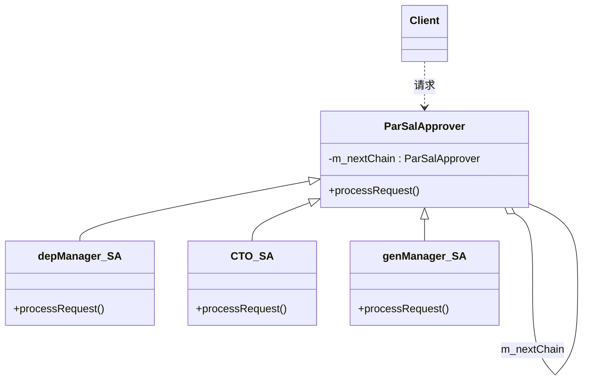

# 第 19 章 职责链模式

&gt; 原书第 252–261 页 ｜ 本节内容：以员工涨薪审批（部门经理/技术总监/总经理）范例引入职责链（Chain of Responsibility）模式，请求类与审批者链的改造实现、模式定义与 UML 图及 3 种角色、职责链的特点、单纯与非单纯的职责链模式（敏感词过滤器功能链范例）。

职责链（Chain of Responsibility）模式也叫责任链模式，是一种行为型模式，用于将一个请求传递给一个链中的若干对象，哪个对象适合处理这个请求就让哪个对象来处理。职责链看起来与传统数据结构中的"链表"非常类似。


## 19.1 一个关于涨薪审批的范例

通过一个小范例来学习职责链模式可以达到非常好的效果。

考虑一个公司员工加薪的请求（可以把这个请求当成一个对象看待），如果员工要求的加薪不超过 1000（要求的加薪≤1000）元，则部门经理就可以批准；如果员工要求的加薪在 1000 元之上但不超过 5000（1000＜要求的加薪≤5000）元，则技术总监才能批准；如果员工要求的加薪超过 5000（要求的加薪＞5000）元，则只有总经理才能批准。

如果按照传统做法，可以创建一个薪水处理类 SalaryHandler，在其中可以书写一个 raiseRequest 方法来处理加薪请求，代码如下：

```cpp
//薪水处理类
class SalaryHandler
{
public:
    //处理加薪请求
    void raiseRequest(const string &sname, int salfigure)   //参数1代表要加薪的员工名字,参
                                                            //数2代表求要加薪多少
    {
        if(salfigure <= 1000)
        {
            //加薪要求不超过1000,部门经理可以批准
            depManagerSP(sname, salfigure);
        }
        else if(salfigure <= 5000)
        {
            //加薪要求在1000元之上但不超过5000,技术总监才能批准
            CTOSP(sname, salfigure);
        }
        else
        {
            //加薪要求超过5000元,总经理才能批准
            genManagerSP(sname, salfigure);
        }
    }
private:
    //部门经理审批加薪请求
    void depManagerSP(const string& sname, int salfigure)
    {
        cout << sname << "的加薪要求为: " << salfigure << "元,部门经理审批通过!" << endl;
    }

    //技术总监审批加薪请求
    void CTOSP(const string& sname, int salfigure)
    {
        cout << sname << "的加薪要求为: " << salfigure << "元,技术总监审批通过!" << endl;
    }

    //总经理审批加薪请求
    void genManagerSP(const string& sname, int salfigure)
    {
        cout << sname << "的加薪要求为: " << salfigure << "元,总经理审批通过!" << endl;
    }
};
```

在 main 主函数中，增加如下测试代码：

```cpp
SalaryHandler sh;
sh.raiseRequest("张三", 15000);     //张三要求加薪1.5万元
sh.raiseRequest("李四", 3500);      //李四要求加薪3500元
sh.raiseRequest("王二", 800);       //王二要求加薪800元
```

执行起来，看一看结果：

```text
张三的加薪要求为: 15000元,总经理审批通过!
李四的加薪要求为: 3500元,技术总监审批通过!
王二的加薪要求为: 800元,部门经理审批通过!
```

从结果中可以看到，张三的加薪必须总经理审批（技术总监和部门经理无权审批），李四的加薪需要技术总监审批（部门经理无权审批），而王二的加薪部门经理审批就可以了。

在这个范例中，加薪请求需根据要加薪的数字来请求不同的领导审批（部门经理、技术总监、总经理）。这个范例代码显然不够灵活，试想一下，如果将来新增加一个**副总经理**可以审批不超过 **18000 元**的加薪请求，则必须修改 SalaryHandler 类的 raiseRequest 成员函数来增加新的 if 判断分支，这显然不符合开闭原则。

有没有更好的解决上述问题的方案呢？有，那就是采用职责链模式。试想一下，如果分别为部门经理、技术总监、总经理创建类并且都继承自同一个父类，然后像链表一样把部门经理、技术总监、总经理（都看成对象）连起来构成一个职责链，当出现一个员工加薪请求（也看成对象）时，将这个请求沿着这个链传递，部门经理能处理的就处理，不能处理的传给技术总监；技术总监能处理的就处理，不能处理的继续传给总经理。总之，链上的对象（部门经理、技术总监、总经理）都有处理到请求的机会。如果将来增加一个副总经理，同样可以为副总经理创建一个子类，把副总经理链到原来的部门经理、技术总监、总经理链上，当出现一个员工加薪请求时，只要适合副总经理审批的就可以让副总经理审批。

说到这里有些读者可能会有疑问：如果职责链中副总经理被链到了总经理之后，那么整个职责链就应该是"部门经理→技术总监→总经理→副总经理"，是否会出现应该副总经理审批的加薪请求却被总经理审批了呢？当然不会，只要定好规则，例如总经理审批的薪水必须是 18000 元之上的，比如张三要求加薪 15000 元，不满足大于 18000 元的条件，那么最终肯定还是会被副总经理审批的。

基于上述的职责链思路，改造一下范例，这里先把加薪请求做成一个类（取名 RaiseRequest），因为类可以承载更多的信息，也更容易进行请求的扩充，例如，现在是加薪请求，将来可以扩充增加离职、部门调动等请求：

```cpp
//加薪请求类
class RaiseRequest
{
public:
    //构造函数
    RaiseRequest(const string& sname, int salfigure) :m_sname(sname), m_isalfigure(salfigure) {}

    //获取请求加薪的人员名字
    const string& getName() const
    {
        return m_sname;
    }
    //获取请求加薪的数字
    int getSalFigure() const
    {
        return m_isalfigure;
    }

private:
    string m_sname;         //请求加薪的人员名字
    int     m_isalfigure;   //请求加薪的数字
};
```

接着，创建职责链中每个对象的父类以及相关子类（部门经理、技术总监、总经理），代码如下：

```cpp
//薪水审批者父类
class ParSalApprover
{
public:
    ParSalApprover() :m_nextChain(nullptr) {}
    virtual ~ParSalApprover() {}        //作父类时析构函数应该为虚函数

    //设置指向的职责链中的下一个审批者
    void setNextChain(ParSalApprover* next)
    {
        m_nextChain = next;
    }

    //处理加薪请求
    virtual void processRequest(const RaiseRequest& req) = 0;

protected:
    //找链中的下一个对象并把请求投递给下一个链中的对象
    void sendRequestToNextHandler(const RaiseRequest& req)
    {
        //找链中的下一个对象
        if(m_nextChain != nullptr)
        {
            //把请求投递给链中的下一个对象
            m_nextChain->processRequest(req);
        }
        else
        {
            //没找到链中的下一个对象
            cout << req.getName() << "的加薪要求为: " << req.getSalFigure() << "元,但无人能够审批!" << endl;
        }
    }

private:
    ParSalApprover* m_nextChain;    //指向下一个审批者(对象)的多态指针(指向自身类
                                    //型),每个都指向下一个,就会构成一个职责链(链表)
};

//部门经理子类
class depManager_SA :public ParSalApprover
{
public:
    //处理加薪请求
    virtual void processRequest(const RaiseRequest& req)
    {
        int salfigure = req.getSalFigure();
        if(salfigure <= 1000)
        {
            //如果自己能处理,则自己处理
            cout << req.getName() << "的加薪要求为: " << salfigure << "元,部门经理审批通过!" << endl;
        }
        else
        {
            //自己不能处理,尝试找链中的下一个对象来处理
            sendRequestToNextHandler(req);
        }
    }
};

//技术总监子类
class CTO_SA :public ParSalApprover
{
    //处理加薪请求
    virtual void processRequest(const RaiseRequest& req)
    {
        int salfigure = req.getSalFigure();
        if (salfigure > 1000 && salfigure <= 5000)
        {
            //如果自己能处理,则自己处理
            cout << req.getName() << "的加薪要求为: " << salfigure << "元,技术总监审批通过!" << endl;
        }
        else
        {
            sendRequestToNextHandler(req);      //自己不能处理,尝试找链中的下一个对象来处理
        }
    }
};

//总经理子类
class genManager_SA :public ParSalApprover
{
public:
    //处理加薪请求
    virtual void processRequest(const RaiseRequest& req)
    {
        int salfigure = req.getSalFigure();
        if (salfigure > 5000)
        {
            //如果自己能处理,则自己处理
            cout << req.getName() << "的加薪要求为: " << salfigure << "元,总经理审批通过!" << endl;
        }
        else
        {
            sendRequestToNextHandler(req);      //自己不能处理,尝试找链中的下一个对象来处理
        }
    }
};
```

在 main 主函数中，注释掉原有代码，增加如下代码：

```cpp
//(1)创建出职责链中包含的各个对象(部门经理、技术总监、总经理)
ParSalApprover* pzzlinkobj1 = new depManager_SA();
ParSalApprover* pzzlinkobj2 = new CTO_SA();
ParSalApprover* pzzlinkobj3 = new genManager_SA();

//(2)将这些对象串在一起构成职责链(链表),现在职责链中pzzlinkobj1排在最前面,pzzlinkobj3
//排在最后面
pzzlinkobj1->setNextChain(pzzlinkobj2);
pzzlinkobj2->setNextChain(pzzlinkobj3);
pzzlinkobj3->setNextChain(nullptr);     //可以不写此行,因为ParSalApprover构造函数中
                                        //设置了m_nextChain为nullptr

//(3)创建几位员工关于加薪的请求(对象)
RaiseRequest emp1Req("张三", 15000);    //张三要求加薪1.5万元
RaiseRequest emp2Req("李四", 3500);     //李四要求加薪3500元
RaiseRequest emp3Req("王二", 800);      //王二要求加薪800元
//看看每位员工的加薪请求由职责链中的哪个对象(部门经理、技术总监、总经理)来处理,从职责链
//中排在最前面的接收者(pzzlinkobj1)开始
pzzlinkobj1->processRequest(emp1Req);
pzzlinkobj1->processRequest(emp2Req);
pzzlinkobj1->processRequest(emp3Req);

//(4)释放资源
delete pzzlinkobj1;
delete pzzlinkobj2;
delete pzzlinkobj3;
```

执行起来，结果不变：

```text
张三的加薪要求为: 15000元,总经理审批通过!
李四的加薪要求为: 3500元,技术总监审批通过!
王二的加薪要求为: 800元,部门经理审批通过!
```

从上述代码可以看到，把 pzzlinkobj1、pzzlinkobj2、pzzlinkobj3 这 3 个分别代表部门经理、技术总监、总经理的对象链到一起构成职责链，其实这 3 个对象谁在链的开头，谁在链的中间或者结尾都行，后续针对张三（包括李四或王二）的加薪请求，从职责链的**开始位置**遍历职责链中的每个对象，如果该对象能处理该加薪请求就处理，处理不了沿着职责链寻找下一个对象并判断下一个对象能否处理，一直寻找到职责链中最后一个对象。如果职责链中的所有对象全都处理不了这个加薪请求，那么会提示这个加薪无人能够审批。当然这个范例中不存在加薪无人审批的情形，因为要求加薪的数目再大，总经理总是可以审批的。

## 19.2 引入职责链模式

引入**"职责链"设计模式的定义（实现意图）**：使多个对象都有机会处理请求，从而避免请求的发送者和接收者之间的耦合关系。将这些对象连成一条链（构成对象链），并沿着这条链传递该请求，直到有一个对象处理它为止。

在上述范例中，"使多个对象都有机会处理请求"中的多个对象，当然是指部门经理、技术总监、总经理（pzzlinkobj1、pzzlinkobj2、pzzlinkobj3 所指向的对象），这些对象也作为请求的接收者被连成了一条链（职责链），而请求指的是 emp1Req（张三要求加薪 1.5 万元）、emp2Req（李四要求加薪 3500 元）、emp3Req（王二要求加薪 800 元），这些请求沿着职责链传递，一直到被职责链中的某个对象审批为止。

针对前面的范例绘制职责链模式的 UML 图，如图 19.1 所示。



*原书图 19.1（第 269 页）：*

职责链模式的 UML 图中包含 3 种角色。

（1）Handler（处理者）。定义了处理请求的接口（processRequest），也记录了下一个处理者是谁（范例中用 m_nextChain 来记录）。这里指 ParSalApprover 类。

（2）ConcreteHandler（具体处理者）。用于实现针对具体请求的处理，如果自身无法处理请求，则会把请求传递给下一个处理者（后继者）。这里指 depManager_SA、CTO_SA、genManager_SA 类。

（3）Client（请求者/客户端）。用于向职责链上的具体处理者对象提交处理请求。这里指 main 主函数中的代码。其实，在上述范例中，main 主函数中的代码还承担了创建职责链对象并搭建职责链（也可以在 Handler 中搭建职责链）的角色。一般来说，职责链模式并不创建职责链，而是由使用职责链的请求者（客户端）来创建。

职责链模式有哪些特点呢？

- 职责链模式应用的一个请求可能有多个接收者（扮演处理者角色），但最后只有一个接收者会处理该请求。此时，请求的发送者和接收者之间是解耦的。换句话说，请求的发送者只需要将请求发送到链上，并不关心请求的处理细节以及请求的传递，也并不知道最终会被哪个接收者处理，这种灵活性可以更好地应对变化。
- 职责链一般是一条直线，职责链上的每个接收者仅需要保存一个指向其后继者的指针（不需要保存其他所有接收者的指针），当然，读者可能也会见到环形或者树形结构的职责链（非直线的职责链建链时要小心，不要造成循环链导致请求传递陷入死循环，从而使整个程序的执行陷入死锁）。同时，**可以在程序运行期间动态地添加、修改或删除职责链上的接收者对象，使针对请求的处理更具灵活性，这是职责链模式的重要特色**。
- 增加新的处理者不需要修改原有的代码，只需要增加新的具体处理者子类并在客户端重新建链即可，符合开闭原则。
- 如果请求传递到职责链的末尾仍然没有得到处理，则应该有一个合理的默认处理方式（书写一个终极处理器并始终将该处理器放在职责链的末尾）或者给出提示信息，这属于接收者的责任。
- 如果职责链比较长，而能够处理请求的接收者在职责链中又比较靠后，则可能会导致请求处理的延迟；如果需要非常快的请求处理速度，就要权衡是否使用职责链模式。
- 可以分别选择不同的接收者对象创建多条不同的职责链以增加接收者在职责链模式中的复用性。

## 19.3 单纯与非单纯的职责链模式

在上述职责链模式的讲解中，读者已经注意到，虽然一个请求可能有多个接收者，但最后只有一个接收者会处理该请求，一旦该请求得到处理，这个请求就不会再沿着职责链向下传递了，这种对职责链的使用方式称为**单纯的职责链模式**（职责链模式的定义描述的正是这种情形）。在单纯的职责链模式中，也要求一个请求必须被某一个处理者对象所处理，不能出现一个请求未被任何处理者对象处理的情形。

非单纯的职责链模式与单纯的职责链模式不同。非单纯的职责链模式中允许一个请求被某个接收者处理后继续沿着职责链传递，其他处理者仍有机会继续处理该请求，这样的职责链往往也被称为**功能链**，即便一个请求未被任何处理者对象处理，在非单纯的职责链模式中也是允许的。功能链一般用于权限的多次多重校验、数据的多重检查和过滤等场合。

下面给出这个敏感词过滤器范例（参照前面的范例书写即可）。该过滤器能够把聊天内容中涉及性、脏话、政治内容的关键词寻找出来并用一些其他符号来代替。首先创建敏感词过滤器父类，代码如下：

```cpp
//敏感词过滤器父类
class ParWordFilter
{
public:
    ParWordFilter() :m_nextChain(nullptr) {}
    virtual ~ParWordFilter() {}         //作父类时析构函数应该为虚函数

    //设置指向的职责链中的下一个过滤器
    void setNextChain(ParWordFilter* next)
    {
        m_nextChain = next;
    }

    //处理敏感词过滤请求
    virtual string processRequest(string strWord) = 0;

protected:
    //找链中的下一个对象并把请求投递给下一个链中的对象
    string sendRequestToNextHandler(string strWord)
    {
        //找链中的下一个对象
        if (m_nextChain != nullptr)
        {
            //把请求投递给链中的下一个对象
            return m_nextChain->processRequest(strWord);
        }
        return strWord;
    }
private:
    ParWordFilter* m_nextChain;
};
```

接着，创建敏感词过滤器子类共 3 个，分别用于过滤性、脏话、政治内容，代码如下：

```cpp
//性敏感词过滤器子类
class SexyWordFilter :public ParWordFilter
{
public:
    virtual string processRequest(string strWord)
    {
        cout << "通过与词库比对,在strWord中查找\"性\"敏感词并用XXX来替换!" << endl;
        strWord += "XXX";               //测试代码,具体的实现逻辑略...
        return sendRequestToNextHandler(strWord);
    }
};

//脏话敏感词过滤器子类
class DirtyWordFilter :public ParWordFilter
{
public:
    virtual string processRequest(string strWord)
    {
        cout << "通过与词库比对,在strWord中查找\"脏话\"敏感词并用YYY来替换!" << endl;
        strWord += "YYY";
        return sendRequestToNextHandler(strWord);
    }
};

//政治敏感词过滤器子类
class PoliticsWordFilter :public ParWordFilter
{
public:
    virtual string processRequest(string strWord)
    {
        cout << "通过与词库比对,在strWord中查找\"政治\"敏感词并用ZZZ来替换!" << endl;
        strWord += "ZZZ";
        return sendRequestToNextHandler(strWord);
    }
};
```

在 main 主函数中，注释掉原有代码，增加如下代码：

```cpp
//(1)创建出职责链中包含的各个对象(性敏感词过滤器、脏话敏感词过滤器、政治敏感词过滤器)
ParWordFilter* pwflinkobj1 = new SexyWordFilter();
ParWordFilter* pwflinkobj2 = new DirtyWordFilter();
ParWordFilter* pwflinkobj3 = new PoliticsWordFilter();
//(2)将这些对象串在一起构成职责链(链表),现在职责链中pwflinkobj1排在最前面,pwflinkobj3
//排在最后面
pwflinkobj1->setNextChain(pwflinkobj2);
pwflinkobj2->setNextChain(pwflinkobj3);
pwflinkobj3->setNextChain(nullptr);
string strWordFilterResult = pwflinkobj1->processRequest("你好，这里是过滤敏感词测试范例");
        //从职责链中排在最前面的接收者(pwflinkobj1)开始,processRequest的参数代表的是聊天内容
cout << "对敏感词过滤后的结果为: " << strWordFilterResult << endl;
//(3)释放资源
delete pwflinkobj1;
delete pwflinkobj2;
delete pwflinkobj3;
```

执行起来，看一看结果：

```text
通过与词库比对,在strWord中查找"性"敏感词并用XXX来替换!
通过与词库比对,在strWord中查找"脏话"敏感词并用YYY来替换!
通过与词库比对,在strWord中查找"政治"敏感词并用ZZZ来替换!
对敏感词过滤后的结果为: 你好，这里是过滤敏感词测试范例XXXYYYZZZ
```

从结果可以看到，聊天内容（请求）先经过性敏感词过滤器处理，然后再把处理后的聊天内容（请求）传递给脏话敏感词过滤器，脏话敏感词过滤器处理完后再传递给政治敏感词过滤器，这些过滤器形成了一个链条。链条上的每个过滤器各自承担自己的处理职责，经过多次被处理并被放行传递到下一个过滤器的过程，最终处理结果被返回到 strWordFilterResult 中。

职责链模式也常用在视窗系统的窗口中，一个窗口中一般会有若干个控件，例如，有普通按钮、文本编辑框，下拉框、单选框、复选框等，窗口中的所有控件就是一个一个的接收者，它们按照先后次序构成职责链（在 Visual Studio 2019 中如果使用 MFC 来设计窗口，可以使用"格式"→"Tab 键顺序"菜单命令指定窗口中各个控件的顺序，这就等同于指定职责链中各个接收者对象的顺序）。当在这样的窗口中单击时，单击事件（请求）就通过职责链来传播，当单击事件传播到某个控件时，该控件一般需要做两件事情：

- 判断自身是否被禁用，如果被禁用，则将单击事件沿着职责链继续传递；
- 如果自身未被禁用，则判断单击的位置是否正好在控件自身上，若不在，则将单击事件沿着职责链继续传递；若正好在控件自身上，则触发该控件的单击事件（一般是调用一个叫作 OnClick 的方法），同时不再将单击事件继续向下传递。
