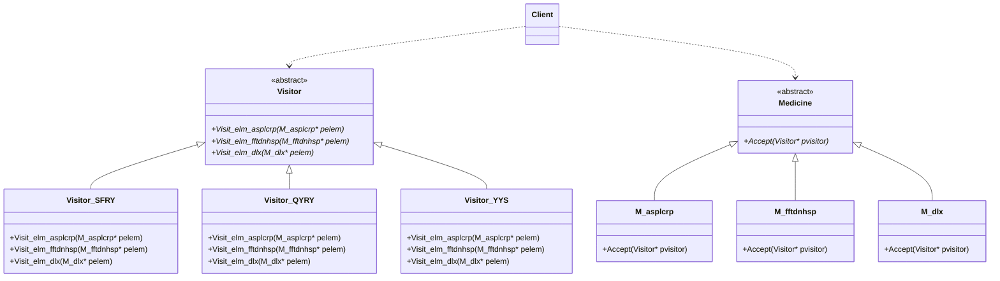
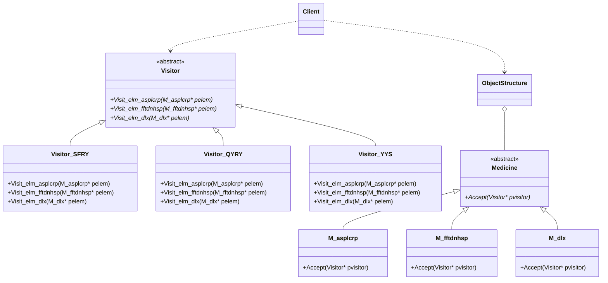

# 第 20 章 访问者模式

&gt; 原书第 262–275 页 ｜ 本节内容：以药品单的缴费/取药/营养师建议等不同处理需求演化出访问者（Visitor）模式，Medicine 元素类族与 Visitor 访问者类族的实现、模式定义与 UML 图及 5 种角色、ObjectStructure 对象结构、双分派（Double-dispatch）调用机制、访问者模式的优缺点与适用场景。

访问者（Visitor）模式也叫访问器模式，是一种行为型模式。想象我到你家串门去看望你，我就是访问者，你就是被访问者。该模式结构比较烦琐，不太好理解，所以在学习过程中应该投入更多的精力。访问者模式的使用条件相对苛刻，在实际工作中使用频率不是太高，虽然不要求读者一定要使用该模式，但在遇到该模式的实现代码时要能够辨认出来。


## 20.1 一个具体范例的逐渐演化

访问者模式的举例需要非常小心，解释这个范例也需要非常细心，因为例子不恰当，会造成读者很难理解该模式，就更谈不上灵活运用该模式了。

前段时间笔者因为备课太过投入而太过劳累，导致胸痛不舒服，随后第一时间跑向医院并挂急诊检查身体，接着又折腾了好几天并做了多项检查，检查结论为神经性问题，医生给开出了 3 种药品。

- 阿司匹林肠溶片：改善血液流通，预防血栓形成，血栓形成就产生阻塞，人就会直接面临危险。
- 氟伐他汀钠缓释片：降血脂。因为血脂高意味着血流慢，营养无法运输到身体各部位，还很可能引发心脑血管疾病。
- 黛力新：医生说我的心脏没有器质性病变，是神经出现了紊乱，出现的症状是因为神经的误报，因此开此药治疗自主神经功能紊乱以及身心疾病伴有的焦虑症状。

我拿着这张药品单分别跑到了医院的缴费窗口去缴费，然后又跑到了取药窗口去取药。如果写一段代码来描述药品以及缴费和取药的过程，该怎样做呢？首先可以用几个类来描述药品——创建一个药品父类和上述 3 种药品相关子类，代码如下：

```cpp
//药品父类
class Medicine
{
public:
    virtual ~Medicine() {}                  //作父类时析构函数应该为虚函数
    virtual string getMdcName() = 0;        //药品名称
    virtual float getPrice() = 0;           //药品总价格,单位:元
};

//药品:阿司匹林肠溶片
class M_asplcrp : public Medicine
{
public:
    virtual string getMdcName()
    {
        return "阿司匹林肠溶片";
    }
    virtual float getPrice()
    {
        return 46.8f;       //为简化代码,直接给出药品总价而不单独强调药品数量了,例如该药
                            //品医生给开了两盒,一盒是23.4元,那么这里直接返回两盒的价格
    }
};

//药品:氟伐他汀钠缓释片
class M_fftdnhsp : public Medicine
{
public:
    virtual string getMdcName()
    {
        return "氟伐他汀钠缓释片";
    }
    virtual float getPrice()
    {
        return 111.3f;      //3盒的价格
    }
};

//药品:黛力新
class M_dlx : public Medicine
{
public:
    virtual string getMdcName()
    {
        return "黛力新";
    }
    virtual float getPrice()
    {
        return 122.0f;      //两盒的价格
    }
};
```

接下来，要编写代码来计算药品的价格（用于缴费）以及描述取药过程。这些代码写在哪里合适呢？应该引入一个类 MedicineProc 来做这样的事情：

```cpp
//针对药品的处理相关类
class MedicineProc
{
public:
    //增加药品到药品列表中
    void addMedicine(Medicine* p_mdc)
    {
        m_mdclist.push_back(p_mdc);
    }

    //针对费用缴纳和取药所做的处理动作
    void procAction(string strvisitor)      //strvisitor代表拿到了药品单的人,不同的人拿到
                                            //药品单所要做的处理也不同
    {
        if(strvisitor == "收费人员")        //收费人员要根据药品单向我(患者)收取费用
        {
            float totalcost = 0.0f;         //总费用
            for (auto iter = m_mdclist.begin(); iter != m_mdclist.end(); ++iter)
            {
                float tmpprice = (*iter)->getPrice();
                cout << "收费人员累计药品\"" << (*iter)->getMdcName() << "\"的价格: " << tmpprice << endl;
                totalcost += tmpprice;
            }
            cout << "所有药品的总价为: " << totalcost << ",收费人员收取了我的费用!" << endl;
        }
        else if (strvisitor == "取药人员")          //取药人员要根据药品单为我拿药
        {
            for (auto iter = m_mdclist.begin(); iter != m_mdclist.end(); ++iter)
            {
                cout << "取药人员将药品\"" << (*iter)->getMdcName() << "\"拿给了我!" << endl;
            }
        }
    }
private:
    //药品列表,记录着药品单上的所有药品,在文件头要
    list<Medicine*> m_mdclist;              //# include <list>
};
```

在 main 主函数中加入代码来描述针对这 3 种药品的缴费和取药动作：

```cpp
Medicine* pm1 = new M_asplcrp();        //药品阿司匹林肠溶片
Medicine* pm2 = new M_fftdnhsp();       //药品氟伐他汀钠缓释片
Medicine* pm3 = new M_dlx();            //药品黛力新

MedicineProc mdcprocobj;
mdcprocobj.addMedicine(pm1);
mdcprocobj.addMedicine(pm2);
mdcprocobj.addMedicine(pm3);
mdcprocobj.procAction("收费人员");
mdcprocobj.procAction("取药人员");

//释放资源
delete pm1;
delete pm2;
delete pm3;
```

执行起来，看一看结果：

```text
收费人员累计药品"阿司匹林肠溶片"的价格: 46.8
收费人员累计药品"氟伐他汀钠缓释片"的价格: 111.3
收费人员累计药品"黛力新"的价格: 122
所有药品的总价为: 280.1,收费人员收取了我的费用!
取药人员将药品"阿司匹林肠溶片"拿给了我!
取药人员将药品"氟伐他汀钠缓释片"拿给了我!
取药人员将药品"黛力新"拿给了我!
```

在 MedicineProc 类的 procAction 方法中，通过对拿到了药品单的**收费人员**或**取药人员**的判断来进行不同的处理——收费人员要计算总价格并向我收取费用，取药人员要把指定的药品拿给我。

分析一下 MedicineProc 类的 procAction 方法，如果将来我的**营养师**或**健身教练**拿到了这个药品单，那么他要根据这个药品单为我配制营养餐或者提供相应的训练建议来改善我的身体状况，那么 procAction 方法中会继续增加额外的 if 分支，诸如：

```cpp
else if ((strvisitor == "营养师"))
{
    cout << "营养师建议: 主食中多搭配粗粮,适当食用肉类!" << endl;
}
else if ((strvisitor == "健身教练"))
{
    cout << "健身教练建议: 多做有氧运动,例如慢跑(35分钟即可),慢跑前后要热身,忌焦虑、忌熬夜,以22:30之前卧床休息为宜!" << endl;
}
```

显然，这样修改代码是违反开闭原则的。每当增加一个新角色（指上述的营养师或者健身教练）拿到这个药品单，可能对我都会有一些不同的建议或者动作产生。

通过采用访问者模式编写代码，当新角色拿到这个药品单后并针对我提出不同的建议或动作时，不再需要在 procAction 方法中增加 if 分支，只需要编写新的类来实现新角色要完成的事情即可。换句话说，就是把 procAction 方法中各个 if 分支中的代码拆解到诸多子类中去实现，这样就做到了不修改原有代码也能增加新的角色从而增加新的操作方式的目的。

访问者模式包含**访问者**和**被访问者**两个重要角色，**被访问者**也常常称为"元素"。在上述范例中，收费人员、取药人员、营养师、健身教练这些都属于访问者，而药品单中的 3 种药品，属于被访问者。访问关系简图如图 20.1 所示。


对于"访问"这件事，读者理解的不要过于复杂，看看如下两个情形：

（1）想象某人到你家去串门，该人就是访问者，你就是被访问者；

（2）某人查看一个东西，某人就是访问者，被查看的东西就是被访问者（所以上述收费人员、取药人员等都是访问者，而各种药品就是被访问者）。

在明确了访问者和被访问者之后，上述范例代码就可以通过访问者模式来改写了。在访问者模式中，药品父类 Medicine 以及各个药品子类 M_asplcrp、M_fftdnhsp、M_dlx 依然存在，但其中的代码会增加一些。这里将引入一个访问者父类（抽象访问者类）以及若干访问者子类来取代原有的 MedicineProc（药品处理相关）类，每个访问者子类就代表上述的一个访问者（收费人员、取药人员、营养师、健身教练）。访问者父类代码如下：

```cpp
//访问者父类
class Visitor
{
public:
    virtual ~Visitor() {}                   //作父类时析构函数应该为虚函数

    virtual void Visit_elm_asplcrp(M_asplcrp* pelem) = 0;       //访问元素:阿司匹林肠溶片
    virtual void Visit_elm_fftdnhsp(M_fftdnhsp* pelem) = 0;     //访问元素:氟伐他汀钠缓释片
    virtual void Visit_elm_dlx(M_dlx* pelem) = 0;               //访问元素:黛力新
};
```

在上述访问者父类的代码中，除虚析构函数外，不难看到还有 **3 个虚函数** Visit_elm_asplcrp、Visit_elm_fftdnhsp、Visit_elm_dlx，这 3 个虚函数用于访问各个被访问者（药品/元素）。注意，它们的形参都是指针类型，而且**这些指针的类型正好是 3 种药品（3 个被访问者）类型**。谈到这里，就需要说一下访问者模式使用时的一个局限性，就是要求被访问者的品种尽可能固定而不发生改变。在本范例中，被访问者是 3 种药品，在不增加或者减少药品品种的情况下，使用访问者模式最合适（扩充功能时代码改动量最小），否则如果将来要增加第四种药品（增加第四个被访问者），则必须扩充 Visitor 类，增加一个新的虚函数接口来访问第四种药品，该虚函数接口的形参也必须是一个指针，并且是指向第四种药品类型的指针。这样代码的改动量就比较大，因为后续 Visitor 的各个子类也需要增加相应的虚函数。这 3 个用于访问各个被访问者的接口名称可以各不相同（例如，上述的 Visit_elm_asplcrp、Visit_elm_fftdnhsp、Visit_elm_dlx，方法名中就标明了要访问的元素的名字），也可以完全相同（成员函数重载），只是参数类型不同，例如，Visitor 中的代码也可以像下面这样实现：

```cpp
//访问者父类(也可以这样实现)
class Visitor
{
public:
    virtual ~Visitor() {}                   //作父类时析构函数应该为虚函数

    //以下几个接口的名字都叫Visit(成员函数重载)
    virtual void Visit(M_asplcrp* pelem) = 0;       //访问元素:阿司匹林肠溶片
    virtual void Visit(M_fftdnhsp* pelem) = 0;      //访问元素:氟伐他汀钠缓释片
    virtual void Visit(M_dlx* pelem) = 0;           //访问元素:黛力新
};
```

为了更清晰，本书采用"用于访问各个被访问者的接口名称各不相同"的代码编写规则。

接着实现收费人员和取药人员访问者子类（营养师、健身教练访问者子类读者可以尝试自己实现），每个子类都要实现 Visitor 父类中声明的 3 个虚函数：

```cpp
//收费人员访问者子类
class Visitor_SFRY : public Visitor
{
public:
    virtual void Visit_elm_asplcrp(M_asplcrp* pelem)
    {
        float tmpprice = pelem->getPrice();
        cout << "收费人员累计药品\"" << pelem->getMdcName() << "\"的价格: " << tmpprice << endl;
        m_totalcost += tmpprice;
    }
    virtual void Visit_elm_fftdnhsp(M_fftdnhsp* pelem)
    {
        float tmpprice = pelem->getPrice();
        cout << "收费人员累计药品\"" << pelem->getMdcName() << "\"的价格: " << tmpprice << endl;
        m_totalcost += tmpprice;
    }
    virtual void Visit_elm_dlx(M_dlx* pelem)
    {
        float tmpprice = pelem->getPrice();
        cout << "收费人员累计药品\"" << pelem->getMdcName() << "\"的价格: " << tmpprice << endl;
        m_totalcost += tmpprice;
    }

    //返回总费用
    float getTotalCost()
    {
        return m_totalcost;
    }
private:
    float m_totalcost = 0.0f;               //总费用
};

//取药人员访问者子类
class Visitor_QYRY : public Visitor
{
public:
    virtual void Visit_elm_asplcrp(M_asplcrp* pelem)
    {
        cout << "取药人员将药品\"" << pelem->getMdcName() << "\"拿给了我!" << endl;
    }
    virtual void Visit_elm_fftdnhsp(M_fftdnhsp* pelem)
    {
        cout << "取药人员将药品\"" << pelem->getMdcName() << "\"拿给了我!" << endl;
    }
    virtual void Visit_elm_dlx(M_dlx* pelem)
    {
        cout << "取药人员将药品\"" << pelem->getMdcName() << "\"拿给了我!" << endl;
    }
};
```

接着说回药品父类 Medicine（被访问者父类）。前面说过，在访问者模式中，被访问者通常称为元素，那么在元素父类 Medicine 中，会声明一个叫作 Accept 的方法（虚成员函数）用于**接受访问者的访问**。Accept 翻译成中文就是"接受"的意思，作为被访问者，接受访问者的访问是必需的。完整的 Medicine 类实现代码如下：

```cpp
class Visitor;                              //类前向声明
//药品父类
class Medicine
{
public:
    virtual ~Medicine() {}                  //作父类时析构函数应该为虚函数
    virtual void Accept(Visitor* pvisitor) = 0;     //这里的形参是访问者父类指针
public:
    virtual string getMdcName() = 0;        //药品名称
    virtual float getPrice() = 0;           //药品总价格,单位:元
};
```

上述代码请注意，Accept 方法的形参是访问者父类指针，在各个药品子类或者说是元素子类（M_asplcrp、M_fftdnhsp、M_dlx）中，都需要声明并实现 Accept 方法。每个子类中的声明代码如下：

```cpp
public:
    virtual void Accept(Visitor* pvisitor);
```

考虑到本范例的测试代码都写在同一个 .cpp 源文件中，由于各个药品子类 Accept 方法的实现体代码需要访问 Visitor 的各个子类的成员函数，因此，将各个药品子类 Accept 方法的实现体代码写在药品子类定义的外面，并且是在 Visitor 所有子类的后面。实现代码如下：

```cpp
//各个药品子类Accept方法的实现体代码
void M_asplcrp::Accept(Visitor* pvisitor)
{
    pvisitor->Visit_elm_asplcrp(this);
}
void M_fftdnhsp::Accept(Visitor* pvisitor)
{
    pvisitor->Visit_elm_fftdnhsp(this);
}
void M_dlx::Accept(Visitor* pvisitor)
{
    pvisitor->Visit_elm_dlx(this);
}
```

通过上面的代码可以看到，各个元素子类的 Accept 方法中，实际上是通过调用 Visitor 各个子类的以"Visit_"开头的方法来实现对元素的访问的，尤其应注意给这些以"Visit_"开头的方法所传递的实参都是 this，这意味着将当前具体元素类（各个药品子类）对象本身作为参数传递给了这些以"Visit_"开头的方法。

在 main 主函数中，注释掉原有代码，增加如下代码来使用"收费人员访问者子类"，以根据药品单对我（患者）进行收费（算法）：

```cpp
Visitor_SFRY visitor_sf;        //收费人员访问者子类,里面承载着向我(患者)收费的算法

M_asplcrp mdc_asplcrp;
M_fftdnhsp mdc_fftdnhsp;
M_dlx mdc_dlx;

//各个元素子类调用Accept接受访问者的访问,就可以实现访问者要实现的功能
mdc_asplcrp.Accept(&visitor_sf);        //累加"阿司匹林肠溶片"的价格
mdc_fftdnhsp.Accept(&visitor_sf);       //累加"氟伐他汀钠缓释片"的价格
mdc_dlx.Accept(&visitor_sf);            //累加"黛力新"的价格

cout << "所有药品的总价为: " << visitor_sf.getTotalCost() << ",收费人员收取了我的费用!" << endl;
```

执行起来，看一看结果：

```text
收费人员累计药品"阿司匹林肠溶片"的价格: 46.8
收费人员累计药品"氟伐他汀钠缓释片"的价格: 111.3
收费人员累计药品"黛力新"的价格: 122
所有药品的总价为: 280.1,收费人员收取了我的费用!
```

如果要根据药品单为我（患者）取药（算法），那么使用取药人员访问者子类 Visitor_QYRY 实现即可，在 main 主函数中继续增加如下代码：

```cpp
Visitor_QYRY visitor_qy;                //取药人员访问者子类,里面承载着向我发放药品的算法
mdc_asplcrp.Accept(&visitor_qy);        //我取得"阿司匹林肠溶片"
mdc_fftdnhsp.Accept(&visitor_qy);       // 我取得"氟伐他汀钠缓释片"
mdc_dlx.Accept(&visitor_qy);            //我取得"黛力新"
```

执行起来，看一看新增代码行的执行结果：

```text
取药人员将药品"阿司匹林肠溶片"拿给了我!
取药人员将药品"氟伐他汀钠缓释片"拿给了我!
取药人员将药品"黛力新"拿给了我!
```

相信读者已经从上面的代码中总结出一些规律——只要针对各个被访问者（药品/元素）对象（mdc_asplcrp、mdc_fftdnhsp、mdc_dlx）调用它们的 Accept 成员函数，并为 Accept 传递一个访问者子类对象（visitor_sf、visitor_qy）作为实参，那么这个访问者子类中所代表的算法就会执行。例如，visitor_sf 对象代表的是收费人员访问者子类，visitor_qy 对象代表的是取药人员访问者子类。从上面程序的输出结果不难看出，这两个访问者子类中的算法（一个用于累计药品价格以向我收取费用，一个用于为我拿药）都已经执行了。

如果现在想扩充一下算法，那么只要增加新的访问者子类就可以做到，例如，本节开头说，如果营养师拿到了这个药品单，他就会根据这个药品单为我配制营养餐，为了实现这个算法，可以增加一个营养师访问者子类，代码如下：

```cpp
//营养师访问者子类
class Visitor_YYS : public Visitor
{
public:
    virtual void Visit_elm_asplcrp(M_asplcrp* pelem)
    {
        cout << "营养师建议: \"多吃粗粮少吃油,可以有效预防血栓\"!" << endl;
    }
    virtual void Visit_elm_fftdnhsp(M_fftdnhsp* pelem)
    {
        cout << "营养师建议: \"多吃蘑菇、洋葱、猕猴桃,可以有效降低血脂\"!" << endl;
    }
    virtual void Visit_elm_dlx(M_dlx* pelem)
    {
        cout << "营养师建议: \"多出去走走呼吸新鲜空气,多晒太阳,多去人多热闹的地方,保持乐观开朗的心情\"!" << endl;
    }
};
```

同样，在 main 主函数中继续增加如下代码就可以使用营养师访问者子类中的算法来让营养师为我配置营养餐了：

```cpp
Visitor_YYS visitor_yys;                //营养师访问者子类,里面承载着为我配置营养餐的算法
mdc_asplcrp.Accept(&visitor_yys);       //营养师针对治疗预防血栓药"阿司匹林肠溶片"给出的对
                                        //应的营养餐建议

mdc_fftdnhsp.Accept(&visitor_yys);      //营养师针对降血脂药"氟伐他汀钠缓释片"给出的对应的
                                        //营养餐建议
mdc_dlx.Accept(&visitor_yys);           //营养师针对治疗神经紊乱药"黛力新"给出的对应的营养
                                        //餐建议
```

执行起来，看一看新增代码行的执行结果：

```text
营养师建议: "多吃粗粮少吃油,可以有效预防血栓"!
营养师建议: "多吃蘑菇、洋葱、猕猴桃,可以有效降低血脂"!
营养师建议: "多出去走走呼吸新鲜空气,多晒太阳,多去人多热闹的地方,保持乐观开朗的心情"!
```

同理，如果增加一个健身教练访问者子类，则可根据药品单为我（患者）配置一些改善身体当前状况的健身方法（算法），这个子类的实现可以参考 Visitor_YYS 子类的实现，留给读者自行完成。这充分说明，**不同的访问者子类，可以对这些药品（元素）进行不同的访问操作**，这样就可以在不修改现有代码的情况下扩展程序的功能，为元素增加新操作。

## 20.2 引入访问者模式

引入**"访问者"模式的定义（实现意图）**：提供一个作用于某对象结构中的各元素的操作表示，便可以在不改变各元素类的前提下定义（扩展）作用于这些元素的新操作。

上述定义听起来有些抽象，下面的解释更明白一些：**允许一个或者多个操作应用到一组对象上，使对象本身和操作解耦**。

根据上述范例，绘制访问者模式的 UML 图，如图 20.2 所示。



图中 M_asplcrp、M_fftdnhsp、M_dlx 的 Accept 方法体分别为 `pvisitor->Visit_elm_asplcrp(this);`、`pvisitor->Visit_elm_fftdnhsp(this);`、`pvisitor->Visit_elm_dlx(this);`（对应图中附注）；Client 本范例中指 main 主函数中的代码。

*原书图 20.2（第 282 页）：*

访问者模式的 UML 图中包含如下 5 种角色。

（1）Visitor（抽象访问者）：为对象结构中的每一个元素子类（M_asplcrp、M_fftdnhsp、M_dlx）声明一个访问操作（Visit_ 开头的方法），从该操作的名称或参数类型可以明确的知道要访问的元素子类的类型，具体的访问者子类要实现这些访问操作。这里指 Visitor 类。

（2）ConcreteVisitor（具体访问者）：实现每个由抽象访问者声明的访问操作，注意，每一个操作用于访问对象结构中的一种类型的元素。这里指 Visitor_SFRY、Visitor_QYRY、Visitor_YYS 类。

（3）Element（抽象元素）：定义了一个 Accept 方法，该方法的形参通常是一个指向抽象访问者类型的指针。这里指 Medicine 类。

（4）ConcreteElement（具体元素）：实现 Accept 方法，在该方法中调用访问者子类中的访问操作（Visit_ 开头的方法）以**让访问者**完成对一个元素的操作。这里指 M_asplcrp、M_fftdnhsp、M_dlx 类。

其实，有时在访问者模式中，还会包含第 5 种角色——ObjectStructure。

（5）ObjectStructure（对象结构）：一个元素的集合，用来存放元素对象并提供遍历其内部元素的接口，一般用于对一批元素进行同一种操作。下面创建一个名字同样叫作 ObjectStructure 的类来实现相关功能（其中的大部分代码与前面的 MedicineProc 类比较相似）：

```cpp
//对象结构
class ObjectStructure
{
public:
    //增加药品到药品列表中
    void addMedicine(Medicine* p_mdc)
    {
        m_mdclist.push_back(p_mdc);
    }

    void procAction(Visitor* pvisitor)
    {
        for (auto iter = m_mdclist.begin(); iter != m_mdclist.end(); ++iter)
        {
            (*iter)->Accept(pvisitor);
        }
    }
private:
    list<Medicine*> m_mdclist;      //药品列表
};
```

在 main 主函数中继续增加如下代码来感受一下对象结构的使用：

```cpp
ObjectStructure objstruc;
objstruc.addMedicine(&mdc_asplcrp);
objstruc.addMedicine(&mdc_fftdnhsp);
objstruc.addMedicine(&mdc_dlx);
objstruc.procAction(&visitor_yys);      //将一个访问者对象(visitor_yys)应用到一批元素上,以
                                        //实现对一批元素进行同一种(营养方面的)操作
```

执行起来，看一看新增代码行的执行结果：

```text
营养师建议: "多吃粗粮少吃油,可以有效预防血栓"!
营养师建议: "多吃蘑菇、洋葱、猕猴桃,可以有效降低血脂"!
营养师建议: "多出去走走呼吸新鲜空气,多晒太阳,多去人多热闹的地方,保持乐观开朗的心情"!
```

此时，完整的访问者模式 UML 图如图 20.3 所示。



*原书图 20.3（第 284 页）：*

再次仔细分析一下上述范例的源码，每个具体元素类在抽象访问者类中都有一个相关的接口，在本范例中，这些接口名字以"Visit_"开头（如 Visit_elm_asplcrp、Visit_elm_fftdnhsp、Visit_elm_dlx），这些接口的形参类型都是一个具体元素类的指针（M_asplcrp*、M_fftdnhsp*、M_dlx*），以允许访问者直接**访问具体元素类**相关的接口。每个具体访问者类都重新定义了这些用"Visit_"开头的接口，从而为具体元素类实现与特定访问者相关的行为，例如，收费人员访问者子类 Visitor_SFRY 实现的是计价并收费行为，而取药人员访问者子类 Visitor_QYRY 实现的是将药品分发给我的行为。

每个具体元素类都会实现 Accept 接口，该接口会调用访问者类中针对本具体元素类型相应的"Visit_"操作，例如，M_asplcrp 类的 Accept 接口执行的代码是"pvisitor-&gt;Visit_elm_asplcrp(this);"，意味着调用的是 Visit_elm_asplcrp 操作。所以，最终执行的调用既依赖于具体的元素类，也依赖于具体访问者类（20.3 节谈到双分派概念时会进一步说明）。

## 20.3 访问者模式深入理解

在访问者模式中，数据结构（元素）与针对数据结构的操作/处理（访问者）被分隔开了，通过访问者子类来访问数据结构中的元素，对这些元素的处理交给访问者子类。当需要增加新的处理时，只需要编写新的访问者子类并让数据结构接受（Accept）访问者的访问即可，如果不进行这样的分隔，那么这些操作就得放入元素所属的类中。

从图 20.3 中可以看到，访问者模式包含两个类层次结构：一个层次结构针对访问者，一个层次结构针对元素。增加新的访问者只需要新增访问者子类，也就达到了增加一个新操作的目的，程序具有比较良好的可扩展性。

特别提及一下访问者模式中的一个叫作**双分派/二次分派/双重分派（Double-dispatch）**的调用机制，正是通过该机制的，才能够实现通过增加新的访问者子类对数据结构增加新处理。双分派表示所要执行的操作取决于**被访问者（元素）的类型**和**访问者的种类**。访问者模式中元素类的 Accept 虚函数就是双分派的调用机制，其执行取决于具体元素的类型和具体访问者的类型。

- 在程序执行时，main 主函数对 Accept 的调用执行的是哪个元素子类中的 Accept 函数，取决于具体元素的类型，以代码行"mdc_asplcrp.Accept(&visitor_qy);"为例，因为 mdc_asplcrp 对象的类型是 M_asplcrp，所以执行的肯定是 M_asplcrp 元素子类中的 Accept。
- M_asplcrp 元素子类中的 Accept 将会去调用访问者的成员函数，执行的代码行是"pvisitor-&gt;Visit_elm_asplcrp(this);"，而这个代码行调用的到底是哪个访问者子类中的 Visit_elm_asplcrp 函数，取决于具体的访问者类型（Accept 方法所带的参数的类型），因为传递进来的是 visitor_qy 作为访问者，visitor_qy 对象的类型是 Visitor_QYRY（取药人员访问者子类），所以最终"mdc_asplcrp.Accept(&visitor_qy);"代码行执行的动作是：取药人员将药品"阿司匹林肠溶片"拿给了我！。
- 再次强调，双分派中的"双"的意思是到底执行哪个对象的哪个方法，取决于两个因素：一是调用 Accept 方法时实际元素对象的类型；二是传递给 Accept 方法的参数（实际访问者对象）类型。

总之，双分派这种机制使得同一个访问者针对不同的元素可以请求不同的操作。所以，不将各种操作（收费、取药、营养师建议、健身教练建议）静态地写在各个元素子类中，而是将它们放在具体的访问者子类中并使用 Accept 在运行时进行绑定，从而达到只要增加新的访问者子类就能够扩展元素对象能力的目的。

访问者模式具有如下优缺点：

- 很容易地增加具体访问者来增加新的操作，但应对具体元素的增加是比较困难的。
- 相关的操作或行为不是分布在元素对象所属的类中而是集中在一个访问者中。无关的行为被各自放在不同的访问者子类中。这样做既简化了元素对象所属的类，也简化了访问者子类中定义的操作，与操作有关的代码都被放在了访问者子类中。
- 增加具体元素类比较困难，因为每增加一个具体元素类都需要在抽象访问者中增加一个新的抽象操作（虚函数）并在具体访问者子类中实现相应的操作。
- 当访问者访问元素对象结构中的每个元素时，可能会累计状态，这一点参考范例中的收费人员访问者子类 Visitor_SFRY，该子类能够累计求得 3 种药品的总价格。
- 访问者模式要求具体元素类的接口比较丰富，功能足够强大，从而能够让访问者进行需要的工作，这一点请参考 Medicine 类中的 getMdcName、getPrice 接口，但这样做会导致元素类暴露了太多公共操作接口，从而破坏了封装性。

访问者模式比较适合用于如下场景：

- 需要对元素对象结构进行很多不同的操作，如果将这些操作放入这些元素对象所属的类中，就会"污染"到类，同时，开发者也并不希望在增加新操作时修改这些类的代码，这违反了开闭原则。通过访问者模式，将各种操作相关代码写在各个访问者子类中，而元素对象结构可以被多个访问者访问和使用，达到将对象自身与针对对象的操作分隔开的目的。
- 元素对象结构所属的类很少发生变动，但在元素对象结构上经常需要增加新的操作。改变元素对象结构类需要重新定义所有访问者相关接口，这个代价比较大，所以如果元素对象结构类经常改变，那么在这些类中定义相关操作更好。
- 一般来讲，访问者模式用得不多，但在需要的场合该模式就是无可替代的。
