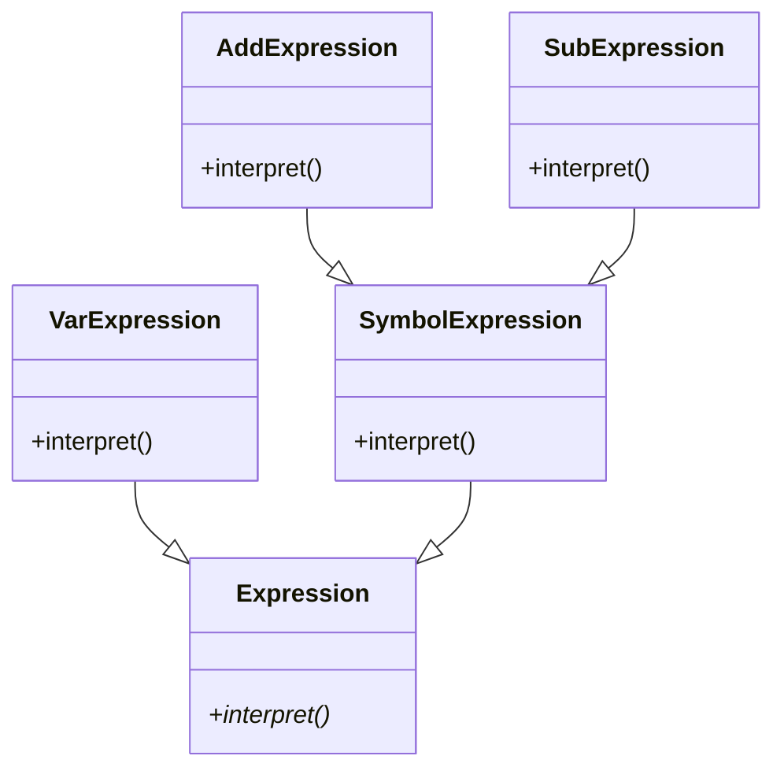
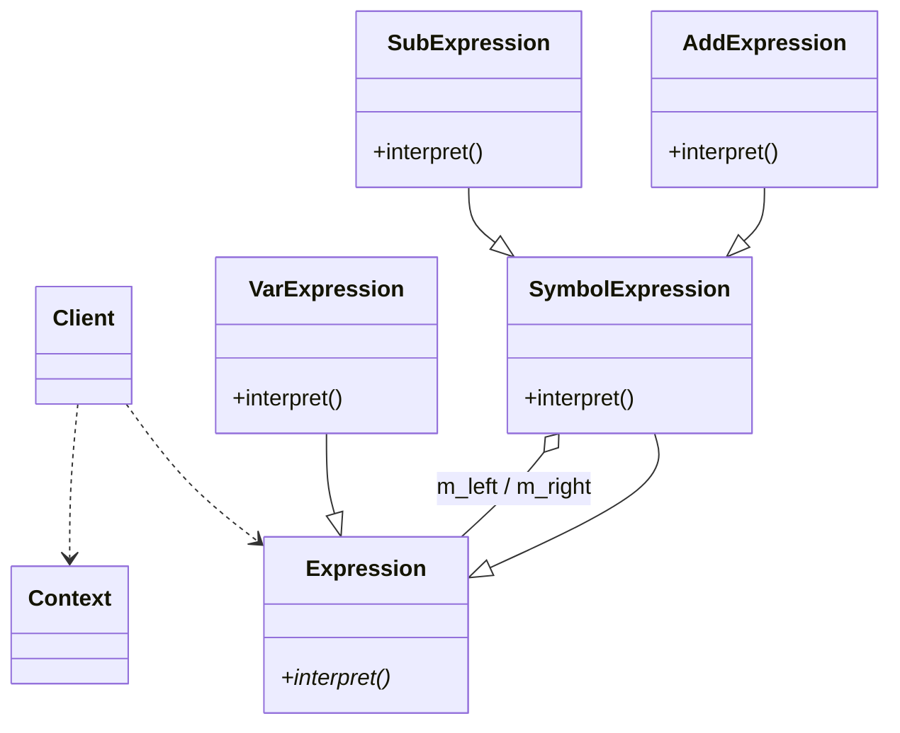
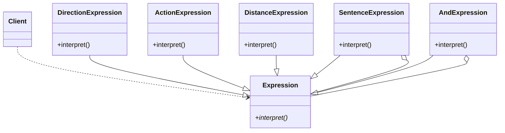

# 第 21 章 解释器模式

&gt; 原书第 276–289 页 ｜ 本节内容：以字符串表达式"a-b+c+d"求值范例逐步演化出解释器（Interpreter）模式，Expression 类族（终结符/非终结符表达式）与语法树的创建、interpret 递归求值与内存释放、模式定义与 UML 图及 4 种角色，以及机器人运动控制范例（第二个解释器范例）。

解释器（Interpreter）模式也叫解析器模式，是一种行为型模式，适合对一些比较简单的文法规则结构（例如，求一个算术表达式的结果）进行分析（翻译）。进一步说，该模式描述如何使用面向对象的程序设计语言（在这里是 C++ 语言）创建一个简单的语言解释器。该模式用的地方并不多，学习难度较大。此外，对于一些文法比较复杂的场合，因性能、复杂度等问题，往往并不采用解释器模式而是使用一些比较成熟的分析手段，例如语法分析器等，但这可能会涉及编译原理方面的一些知识，有兴趣的读者可以自行深入研究。


## 21.1 一个用解释器模式编写的范例

解释器模式单纯用语言描述会非常晦涩，不如看一个具体的范例。

为简化问题，有些变量名只用一个字母表示，诸如 a、b、c、d 等，它们的值可以在程序运行时指定。现在希望对这些变量进行加减法运算（考虑到编码的复杂性，避免涉及一些运算符优先级问题，本范例只进行加减法运算，不涉及乘除法）。假设 a、b、c、d 的值分别为 7、9、3、2，则给出任意一个字符串表达式诸如"a-b+c+d"，希望能够将变量的值代入字符串表达式中并计算出最终的结果 3，即"7-9+3+2"的结果为 3。这个范例的难点是变量的值以及要计算最终结果的字符串表达式都是在程序运行时给出的。拿到这个需求后，读者如果有自己的实现思路，可以率先写出相应的程序，看执行结果是否能如题目所愿。

可以看到，字符串表达式可以做任意变量之间的任意加减法，但并不是没有规律可循，就以"a-b+c+d"来说明，要计算其结果，可以先计算 a-b，得到的结果再和 c 做加法运算，再得到一个结果，这个结果和 d 做加法运算，从而得到最终结果，遵循的是**从左到右的计算规则或者说是语法规则**，将这些规则表达为一个句子（来代表"a-b+c+d"），然后构建解释器来解释这个句子，这就是解释器模式所做的事情。

现在，尝试用解释器模式实现该范例。当然，范例的目的主要是展示解释器模式适用的场景而不是写出完善的代码来实现需求，所以本范例只编写必需的用于实现基本功能的代码。

前面所说的将规则表达为一个句子，其实质就是如何将上述计算规则**表达为一棵语法树（表达式树）**。这棵语法树如图 21.1 所示。

对图 21.1 应该从左下角开始逐步向右上角观察，图中每个节点（圆形）中包含的都是一个独立的**小表达式**，用于表达一些内容。因为先计算 a-b，这意味着这个减法中有左右两个操作数 a 和 b，所以图中减号（节点）的左下角为 a 节点，右下角为 b 节点，a-b 的计算结果作为一个新节点并作为加号（节点）的左操作数，c 作为加号的右操作数，做与 c 的加法操作，结果再作为一个新节点并作为最上面加号的左操作数，d 作为加号的右操作数，做与 d 的加法操作，最终得到"a-b+c+d"这个完整表达式的结果。


上面提到过，图 21.1 中每个节点中包含的都是一个独立的小表达式，在本范例中，这些独立的小表达式分为两种——**非终结符表达式（树枝）**和**终结符表达式（树叶）**。图中＋、-号节点所代表的小表达式都是非终结符表达式，因为它们的组成部分仍然是其他小表达式，也就是这些节点的左下角和右下角仍旧指向其他节点，而 a、b、c、d 节点（变量）所代表的小表达式都是终结符表达式，因为它们不能被再分解（树中的叶子节点）。

有了上述这棵语法树，就可以对这棵树进行解释（解析）了。说得明确一些，语法树中每个节点所属的类都会有一个叫作 interpret 的成员函数对本节点进行解释，对于终结符表达式这种节点，只需要用实际的数字替换掉变量名（解析）；对于非终结符表达式，例如＋这种节点，就要用该表达式的左操作数与右操作数做实际的相加来得到结果（解析）。

下面开始编码。首先为每个独立的小表达式创建一个父类 Expression，代码如下：

```cpp
//小表达式（节点）父类
class Expression
{
public:
    Expression(int num, char sign) :m_dbg_num(num), m_dbg_sign(sign) {}         //构造函数
    virtual ~Expression() {}        //作父类时析构函数应该为虚函数

public:
    //解析语法树中的当前节点
    virtual int interpret(map<char, int> var) = 0;      //#include<map>，map容器中的键值对
                                                        //用于保存变量名及对应的值

public:
    //以下两个成员变量是为程序跟踪调试时观察某些数据方便而引入
    int m_dbg_num;      //创建该对象时的一个编号，用于记录本对象是第几个创建的
    char m_dbg_sign;    //标记本对象的类型，可能是个字符v代表变量（终结符表达式），也可能是加减号（非终结符表达式）
};
```

接着，创建子类 VarExpression 来代表变量表达式，也就是终结符表达式，代码如下：

```cpp
//变量表达式（终结符表达式）
class VarExpression : public Expression
{
public:
    VarExpression(const char& key, int num, char sign) :Expression(num, sign)   //构造函数
    {
        m_key = key;
    }
    virtual int interpret(map<char, int> var)
    {
        return var[m_key];          //返回变量名对应的数值
    }

private:
    char m_key;                     //变量名，本范例中诸如a、b、c、d都是变量名
};
```

从上述代码中可以看到，对变量表达式的解析（interpret）无非就是返回变量名所对应的变量值。

非终结符表达式有两个，分别是＋、-，这里先为非终结符表达式创建一个父类 SymbolExpression，也继承自 Expression 类，代码如下：

```cpp
//运算符表达式(非终结符表达式)父类
class SymbolExpression :public Expression
{
public:
    SymbolExpression(Expression * left, Expression * right, int num, char sign) : m_left(left), m_right(right), Expression(num, sign) {}     //构造函数
    Expression * getLeft() { return m_left; }
    Expression * getRight() { return m_right; }
protected:
    //左右各有一个操作数
    Expression * m_left;
    Expression * m_right;
};
```

接着，以 SymbolExpression 为父类，创建加法运算符表达式 AddExpression 和减法运算符表达式 SubExpression，代码如下：

```cpp
//加法运算符表达式(非终结符表达式)
class AddExpression :public SymbolExpression
{
public:
    AddExpression(Expression * left, Expression * right, int num, char sign) : SymbolExpression(left, right, num, sign) {}      //构造函数

    virtual int interpret(map<char, int> var)
    {
        //分步骤拆开写，方便理解和观察
        int value1 = m_left->interpret(var);        //递归调用左操作数的interpret方法
        int value2 = m_right->interpret(var);       //递归调用右操作数的interpret方法
        int result = value1 + value2;
        return result;                              //返回两个变量相加的结果
    }
};

//减法运算符表达式(非终结符表达式)
class SubExpression :public SymbolExpression
{
public:
    SubExpression(Expression * left, Expression * right, int num, char sign) : SymbolExpression(left, right, num, sign) {}      //构造函数

    virtual int interpret(map<char, int> var)
    {
        int value1 = m_left->interpret(var);
        int value2 = m_right->interpret(var);
        int result = value1 - value2;
        return result;                              //返回两个变量相减的结果
    }
};
```

从上述代码中可以看到，对加法运算符表达式的解析，是将该表达式左右两个操作数相加，而对减法运算符表达式的解析，是将该表达式左右两个操作数相减。

此时的类层次关系 UML 图如图 21.2 所示。



*原书图 21.2（第 290 页）：*

接下来要做的工作就是将上述计算规则创建为一棵语法树，具体是在函数 analyse 中创建。创建的思路是针对每个树中的节点创建一个 Expression 子类对象，然后根据节点的类型（节点所代表的是非终结符表达式还是终结符表达式），让非终结符表达式节点的 m_left 和 m_right 成员（SymbolExpression 类中定义）分别指向其他的节点，最终构成一个 Expression 子类型的链表，链表的外形以及指向与图 21.1 相同。函数 analyse 的代码如下：

```cpp
//分析—创建语法树（表达式树）
Expression * analyse(string strExp)     //strExp:要计算结果的表达式字符串,例如"a-b+c+d"
{
    stack<Expression *>  expStack;      //#include<stack>，这里用到了栈这种顺序容器
    Expression * left = nullptr;
    Expression * right = nullptr;
    int icount = 1;
    for (size_t i = 0; i < strExp.size(); ++i)      //循环遍历表达式字符串中的每个字符
    {
        switch (strExp[i])
        {
        case '+':
            //加法运算符表达式(非终结符表达式)
            left = expStack.top();                  //返回栈顶元素(左操作数)
            ++i;
            right = new VarExpression(strExp[i], icount++, 'v');    //v代表是一个变量节点
            //在栈顶增加元素
            expStack.push(new AddExpression(left, right, icount++, '+'));
                                                    //'+'代表是十个加法运算符节点
            break;
        case '-':
            //减法运算符表达式(非终结符表达式)
            left = expStack.top();                  //返回栈顶元素
            ++i;
            right = new VarExpression(strExp[i], icount++, 'v');
            expStack.push(new SubExpression(left, right, icount++, '-'));
                                                    //'-'代表是一个减法运算符节点
            break;
        default:
            //变量表达式(终结符表达式)
            expStack.push(new VarExpression(strExp[i], icount++, 'v'));
            break;
        }                                           //end switch
    }                                               //end for
    Expression * expression = expStack.top();       //返回栈顶元素
    return expression;
}
```

上述代码针对终结符表达式和非终结符表达式分别创建了若干 Expression 子类对象，并通过指针将这些对象连起来构成一棵语法树。代码中使用 new 来创建 VarExpression、AddExpression、SubExpression 类型的对象，这些代码有一定难度，可以直接进行断点调试来查看代码的执行。代码中一共执行了 7 次 new 创建了 4 个 VarExpression 对象、2 个 AddExpression 对象以及 1 个 SubExpression 对象（参考图 21.1）。创建这些对象的顺序如图 21.3 所示，图中从小到大数字的顺序就是创建这些对象的顺序。


将图 21.1 与图 21.3 进行比较，不难发现，analyse 函数所创建的语法树中包含的 7 个节点的创建顺序分别是 a、b、-、c、＋、d、＋。当创建 AddExpression 或 SubExpression 类型对象时，它们的 m_left 和 m_right 指针分别指向左操作数和右操作数，这样，所创建的对象就会被连起来。整个 analyse 函数最终返回图 21.3 中数字 7 这个节点（＋）所代表的 AddExpression 对象的指针，这个指针串起了语法树中的所有节点（通过这个指针可以遍历语法树中的所有其他节点），整个语法树创建完毕。

有了这棵语法树，就可以直接调用 interpret 接口对诸如"a-b+c+d"这样的字符串表达式进行求值了。在 main 主函数中可以加入如下代码：

```cpp
string strExp = "a-b+c+d";                      //将要求值的字符串表达式
map<char, int> varmap;
//下面是给字符串表达式中所有参与运算的变量一个对应的数值
varmap.insert(make_pair('a', 7));               //类似于赋值语句 a = 7
varmap.insert(make_pair('b', 9));               //类似于赋值语句 b = 9
varmap.insert(make_pair('c', 3));               //类似于赋值语句 c = 3
varmap.insert(make_pair('d', 2));               //类似于赋值语句 d = 2

Expression * expression = analyse(strExp);      //调用analyse函数创建语法树
int result = expression->interpret(varmap);     //调用interpret接口求解字符串表达式的结果
cout << "字符串表达式\"a - b + c + d\"的计算结果为: " << result << endl;    //输出字符串表达式结果
```

执行起来，看一看结果：

```text
字符串表达式"a - b + c + d"的计算结果为: 3
```

可以看到，程序正确计算出了字符串表达式"a-b+c+d"的结果，也就是"7-9+3+2"的结果。

上述代码中，比较难理解的是 main 主函数中的代码行"int result = expression-&gt;interpret(varmap);"是如何执行从而计算出最终结果的。这里建议读者继续断点调试以明确查看 interpret 成员函数的执行过程，其中涉及递归调用，这里对照图 21.3 进行说明。

- 代码行"int result = expression-&gt;interpret(varmap);"执行的是图 21.3 中标记为 7 的节点的 interpret 成员函数来计算该节点代表的和值，这必须先计算标记为 5 的节点代表的和值（程序中开始递归执行 interpret）。
- 要计算标记为 5 的节点代表的和值，必须先计算标记为 3 的节点代表的差值。
- 标记为 3 的节点代表的差值是由标记为 1 和标记为 2 的节点相减得到，而标记为 1 和标记为 2 的节点是变量节点（终结符表达式），有明确的值，因此此时可以求得标记为 3 的节点代表的差值。
- 标记为 4 的节点同样是变量节点，与标记为 3 的节点进行相加，求得标记为 5 的节点代表的和值。
- 标记为 6 的节点同样是变量节点，与标记为 5 的节点进行相加，最终求得标记为 7 的节点代表的和值。这也是对整个语法树进行求值后得到的结果。

当然，程序执行的最后，不要忘记释放用 new 分配的内存以免造成内存泄漏。为释放内存，编写一个 release 函数，代码如下：

```cpp
void release(Expression * expression)
{
    //释放表达式树的节点内存
    SymbolExpression * pSE = dynamic_cast<SymbolExpression *>(expression);
                                    //此处代码有优化空间(不使用dynamic_cast)，留给读者思考
    if (pSE)
    {
        release(pSE->getLeft());
        release(pSE->getRight());
    }
    delete expression;
}
```

在 main 主函数中，继续增加对 release 函数的调用代码：

```cpp
//释放内存
release(expression);
```

release 对内存的释放，也涉及递归调用，与计算字符串表达式结果涉及的递归调用道理是一样的，可以通过对代码断点调试来加深理解，把断点设置到"delete expression;"代码行，不难看到，参考图 21.3 的编号，内存的释放顺序分别为标记为 1、2、3、4、5、6、7 的节点，也就是说，标记为 1 的节点内存被最先释放，标记为 7 的节点内存被最后释放。

现在，整个程序的执行就不会泄漏内存了。

## 21.2 引入解释器模式

引入"解释器"设计模式的**定义（实现意图）**：定义一个语言的文法（语法规则），并建立一个解释器解释该语言中的句子。

其实，解释器模式是描述如何用面向对象程序设计语言来创造一个简单的语言解释器，这种语言拥有自己的语法规则，程序员正是利用解释器模式来设计并解释这种新的语言的，要想解释这种语言，需要调用每个表达式（非终结符表达式和终结符表达式）的 interpret 方法。换句话说，当一个语言需要解释执行并且可以将该语言中的句子**表示为一棵语法树**时，就可以使用解释器模式。

根据上述范例，绘制解释器模式的 UML 图，如图 21.4 所示。



*原书图 21.4（第 294 页）：*

解释器模式的 UML 图中包含如下 4 种角色。

（1）AbstractExpression（抽象表达式）：声明了一个抽象的解释操作，它是所有终结符表达式和非终结符表达式的公共基类。这里指 Expression 类。

（2）TerminalExpression（终结符表达式）：抽象表达式的子类，实现了语言文法中与终结符表达式相关的解释操作。一个句子中的每个终结符表达式都是该类的一个实例，这些实例可以通过非终结符表达式组成更为复杂的句子。这里指 VarExpression 类。

（3）NonterminalExpression（非终结符表达式）：同样是抽象表达式的子类，实现了语言文法中与非终结符表达式相关的解释操作，考虑到非终结符表达式既可以包含终结符表达式，也可以包含其他非终结符表达式，所以其相关的解释操作一般是通过递归调用实现的。这里指 AddExpression、SubExpression。注意，引入 SymbolExpression 类的目的是方便 AddExpression、SubExpression 作为其子类的编写（方便继承），SymbolExpression 类本身并不是非终结符表达式，也并不是必须存在的。

（4）Context（环境类/上下文类）：用于存储解释器之外的一些全局信息，例如变量名与值的映射关系、存储和访问表达式解释器的状态等，之后这个信息会作为参数传递到所有表达式的解释操作（interpret 成员函数）中作为这些解释操作的公共对象来使用。可以根据实际情况决定是否需要使用该类。这里指 varmap 这个 map 容器（虽然上述范例并没有将该容器封装到一个类中）。

从解释器模式可以看到，不管需要求值的字符串表达式如何变动，只要制定好相关的语法规则，利用解释器来解释这些规则，就可以达到对这些字符串表达式求解的目的。在解释器模式中，每种终结符表达式和非终结符表达式都有一个具体类与之对应，这样就将语法解析的工作拆分到各个类中，从而避免出现大而全的解析类。

因为使用类来表示语法规则，因此具有良好的灵活性和可扩展性，这也是解释器模式的优点。

对于何时、在什么场合下适合使用解释器模式的问题，一般来说，能将一个需要解释执行的语言中的句子表示为一棵语法树或者一些重复出现的问题能够用一种简单的语言表达时可以考虑使用解释器模式，比较典型的应用场合例如对正则表达式的解释等。在这方面，读者可以进一步查阅更多采用解释器模式实现的范例。

解释器模式具有如下缺点：

- 能够解释的语言比较简单或者说这种模式适合实现小而简单的文法；
- 执行效率不会太高，因为在解释的过程中会涉及许多递归调用；
- 如果文法（语法规则）太多，会导致产生大量的类，对于跟踪调试会产生诸多不便。

## 21.3 机器人运动控制范例

为了让读者对解释器模式有一个更加灵活和深入的认识，这里再实现一个机器人运动控制范例。

范例规定一些机器人的行为规则：

- 机器人的运动方向有 4 个：上（up）、下（down）、左（left）、右（right）；
- 机器人的运动方式有两个：行走（walk）和奔跑（run）；
- 机器人能接受的终结符表达式有**运动方向、运动方式**以及**运动距离**，其中运动距离是个正整数，单位是"米"，例如，"left walk 15"表示向左行走 15 米，而"down run 20"表示向下奔跑 20 米。
- 机器人能接受的一个非终结表达式是"句子"，句子由"运动方向、运动方式、运动距离"构成，例如，上面说过的"left walk 15"；另一个非终结表达式是"and"，代表"和"的意思，例如，"left walk 15 and down run 20"表示向左行走 15 米再向下奔跑 20 米。

仿照前面的计算字符串表达式值的范例，实现本范例并不困难。将本范例代码放入一个新的命名空间中，以免使用一些同名类时报错，先创建表达式父类以及终结符表达式和非终结符表达式，代码如下：

```cpp
//表达式父类
class Expression
{
public:
    virtual ~Expression() {}        //作父类时析构函数应该为虚函数

public:
    //解析语法树中的当前节点
    virtual string interpret() = 0;
};

//运动方向表达式(终结符表达式)
class DirectionExpression :public Expression
{
public:
    DirectionExpression(const string& direction)        //构造函数
    {
        m_direction = direction;
    }
    virtual string interpret()
    {
        if (m_direction == "up")
        {
            return "向上";
        }
        else if (m_direction == "down")
        {
            return "向下";
        }
        else if (m_direction == "left")
        {
            return "向左";
        }
        else if (m_direction == "right")
        {
            return "向右";
        }
        else
        {
            return "运动方向错";
        }
    }
private:
    string m_direction;     //运动方向 : up、down、left、right分别表示上、下、左、右
};

//运动方式表达式(终结符表达式)
class ActionExpression :public Expression
{
public:
    ActionExpression(const string& action)              //构造函数
    {
        m_action = action;
    }
    virtual string interpret()
    {
        if (m_action == "walk")
        {
            return "行走";
        }
        else if (m_action == "run")
        {
            return "奔跑";
        }
        else
        {
            return "运动方式错";
        }
    }
private:
    string m_action;        //运动方式 : walk、run分别表示行走、奔跑
};

//运动距离表达式(终结符表达式)
class DistanceExpression :public Expression
{
public:
    DistanceExpression(const string& distance)          //构造函数
    {
        m_distance = distance;
    }
    virtual string interpret()
    {
        return m_distance + "米";
    }
private:
    string m_distance;      //运动距离,用字符串表示即可
};

//"句子"表达式(非终结符表达式)由"运动方向、运动方式、运动距离"构成
class SentenceExpression :public Expression
{
public:
    SentenceExpression(Expression * direction, Expression * action, Expression * distance) :
        m_direction(direction), m_action(action), m_distance(distance) {}       //构造函数
    Expression * getDirection() { return m_direction; }
    Expression * getAction() { return m_action; }
    Expression * getDistance() { return m_distance; }

    virtual string interpret()
    {
        return m_direction->interpret() + m_action->interpret() + m_distance->interpret();
    }
private:
    Expression * m_direction;       //运动方向
    Expression * m_action;          //运动方式
    Expression * m_distance;        //运动距离
};

//"和"表达式(非终结符表达式)
class AndExpression :public Expression
{
public:
    AndExpression(Expression * left, Expression * right) :m_left(left), m_right(right) {}    //构造函数

    Expression * getLeft() { return m_left; }
    Expression * getRight() { return m_right; }

    virtual string interpret()
    {
        return m_left->interpret() + "再" + m_right->interpret();
    }
private:
    //左右各有一个操作数
    Expression * m_left;
    Expression * m_right;
};
```

组成语法树的各个必需的类已经创建完毕，接着，开始创建语法树，代码如下：

```cpp
//分析—创建语法树（表达式树）
Expression * analyse(string strExp)     //strExp:要计算结果的表达式字符串,例如"left walk
                                        //15 and down run 20"
{
    stack<Expression *>  expStack;
    Expression * direction = nullptr; Expression * action = nullptr; Expression * distance = nullptr;
    Expression * left = nullptr;    Expression * right = nullptr;

    //机器人运动控制命令之间是用空格来分隔的,所以用空格作为分隔字符来对整个字符串进行拆分
    char * strc = new char[strlen(strExp.c_str()) + 1];
    strcpy(strc, strExp.c_str());       //若本行编译报错提醒使用strcpy_s，则可以在文件头
                                        //增加代码行：#pragma warning(disable : 4996)
    vector<string> resultVec;           //#include<vector>
    char * tmpStr = strtok(strc, " ");  //按空格来切割字符串
    while (tmpStr != nullptr)
    {
        resultVec.push_back(string(tmpStr));
        tmpStr = strtok(NULL, " ");
    }
    delete[] strc;
    for (auto iter = resultVec.begin(); iter != resultVec.end(); ++iter)
    {
        if ((*iter) == "and")           //和
        {
            left = expStack.top();      //返回栈顶元素(左操作数)
            ++iter;

            direction = new DirectionExpression(*iter);     //运动方向
            ++iter;
            action = new ActionExpression(*iter);           //运动方式
            ++iter;
            distance = new DistanceExpression(*iter);       //运动距离
            right = new SentenceExpression(direction, action, distance);
            expStack.push(new AndExpression(left, right));
        }
        else
        {
            direction = new DirectionExpression(*iter);     //运动方向
            ++iter;
            action = new ActionExpression(*iter);           //运动方式
            ++iter;
            distance = new DistanceExpression(*iter);       //运动距离
            expStack.push(new SentenceExpression(direction, action, distance));
        }
    }
    Expression * expression = expStack.top();               //返回栈顶元素
    return expression;
}
```

上述代码构建的语法树同样可以用图表示，如图 21.5 所示。


释放内存的 release 函数代码如下：

```cpp
void release(Expression * expression)
{
    //释放表达式树的节点内存
    SentenceExpression * pSE = dynamic_cast<SentenceExpression *>(expression);
    if (pSE)
    {
        release(pSE->getDirection());
        release(pSE->getAction());
        release(pSE->getDistance());
    }
    else
    {
        AndExpression * pAE = dynamic_cast<AndExpression *>(expression);
        if (pAE)
        {
            release(pAE->getLeft());
            release(pAE->getRight());
        }
    }
    delete expression;
}
```

在 main 主函数中，注释掉原有代码，增加如下代码：

```cpp
string strExp = "left walk 15 and down run 20";
Expression * expression = analyse(strExp);      //调用analyse函数创建语法树
cout << expression->interpret() << endl;

//释放内存
release(expression);
```

执行起来，看一看结果：

```text
向左行走 15 米再向下奔跑 20 米
```

上述范例的 UML 图如图 21.6 所示。



*原书图 21.6（第 300 页）：*

本范例中没有用到如图 21.4 所示的 Context（环境类/上下文类），因为并不需要给 interpret 成员函数传递参数。
