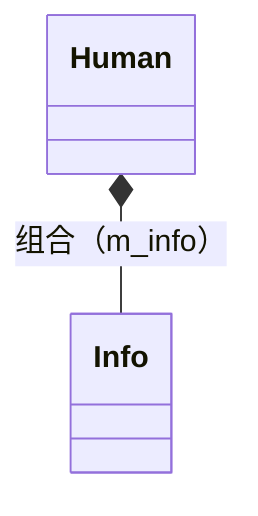
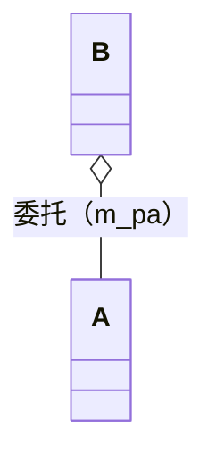

# 附录 A 类和对象

&gt; 原书第 293–340 页 ｜ 本节内容：支撑模式代码的纯 C++ 语言知识专题——静态对象与全局对象构造顺序、拷贝构造函数与拷贝赋值运算符、public 继承（is-a 关系）与代码编写规则、组合与委托关系、private 继承、不能被拷贝的类对象（noncopyable）、虚析构函数与内存泄漏、类设计技巧（NVI、explicit、堆/栈分配控制等）、命名空间注意事项、类定义的相互依赖与前向声明。

## A.1 静态对象的探讨与全局对象的构造顺序

### A.1.1 静态对象的探讨

（1）类中的静态成员变量（一般指类类型的静态成员变量），即使没有被使用，也会被构造和析构。

请看如下范例，在 MyProject.cpp 的上面定义一个类 A：

```cpp
class A
{
public:
    A()
    {
        m_i = 5;
        cout << "A::A()默认构造函数执行了" << endl;
    }
    ~A()
    {
        cout << "A::~A()析构函数执行了" << endl;
    }
    int m_i;
};
```

紧接着定义一个类 B，注意，类 B 中有一个静态成员变量 m_sa，其类型为 A（类类型）：

```cpp
class B
{
public:
    static A m_sa;          //这是静态成员变量的声明
};
```

类 B 中的代码行"static A m_sa;"只是对静态成员变量的**声明**。如果在 main 主函数中，没有用到类 B 的静态成员 m_sa，则自然可以不对该静态成员变量进行定义；但如果用到了该静态成员，例如在 main 主函数中增加如下代码：

```cpp
B bobj;
cout << bobj.m_sa.m_i << endl;      //用到了m_sa静态成员变量
```

则必须要对类 B 的静态成员 m_sa 进行**定义**，否则会报链接错误。静态成员变量的定义一般会放在项目中某个 .cpp 文件的上面位置，这里把如下代码放在类 B 的定义之后：

```cpp
A B::m_sa;                          //这是对类B静态成员变量m_sa的定义
```

这样，main 主函数中的代码就可以顺利执行而不会报错了。但此时，如果把 main 主函数中的所有代码清空（压根就不生成类 B 的任何对象），再次执行程序，居然发现类 A 的构造函数和析构函数执行了。这其实是一件很让人郁闷的事，因为这表示系统为类 B 的静态成员 m_sa 分配空间了，但其实代码中既没有使用到类 B，更没有使用到类 B 的静态成员 m_sa。这就证明了刚刚说到的结论：**类中的静态类类型成员变量，即使没有被使用，也会被构造和析构**。只要你使用了前面的代码行"A B::m_sa;"对 m_sa 进行了定义，那么这个静态成员变量就会被分配内存，这一点，大家要知道。

inline 关键字大家很熟悉了，一般用于声明一个内联函数。但是在 C++17 中引入了 **inline 静态成员变量**这样一个说法，有了 inline，就不用在类外某个 .cpp 源文件中对类 B 的静态成员变量 m_a 进行定义了，只需要在类 B 内的静态成员变量 m_a 声明行前面增加一个 inline 关键字，改造后的代码如下：

```cpp
class B
{
public:
    inline static A m_sa;       //既声明又定义了，注意打开编译器的C++17支持开关
};
```

当然，这种写法也是一样的——m_sa 成员变量，即使没有被使用，也会被构造和析构（为该静态成员变量分配了内存）。如果大家注意观察对 .cpp 源文件进行编译后生成的 .obj 文件（只需要用记事本打开 .obj 文件进行一些查找），还可以发现一个有意思的事，如果这个静态成员变量不是类类型，而是一个简单类型，例如 int、double 等类型，那么如果源码中没有用到这个静态成员变量，编译器就很可能不为这个静态成员变量分配内存，有兴趣的读者请自行观察。

（2）函数中的静态对象（一般指类类型的静态对象），如果这个函数没有被调用过，则这个静态对象不会被构造。当然，即使这个函数被调用过多次，这个静态对象也只会被构造一次（这一点在笔者的《C++ 新经典：对象模型》一书中有详细的介绍）。为了测试这一点，可以先把类 B 的定义注释掉，然后增加如下普通函数：

```cpp
void myfunc()
{
    static A aobj;
}
```

此时执行程序，类 A 的构造函数和析构函数并不会被调用。接着，在 main 主函数中增加如下代码：

```cpp
myfunc();
myfunc();
```

执行起来，看一看结果：

```text
A::A()默认构造函数执行了
A::~A()析构函数执行了
```

从结果中不难看到，只有 myfunc 函数被调用了，才会构造 aobj 对象，而且，不管调用几次 myfunc 函数，aobj 对象只会被构造一次（结果中显示类 A 的构造函数只执行了一次）。

### A.1.2 全局对象的构造顺序问题

一般来讲，函数中的静态对象在该函数第一次执行到这个静态对象被定义的地方时初始化，但对于全局对象（包括类的静态对象——类类型的静态成员变量），C++ 一般只保证在一个特定编译单元中（一个 .cpp 文件中）全局对象的初始化顺序，但并没有针对不同编译单元全局对象初始化顺序做出任何规定。

工程中有 5 个文件：Class1.h、Class1.cpp、Class2.h、Class2.cpp 和 MyProject.cpp。

（1）Class1.h 文件的内容如下：

```cpp
#ifndef __CLASS1__
#define __CLASS1__

class CLASS1
{
public:
    CLASS1();               //构造函数声明
    ~CLASS1();              //析构函数声明
};

#endif
```

（2）Class1.cpp 文件的内容如下：

```cpp
#include <iostream>
#include "Class1.h"
#include "Class2.h"
using namespace std;

//构造函数实现
CLASS1::CLASS1()
{
    cout << "CLASS1::CLASS1()构造函数执行了" << endl;
}

//析构函数实现
CLASS1::~CLASS1()
{
    cout << "CLASS1::~CLASS1()析构函数执行了" << endl;
}
```

（3）Class2.h 文件的内容如下：

```cpp
#ifndef __CLASS2__
#define __CLASS2__

class CLASS2
{
public:
    CLASS2();               //构造函数声明
    ~CLASS2();              //析构函数声明
};

#endif
```

（4）Class2.cpp 文件的内容如下：

```cpp
#include <iostream>
#include "Class1.h"
#include "Class2.h"

using namespace std;

//构造函数实现
CLASS2::CLASS2()
{
    cout << "CLASS2::CLASS2()构造函数执行了" << endl;
}

//析构函数实现
CLASS2::~CLASS2()
{
    cout << "CLASS2::~CLASS2()析构函数执行了" << endl;
}
```

（5）MyProject.cpp 文件的内容如下：

```cpp
#include <iostream>
#include "Class1.h"
#include "Class2.h"
using namespace std;

CLASS1 gclass1;
CLASS2 gclass2;

int main()
{
    return 0;
}
```

这几个文件的内容非常简单，定义了 CLASS1 和 CLASS2 两个类，在这两个类的构造函数和析构函数中分别输出一条信息。在 MyProject.cpp 文件中，用这两个类定义了两个全局对象 gclass1 和 gclass2。main 主函数中没有什么实际内容。

使用 Ctrl+F5 键执行程序，看一看输出结果：

```text
CLASS1::CLASS1()构造函数执行了
CLASS2::CLASS2()构造函数执行了
CLASS2::~CLASS2()析构函数执行了
CLASS1::~CLASS1()析构函数执行了
```

可以看到，CLASS1 类和 CLASS2 类的构造函数和析构函数各被执行了一次。这是 gclass1 和 gclass2 对象被构造和被析构的结果，但是非常遗憾，这两个对象谁会被先构造出来，顺序是不一定的。有些读者可能会说，因为 gclass1 比 gclass2 先定义，所以 gclass1 对象先被构造出来，这个说法在当前这个范例中说得通，但是，请考虑，如果一个项目中有多个 .cpp 源文件，每个源文件中都可能定义着一些不同的全局对象，那么，**这些全局对象的构造顺序（初始化顺序）是无规律的、不确定的**。

多运行几次程序，就目前的情况来看，gclass1 对象先被构造出来，而 gclass2 对象后被构造出来，那么如果在 gclass2 对象被构造出来之前使用了 gclass2 对象，就非常有可能导致程序执行出现问题。下面验证一下这件事。

在 Class2.h 的 CLASS2 类定义中，增加一个成员变量 m_i：

```cpp
public:
    int m_i;
```

修改 Class2.cpp 中的 CLASS2 构造函数，增加初始化列表，来初始化 m_i 的值：

```cpp
CLASS2::CLASS2() : m_i(5)
{
    cout << "CLASS2::CLASS2()构造函数执行了" << endl;
}
```

修改 Class1.cpp，在文件开始位置增加外部变量声明（外部变量说明）：

```cpp
extern CLASS2 gclass2;
```

然后，继续在 Class1.cpp 文件的 CLASS1 构造函数增加一些代码来输出 gclass2 对象 m_i 成员变量的值：

```cpp
CLASS1::CLASS1()
{
    cout << gclass2.m_i << endl;
    cout << "CLASS1::CLASS1()构造函数执行了" << endl;
}
```

再次执行程序，结果如下：

```text
0
CLASS1::CLASS1()构造函数执行了
CLASS2::CLASS2()构造函数执行了
CLASS2::~CLASS2()析构函数执行了
CLASS1::~CLASS1()析构函数执行了
```

从结果中不难看出，程序先构造了 gclass1，但在还没有构造 gclass2（没执行 gclass2 构造函数）的时候，就使用了 gclass2 对象的 m_i 成员，所以输出的结果错误（希望输出 5，结果输出的是 0），也就是说，在 gclass2 还没构造完的时候就去使用它，显然是错误的。

所以，日后读者千万不要写出这种代码来——**构造一个全局对象的时候，需要用到另外一个全局对象**，因为根本无法确定另外一个全局对象是否已经被构造出来。

如果 gclass1 的构造必须要用到 gclass2，那么怎么办呢？可以变通一下：把 gclass2 换个位置，在 Class2.cpp 中增加一个全局函数 getClass2Obj 如下：

```cpp
CLASS2& getClass2Obj()
{
    static CLASS2 gclass2;
    return gclass2;
}
```

从上面这个函数可以看到，返回的是一个静态局部对象的引用。可以理解成：用这个静态局部对象 gclass2 替换了刚刚的全局对象 gclass2。

在 MyProject.cpp 中，注释掉 gclass2 全局对象：

```cpp
//CLASS2 gclass2;
```

在 Class1.cpp 中，注释掉如下代码行：

```cpp
//extern CLASS2 gclass2;
```

然后修改一下 CLASS1 类构造函数的实现代码，把代码：

```cpp
cout << gclass2.m_i << endl;
```

替换为：

```cpp
cout << getClass2Obj().m_i << endl;
```

此外，创建一个新的 func.h 头文件，把 getClass2Obj 函数的声明放进去：

```cpp
#ifndef __FUNC__
#define __FUNC__

class CLASS2;                       //类的前向（前置）声明，某些编译器此行可以不需要
CLASS2& getClass2Obj();             //函数声明

#endif
```

当然，在 Class1.cpp 的开头位置要包含该头文件：

```cpp
#include "func.h"
```

再次执行程序，结果如下：

```text
CLASS2::CLASS2()构造函数执行了
5
CLASS1::CLASS1()构造函数执行了
CLASS1::~CLASS1()析构函数执行了
CLASS2::~CLASS2()析构函数执行了
```

可以看到，这次的结果是对的，还可以看到，CLASS2 类的构造函数先执行了，CLASS1 类的构造函数后执行，这正是所需要的。这里，通过引入了 getClass2Obj 全局函数这个小技巧来确保 **gclass2 对象肯定会被先构造出来，因为一个 static 对象是在第一次执行到定义该对象的代码时被构造出来的**，而且它一旦被构造出来，其生命周期就会一直延续到整个程序结束。

引入 getClass2Obj 全局函数还有另外一个好处——以往把 gclass2 定义成全局对象的时候，不管是否对 gclass2 对象进行使用，该对象都会被构造出来，但是改造之后不难发现，如果不对 getClass2Obj 函数进行调用，那么 gclass2 对象不会被构造出来，这样（如果不使用 gclass2 对象就不会构造出 gclass2 对象），间接实现了节省内存空间的效果。

特别提醒：

（1）上面定义一个静态局部变量的代码行（指 getClass2Obj 全局函数中"static CLASS2 gclass2;"代码行）不要在多线程中执行，否则是不安全的。例如，在多线程中如果同时执行如下这行语句，可能就会有问题。

```cpp
static CLASS2 gclass2;
```

这就要求上面这种语句一定要在单线程中执行完毕，甚至在必要的时候，可以手工的通过在主线程（例如 main 主函数）中直接调用 getClass2Obj 函数来完成对 gclass2 对象的构造，那么后续再在多线程中调用 getClass2Obj 函数就不会有问题了。换句话说，只要 gclass2 对象被安全（单线程）地构造出来，后续就可以被多线程使用了。例如在 main 主函数中加入如下代码：

```cpp
#include "func.h"
int main()
{
    getClass2Obj();     //通过手工调用的方式来率先把gclass2对象构造出来
    return 0;
}
```

（2）从上面的结果可以看到，CLASS1 类的析构函数是先执行的，而 CLASS2 类的析构函数是后执行的，这说明析构 gclass2 对象的时候，gclass1 已经被析构了。所以从这个角度来讲，就不要在 CLASS2 类的析构函数中引用 gclass1 对象了，因为它已经被析构了。

在 Class1.h 的 CLASS1 类定义中，增加一个成员变量 m_i：

```cpp
public:
    int m_i;
```

修改 Class2.cpp 文件，在文件开始位置增加外部变量声明（外部变量说明）：

```cpp
extern CLASS1 gclass1;
```

然后，继续修改 Class2.cpp 文件的 CLASS2 类析构函数实现代码，修改后的代码如下：

```cpp
CLASS2::~CLASS2()
{
    cout << "CLASS2::~CLASS2()析构函数执行了" << endl;
    gclass1.m_i = 56;
    cout << "gclass1.m_i = " << gclass1.m_i << endl;
}
```

因为 gclass1 已经被析构了，所以按道理讲，在 CLASS2 类的析构函数中是不应该引用 gclass1 对象的。执行起来，看一下结果：

```text
CLASS2::CLASS2()构造函数执行了
5
CLASS1::CLASS1()构造函数执行了
CLASS1::~CLASS1()析构函数执行了
CLASS2::~CLASS2()析构函数执行了
gclass1.m_i = 56
```

虽然从结果看似乎是正常的，但是这种代码显然不让人放心，所以不建议读者写出这种代码来。

## A.2 拷贝构造函数和拷贝赋值运算符

### A.2.1 拷贝构造函数和拷贝赋值运算符的书写

假如有一个类 A，类中有构造函数、拷贝构造函数、拷贝赋值运算符，非常简单，代码如下：

```cpp
class A
{
public:
    A() :m_caa(0), m_cab(0) {}          //构造函数
    A(const A& tmpobj)                  //拷贝构造函数
    {
        m_caa = tmpobj.m_caa;
        m_cab = tmpobj.m_cab;
    }
    A& operator = (const A& tmpobj)     //拷贝赋值运算符
    {
        m_caa = tmpobj.m_caa;
        m_cab = tmpobj.m_cab;
        return *this;
    }
public:
    int m_caa;
    int m_cab;
};
```

这里首先应注意的就是拷贝构造函数以及拷贝赋值运算符的参数类型、返回值类型等，请注意它们的写法。

在 main 主函数中，增加如下代码：

```cpp
A aobj1;
aobj1.m_caa = 10; aobj1.m_cab = 20;
A aobj2 = aobj1;                    //调用拷贝构造函数
aobj2 = aobj1;                      //调用拷贝赋值运算符
```

运行起来，感觉一切正常。

### A.2.2 对象自我赋值产生的问题

对象自我赋值这件事本身是允许的，当然，现实中这样赋值并没什么意义，但不排除两个不同的指针或者引用指向或绑定到相同对象导致的自我赋值。如果真出现这样的情况，没有编写合适的代码进行处理就可能会出现问题。

现在，把这个类 A 复杂化一点，引入一个 char* 类型的成员变量，并且这个 char* 固定指向 100 字节的内存。那么增加了这个成员变量后的类 A 的代码应该如下：

```cpp
class A
{
public:
    A() :m_caa(0), m_cab(0), m_cap(new char[100]) {}    //构造函数
    ~A()                                                //析构函数
    {
        delete[]m_cap;
    }
    A(const A& tmpobj)                  //拷贝构造函数
    {
        m_cap = new char[100];
        memcpy(m_cap, tmpobj.m_cap, 100);
        m_caa = tmpobj.m_caa;
        m_cab = tmpobj.m_cab;
    }
    A& operator = (const A& tmpobj)     //拷贝赋值运算符
    {
        delete m_cap;
        m_cap = new char[100];
        memcpy(m_cap, tmpobj.m_cap, 100);
        m_caa = tmpobj.m_caa;
        m_cab = tmpobj.m_cab;
        return *this;
    }
public:
    int m_caa;
    int m_cab;
    char *m_cap;                        //指向定长100的一个数组
};
```

这段代码当然有优化的余地（例如，考虑编写移动构造函数，公共代码可以统一放到某个函数中，等等），但这里不进行优化。

针对这个程序，存在可能因为误写，也可能因为操作对象数组的时候代码不完善或者出现多态的情况（父类指针指向子类对象）等，总之，出现了对象自己给自己赋值的情况。在 main 中加入如下代码：

```cpp
strcpy(aobj2.m_cap, "abcdefg");     //文件头加#pragma warning(disable:4996)
aobj2 = aobj2;                      //因为一些代码书写上的原因导致不小心把自己赋值给自己
```

上面这两行代码，编译没有问题，但是跟踪调试一下不难发现，执行到"aobj2 = aobj2;"这行代码的时候，针对 m_cap 成员变量的 memcpy 就出问题了。因为赋值符号两侧是同一个对象，在执行拷贝赋值运算符的时候，"delete m_cap;"代码行就会导致同时把源对象和目标对象的 m_cap 成员指向的内存全部释放，这时再执行"memcpy(m_cap, tmpobj.m_cap, 100);"肯定无法得到正确的结果，因为此时 m_cap 和 tmpobj.m_cap 是同一段内存。

那么，怎样解决这个问题呢？有几种解决方法，当然，每种方法都是围绕着修改拷贝赋值运算符的代码实现的。

（1）在拷贝赋值运算符的实现代码中增加是否是自己的判断代码：

```cpp
if (this == &tmpobj)
{
    return *this;
}
```

上面这段代码的优点是简单、直接、有效，不足之处是引入了一个 if 条件判断，每次做对象赋值的时候都要做这个条件判断，对程序的执行效率可能会产生一点影响，尤其是频繁进行对象赋值操作的时候。但是笔者还是比较提倡这种写法，因为这种写法比较清晰。

（2）如果对效率特别注重，则可以考虑换一种写法：

```cpp
A& operator = (const A& tmpobj)     //拷贝赋值运算符
{
    char *ptmp = new char[100];
    memcpy(ptmp, tmpobj.m_cap, 100);
    delete m_cap;
    m_cap = ptmp;
    m_caa = tmpobj.m_caa;
    m_cab = tmpobj.m_cab;
    return *this;
}
```

上面这段代码的优点是执行效率更高一些，但究竟高多少，其实不好说，因为这种写法虽然没有条件判断语句了，但定义了一个局部变量 ptmp，而且还多了赋值语句"m_cap = ptmp;"。从代码清晰度上来讲，这种写法要差一些，而且写这种代码的时候要小心代码的执行顺序，一个不留神就容易写错。

### A.2.3 继承关系下拷贝构造函数和拷贝赋值运算符的书写

现在引入一个新类 B，继承自类 A，代码如下：

```cpp
class B :public A
{
public:
};
```

因为有继承关系了，所以类 A 的析构函数一般都设置为虚函数以避免产生麻烦，这一点在笔者的《C++ 新经典：对象模型》一书里面讲得非常清楚。修改类 A 的析构函数：

```cpp
virtual ~A()                        //析构函数
{
    delete[]m_cap;
}
```

目前可以看到，类 B 是一个空类。在 main 主函数中，加入如下代码：

```cpp
B bobj1;
bobj1.m_caa = 100; bobj1.m_cab = 200;
strcpy(bobj1.m_cap, "new class");
B bobj2 = bobj1;                    //执行类A的拷贝构造函数
bobj2 = bobj1;                      //执行类A的拷贝赋值运算符
```

从上面的代码可以看到，因为类 B 是类 A 的子类，所以代码行"B bobj2 = bobj1;"会执行类 A 的拷贝构造函数，而代码行"bobj2 = bobj1;"会执行类 A 的拷贝赋值运算符，这些都是**编译器**帮助程序员完成的。

目前看起来程序一切正常，如果现在在子类 B 中也加入相应的拷贝构造函数和拷贝赋值运算符，看看会怎么样。改造后的类 B 代码如下：

```cpp
class B :public A
{
public:
    B() {}
    B(const B& tmpobj)              //拷贝构造函数
    {
    }
    B& operator = (const B& tmpobj) //拷贝赋值运算符
    {
        return *this;
    }
};
```

再次运行程序，可以跟踪调试一下，不难发现，执行 main 主函数中的代码时，居然不会再调用父类 A 中的拷贝构造函数和拷贝赋值运算符了，这显然是不行的。

为什么会造成这种情况呢？这里读者就要明白一点：**如果程序员在子类中写了自己的拷贝构造函数和拷贝赋值运算符，那么对于父类中拷贝构造函数和拷贝赋值运算符的调用就变成了程序员自己的责任**（编译器不会再帮助程序员去调用父类中的拷贝构造函数和拷贝赋值运算符）。换句话说，程序员要负责在子类的拷贝构造函数中调用父类的拷贝构造函数，还要负责在子类的拷贝赋值运算符中调用父类的拷贝赋值运算符。修改后的类 B 代码如下：

```cpp
class B :public A
{
public:
    B() {}
    B(const B& tmpobj) :A(tmpobj)   //拷贝构造函数，调用类A的拷贝构造函数
    {
    }
    B& operator = (const B& tmpobj) //拷贝赋值运算符
    {
        A::operator = (tmpobj);     //调用类A的拷贝赋值运算符
        return *this;
    }
};
```

经过这样的改造，在进行类 B 对象的拷贝构造和拷贝赋值时，就可以正常地调用类 A 的拷贝构造函数和拷贝赋值运算符了。

在上面的代码中，类 B 的拷贝构造函数调用类 A 的拷贝构造函数的代码放在了类 B 的拷贝构造函数初始化列表中：B(const B& tmpobj) : **A(tmpobj)**，有些读者可能会尝试将其放在类 B 的拷贝构造函数体中：

```cpp
B(const B& tmpobj)
{
    A(tmpobj);          //意图调用类A的拷贝构造函数
}
```

上面的代码在编译时会报形参 tmpobj 的重定义错误。这是因为代码行"A(tmpobj);"的写法是存在二义性的，可以被解释成函数调用，也可以被解释成定义一个对象，你没听错，"A(tmpobj);"被解释成定义一个对象时相当于代码"A tmpobj;"。显然，在这里，C++ 标准将"A(tmpobj);"代码行解释成了定义一个对象——tmpobj，因此，编译时会报形参 tmpobj 重定义错误。所以，对类 A 拷贝构造函数的调用，需要放在类 B 拷贝构造函数的初始化列表中。

### A.2.4 拷贝构造函数和拷贝赋值运算符中重复代码的处理

读者会发现，类 A 的拷贝构造函数中的一些初始化代码和拷贝赋值运算符中的一些初始化代码有些重复，可以优化一下：把重复的代码写成一个成员函数，然后让拷贝构造函数和拷贝赋值运算符都去调用这个成员函数。

有人可能会发现：既然类 A 的拷贝构造函数中的代码和拷贝赋值运算符中的代码如此相似，那么是否可以用类 A 的拷贝构造函数去调用拷贝赋值运算符或者用拷贝赋值运算符去调用拷贝构造函数呢？

笔者的建议是：当读者有一个想法的时候，就大胆地去尝试，把代码写出来，做到编译、链接通过并调试起来，只要结果是对的，就可以验证这个想法。

## A.3 类的 public 继承（is-a 关系）及代码编写规则

C++ 类与类之间的关系非常重要，在实际编写代码中也经常用到，所以有必要总结一下。另外，在这里还会提出一些程序的编写规则建议，遵循这些规则建议来编写程序，能让代码的质量得到进一步的提高。

读者都知道，子类继承父类的继承方式有 3 种：public、protected、private。本节主要讲一讲 public 继承。

public 继承所代表的是一种 is-a（is a kind of）的关系。is-a 翻译成中文的意思表示"是一个"。也就是说，如果一个子类通过 public 继承一个父类，那么表示程序员告诉编译器，**通过这个子类产生的对象一定也是一个父类对象**（不相关的两个类不应该使用 public 继承）。

例如，创建一个 Human（人类）类作为父类，再创建一个 Man（男人）类并通过 public 的继承方式来继承 Human，这就等于告诉编译器，男人一定是人类；反之不成立（人类不一定是男人，也可能是女人）。所以，可以理解成，父类表示的是一种更泛化的概念，而子类表现的是一种更特化的概念。这就是 public 继承所表达的确切含义——"is-a 关系"。

不要被虚假的父子继承关系迷惑。现实中常有一个例子，例如，有一个父类 Rectangle（矩形），然后有一个类 Square（正方形），如果从正常的角度理解，正方形确实是一个矩形，但如果根据这个说法让 Square 类以 public 继承的方式来继承 Rectangle 类，这个设计合适吗？

显然不合适，为什么呢？因为正方形有个特性是宽度和高度相等，而矩形的宽度和高度可以不相等，例如，Rectangle 类中有一个专门设置矩形宽度的成员函数和一个专门设置矩形高度的成员函数，那么这两个成员函数就都不适用于 Square 类，也就是说，Rectangle 类的宽度和高度都可以单独设置并且两者可以不相等，而 Square 类要始终保持宽度和高度相等。所以从这个角度来讲，非让 Rectangle 类成为 Square 类的父类就是不合适的。

总结一下 public 继承关系的检验规则：**能够在父类对象上做的行为也必然能在子类对象上做，每个子类对象同时也都是一个父类对象**。

看看如下代码，引入两个类，其中 Human 表示人类，Man 表示男人：

```cpp
class Human
{
    public:
};

class Man :public Human              //公有继承
{
    public:
};
```

总的来说：引入 public 继承的目的虽然与**代码重用**有关系，但并不是通常所理解的为了让子类重用父类的代码来实现子类的功能（子类的功能可以用后续讲到的 private 继承或者通过类之间的组合关系来实现），public 继承更多代表的是一种 is-a 关系。也就是说，在需要用到父类对象的场合下，可以用子类对象来代替［里氏替换原则，也叫 Liskov 替换原则（Liskov Substitution Principle，LSP），即任何基类出现的地方都应该可以无差别地使用子类替换］。

### A.3.1 子类遮蔽父类的普通成员函数

修改 Human 和 Man 类，分别增加普通成员函数 eat，修改后的代码如下：

```cpp
class Human
{
public:
    void eat()
    {
        cout << "人类吃食物" << endl;
    }
    virtual ~Human()                //作父类应该有一个虚析构函数
    {
    }
};

class Man :public Human
{
public:
    void eat()
    {
        cout << "男人吃面食" << endl;
    }
};
```

在 main 主函数中，增加如下代码：

```cpp
Man myman;
myman.eat();
```

执行起来，结果如下：

```text
男人吃面食
```

从这个结果不难看到，子类覆盖了父类的同名普通成员函数 eat，那么子类对象调用该同名函数的时候，执行的是子类的 eat 函数，这叫作**函数遮蔽**。也就是说，子类把父类中的同名函数遮蔽掉了。当然，如果非要调用父类 Human 的 eat 函数，也是可以的，可以在 main 主函数中用"子类对象名.父类名::eat()"的方式来调用父类的 eat 函数：

```cpp
myman.Human::eat();
```

可以看到，虽然语法上可以做到子类对父类同名函数 eat 的覆盖。但并不建议子类写一个 eat 函数来覆盖父类同名的 eat 函数。因为对于 public 继承来说，否决了父类中的 eat 函数而自己在子类中重新实现了 eat 函数，就等于违反了父类和子类之间的 is-a 关系。

所以对于 **public 继承，不建议也不应该用子类内的普通成员函数遮蔽父类的同名普通成员函数**。既然在父类中是个普通成员函数，就代表子类中不会有不同的行为，代表的是一种不变性。

因此在这里可以把 Man 类的 eat 成员函数注释掉了。

### A.3.2 父类的纯虚函数接口

**纯虚函数让子类继承父类的成员函数接口。**

继续引入一个新的子类，Woman 表示妇女，这个类也 public 继承 Human 类：

```cpp
class Woman :public Human
{
public:
};
```

现在，希望在父类中引入一个成员函数 work，代表"工作"，但是，现在 Man（男人）、Woman（女人）这两个类的工作各不相同，例如 Man 做的是重体力工作，Woman 做的是轻体力工作。

在这种情况下，对于 Human 这个父类来讲，实在是很难知道每个子类的具体工作是什么，那么在 Human 父类中，可以把 work 定义成纯虚函数，那么此时 Human 类就变成抽象类（抽象基类）了。

- ① 纯虚函数所在的类变成了抽象类，抽象类不能用来生成该类的对象。
- ② 任何从抽象类 Human 继承的子类都要定义该虚函数自己的实现方法，也就是说，此时，子类从父类中**只继承到了一个成员函数的接口**。

看一看父类 Human 中的 work 函数：

```cpp
public:
    virtual void work() = 0;        //纯虚函数
```

子类 Man、Woman 应分别实现 work 函数：

```cpp
public:                             //Man类中的work实现
    virtual void work()
    {
        cout << "重体力工作" << endl;
    }
```

```cpp
public:                             //Woman类中的work实现
    virtual void work()
    {
        cout << "轻体力工作" << endl;
    }
```

所以，日后，如果需要在子类中来实现具体的函数代码时，则可以在父类中定义一个**纯虚函数**。

### A.3.3 父类的虚函数接口

**虚函数让子类继承父类的成员函数接口和实现，子类还可以提供自己新的实现。**

这里在父类 Human 中提供一个获取人类平均寿命的虚函数接口 avlf：

```cpp
public:
    virtual void avlf()             //平均寿命
    {
        cout << "大概75岁" << endl;
    }
```

那么在子类 Man、Woman 中，可以分别实现 avlf 函数，当然也可以不实现。在不实现的情况下，会自动使用父类的该成员函数：

```cpp
public:                             //Man类中的avlf实现
    virtual void avlf()
    {
        cout << "大概72岁" << endl;
    }
```

```cpp
public:                             //Woman类中的avlf实现
    virtual void avlf()
    {
        cout << "大概80岁" << endl;
    }
```

这里特别值得提醒的是，引入新子类的时候，**不要忘记去实现这里的 avlf 接口**，否则会使用父类中的 avlf 接口，这可能不是程序员想要的结果。因为如果 avlf 在父类中是一个纯虚函数，那么会强制要求子类实现这个函数的，而普通的虚函数是允许不在子类中重新实现的，这一点请读者务必要注意。

另外，作父类要遵循一些作为父类的规范：父类中肯定会有一些虚函数，至少析构函数就应该是虚函数的。

### A.3.4 为纯虚函数指定实现体

在刚刚介绍的 avlf 虚函数中，面临的一个问题就是所有 public 继承 Human 类的子类，都要记得去实现 avlf，一旦忘记实现了 avlf，就会在无意中调用 Human 父类的 avlf 函数，这可能导致程序代码产生逻辑错误——本来子类应该实现自己的 avlf 函数，却不小心调用了父类的 avlf 函数。

例如，在 Woman 类中注释掉 avlf 函数。在 main 函数中，如果有下面的代码：

```cpp
Woman mywoman;
mywoman.avlf();
```

执行起来，结果就是：

```text
大概75岁
```

这就说明，一旦 Woman 类忘记了实现 avlf 函数，那么父类 Human 的 avlf 函数就会被执行了。这往往不是程序员的本意——程序员就是希望调用 Woman 中的 avlf 函数，只是忘记在 Woman 类中实现该函数而已。

那么有没有什么办法能够强制程序员必须去实现 avlf 函数呢？方法就是将父类的 avlf 函数实现为纯虚函数，这就要求每个子类必须实现 avlf 函数：

```cpp
public:
    virtual void avlf() = 0;
```

这样做的好处是**强制子类必须去实现 avlf 函数**。对于一些高度敏感行业，强制一定在子类中实现 avlf 函数接口，就可以采取这种编程手段。

另外一个值得注意的问题是，虽然 avlf 函数在 Human 类中被实现为了纯虚函数，但在 Human 类定义之外，依然可以给 Human 类的 avlf 函数增加一个实现体：

```cpp
void Human::avlf()
{
    cout << "大概75岁" << endl;
}
```

这时有些读者会疑惑：

（1）纯虚函数可以有实现体吗？确实可以有实现体。

（2）另外一个疑惑是给纯虚函数增加实现体合适吗？当然有不合适的一面，因为纯虚函数引入的初衷其实是希望在父类中没有实现体（函数体），需要到子类中去实现。

有些读者接下来想知道的就是为什么要给纯虚函数 avlf 增加一个函数体。其实是为了简便，试想一下，如果 Human 类有多个子类，绝大多数子类的 avlf 函数接口执行的代码都是相同的，那么这种相同的代码放在父类中来实现是合适的。

总的来说，给父类的纯虚函数增加实现体有两个目的：

（1）强制子类必须去实现该函数，以免产生一些重要的程序代码逻辑错误。

（2）让一些确实不需要单独实现 avlf 接口的子类有机会直接调用父类的 avlf 成员函数。假如，这里的 Woman 类希望调用父类 Human 的 avlf 成员，那么该如何修改 Woman 类呢？

```cpp
public:
    virtual void avlf()
    {
        Human::avlf();              //调用父类的同名函数
    }
```

### A.3.5 类的 public 继承（is-a 关系）综合范例

设想有 3 个类，分别为 A、B、C，类 B 通过 public 继承类 A，类 C 通过 public 继承类 B，代码如下：

```cpp
class A{};
class B :public A{};
class C :public B{};
```

函数 myfunc 是重载函数，其形参类型分别为 A 类型和 C 类型：

```cpp
void myfunc(A tmpa)
{
    cout << "myfunc(A tmpa)执行了" << endl;
}

void myfunc(C tmpc)
{
    cout << "myfunc(C tmpc)执行了" << endl;
}
```

在 main 主函数中，增加如下代码：

```cpp
B myobjb;
myfunc(myobjb);
```

执行起来，看一看结果：

```text
myfunc(A tmpa)执行了
```

从结果中可以看到，当传递一个 B 类对象 myobjb 作为实参时，调用的是形参为 A 类型的 myfunc 函数，这是因为类 B 通过 public 继承自类 A，因此是一种 is-a 关系，那么 myobjb 这个 B 类对象也一定是一个 A 类对象，因此调用形参为 A 类型的 myfunc 函数是合适的。

在 main 主函数中，继续增加如下代码：

```cpp
C myobjc;
myfunc(myobjc);
```

执行起来，新增加的 myfunc 函数调用代码行的执行结果是：

```text
myfunc(C tmpc)执行了
```

这个结果不难理解，当传递一个 C 类对象 myobjc 作为实参时，调用的是形参为 C 类型的 myfunc 函数，因为该版本的 myfunc 函数形参类型与实参类型完全匹配。试想一下，如果此时注释掉 C 类型形参的 myfunc 函数，那么代码行"myfunc(myobjc);"的执行结果会如何呢？

将形参为 C 类型的 myfunc 函数注释掉：

```cpp
/*void myfunc(C tmpc)
{
    cout << "myfunc(C tmpc)执行了" << endl;
}*/
```

执行程序，代码行"myfunc(myobjc);"的执行结果是：

```text
myfunc(A tmpa)执行了
```

这个结果同样很好理解，因为类 B 通过 public 继承自类 A，而类 C 通过 public 继承自类 B，就等价于类 C 通过 public 继承了类 A，因此类 C 和类 A 也是一种 is-a 关系，也就是说，myobjc 这个 C 类对象也一定是一个 A 类对象，因此调用形参为 A 类型的 myfunc 函数并没有任何问题。

接下来增加一个新的重载函数 myfunc，其形参类型为 B 类型：

```cpp
void myfunc(B tmpb)
{
    cout << "myfunc(B tmpb)执行了" << endl;
}
```

执行程序，代码行"myfunc(myobjc);"的执行结果是：

```text
myfunc(B tmpb)执行了
```

从结果可以看到，类 C 和类 B 是一种 is-a 关系，类 C 和类 A 也是一种 is-a 关系，但因为类 C 与类 B 的关系更加亲近（父子关系）而与类 A 的关系相对疏远（爷孙关系），所以，在选择形参为 A 类型或 B 类型的 myfunc 函数都可以的时候，编译器优先选择形参为 B 类型的 myfunc 函数。

### A.3.6 public 继承关系下的代码编写规则

最后再总结一下 public 继承关系下的代码编写规则：

（1）父类的普通成员函数，子类不应该去覆盖。如果需要去覆盖，那么应该（在父类中）将该普通成员函数修改为虚函数。

（2）父类的纯虚函数，定义了一个接口，子类等于继承了该接口，具体的实现需要子类自己去完成。

（3）父类的普通虚函数（非纯虚函数），不但定义了一个接口，还编写了实现代码，子类继承了该接口，可以编写自己的实现代码来取代父类的实现代码，也可以不编写自己的实现代码而使用父类的默认实现代码。

（4）在可以使用非 public 继承时，就不要使用 public 继承（后面有探讨 private 继承所适合的情形）。为什么单独说这件事情呢？因为许多程序员在写代码的时候，只要涉及继承，就会直接使用 public 继承。

## A.4 类与类之间的组合关系与委托关系

### A.4.1 组合关系

前面学习了 is-a 关系，表示的是父类和子类之间的"是一个"关系，类与类之间还有另外一种关系——"组合（复合）"关系，英文名称是 Composition。所谓组合关系，其实就是一个**类的定义中含有其他类类型成员变量**，那么这两个类之间就是一种组合关系。组合关系分两种：has-a 关系和 is-implemented-in-terms-of 关系。

#### 1. has-a 关系

第一种类与类之间的组合关系被称为 has-a 关系，has-a 翻译成中文的意思表示"有一个"。看一个范例，其中定义了两个类——Info 和 Human。代码如下：

```cpp
class Info
{
private:
    std::string m_name;         //名字
    int m_gender;               //性别
    int m_age;                  //年龄
};

class Human
{
public:
    Info m_info;
};
```

可以看到，类 Human 中的 m_info 成员变量的类型是 Info 类类型，所以类 Human 与类 Info 之间就是 has-a 关系，进一步说就是 **Human 有一个 Info**（人有一个信息，或者说，Human 对象中包含着一个 Info 对象，当然 Human 对象中可能还包含其他对象）。has-a 关系也称为是 is-part-of 关系，如果说 Human has-a Info，那么也可以认为 Info is-a-part-of Human。

#### 2. is-implemented-in-terms-of 关系

is-implemented-in-terms-of 关系翻译成中文的意思是"根据……实现出"。怎么理解这种组合关系呢？其实也很简单，通过一个范例来理解。

读者都知道 multimap 容器，是一个关联容器，里面保存的是"键值对"。下面回顾一下这个容器，首先包含头文件：

```cpp
#include <map>
```

然后，在 main 主函数中，增加如下代码：

```cpp
std::multimap<int, int> tmpmpc;
tmpmpc.insert(std::make_pair(1, 1));
tmpmpc.insert(std::make_pair(2, 3));
tmpmpc.insert(std::make_pair(1, 2));
cout << "tmpmpc.size() = " << tmpmpc.size() << endl;
```

执行起来，结果如下：

```text
tmpmpc.size() = 3
```

可以看到，向容器 tmpmpc 中成功地增加了 3 条数据。multimap 容器的特点是允许键重复，例如在这个范例中，有两条数据的"键"对应的数字是 1。假设现在希望开发一个新的容器，取名为 **smap**，这个新容器的特点是不允许"键"重复（虽然系统提供的 map 容器已经做到了这一点，但是这里为了阐述 is-implemented-in-terms-of 这种组合关系，不妨自己来实现一下这个不允许"键"重复的新容器）。

要实现的新容器与 multimap 容器非常类似，所以，很容易想到，如果通过 multimap 来实现 smap 这个新容器，肯定会比较简单。怎样通过 multimap 来实现 smap 呢？

可能第一个反应是让 smap 来继承 multimap，例如下面的代码：

```cpp
class smap :public std::multimap<T, U>{ ... };
```

但是这种 public 继承关系是否合适呢？前面讲过，public 继承是一种 is-a 关系，子类对象也是一个父类对象，在这个范例中显然不成立，1 这个"键"可以出现在 multimap 中两次，但是不可以出现在 smap 中两次，这就说明了 smap 类对象并不是一个 multimap 类对象，所以，它们之间并不是 is-a 关系，让 smap 用 public 继承 multimap 是不合适的（注意笔者的用词，不合适，不等于一定不可以）。

那么怎么做合适呢？用组合关系就比较合适，写一段最简单的代码：

```cpp
template <typename T, typename U>
class smap
{
public:
    void insert(const T& key, const U& value)
    {
        if (container.find(key) != container.end())
            return;
        container.insert(std::make_pair(key, value));
    }

    size_t size()
    {
        return container.size();
    }

private:
    std::multimap<T, U> container;
};
```

然后，在 main 主函数中，增加如下代码：

```cpp
smap<int, int> tmpsmap;
tmpsmap.insert(1, 1);
tmpsmap.insert(2, 3);
tmpsmap.insert(1, 2);
cout << "tmpsmap.size() = " << tmpsmap.size() << endl;
```

执行起来，结果如下：

```text
tmpmpc.size() = 3
tmpsmap.size() = 2
```

可以看到，虽然向容器 tmpsmap 中增加了 3 条数据，但是因为有 1 条数据的"键"是重复的，所以实际上只成功地增加了 2 条数据，因此 tmpsmap 的 size 值是 2。

上面的例子展示了自己定义的 smap 容器与系统定义的 multimap 容器之间的关系，是属于 is-implemented-in-terms-of 这种组合关系，进一步说，就是**根据 multimap 容器实现了 smap 容器**，实现的方法也是在 smap 类中定义了一个 multimap 类型的成员变量 container。

#### 3. 组合关系的 UML 图

当两个类之间是组合关系的时候，UML 关系图如图 A.1 所示（这里就以上面范例中的 Info 类和 Human 类为例）。



*原书图 A.1（第 324 页）：*

在图 A.1 中，因为 Human 类中包含一个 Info 类的对象 m_info，所以 Human 类中有一个箭头指向 Info 类，同时在 Human 这一侧出现了一个实心菱形。**实心菱形框**（与空心菱形框相对）表示**真包含**的意思，这意味着如果创建一个 Human 类对象（整体对象），那么其中会包含 Info 类对象（成员对象），这两个对象具有统一的生命周期。一旦整体对象不存在，成员对象也将不存在。当然，在构造 Human 类对象时，也会先构造出 Info 对象（编译器内部会做这件事）。

### A.4.2 委托关系

其实类与类之间的关系一般为继承或组合关系。当然，组合关系还可以细分，细分出一种叫作委托（聚合）关系，英文名称是 Delegation。委托关系是指一个类中包含指向另一个类的指针，看如下代码：

```cpp
class A
{
public:
    void funca() {}
};

class B
{
public:
    B(A* tmpa)
    {
        m_pa = tmpa;
    }
    void funcb()
    {
        m_pa->funca();
    }

private:
    A* m_pa;
};
```

然后，在 main 主函数中，增加如下代码进行测试：

```cpp
A *pa = new A();
B *pb = new B(pa);
pb->funcb();

//释放资源
delete pa;
delete pb;
```

从上述代码中可以看到，B 类有一个指向 A 类对象的指针（m_pa），UML 关系图如图 A.2 所示。

因为 B 类中只有一个指针指向 A 类对象，而不是包含一个代表 A 类对象的实体，因此在 B 类这一侧用一个空心菱形框代表。



*原书图 A.2（第 325 页）：*

因为 B 类有一根指向 A 类对象的指针 m_pa，因此如果调用 B 类的 funcb 成员函数做某件事情，B 类可以把这个动作通过调用 A 类的 funca 成员函数来完成，这意味着 B 类可以把自己要做的事情委托给 A 类来做，委托关系由此得名。

m_pa 所指向的 A 类对象的创建并没有固定时机，在需要的时候创建即可，这意味着 B 类对象和 A 类对象的生命周期是不一致的（区别于组合关系中整体对象和成员对象有统一的生命周期），即便 B 对象不存在了 A 对象（m_pa 所指向的对象）可以依旧存在；反之亦然。

## A.5 类的 private 继承探讨

前面曾经详细探讨过类的 public 继承，读者都知道，类的 public 继承描述的是一种 is-a 关系，看一看曾经写过的代码：

```cpp
class Human
{
public:
    virtual ~Human()                //作父类应该有个虚析构函数
    {
    }
};

class Man :public Human
{
public:
};
```

可以看到，Man 类以 public 的方式继承了 Human 类，在 main 主函数中，代码如下：

```cpp
Man myman;
Human &myhuman = myman;             //父类引用绑定子类对象
Human *myhuman2 = new Man;          //父类指针指向子类对象
```

在上面这 3 行代码中，其中第 2 行是父类引用绑定（引用）子类对象，第 3 行是父类指针指向子类对象。编译一下整个项目，没有问题。

现在，如果把 Man 类的继承方式从 public 继承变为 private 继承，代码如下：

```cpp
class Man :private Human
{
public:
};
```

再次编译一下整个项目，发现上面的 3 行代码中，后 2 行都会报错：

```text
error C2243: "类型强制转换": 从"Man *"到"Human &"的转换存在，但无法访问
error C2243: "类型强制转换": 从"Man *"到"Human *"的转换存在，但无法访问
```

由此首先可以得出一个结论：public 继承和 private 肯定有不一样的地方。出现错误的具体原因后面再分析。

在《C++ 新经典》一书中，笔者曾经给出过一个访问权限及继承方式总结表，如表 A.1 所示。

表 A.1 访问权限及继承方式总结

| 3 种访问权限 | 3 种继承方式 |
| --- | --- |
| public：可以被任意实体访问 | public 继承 |
| protected：只允许本类或者子类的成员函数来访问 | protected 继承 |
| private：只允许本类的成员函数访问 | private 继承 |

| 父类中的访问权限 | 子类继承父类的继承方式 | 子类得到的访问权限 |
| --- | --- | --- |
| public | public | public |
| protected | public | protected |
| private | public | 子类无权访问 |
| public | protected | protected |
| protected | protected | protected |
| private | protected | 子类无权访问 |
| public | private | private |
| protected | private | private |
| private | private | 子类无权访问 |

总结：（1）子类 public 继承父类，则父类所有成员在子类中的访问权限都不发生改变；（2）protected 继承将父类中 public 成员变为子类的 protected 成员；（3）private 继承使得父类所有成员在子类中的访问权限变为 private；（4）父类中的 private 成员不受继承方式的影响，子类永远无权访问；（5）对于父类来讲，尤其是父类的成员函数，如果不想让外面访问，就设置为 private；如果想让自己的子类能够访问，就设置为 protected；如果想公开，就设置为 public。

*原书表 A.1（第 326 页）：*

从表 A.1 中可以看到，从父类继承的所有成员变量、成员函数，只要是通过 private 修饰的，那么到子类中，这些成员变量和成员函数要么变成 private 访问权限，要么子类根本没有访问权限，这个结论，读者要先记住。

public 继承是一种 is-a 的关系，也就是说，每个子类对象同时也是一个父类对象。那么，private 继承是一种什么关系呢？其实是一种**组合关系**，更确切地说，是组合关系中的 is-implemented-in-terms-of（根据……实现出）关系。例如，Man 类以 private 的继承方式继承了 Human 类，那么意味着程序员想**通过 Human 类实现出 Man 类**（表面看有点通过父类实现出子类的意思）。也就是说，程序员希望利用 Human 类中已经具备的各种功能来实现出 Man 类。所以，这种 private 继承关系可能会颠覆以往读者对继承的理解。建议读者，当进行这种 private 继承的时候，**不要把 Human 和 Man 这两个类再当成具有父子关系的两个类来理解**（如果不当成父子关系来理解这两个类，可能会减少很多疑惑）。

但这里又可能出现一个疑问：既然这种 private 继承关系就是一种组合关系，那为什么不用组合关系而却用 private 继承关系呢？一般情况下，还是要优先考虑使用组合关系，只有在一些比较特殊的和必要的情况之下，例如，涉及一些 protected 成员、private 成员、虚函数等情况下才考虑使用 private 继承。

看一个例子，这个例子就是通过 private 继承来借用被继承的类中的虚函数。创建一个消息队列类：

```cpp
//消息队列类
class MsgQueue
{
    //...入消息队列，出消息队列等
};
```

这个消息队列类主要是用来向消息队列中放入消息和从消息队列中取出消息。现在有一个需求：希望每隔 10 秒钟，向屏幕上输出当前这个消息队列有多少条消息（这些消息都属于尚未被处理的）。实现这个功能的方法比较多，但是假如正好有一个 Timer 类：

```cpp
class Timer
{
public:
    Timer(int inttimems);           //inttimems：间隔多少毫秒调用一次CallBack
    virtual void CallBack();        //一个到时间后会被调用的虚函数
    //...定时器的编写，有一定复杂度，这里不详细探讨
};
```

这个 Timer 类是一个定时器，它的能力是间隔一定的时间（以毫秒为单位）去调用 CallBack，注意这个 CallBack 是个虚函数。既然有这样一个 Timer，就看一看怎么能够在 MsgQueue 类中使用它呢？

如果让 MsgQueue 类通过 public 公有继承 Timer 类，感觉不太合适，因为这两个类之间不应该是 is-a 关系，而用 private 继承就比较合适，表示 MsgQueue 类对象具备 Timer 类对象所具备的定时调用某个成员函数的特性（**通过 Timer 类实现出 MsgQueue 类**/Timer 类的存在是为了帮助 MsgQueue 类的实现）。修改后的 MsgQueue 类代码应该如下：

```cpp
//消息队列类
class MsgQueue :private Timer       //注意Timer类要在MsgQueue类之前定义
{
    //...入消息队列，出消息队列等
private:
    virtual void CallBack();        //一个到时间后会被调用的虚函数
};
```

从上述代码中也可以看到，在 MsgQueue 类通过 private 继承了 Timer 类之后，把 CallBack 这个到时间能够被自动调用的虚函数修改为由 private 修饰，试想，如果你是第三方接口库的提供者，这样做可以避免用户误用 CallBack 函数。因为如果暴露出了 CallBack 函数，用户肯定会以为 CallBack 是类 MsgQueue 自带的接口，那么被用户调用就会成为必然。

后续还会有一个话题"不能被拷贝的类对象"（见 A.6 节），在这个话题中，读者可以进一步看到 **private 继承的又一个具体应用**，上面范例的 private 继承涉及的是被继承的类（Timer）中的**虚函数**，而"不能被拷贝的类对象"，涉及的是被继承的类中的 protected 成员和 private 成员。

回过头来再分析一下前面出现的如下两行报错的原因：

```text
error C2243: "类型强制转换": 从"Man *"到"Human &"的转换存在，但无法访问
error C2243: "类型强制转换": 从"Man *"到"Human *"的转换存在，但无法访问
```

通过对 private 继承的分析和说明，读者已经意识到：private 继承并不是一种 is-a 关系，而只有 is-a 关系才存在父类指针指向子类对象或者父类引用绑定（引用）子类对象的情形，所以，编译器拒绝了这种类型的转换，这就是项目编译时报错的原因。

再举一例，如下定义了类 A、类 B 以及形参类型为 A 的函数 f，其中类 B 通过 private 继承的方式继承了类 A：

```cpp
class A{};
class B :private A{};
void f(A aobj) {}
```

在 main 主函数中若有如下代码：

```cpp
B bobj;
f(bobj);
A aobj = bobj;
```

则编译时代码行"f(bobj);"会报错，因为对象 bobj 的类型为类 B，而类 B private 继承自类 A，所以类 B 和类 A 之间并不是 is-a 关系（类 B 对象并不是一个类 A 对象），因此，bobj 不能作为实参传递给函数 f 的类型为类 A 的形参。当然，若类 B 通过 public 的方式继承类 A，则代码行"f(bobj);"在编译时就不会报错，因为 public 继承方式的 is-a 关系代表 bobj 对象是一个类 A 对象。"A aobj = bobj;"代码行报错其实也是同样的道理（bobj 对象不是一个 aobj 对象，不能通过这样的方式拷贝构造 aobj 对象）。

虽然类的 private 继承表示的是 is-implemented-in-terms-of 关系，而类与类之间的组合关系也可以表示 is-implemented-in-terms-of 关系，但一般来讲，优先选择组合关系而不是 private 继承关系（因为继承关系是类之间一种比较强的耦合关系，只比友元关系这种耦合关系弱一点，不建议优先考虑使用），除非确实需要这种 private 继承关系，例如要对父类的虚函数进行覆盖，对父类的 protected 修饰的成员函数要进行访问，等等。

## A.6 不能被拷贝构造和拷贝赋值的类对象

先来看一个最简单的类的拷贝构造和拷贝赋值。定义一个类 A，代码如下：

```cpp
class A
{
public:
};
```

在 main 主函数中增加如下代码：

```cpp
A aobj1;
A aobj2(aobj1);         //拷贝构造
A aobj3;
aobj3 = aobj2;          //拷贝赋值
```

至目前为止，代码没有任何问题，可以正常执行。

假设你某次去面试 C++ 工作岗位，面试官很可能提出一个问题：写一个类，让该类的对象不能被拷贝也不能被赋值（就以上面的类 A 来举例）。

可能你反应很快，听到这个考题，马上就想出了答案：这个简单，C++11 新标准中有"=delete;"，正好派上用场，只要把类 A 的拷贝构造函数设置为"=delete;"，那么这个对象就不允许拷贝构造了。那么，在类 A 的定义中，增加如下代码：

```cpp
public:
    A(const A& tmp) = delete;
```

此时，编译一下项目，发现 main 主函数中的如下代码行报错：

```cpp
A aobj1;
```

所报的错误是："A"：没有合适的默认构造函数可用。

这个错误挺有意思，读过笔者《C++ 新经典》一书的 14.4.4 节（默认构造函数）的读者都知道一个结论：一旦程序员编写了自己的构造函数，那么在创建对象的时候，必须提供跟编写的构造函数形参相符合的实参，才能成功创建对象。那么根据现在观察到的现象，程序员在这里并没有编写自己的构造函数，但是却明确表示不让系统合成拷贝构造函数，看来，这个行为导致了和程序员编写一个自己的构造函数一样的效果——必须为类 A 提供一个默认的构造函数，才能使代码行"A aobj1;"顺利编译通过。

根据这个结论，就来为类 A 提供一个默认的构造函数。在类 A 的定义中，增加如下 public 修饰的代码：

```cpp
A() {}
```

编译一下，可以看到，"A aobj2(aobj1);"代码行报错了，表示确实不允许类 A 对象的拷贝构造了。

然后继续增加代码来标识拷贝赋值运算符被删除，那么类 A 对象就不允许被赋值了。继续在类 A 的定义中，增加如下 public 修饰的代码：

```cpp
A& operator = (const A&) = delete;
```

编译一下，可以看到，"aobj3 = aobj2;"代码行也报错了，表示确实不允许类 A 对象的赋值操作了。

接下来，面试官又问：不允许使用"=delete;"，该怎么实现呢？在笔者的求职经历中，就遇到了问这种问题的面试官。

实现方法其实也简单，那就是把类 A 的拷贝构造函数和拷贝赋值运算符使用 private 修饰符修饰一下。在类 A 的定义中，把上述的两行"=delete;"语句注释掉，修改为如下内容：

```cpp
private:
    A(const A& tmp) {};
    A& operator = (const A&) { return *this; };
```

这样看起来就达到目的了——类 A 的对象无法拷贝构造，也无法拷贝赋值。但是这样做还有个小问题——虽然这两个成员函数都是私有的，但是因为有函数体，所以成员函数和友元函数还是能够访问这两个私有成员函数的。例如，在类 A 的定义中增加 public 修饰的成员函数：

```cpp
void func(const A& aobj)
{
    *this = aobj;           //调用拷贝赋值运算符
    A aobj2(aobj);          //调用拷贝构造函数
    return;
}
```

在 main 函数中，重新加入如下测试代码，这些测试代码都是可以正常编译运行的：

```cpp
A aobj1;
A aobj2;
aobj2.func(aobj1);
```

所以，为了避免成员函数或者友元函数对拷贝构造函数和拷贝赋值运算符的调用，干脆不写这两个成员函数的函数体了（只保留函数声明）。在类 A 的定义中，这样修改：

```cpp
private:
    A(const A& tmp);
    A& operator = (const A&);
```

编译一下，因为没有针对拷贝构造函数和拷贝赋值运算符的函数实现体，所以编译链接时会报告**链接错误**。这样就禁止了对象的拷贝构造和拷贝赋值动作。

针对禁止类对象被拷贝构造和被拷贝赋值的问题，还有一种实现方法，就是通过借助一个新引进的类来实现。这种实现方法在很多项目中都能看到，例如，借助 Boost 库中 noncopyable 类来实现。这里可以简单研究一下，Boost 库中的 noncopyable 类的源码大概如下：

```cpp
class noncopyable
{
protected:                          //只允许本类或者子类的成员函数来访问
    noncopyable() {};
    ~noncopyable() {};
private:
    noncopyable(const noncopyable&);
    noncopyable& operator = (const noncopyable&);
};
```

然后，**类 A 继承 noncopyable 类**，注意，这里用的是 private 继承。

```cpp
class A :private noncopyable
{
public:
};
```

类 A 的实现代码采用了 private 继承类 noncopyable，可能有些读者有疑问，用 public 继承是否可以，其实不是不可以，但不太好。因为读者都知道，public 继承是一个 is-a 关系（也就是说，类 A 对象是一个 noncopyable 对象）。这样说似乎不够清晰。

再换一种解释方法：类 A 对象关心的是类 A 具体实现了哪些功能，而不是类 A 对象能不能被拷贝，所以从认知上讲，类 noncopyable 不应该作为类 A 的组成部分，不应该被类 A 通过 public 继承。

所以，说成是类 A 对象具备 noncopyable 对象所具备的不允许拷贝的特性，这种说法似乎更说得过去，所以这里使用 private，让类 A private 继承类 noncopyable，从而表示类 A 与 noncopyable 之间是一种 is-implemented-in-terms-of（根据……实现出）的组合关系（**通过 noncopyable 类实现出 A 类**）。

考虑一下，当对类 A 的对象进行拷贝构造和拷贝赋值时，那么父类 noncopyable 的拷贝构造函数和拷贝赋值运算符就会被子类相应的函数调用，而在父类中，它们被 private 修饰，意味着无法被子类相应的函数调用，所以编译器直接报错。

同时，如果把刚才的 func 函数加回到类 A 中，编译一下看看，可以发现，编译器报的不是链接错，而是**编译错**，这表示类 A 在继承了 noncopyable 后，编译器在**编译期间**就能够发现类 A 中的 func 成员函数中的代码错误。

不能被拷贝的类对象是有实际意义的，在《C++ 新经典》一书的 17.11.3 节（自动析构技术）中，笔者介绍过一个 CWinLock 类，这个类的构造函数能够自动进入临界区，析构函数能够离开临界区，所以，利用 CWinLock 类的对象，就可以防止程序员写程序时出现进入临界区却忘记离开临界区导致程序死锁的问题，那么，这种 CWinLock 类对象，显然不应该允许被复制，所以，读者可以尝试把本节介绍的防止对象被复制的技术加入到 CWinLock 类中，以让该类更健壮。

## A.7 虚析构函数的内存泄漏问题深谈

前面引入了 noncopyable 类被当作父类来使用，以解决某个对象不想被拷贝构造和拷贝赋值的问题。这时，有些读过笔者的《C++ 新经典：对象模型》一书 5.6.3 节（父类非虚析构函数时导致的内存泄漏演示）的读者马上想起来一个问题：既然 noncopyable 类作父类，那么是不是要给该类增加**一个虚析构函数**以保证不产生内存泄漏呢？

我们知道，内存泄漏问题产生的主要原因是父类指针指向子类对象时，在 delete 这个父类指针时，如果父类的析构函数不是虚析构函数，则会导致子类的析构函数不执行，换句话说，就是对象的父类部分被销毁了，子类部分没被销毁，成为了一个**半销毁**的对象。

对对象模型知识掌握得比较好的读者都知道，一般来讲，一个类要是不作父类，是不应该随便给这个类增加一个**虚析构函数**的，尤其是在该类以往没有虚函数的情况下。因为一旦增加虚析构函数，就会导致这个类生成一个虚函数表（vtbl），同时导致这个类对象多出一个虚函数表指针（vptr）成员（x86 平台会多出 4 字节，x64 平台会多出 8 字节），这最起码是对内存空间的浪费，所以，不需要虚函数的地方不要随便加虚函数，除非这个类里原来已经有其他虚函数了，此时该虚函数表指针 vptr 已经存在，给析构函数增加 virtual 修饰变成虚析构函数还是可以的。

这里要特别提醒一下，有些程序员在开发程序的过程中，可能会用到第三方开发商开发的一些类，例如下面一个第三方开发商开发的类：

```cpp
class ThirdPartClass
{
public:
    //...
};
```

当然，这个第三方的类开放了哪些接口可以调用，开发商都会在开发手册中说明。但有些程序员有个习惯，拿到一个第三方的类之后，马上先继承一下，于是，下面这样写法的代码就诞生了：

```cpp
class B :public ThirdPartClass
{
public:
    //...
};
```

那么，想一想，这样的继承方式存在哪些隐患呢？这里做两个假设：

（1）假设程序员并不了解第三方类 ThirdPartClass 的源码内容。

（2）假设第三方类 ThirdPartClass 并没有一个**虚析构函数**。

当上述两个假设成立的时候，如果程序员不小心写出下面的代码，就会导致内存泄漏。看一看类 B 的具体代码：

```cpp
class B :public ThirdPartClass
{
public:
    char * m_p;
    B()
    {
        m_p = new char[100];
    }
    ~B()
    {
        delete m_p;
    }
};
```

在 main 主函数中，加入如下代码：

```cpp
ThirdPartClass* ptp = new B;    //父类指针指向子类对象
delete ptp;
```

调试起来不难发现，当执行"delete ptp;"代码行的时候，类 B 对象的 m_p 指针所指向的内存并没有被释放，也就是说，类 B 的析构函数并没有被执行。那么，ptp 指向的对象被 delete 后就变成了一个未被完全销毁的对象并泄漏了 100 字节的内存。

解决之道是什么？有两个办法：

（1）如果能与开发商协商，让开发商为 ThirdPartClass 类增加一个虚析构函数。

（2）如果无法做到上面这点，那么就不要从 ThirdPartClass 进行 public 继承。今后也必须注意，不要随便 public 继承一个自己不熟悉的类。

当然，如果程序员本身就是第三方开发商，那么建议写代码的时候考虑周全一点，如果自己写的类不准备让其他程序员进行继承，C++11 新标准里有 final 关键字，把它加在类后面。如果不支持 C++11 新标准的编译器，《C++ 新经典：对象模型》一书的 7.2.1 节（不能被继承的类）中也详细讲解了如何让一个类不能被继承，读者可以参考。如果只是不希望该类被 public 继承，但可以以 private 或者 protected 来继承，那么在开发文档中一定要说清楚。

现在，再说一说 noncopyable 类：

```cpp
class noncopyable
{
protected:                          //只允许本类或者子类的成员函数来访问
    noncopyable() {};
    ~noncopyable() {};
private:
    noncopyable(const noncopyable&);
    noncopyable& operator = (const noncopyable&);
};
```

noncopyable 类虽然作为父类，但是，在演示代码中，并没有给这个父类增加虚析构函数。通过上面的分析可以知道，只有父类指针指向子类对象（或者父类引用绑定子类对象）**这种多态形式的代码存在的时候，父类才有必要写一个虚析构函数（用 public 修饰）**，但在这里，noncopyable 类的出现并不是为了实现多态目的，而是为了解决对象不想被拷贝构造和拷贝赋值的问题。

前面说过，如果类 A 私有继承自 noncopyable 类：

```cpp
class A :private noncopyable
{
public:
};
```

那么，在 main 主函数中这样写代码是不合法的：

```cpp
noncopyable* pnca = new A();
```

编译一下，会看到报错——"类型强制转换"：从"A *"到"noncopyable *"的转换存在，但无法访问。这个编译错误前面也解释过了，其实就是 private 继承导致的。编译器就是这样规定的，读者就当作一种规则记住就行：

（1）如果子类 public 继承父类，那么父类指针可以指向子类对象。

（2）如果子类 protected 或者 private 继承父类，那么父类指针不可以指向子类对象。

（3）如果让父类指针指向子类对象，那么就需要用 public 继承，这时父类就需要提供虚析构函数。因为 public 继承建立了一种 is-a（is a kind of）也就是"是一个"的关系，即子类对象也是一个父类对象，对父类对象执行的操作也可以对子类对象执行（因为子类对象是建立在父类对象基础之上的），而 protected 和 private 继承不建立这种关系。

总结一下类中存在虚析构函数的情形：

（1）一般来说，如果父类中有其他的虚函数，那么这意味着会按照多态的方式来使用该父类，也就是说，一般都会存在父类指针指向子类对象的情形，那么此时父类中应该有一个 public 修饰的虚析构函数。

（2）如果代码中并不会出现父类指针指向子类对象（或父类引用绑定子类对象）的多态情形，那么父类不需要虚析构函数，例如 noncopyable 类就是这种情况，同时，文档中应该明确告知开发者不应该 public 继承该类（而应该 private 继承）。

有趣的是，如果上述的类 A 公有继承自 noncopyable，代码如下：

```cpp
class A :public noncopyable{...}
```

那么，这种 is-a 关系使得 main 主函数中的"noncopyable * pnca = new A();"代码行能够被成功执行，但"delete pnca;"无法被成功执行（这表示能 new 不能 delete，这肯定不行），因为析构对象的时候要执行 noncopyable 类的析构函数，而这个析构函数是 protected 类型，无法被调用。所以，这里最终还是无法做到父类指针指向子类对象，也就不用面对给 noncopyable 类增加虚析构函数以防止内存泄漏的问题了。

（3）如果某个类并不作为父类使用，那么不应该在该类中存在虚析构函数。

## A.8 类设计中的一些技巧

### A.8.1 优先考虑为成员变量提供访问接口

在定义一个类的时候，为了遵从面向对象编程三大特性之一的封装性，成员变量一般都优先考虑用 private 来修饰。

编写代码时，将成员变量用 public 修饰往往是为了访问方便，但这种访问方式暴露了类内部的细节信息。尤其是作为类的设计者在开发接口库给第三方使用的时候，是不希望暴露不必要的信息给第三方开发者的。下面看一个范例，定义类 A1 和类 A2：

```cpp
class A1
{
public:
    int m_a;
};

class A2
{
public:
    int& getA()
    {
        return m_a;
    }
private:
    int m_a;
};
```

从代码中可以看到，类 A1 定义了一个 public 修饰的 m_a 成员变量，可以直接访问，而类 A2 定义的是一个 private 修饰的 m_a 成员变量，必须通过 getA 成员函数来访问。

在 main 主函数中增加如下代码：

```cpp
A1 a1obj;
a1obj.m_a = 3;
cout << a1obj.m_a << endl;
A2 a2obj;
a2obj.getA() = 5;
cout << a2obj.getA() << endl;
```

执行起来，看一下结果：

```text
3
5
```

代码片段中 a2obj.getA() 是为了访问类 A2 的成员变量 m_a，但 a2obj 对象对 getA 成员函数的调用并不会产生函数调用成本。因为 getA 位于类 A2 的内部，属于 inline（内联）函数。在 Visual Studio 2019 中，可以把对 inline 函数的支持开关打开，方法如下：右击 Visual Studio 中左侧的"解决方案资源管理器"中的 MyProject 工程名，在弹出的快捷菜单中选择"属性"命令，会弹出一个对话框，在这个对话框的左侧单击"配置属性"→C/C++→"优化"选项，在右侧"内联函数扩展"中选择"只适用于 __inline（/Ob1）"并单击"确定"按钮，如图 A.3 所示。


图 A.3 中的关于"内联函数扩展"用于选择生成的内联函数扩展级别，其中的几个选项各有用途，下面简单介绍一下。

（1）/Ob0：禁用内联扩展。默认情况下，扩展由编译器自行对所有函数进行（通常称为自动内联）。

（2）/Ob1：仅允许对标记为 inline、__inline 或 __forceinline 的函数或是在类声明中定义的 C++ 成员函数中进行扩展。

（3）/Ob2：默认值。允许对标记为 inline、__inline 或 __forceinline 的函数或是编译器选择的任何其他函数进行扩展。

利用前面介绍的调试知识使用 F9 键把断点设置在"a2obj.getA() = 5;"代码行，并按 F5 键开始执行程序。当程序执行流程停在断点行时切换到反汇编窗口查看反汇编代码，如图 A.4 所示。


从图 A.4 可以看到，对 inline（内联）成员函数 getA 的调用，完全不会产生函数调用成本，编译器会直接将其优化成对成员变量 m_a 的访问。

这种通过 getA 访问 m_a 成员变量的方式不但避免了暴露更多类的细节信息，也给程序编写带来了更大的灵活性，例如，将来可能要对访问 m_a 成员变量的次数做个统计或者是在访问 m_a 成员变量之前做一些预备动作，那么这种次数统计或者预备动作代码可以很方便地加入到 getA 成员函数中，但是如果在代码中处处都充斥着诸如"a1obj.m_a = 3;"这样的对成员变量 m_a 进行的直接访问，那么想增加对访问 m_a 成员变量次数统计的代码或增加在访问 m_a 成员变量之前做一些预备动作的代码将很麻烦，也许每处出现 m_a 的地方都需要做出代码改动。

总结：当需要对成员变量进行访问时，可以使用 private 来修饰成员变量，然后提供一个 public 修饰的成员函数作为外界访问该成员变量的接口。

### A.8.2 如何避免将父类的虚函数暴露给子类

看看下面这个范例，定义具有父子关系的类 A 和类 B，代码如下：

```cpp
class A
{
public:
    void myfunc()
    {
        myvirfunc();
    }
    virtual ~A() {}                 //作父类析构函数应该为虚函数
private:
    virtual void myvirfunc()
    {
        cout << "A::myvirfunc()执行了!" << endl;
    }
};

class B :public A
{
private:
    virtual void myvirfunc()
    {
        cout << "B::myvirfunc()执行了!" << endl;
    }
};
```

在 main 主函数中增加如下代码：

```cpp
A *pobj = new B();
pobj->myfunc();
delete pobj;
```

执行起来，看一看这两行代码的执行结果：

```text
B::myvirfunc()执行了!
```

从结果中可以看到，子类 B 的虚函数 myvirfunc 执行了。在代码中，类 A 和类 B 是父子关系，每个类中都有一个叫作 myvirfunc 的虚函数。

这种将 myfunc 设置为 public 修饰，将 myvirfunc 设置为 private 修饰，然后通过 myfunc 来调用 myvirfunc（这里 myfunc 函数只是 myvirfunc 函数的一行通道性质的代码）的手法，有一个名称，叫作"**非虚拟接口（Nonvirtual Interface，NVI）模式**"，不过这种手法一般不适合于虚析构函数（即通常情况下虚析构函数不会用 private 修饰）。

如果父类 A 的虚函数是 public 修饰的，那么可以通过如下代码行来调用：

```cpp
pobj->A::myvirfunc();
```

如果父类不希望自己的 myvirfunc 虚函数被子类调用，那么可以使用 private 修饰该虚函数。为了实现多态效果，父类中引入了一个普通成员函数 myfunc。

在 main 主函数中，pobj 是一个父类 A 的指针，指向的是子类 B 对象，那么当用 pobj 调用普通成员函数 myfunc 的时候，myfunc 函数调用的其实是子类 B 中的 myvirfunc 虚函数。

这里值得一提的是，普通成员函数 myfunc 也是一个 inline（内联）成员函数，编译器会对其做优化，优化之后对普通成员函数 myfunc 的调用就变成了直接对 myvirfunc 虚函数的调用了。

总结：如果能将虚函数设置为私有，则优先考虑将其设置为私有。

### A.8.3 不要在类的构造函数与析构函数中调用虚函数

在类的构造函数与析构函数中调用虚函数（包括直接调用或者通过调用其他函数来间接调用）都是不明智的做法。

设想一下具有父子关系的两个类，

（1）如果在父类的构造函数中调用一个子类的虚函数是无法做到的，因为执行到父类的构造函数体时对象的子类部分还没被构造出来（未成熟的对象）。

（2）如果在父类的析构函数体中调用一个子类的虚函数是无法做到的，因为执行到父类的析构函数体时对象的子类部分其实已经被销毁了。

先看一下下面这个范例，再好好分析一下这个范例的输出结果。先定义具有父子关系的两个新类 ANew 和 BNew：

```cpp
class ANew
{
public:
    ANew() {f1();}
    virtual ~ANew() { f2(); }

    //定义两个虚函数
    virtual void f1(){cout << "虚函数ANew::f1()执行了" << endl;}
    virtual void f2() { cout << "虚函数ANew::f2()执行了" << endl; }

    //定义普通成员函数，调用虚函数
    void AClassFunc()
    {
        f1();
    }
};

class BNew:public ANew
{
public:
    BNew() { f1(); }
    virtual ~BNew() { f2(); }

    //定义两个虚函数，覆盖父类的同名虚函数
    virtual void f1() { cout << "虚函数BNew::f1()执行了" << endl; }
    virtual void f2() { cout << "虚函数BNew::f2()执行了" << endl; }
};
```

在 main 主函数中，加入如下代码：

```cpp
ANew * pnew = new BNew();
cout << "-------begin --------" << endl;
pnew->f1();                 //虚函数BNew::f1()执行了
pnew->f2();                 //虚函数BNew::f2()执行了
pnew->AClassFunc();         //虚函数BNew::f1()执行了
cout << "------- end--------" << endl;
delete pnew;
```

执行起来，看一看结果：

```text
虚函数ANew::f1()执行了
虚函数BNew::f1()执行了
-------begin --------
虚函数BNew::f1()执行了
虚函数BNew::f2()执行了
虚函数BNew::f1()执行了
------- end--------
虚函数BNew::f2()执行了
虚函数ANew::f2()执行了
```

结果中的第一行展示了类 ANew 构造函数中针对虚函数 f1 的调用实际调用的是类 ANew 中的 f1 虚函数（并不是类 BNew 中的 f1 虚函数），结果中的最后一行展示了类 ANew 析构函数中针对虚函数 f2 的调用实际调用的是类 ANew 中的 f2 虚函数（并不是类 BNew 中的 f2 虚函数）。

重点观察代码行"pnew-&gt;AClassFunc();"的输出结果，这虽然是类 ANew 中的普通成员函数，但它调用的是名为 f1 的虚函数，而此处，实际执行的是类 BNew 类中的 f1 虚函数。

总结：不要在类的构造函数和析构函数中调用虚函数，在构造函数和析构函数中，虚函数可能会失去虚函数的作用而被当作普通函数对待。

### A.8.4 析构函数的虚与非虚

前面已经说过，父类的析构函数不一定非得是虚函数，但是当父类指针指向子类对象（或者父类引用绑定子类对象）这种多态形式的代码存在时，父类有必要写一个用 public 修饰的虚析构函数，这样就可以通过父类的接口来多态的销毁子类对象，否则就可能会造成内存泄漏。

但是，前面也看到了 noncopyable 类，并且注意到了该类的析构函数是用 protected 修饰的。这里举一个类似的例子：

```cpp
class ANew2
{
protected:
    ~ANew2(){};
};

class BNew2 :public ANew2
{
};
```

在 main 函数中，如果加入如下 5 行代码：

```cpp
ANew2 aobj;
ANew2 * paobj = new ANew2;
delete paobj;

ANew2 * paobj2 = new BNew2;
delete paobj2;
```

编译后不难看到，上面第 1、3、5 行代码都会导致编译错误。所以，仅仅让父类 ANew2 的析构函数用 protected 修饰，就可以：

（1）无法创建父类对象；

（2）无法让父类指针指向父类或者子类对象（因为无法成功 delete）。

在 main 主函数中加入如下代码行不会产生编译错误：

```cpp
BNew2 bobj;
BNew2 * pbobj = new BNew2;
delete pbobj;
```

总结：

（1）如果一个父类的析构函数不是虚函数，并且不利用这个父类创建对象，也不会用到这个父类类型的指针，则应该考虑将该父类的析构函数使用 protected 而非 public 来修饰，以防止写出错误的代码（增加代码编写的安全性，防止误用。正如世界知名 C++ 技术作家 Scott Meyers 所说，一个类型要做到"易于正确使用，难以错误使用"）。

（2）其实，父类的析构函数不是虚函数，本身就暗示着不会通过父类的接口来以多态方式销毁子类对象，也暗示着不会用到父类类型指针。

### A.8.5 抽象类的模拟

抽象类不能用来生成对象，主要用于定义一些接口规范（纯虚函数）来统一管理子类（或者说建立一些供子类参照的标准或规范），同时派生出子类并要求在子类中实现这些接口规范。

抽象类中要求至少有一个纯虚函数，但有时确实无法找到一个合适的纯虚函数又仍旧希望创建一个有抽象类特征的类，那么可以考虑采用如下的方法达成目的。

（1）将模拟的抽象类的构造函数和拷贝构造函数都使用 protected 来修饰，例如用下面的 PVC 类来模拟一个抽象类：

```cpp
class PVC
{
protected:
    PVC() {};                   //构造函数
    PVC(const PVC&) {};         //拷贝构造函数
};
```

子类 SubPVC 代码如下：

```cpp
class SubPVC :public PVC
{
    //...
};
```

因为类 PVC 的构造函数、拷贝构造函数都使用了 protected 修饰，这样做就允许创建子类 SubPVC 的类对象，但无法创建父类 PVC 的类对象。例如下面的代码都是正确的：

```cpp
SubPVC mysubobj1;
SubPVC mysubobj2(mysubobj1);
```

而下面的代码都是错误的：

```cpp
PVC     myobj1;
PVC     myobj2(mysubobj1);
```

（2）将模拟的抽象类的析构函数设置为纯虚函数并在类定义之外为该纯虚函数定义函数体，例如下面的 PVC 抽象类：

```cpp
class PVC
{
public:
    virtual ~PVC() = 0;
};

//类定义之外实现类析构函数（绝大部分纯虚函数没有实现体，但纯虚析构函数是一个特例，为了释
//放资源等，它一般都要有实现体）
PVC::~PVC()
{
}
```

子类 SubPVC 代码如下，为演示方便，可以为 SubPVC 增加一个析构函数（因为父类 PVC 的析构函数为虚函数，因此子类 SubPVC 的析构函数也会变成虚函数，即使不加 virtual 修饰）：

```cpp
class SubPVC : public PVC
{
public:
    ~SubPVC()
    {
    }
};
```

这里需要解释的是为什么需要为抽象类的析构函数定义函数体（提供实现体），因为子类 SubPVC 的析构函数会隐式地调用父类 PVC 的析构函数，即便子类 SubPVC 没有编写析构函数，编译器内部也会为子类 SubPVC 合成析构函数并在该析构函数中插入调用父类 PVC 析构函数的代码（读者可能不理解为什么子类 SubPVC 会合成析构函数，请记住，如果当前类继承一个基类，基类带析构函数，那么编译器就会为当前类合成出一个析构函数。这个合成出的析构函数的存在意义是因为它要调用基类的析构函数）。

下面的代码行在对象 mysubobj 做析构的时候编译器会怎样调用呢：

```cpp
SubPVC mysubobj;
```

当 mysubobj 超出作用域并析构时，编译器会先执行该类自己的析构函数体，然后再执行父类的析构函数体。

对于下面的代码行：

```cpp
PVC* p = new SubPVC();
delete p;
```

当"delete p;"执行的时候，同样会先执行该类自己的析构函数体，然后再执行父类的析构函数体，这方面知识在《C++ 新经典：对象模型》一书中有非常详细的描述。

（3）该方法其实前面介绍过（讲解 noncopyable 时），这里再强调一次：就是将模拟的抽象类的析构函数使用 protected 来修饰，例如用下面的 PVC 类来模拟一个抽象类：

```cpp
class PVC
{
protected:
    ~PVC() {};
};
```

子类 SubPVC 代码如下：

```cpp
class SubPVC : public PVC
{
    //...
};
```

这样做就允许创建子类 SubPVC 的类对象。例如，下面的代码都是正确的：

```cpp
SubPVC mysubobj1;
SubPVC mysubobj2(mysubobj1);
SubPVC * pobj = new SubPVC();
delete pobj;
```

下面的代码都是错误的，错误的原因在于对象离开作用域被销毁时因无法调用 PVC 类 protected 修饰的析构函数所致：

```cpp
PVC     myobj1;
PVC     myobj2(myobj1);
```

下面的代码行中的 delete 代码行是错误的，错误的原因与上面一样——执行 delete 销毁对象时因无法调用 PVC 类 protected 修饰的析构函数所致：

```cpp
PVC * p1 = new PVC();
delete p1;
PVC * p2 = new SubPVC();
delete p2;
```

### A.8.6 尽量避免隐式类型转换

隐式类型转换往往会给程序开发带来麻烦和意想不到的问题。

看看下面这个类 A，类 A 中有一个构造函数，该构造函数带一个形参：

```cpp
class A
{
public:
    A(int i)
    {
        cout << i << endl;
    }
};
```

在 main 函数中增加如下代码：

```cpp
A aobj = 15;
```

执行起来观察一下结果，会发现类 A 的构造函数被执行了，那么"A aobj = 15;"代码行是怎样运作的呢？实际上，这行代码是做了隐式类型转换的，编译器通过构造函数（类型转换构造函数）把数字 15 转换成一个 A 类型的类对象（临时对象）并构造在 aobj 对象预留的空间里。

回顾一下类型转换构造函数的概念：构造函数可以有很多个，可以带不同数量、不同类型的参数。在这么多的构造函数中，有一种构造函数，称为"类型转换构造函数"，这种构造函数主要的功能是将某个其他类型数据（对象）转换成该类类型的对象。

类型转换构造函数的特点是只有一个形参，该形参又不是本类的 const 引用（不然就成拷贝构造函数了）。其实，形参是待转换的数据类型，显然，待转换的数据类型都不应该是本类类型。

不难想象，因为上述类 A 中类型转换构造函数的存在，可能无意之间，在程序员没有察觉的情况下，某个类型就被转换成了类型 A 的对象，如果这并不是程序员的本意，则几乎可以肯定会产生程序运行错误。为了避免这种隐式类型转换，可以在只有一个形参的构造函数前面增加 explicit 修饰符来指明不准通过该构造函数（类型转换构造函数）进行隐式类型转换，那么类 A 的构造函数应该如下：

```cpp
public:
    explicit A(int i)
    {
        cout << i << endl;
    }
```

此时，再次编译项目，main 主函数中的代码行"A aobj = 15;"就会报编译错误如下：

```text
error C2440: "初始化": 无法从"int"转换为"A"
```

这说明数字 15 已经无法隐式地通过构造函数转换成 A 类型对象了，所以需要对该代码行进行修改如下，才能保证正常的编译：

```cpp
A aobj = A(15);
```

在实际的开发中，笔者曾遇到过多次因无意中的隐式类型转换带来的问题，有些问题非常隐蔽，并且在很多时候并不会产生编译错误，但显然可能造成程序无法正常运行（运行产生未定义行为）。所以，除非这种类型转换构造函数是程序员有意为之，否则建议给一个类（类模板）中所有的带一个参数的构造函数（**包括构造函数模板、拷贝构造函数、拷贝构造函数模板等**）都使用 explicit 进行修饰以防止无意中产生隐式类型转换。

### A.8.7 强制类对象不可以或只可以在堆上分配内存

#### 1. 强制类对象不可以在堆上分配内存

假设存在一个类 A（代码随意，甚至是空类也没问题），如果在堆上为其分配内存以及对其进行内存释放可以使用下面的语句进行：

```cpp
A * paobj = new A();
delete paobj;
```

可能因为某些特殊的需要，例如为确保该类型的对象一定会被析构掉（防止忘记 delete 无法被析构）而要求该类型对象不可以在堆上分配内存（只能在栈上分配内存）。换句话说，就是不允许 new 一个该类型的对象，如何实现这个需求呢？

这个需求实现起来并不复杂，在《C++ 新经典》一书中曾经详细讲解过重载类中的 operator new 和 operator delete 操作符，只要将这两个操作符使用 private 进行修饰即可以达到这样的效果。修改后的类 A 的代码如下：

```cpp
class A
{
private:
    static void * operator new(size_t size);
    static void operator delete(void * phead);
};
```

此时，下面的代码行都会报告编译错误，因为 new 和 delete 操作都无法调用使用 private 修饰的 operator new 和 operator delete 操作符：

```cpp
A * paobj = new A();
delete paobj;
```

在类 A 的实现代码中，operator new 和 operator delete 操作符前面的 static 可以不写，编译器内部会将其当作静态成员函数来看待。

同理，如果想禁止在堆上为对象数组分配内存，例如禁止下列代码的执行：

```cpp
A * paobjarray = new A[3]();
delete[] paobjarray;
```

那么也只需要使用 private 修饰 operator new[] 和 operator delete[] 操作符即可，修改后的类 A 的代码如下：

```cpp
class A
{
private:
    static void * operator new(size_t size);
    static void operator delete(void * phead);

    static void * operator new[](size_t size);
    static void operator delete[](void * phead);
};
```

#### 2. 强制类对象只可以在堆上分配内存

如果不希望在栈上为一个对象分配内存，就意味着下面的代码行无法被成功编译：

```cpp
A aobj;
```

这时只需要将类 A 的析构函数使用 private 修饰即可，代码如下：

```cpp
class A
{
private:
    ~A() {};
};
```

但如果将类 A 的析构函数使用 private 修饰，那么会造成在堆中分配的类 A 对象无法被成功 delete。例如，如下代码行中 delete 所在的代码行无法成功编译：

```cpp
A * paobj = new A();
delete paobj;
```

为了弥补 new 出来的对象无法被 delete（无法释放内存）的缺憾，可以在类 A 中提供一个 public 修饰的接口，专用于对象内存的释放工作。修改后的类 A 代码如下：

```cpp
class A
{
public:
    void destroy()
    {
        delete this;
    }
private:
    ~A() {};
};
```

经过上述修改后，就可以保证类 A 对象只可以在堆上分配内存，而且释放对象内存的时候，必须使用类 A 的 destroy 成员函数才能达成，参考如下代码：

```cpp
A * paobj = new A();
paobj->destroy();           //释放内存
```

可能也有人认为在一个成员函数中直接用"delete this;"把对象自己删除掉的行为比较奇怪，其实这种做法是安全的，只要：

（1）调用了 destroy 成员函数后不再对 paobj 进行任何操作。

（2）在 destroy 成员函数中，"delete this;"作为最后一条语句或不要在该语句之后调用任何其他类 A 的成员函数或引用任何类 A 的成员变量，也不要再对 this 进行任何形式的引用。

## A.9 命名空间使用的一些注意事项

我们知道，可以通过"namespace 命名空间名{...}"的方式定义一个命名空间。然后就可以通过"命名空间名::实体名"的方式来访问某个命名空间中的实体。

C++ 标准库大部分组成部件位于 std 命名空间中，如果以常规方式编写一条简单的 C++ 输出语句，可以这样写：

```cpp
std::cout << "I Love China!" << std::endl;
```

这里的 cout 作为一个对象（与 iostream 相关的对象），因为定义在了 std 命名空间中，所以每次使用时前面都要增加"std::"前缀，这给程序的编写带来了不便，如果在程序员自己编写的 .cpp（或其他扩展名）源文件中使用 using 来事先**声明** std 命名空间，代码如下：

```cpp
using namespace std;
```

那么，日后用到 std 命名空间中的各种实体（包括 cout、endl 等）时，就不必再使用"std::"前缀，于是，上面的简单 C++ 输出语句就可以写成如下形式：

```cpp
cout << "I Love China!" << endl;
```

上面的代码行在很大程度上简化了编写形式。

使用命名空间时有一些注意事项：

（1）通过 using 声明命名空间的代码行强烈建议不要放在 .h 头文件中。

如果命名空间众多，且命名空间中的组成部件同名，那么采用"using namespace 命名空间名;"的形式声明命名空间很可能造成名字冲突的问题，这种问题也被称为命名空间被污染。例如，有 a1.h 和 a2.h 两个头文件，代码分别如下：

```cpp
//a1.h
#ifndef _A1_H
#define _A1_H

namespace a1nsp
{
    class A{};
}

#endif
```

```cpp
//a2.h
#ifndef _A2_H
#define _A2_H

namespace a2nsp
{
    class A{};
}

#endif
```

在 MyProject.cpp 源文件中，先把 a1.h 和 a2.h 这两个头文件包含进来：

```cpp
#include "a1.h"
#include "a2.h"
```

然后进行如下命名空间声明：

```cpp
using namespace a1nsp;
```

那么 main 主函数中的如下代码就可以顺利编译：

```cpp
A aobj;
```

但如果在 MyProject.cpp 源文件中也进行了如下命名空间声明：

```cpp
using namespace a2nsp;
```

那么 main 主函数中的"A aobj;"代码行就会报错，因为编译器不知道该行中的 A 指的到底是 a1nsp 命名空间中的 A 还是 a2nsp 命名空间中的 A，这就是典型的名字冲突问题。这个时候就要在类名前使用命名空间前缀，例如，将代码"A aobj;"修改为"a1nsp::A aobj;"。

如果将使用 using 声明命名空间的代码行从 .cpp 源文件中移到某个 .h 头文件中，例如，将如下代码行移到 define.h 头文件中：

```cpp
#ifndef _DEFINE_H
#define _DEFINE_H

#include "a1.h"
#include "a2.h"
using namespace a1nsp;
using namespace a2nsp;

#endif
```

那么一旦遇到名字冲突的问题，所有 #include 了该头文件的 .cpp 源文件就都会报错。

当然，如果确实在某个 .h 头文件中需要用到某个命名空间中的部件（例如，需要用到 cout、endl 等），那么直接采用命名空间前缀的方式来修饰这些部件是最合适的。例如，在某个 .h 头文件中需要输出信息，可以直接这样写：

```cpp
std::cout << "I Love China!" << std::endl;
```

（2）在 .cpp 源文件中使用 using 声明命名空间时强烈建议 using 代码行放在所有 #include 语句行之后。

此举是考虑到 using 可能会引入一些部件（名称），引入的这些部件可能会对后续使用 #include 包含到 .cpp 源文件中的头文件中的某些语句产生影响。所以，下面是某个 .cpp 源文件中不恰当地使用 using 声明命名空间的方式：

```cpp
using namespace std;
#include <iostream>
```

而下面这种在 .cpp 源文件中使用 using 声明命名空间的方式就是正确的：

```cpp
#include <iostream>
//...其他各种要#include的头文件
using namespace std;
```

## A.10 类定义的相互依赖与类的前向声明

在实际的编程工作中，偶尔可能会碰到这样的情形，假设有 a1.h 和 a2.h 两个头文件，其中分别定义了类 A1 和类 A2，a1.h 文件的内容如下：

```cpp
#ifndef _A1_H
#define _A1_H

class A1
{
public:
    A2 * m_pa2;
};

#endif
```

a2.h 文件的内容如下：

```cpp
#ifndef _A2_H
#define _A2_H

class A2
{
public:
    A1 * m_pa1;
    void a2func(){}
};

#endif
```

从 a1.h 和 a2.h 的代码中不难看到，类 A1 的定义中，有一个 A2* 类型的成员变量 m_pa2，而类 A2 的定义中，有一个 A1* 类型的成员变量 m_pa1。

那么，类 A1 和类 A2 就构成了类定义上的相互依赖（非彼此独立），这种关系属于直接依赖（还有一种依赖被称为间接依赖，例如类 A1 依赖于类 A2，而类 A2 依赖于类 A3，类 A3 又依赖于类 A1，诸如此类）。这种直接或者间接的依赖关系，在进行设计时应尽量避免，例如，在上面的代码中，可以考虑让类 A1 和类 A2 都依赖于一个新的类，从而打破这种类 A1 和类 A2 之间的直接或者间接依赖关系。

如果不引入新类来打破类 A1 和 A2 之间的依赖关系，该如何解决这两个类之间的相互依赖问题呢？在 MyProject.cpp 中可以把 a1.h 和 a2.h 这两个头文件包含进来：

```cpp
#include "a1.h"
#include "a2.h"
```

如果此时对项目进行编译则编译器会报错。因为类 A1 不认识类 A2，类 A2 也不认识类 A1，所以类 A1 定义中的"A2 * m_pa2;"代码行以及类 A2 定义中的"A1 * m_pa1;"代码行都会导致编译出错。

这时有些读者立即会想到，可以在 a1.h 中加"#include "a2.h""，在 a2.h 中加"#include "a1.h""。实际上，这样做了之后，因为诸如 #ifndef _A1_H 这种头文件防卫式声明的存在，编译依旧会报错（例如，类 A2 还是不认识类 A1），所以使用 #include 的解决手段是无效的。

此时，可以考虑用类的前向声明来解决问题，而且一般来讲，即便不存在类的依赖关系，如果在头文件中某个类的定义涉及另外一个类（例如，这里类 A1 的定义中涉及了类 A2），则也应该优先考虑使用类的前向声明。于是，a1.h 文件的内容可以修改如下：

```cpp
#ifndef _A1_H
#define _A1_H

class A2;           //类A2的前向声明

class A1
{
public:
    A2 * m_pa2;
};

#endif
```

a2.h 文件的内容如下：

```cpp
#ifndef _A2_H
#define _A2_H

class A1;           //类A1的前向声明

class A2
{
public:
    A1 * m_pa1;
    void a2func(){}
};

#endif
```

此时再次对项目进行编译，发现不再报错。

类的前向声明并不是类的完整定义，目前，在类 A1 的定义中，并不需要类 A2 的完整定义，只需要类 A2 的前向声明即可；同样，在类 A2 的定义中，也并不需要类 A1 的完整定义，只需要类 A1 的前向声明即可。

但有些情况下，必须要类的完整定义而不是类的前向声明。

（1）在类 A1 中定义了一个 A2 类型的对象。在类 A1 的定义中加入如下代码行：

```cpp
A2 maobj2;
```

此时编译就会报错，提示"A1::ma"使用未定义的 class "A2"。

（2）在类 A1 的定义中需要知道 A2 类型对象的大小。在类 A1 的定义中，增加如下成员函数的定义：

```cpp
void a1func_1()
{
    int tmpvalue = sizeof(A2);
}
```

sizeof(A2) 会导致编译报错，提示使用了未定义类型"A2"。

（3）在类 A1 的定义中需要调用类 A2 的成员函数时。在类 A1 的定义中，增加如下成员函数的定义：

```cpp
void a1func_2()
{
    m_pa2->a2func();
}
```

此时编译就会报错，提示使用了未定义类型"A2"。

细心的读者可能会发现，如果在 MyProject.cpp 中将如下两条 #include 语句：

```cpp
#include "a1.h"
#include "a2.h"
```

互换位置：

```cpp
#include "a2.h"
#include "a1.h"
```

此时，会发现上面描述的 3 条在类 A1 定义中所出现的编译错误，全部都不再出现。这只是表示因为 MyProject.cpp 中这两条 #include 语句位置的互换，导致类 A1 的定义中能够得到类 A2 的完整定义，但此时如果在类 A2 中编写与类 A1 中同样的代码（定义类 A1 的对象、获取类 A1 类型的大小、调用类 A1 的成员函数），还是会出现编译错误。所以显然，互换 MyProject.cpp 中两条 #include 语句的位置并不是解决之道。所以：

（1）如果要在类 A1 的定义中定义一个 A2 类型的对象，则必须要在类 A1 的定义之前（也就是在 a1.h 文件的上面位置）包含 a2.h 文件：

```cpp
#ifndef _A1_H
#define _A1_H

#include "a2.h"

//class A2;            //类A2的前向声明行就可以省略了

class A1
{
public:
    A2 * m_pa2;
    A2 maobj2;
    //...
};

#endif
```

当然，此时不可以在类 A2 中定义一个 A1 类型的对象，否则不管如何修改代码，编译时始终会报错。其实，在这种类定义相互依赖的情况下，不建议在类（A1）中定义所依赖的类类型（A2）的对象，只定义所依赖的类类型的指针，例如，不要在类 A1 中定义 A2 类型的 maobj2 对象，只定义 A2* 类型的 m_pa2 对象指针。

（2）对于前述类 A1 中的 a1func_1 和 a1func_2 成员函数导致的编译错误，如果坚持在类 A1 定义之前使用类 A2 的前向声明（而不使用"#include "a2.h""），则可以把 a1func_1 和 a1func_2 成员函数的实现体放到诸如 a1.cpp 这样的源文件中，而在类 A1 定义内部只保留对 a1func_1 和 a1func_2 成员函数的声明。例如，类 A1 的定义部分这样修改：

```cpp
class A1
{
public:
    void a1func_1();        //函数声明
    void a1func_2();        //函数声明
    //...
};
```

而 a1.cpp 的内容如下（记得将 a1.cpp 添加到整个项目中）：

```cpp
#include "a1.h"
#include "a2.h"

void A1::a1func_1()
{
    int tmpvalue = sizeof(A2);
}

void A1::a1func_2()
{
    m_pa2->a2func();
}
```
